# El Mapa de Capacidades de Negocio: la «Piedra de Rosetta» de la alineación Negocio/TI

**Cutter Consortium — Informe Ejecutivo, *Enterprise Architecture* (Arquitectura Empresarial), Vol. 14, N.º 2, 8 de marzo de 2011**

**Autores:** William Ulrich, Consultor Sénior, Cutter Consortium; y Michael Rosen, Director de la Práctica de Arquitectura Empresarial

> *Traducción al español del documento original en inglés «The Business Capability Map: The "Rosetta Stone" of Business/IT Alignment». Los derechos del texto y las figuras originales pertenecen a Cutter Consortium (© 2011) y a TSA, Inc. Esta traducción se realizó con fines de estudio personal.*
>
> *Nota: los términos «capability» y «business capability» se traducen como «capacidad» y «capacidad de negocio»; «value stream» como «flujo de valor»; y «LOB (line of business)» como «línea de negocio (LOB)». Las figuras son las originales en inglés; debajo de cada una se incluye la traducción de sus textos.*

---

## Resumen

La arquitectura de negocio, en general, y el mapeo de capacidades, en particular, han aportado claridad al complejo rompecabezas de la transformación Negocio/TI. La capacidad de negocio proporciona el vínculo entre dos entornos complejos, pero dispares: la arquitectura de negocio y la arquitectura de TI. Este *Informe Ejecutivo* analiza cómo el mapeo de capacidades facilita el análisis de negocio y la alineación entre la arquitectura de negocio y la de TI. Entre los temas tratados están el mapeo de capacidades, la transformación de la arquitectura de TI, el uso de capacidades para especificar la arquitectura orientada a servicios (SOA) y la transformación de arquitecturas de TI centrales.

---

## Acceso a los expertos (Acerca de Cutter Consortium)

Cutter Consortium es una firma de asesoría en TI singular, compuesta por un grupo de más de 100 expertos reconocidos internacionalmente que se han reunido para ofrecer contenido, consultoría y capacitación a sus clientes. Estos expertos se comprometen a brindar asesoría del más alto nivel, crítica y objetiva. Han realizado —y siguen realizando— trabajos innovadores en organizaciones de todo el mundo, ayudando a las empresas a abordar problemas en las áreas centrales de desarrollo de software y gestión ágil de proyectos, arquitectura empresarial, tendencias y estrategias de tecnología de negocio, innovación, gestión de riesgos empresariales, métricas y contratación externa (sourcing).

Cutter ofrece una propuesta de valor diferente a la de otras firmas de investigación en TI: le damos *Acceso a los Expertos*. Usted obtiene los puntos de vista de profesionales, derivados de experiencia práctica con los mismos problemas críticos a los que usted se enfrenta, y no la perspectiva de un analista de escritorio que solo puede hacer predicciones y observaciones sobre lo que ocurre en el mercado. Con Cutter Consortium obtiene las mejores prácticas y las lecciones aprendidas de los expertos líderes del mundo, que están implementando estas técnicas en empresas como la suya en este momento.

Los clientes de Cutter pueden aprovechar su experiencia en diversos formatos, incluidos servicios de asesoría y revistas impresas y en línea, mentoría, talleres, capacitación y consultoría. Y al personalizar nuestros productos de información, capacitación y servicios de consultoría, usted obtiene las soluciones que necesita sin salirse de su presupuesto.

La filosofía de Cutter Consortium es que no existe una única solución correcta para todas las empresas, ni para todos los departamentos de una misma empresa, ni siquiera para todos los proyectos dentro de un departamento. Cutter considera que la complejidad de los problemas de tecnología de negocio que enfrentan hoy las corporaciones exige múltiples perspectivas detalladas desde las cuales una compañía pueda ver sus oportunidades y riesgos para tomar las decisiones estratégicas y tácticas correctas. Los pronunciamientos simplistas que hacen otras firmas de análisis no tienen en cuenta la situación particular de cada organización. Esta es otra razón para presentar los distintos lados de cada tema: permitir que los clientes determinen el curso de acción que mejor se ajuste a su situación única.

### Consultores expertos

Los productos y servicios de Cutter Consortium son proporcionados por los mejores pensadores de TI de la actualidad: un grupo distinguido de expertos de reconocimiento internacional comprometidos con ofrecer asesoría del más alto nivel, crítica y objetiva. Ellos crean todos los entregables escritos y realizan toda la consultoría. Por eso decimos que Cutter Consortium le da *Acceso a los Expertos*.

**Para más información, contacte a Cutter Consortium al +1 781 648 8700 o en sales@cutter.com.**

*El Informe Ejecutivo del Servicio de Asesoría en Arquitectura Empresarial (Enterprise Architecture Advisory Service) es publicado por Cutter Consortium, 37 Broadway, Suite 1, Arlington, MA 02474-5552, EE. UU. Servicios al cliente: Tel.: +1 781 641 9876; Fax: +1 781 648 8707; correo electrónico: service@cutter.com; sitio web: www.cutter.com. Editora del grupo: Kara Letourneau, kletourneau@cutter.com. Editora gerente: Cindy Swain, cswain@cutter.com. ISSN impreso: 1554-7108 (Informe Ejecutivo, Resumen Ejecutivo y Actualización Ejecutiva); ISSN en línea/electrónico: 1554-7116.*

*© 2011 Cutter Consortium. Todos los derechos reservados. Queda prohibida por ley la reproducción no autorizada en cualquier forma, incluidas la fotocopia, la descarga de copias electrónicas, la publicación en Internet, el escaneo de imágenes y el envío por fax. Las reimpresiones son una excelente herramienta de capacitación. Para más información sobre reimpresiones o números atrasados de las publicaciones de Cutter Consortium, llame al +1 781 648 8700 o escriba a service@cutter.com.*

*Cutter Business Technology Council: Rob Austin, Ron Blitstein, Christine Davis, Tom DeMarco, Lynne Ellyn, Tim Lister, Lou Mazzucchelli, Ken Orr, Robert Scott.*

---

## Autores de este mes

- **William Ulrich**, Consultor Sénior, Cutter Consortium
- **Michael Rosen**, Director de la Práctica de Arquitectura Empresarial de Cutter

### En este número

1. Lo básico: ¿qué es una capacidad de negocio y por qué usarla?
2. Mapeo de capacidades de negocio
3. El papel de las capacidades en la planificación de la transformación Negocio/TI
4. Conclusión
5. Notas finales
6. Acerca de los autores

---

## Introducción

En los últimos años, la capacidad de negocio ha pasado a ocupar un lugar central en el análisis y la planificación del negocio. Como vista de un negocio, la solidez y versatilidad de la capacidad de negocio ha impulsado su uso dentro de los equipos de planificación empresarial, los comités directivos ejecutivos, los equipos de arquitectura de negocio y las iniciativas de transformación Negocio/TI. Este *Informe Ejecutivo* analiza por qué la capacidad de negocio ha surgido como la «Piedra de Rosetta» para la comunicación y la colaboración en el negocio y, más específicamente, para la alineación Negocio/TI (véase el recuadro). Como aspecto clave de los esfuerzos de transformación del negocio, la capacidad de negocio sirve como medio de comunicación esencial entre un negocio y la capacidad de una organización de transformarse mediante el uso de TI.

El informe se centra en el uso de la capacidad de negocio como vehículo de comunicación fundamental para la planificación de la transformación Negocio/TI, así como en proporcionar un vocabulario para que el negocio se comunique y colabore con los equipos de arquitectura de TI y de entrega de soluciones. Aunque el informe se centra en la capacidad de negocio como el eslabón perdido en las comunicaciones de negocio a negocio y de negocio a TI, incorporamos a la discusión conceptos adicionales ya conocidos, entre ellos los flujos de valor, los procesos de negocio y los activos de información desde una perspectiva de negocio, y la arquitectura de aplicaciones y de información desde una perspectiva de TI.

En conjunto, estas representaciones de la arquitectura de negocio y de TI ofrecen vistas del ecosistema Negocio/TI que permiten que tanto los profesionales de negocio como los de TI se comuniquen y colaboren en igualdad de condiciones. Con estas representaciones como telón de fondo, este informe propone un enfoque de bloques de construcción para las capacidades de negocio, analiza cómo se relacionan las capacidades con la arquitectura de negocio en su conjunto y ofrece un enfoque para utilizar las capacidades como base para planificar y ejecutar un programa de transformación Negocio/TI.

---

## Lo básico: ¿qué es una capacidad de negocio y por qué usarla?

Comenzamos con lo básico, que incluye definir la capacidad de negocio y su papel en el análisis de negocio y en la transformación Negocio/TI.

### Definición de la capacidad de negocio

Una capacidad de negocio, o simplemente una «capacidad», define *qué* hace un negocio. No comunica ni expone *dónde*, *por qué* o *cómo* se hace algo, solo lo que se hace. Específicamente, la capacidad de negocio es «una habilidad o aptitud particular que un negocio puede poseer o intercambiar para lograr un propósito o resultado específico».¹ Esta es la definición estándar de una capacidad y ha sido de uso común durante los últimos años en la comunidad de arquitectura de negocio.

Entender lo que hace un negocio es tan importante como entender «cómo» se hace algo.

> ### Descifrando la «Piedra de Rosetta»
>
> La Piedra de Rosetta, creada originalmente en el año 196 a. C., fue inscrita con un antiguo decreto escrito en tres lenguas: jeroglíficos egipcios antiguos, escritura demótica egipcia y griego antiguo. Debido a que el mismo texto estaba escrito en tres lenguas, tanto bien comprendidas como poco comprendidas, se convirtió en un artefacto crítico para la capacidad de la civilización de entender los jeroglíficos egipcios antiguos. Desde entonces, la Piedra de Rosetta se ha convertido en un modismo para cualquier tipo de clave útil para descifrar información codificada entre medios de comunicación bien comprendidos y poco comprendidos. (Tomado de www.ancientegypt.co.uk/writing/rosetta.html.)

Centrarse en lo que hace un negocio proporciona un método para analizar entornos de negocio complejos de maneras que los ejecutivos y los equipos de planificación pueden digerir fácilmente. Ver un negocio como un conjunto de capacidades básicas abre la puerta a poder visualizar los ecosistemas de negocio de una amplia variedad de formas sin ofuscar el mensaje. Se dispone de más detalle al hacer zoom en los niveles inferiores dentro de una capacidad determinada.

Consideremos el ejemplo de la capacidad de negocio de alto nivel llamada «gestión de clientes». Esta capacidad de negocio es común a la mayoría de los negocios. Un gobierno puede usar el término «ciudadano» o «parte interesada», o un hospital puede usar el término «paciente», pero el concepto sigue siendo el mismo. Los clientes son partes interesadas externas a quienes un negocio entrega productos y/o servicios a cambio de valor monetario (o no monetario). La mayoría de los negocios tienen la capacidad de gestionar los diversos aspectos de un cliente. La gestión de clientes se considera una capacidad de Nivel 1. Las capacidades de Nivel 2 dentro de la gestión de clientes pueden incluir la gestión de información de clientes o el análisis de tendencias de clientes.

Las capacidades pueden descomponerse, típicamente en los Niveles 1-3 para fines de planificación y en los Niveles 4-6 para el mapeo detallado Negocio/TI. Por lo tanto, al ver una capacidad es importante recordar que siempre se está viendo lo que se hace y no los aspectos relacionados del negocio de los que dependen una o más capacidades.

Deconstruir una capacidad de negocio determinada, que es una abstracción del propio negocio, da una mejor idea de cómo encajan las capacidades en la visión global del negocio. La Figura 1 ofrece una vista externa de una capacidad al resaltar el hecho de que una capacidad de negocio se relaciona con el negocio de muchas maneras. Por ejemplo, una capacidad de gestión de información de clientes naturalmente dependería de información de clientes. Además, varias unidades organizativas tienen ciertas capacidades relacionadas con la gestión de clientes.

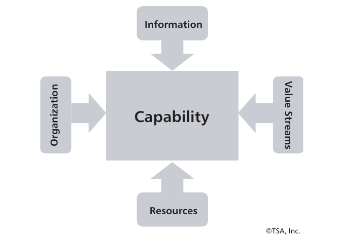

**Figura 1 — Las capacidades se relacionan con otros aspectos de un negocio.**
*Texto de la figura:* Capacidad (centro), rodeada por: Información, Organización, Flujos de valor y Recursos. © TSA, Inc.

El mapeo organizacional es particularmente importante. Consideremos que las líneas de negocio (LOB) de banca minorista, fondos mutuos y gestión de inversiones tienen todas capacidades de gestión de información de clientes. Establecer una visión común del cliente y una forma común de gestionarlo requiere que estas LOB colaboren y consoliden su pensamiento. Esta no es una tarea que pueda, ni deba, dejarse en manos de TI. Al tratarse de una decisión de negocio, requiere que el negocio actúe.

Los recursos son una categoría general que incluye tecnologías, financiamiento y otros activos según corresponda. El financiamiento es de particular interés para muchos equipos ejecutivos cuando se trata de mejorar o habilitar una capacidad de negocio determinada. La parte de tecnologías de la categoría de recursos puede incluir una amplia gama de tecnologías de la información que habilitan o automatizan una capacidad determinada. Analizaremos los detalles de la arquitectura de aplicaciones, incluida la arquitectura orientada a servicios (SOA), en el contexto de la alineación Negocio/TI.

Los flujos de valor, un componente clave del ecosistema de negocio, pueden requerir un poco más de explicación. Los flujos de valor describen *cómo* un negocio logra valor para una parte interesada interna o externa. Se definen como una colección de actividades de extremo a extremo que crean un resultado para un cliente.² Los flujos de valor son una vista de muy alto nivel de la acumulación de valor, dividida en etapas. Las etapas del flujo de valor se descomponen a su vez en procesos de negocio, que típicamente definen los detalles bajo las diversas etapas de un flujo de valor dado. Analizaremos este concepto más adelante en el informe. El punto importante que hay que recordar es que la capacidad de negocio tiene relaciones con otros aspectos del negocio y de la arquitectura de TI.

Otro punto importante es que la Figura 1 no implica que una capacidad contenga o de alguna manera abarque o subsuma unidades organizativas, información, recursos o flujos de valor. Esta idea errónea común ha generado cierto grado de confusión con el mapeo de capacidades. Las relaciones entre la capacidad y otros aspectos del negocio o de la arquitectura de TI son justamente eso: relaciones. Es el poder de estas relaciones lo que proporciona la visibilidad necesaria para evaluar la causa raíz de un problema determinado y determinar el impacto global de lo que se necesitará para abordar ese problema en particular.

Las relaciones con cualquier capacidad dada pueden contarse por cientos cuando se rastrean a través de unidades de negocio, tecnologías, procesos y activos de información. Pero estas complejidades pueden permanecer fuera de vista a menos que una iniciativa o un equipo de planificación en particular requiera profundizar en más detalle. Por ejemplo, si la gestión de adquisiciones se despliega mal y le cuesta a la empresa mucho más de lo que debería, la dirección querrá llegar a la capacidad específica de nivel inferior que causa el problema. En este ejemplo, puede encontrarse que una capacidad de gestión de información de proveedores está dispersa en docenas de unidades de negocio. Un análisis de profundización adicional determina que un flujo de valor llamado «adquirir recursos» se implementa mediante docenas de procesos paralelos pero no coordinados, cada uno de los cuales depende de sus propios sistemas de software y bases de datos de seguimiento dispares. En este caso, la capacidad fue la clave para identificar las unidades de negocio y los proveedores, procesos y tecnologías de apoyo relacionados que requieren atención. Obsérvese que esta investigación podría hacerse de manera informal, pero el negocio y la capacidad relacionada y las abstracciones de negocio ofrecen un vocabulario, una disciplina analítica y una estructura formal de mapeo que pueden institucionalizarse para innumerables desafíos similares que surgen de forma regular en las organizaciones. Esto demuestra aún más el poder de la capacidad de negocio en diversas etapas de la planificación y el despliegue de la alineación Negocio/TI.

### Principios básicos de las capacidades

Entender, usar y representar un conjunto de capacidades de negocio para un negocio es un desafío para muchos equipos de gestión. Establecer ciertos principios («verdades acordadas que guían nuestras acciones») agiliza los esfuerzos para entender, explicar, definir, mapear y usar capacidades para planificar y ejecutar iniciativas de transformación Negocio/TI. Estos 10 principios son:

1. **Las capacidades definen lo que hace un negocio, no cómo lo hace.** Hay que resistir la tentación de mezclar estos conceptos, porque ello desestabilizará el uso posterior de las capacidades de negocio. Esta es la prueba número uno para determinar si una capacidad es realmente una capacidad y no un flujo de valor o un proceso.

2. **Las capacidades son sustantivos, no verbos.** El enfoque pasivo para especificar una capacidad (p. ej., gestión de inversiones) refleja una de las diferencias entre la capacidad y un flujo de valor o proceso de negocio, donde se usa una construcción activa de verbo/sustantivo (p. ej., emitir licencia). Este principio ayuda a reforzar el Principio 1.

3. **Las capacidades se definen en términos de negocio, no en términos técnicos.** Los profesionales de negocio, desde las líneas de frente hasta la alta dirección, deberían poder mirar una o más capacidades y entender de inmediato qué significan en términos de su entorno de negocio particular. El hecho de que una aplicación automatice una capacidad no es motivo para darle un giro técnico al nombre y replicarlo en el mapa de capacidades. (El mapeo de capacidades se presentará en una sección posterior.)

4. **Las capacidades son estables, no volátiles.** Existe un conjunto fundamental de capacidades que una organización en particular requiere para llevar a cabo su negocio. Estas capacidades rara vez cambian dentro de una organización, aunque hay muchas capacidades que se despliegan de maneras subóptimas. Por ejemplo, la dirección puede argumentar que los clientes tienen la capacidad de gestionar una cartera de productos o servicios, pero hacerlo puede ser engorroso y carecer de capacidades básicas de automatización y conciliación. La capacidad sigue existiendo, pero se considera débilmente desplegada. Estas capacidades aún deben definirse para que puedan considerarse en las actividades de planificación. Se produce la adición de una nueva capacidad, pero esto generalmente no se hace al más alto nivel a menos que haya un cambio a nivel ejecutivo en el modelo de negocio o la estrategia de negocio. Por ejemplo, si una empresa que vende sus productos a otras empresas manufactureras se traslada al negocio minorista, es probable que surjan nuevas capacidades para gestionar el negocio minorista.

5. **Las capacidades no son redundantes.** Las capacidades aparecen en un mapa de capacidades una y solo una vez para un negocio, sin importar cuántas unidades de negocio posean esa capacidad en particular, cuántos procesos de negocio la desplieguen o cuántos sistemas de aplicación la implementen. Por ejemplo, la gestión de reclamaciones solo aparecería una vez en un mapa de capacidades, aunque múltiples líneas de producto de un negocio de seguros tengan esta capacidad.

6. **Hay un solo mapa de capacidades para un negocio.** Todo negocio debería tener un único mapa de capacidades que abarque las fronteras organizativas. Lamentablemente, este principio se viola constantemente. En un caso, trabajamos con una institución financiera que tenía múltiples mapas de capacidades, uno por cada unidad de negocio. No había una forma efectiva de ver el negocio de manera agregada porque cada mapa era una visión de la organización desde una perspectiva singular. Cuando esto ocurre, la capacidad de aportar la transparencia al negocio que típicamente requieren las iniciativas estratégicas se ve empañada hasta el punto en que estos mapas de capacidades ofrecen un valor marginal, si acaso, fuera de una unidad de negocio determinada.

7. **Las capacidades se mapean a, pero no son lo mismo que, una LOB, unidad de negocio, proceso de negocio o flujo de valor.** Una LOB no es una capacidad. Los nombres pueden tener similitudes y las LOB son una consideración útil al construir capacidades, pero rara vez existe una correspondencia uno a uno entre las LOB y las capacidades. De manera similar, cuando una capacidad se descompone a un nivel dado, no se convierte en un proceso, tarea o actividad. Estas son abstracciones distintas del negocio, y mezclarlas compromete el valor que ofrecen en el análisis de negocio y en la planificación y despliegue de la transformación. Por ejemplo, una capacidad se mapea de manera sucinta a una unidad de negocio, iniciativa, activo de información o aplicación o servicio. Sin embargo, mapear procesos a estas abstracciones de negocio y de TI crea una visión confusa, porque un proceso dado puede cruzar docenas de unidades de negocio y despliegues de TI de maneras ajenas que tienen poco que ver con la capacidad bajo revisión. Una capacidad no se descompone en un proceso; un proceso no se descompone en una capacidad.

8. **Las capacidades tienen relaciones con los despliegues de TI y con la arquitectura de TI del estado futuro.** Las capacidades identifican las funciones, actividades y habilidades fundamentales que una empresa requiere para prosperar. Las capacidades se alinean directamente con las implementaciones SOA. Sin embargo, hay que tener en cuenta que las capacidades pueden o no estar automatizadas mediante arquitecturas de aplicaciones back-end, servicios de negocio SOA, software COTS o incluso entornos de escritorio. Las capacidades pueden ser de naturaleza completamente manual.

9. **Las capacidades automatizadas siguen siendo capacidades de negocio, no capacidades de TI.** Este principio se refiere a una trampa común. TI ocasionalmente introduce el concepto de «capacidad de TI», con lo que quiere decir una capacidad de negocio implementada en una aplicación. Esto no es una capacidad de TI; es una capacidad de negocio automatizada. Sin embargo, TI como unidad de negocio sí tiene ciertas capacidades relacionadas con el aprovisionamiento de infraestructura de TI, la construcción de software de negocio y la gestión de soluciones operativas.

10. **Las capacidades tienen el mayor valor cuando se incorporan a una visión más amplia del ecosistema de una empresa.** Analizaremos cómo encajan las capacidades en las vistas de arquitectura de negocio y de TI en secciones posteriores. Aunque son útiles como paradigma independiente de planificación y discusión, aprovechar las capacidades en todo su potencial requiere que se incorporen a la imagen general del ecosistema Negocio/TI.

Estos principios son útiles para guiar las acciones de implementación al definir, comunicar y aprovechar capacidades de negocio en ejercicios de análisis, planificación y transformación de negocio. Evaluar el análisis y la planificación de la transformación frente a estos principios debería asegurar que sus esfuerzos estén equilibrados y apliquen las mejores prácticas, lo que a su vez debería mantener los proyectos enfocados y encaminados.

### Por qué la capacidad es el eslabón perdido en la transformación Negocio/TI

El surgimiento y la creciente popularidad de la capacidad de negocio se debe a una combinación de factores que posibilitan las transformaciones Negocio/TI:

- **Las capacidades proporcionan al negocio un lenguaje común.** Las capacidades ofrecen una forma en que los ejecutivos de negocio pueden obtener una comprensión común de qué parte de su negocio necesitan abordar. Esto es particularmente cierto para los problemas y estrategias de negocio que cruzan las fronteras divisionales, de unidades de negocio o incluso empresariales. Por ejemplo, si la capacidad de diseño de producto dentro de la gestión de producto está de alguna manera deteriorada, los ejecutivos tienen un lenguaje común para discutir el problema, sin importar la división, el departamento o incluso las unidades de negocio subcontratadas en cuestión. De manera similar, si la gestión de clientes requiere atención en una empresa donde los clientes se comparten entre LOB y líneas de producto, el análisis de capacidades proporciona un punto focal común en torno al cual evaluar la situación y establecer una hoja de ruta de solución.

- **Las capacidades permiten un enfoque de inversión de negocio tipo láser.** Una empresa gastará dinero para asegurarse de que una capacidad determinada apoye adecuadamente al negocio. Por ejemplo, si los ejecutivos perciben que la capacidad de gestión del dinero es de algún modo inferior o deficiente, acordarán hacer una inversión para mejorarla. Otra visión de este mismo escenario es que su negocio ya está invirtiendo significativamente en mejorar la gestión del dinero, pero los ejecutivos no pueden articular exactamente cuánto presupuesto se asigna a estos esfuerzos en múltiples divisiones y unidades de negocio. El análisis de inversión basado en capacidades es una tendencia creciente en los círculos empresariales y permite una estrategia enfocada dirigida a mejorar una capacidad de negocio determinada. Este tipo de análisis requiere la capacidad de visualizar una capacidad que se «abre en abanico» a través de un negocio y de las arquitecturas de TI relacionadas, centrándose específicamente en las áreas de impacto de la capacidad en riesgo.

- **Las capacidades sirven como línea base para la planificación estratégica, la gestión del cambio y el análisis de impacto.** Las capacidades proporcionan un punto de partida orientado al negocio para cualquier discusión sobre planificación estratégica y ayudan a determinar los impactos de esos planes desde la perspectiva empresarial. En nuestro ejemplo de gestión del dinero hay innumerables procesos, vistas de información y recursos tecnológicos que habilitan la gestión del dinero. Por regla general, hay poca visibilidad de los impactos de cualquier cambio impulsado por una estrategia para realinear la gestión del dinero con base en debilidades en el modelo de negocio actual o en el despliegue de ese modelo. Las capacidades sirven como punto de partida común, o Piedra de Rosetta, para rastrear los impactos horizontales y verticales de las directrices estratégicas y tácticas del equipo ejecutivo.

- **Las capacidades conducen directamente a la especificación y el diseño de servicios de negocio.** Las capacidades representan una abstracción, centrada en el negocio, de las funciones e informaciones singulares que los sistemas de TI deben proporcionar; en otras palabras, una representación fundamental de los requisitos de negocio. Los servicios de negocio y de información SOA proporcionan «una forma de hacer una cosa» y «un lugar para obtener un tipo de información» en toda la empresa. ¿Qué mejor lugar para obtener los requisitos de lo que debe proporcionar un servicio que directamente de las necesidades del negocio?

Consideremos la capacidad de gestión de clientes. La gestión de clientes involucra numerosos equipos, múltiples divisiones, cientos de procesos y subprocesos, docenas de sistemas de aplicación back-end y bases de datos, e incontables sistemas de escritorio. Intentar absorber esta riqueza de información —suponiendo que sea siquiera posible— como paso inicial para buscar una solución a la pérdida de clientes no solo es imposible sino contraproducente. La visión limitada desde cualquier perspectiva única conduce a soluciones «curita» (parches), proyectos redundantes pero mal coordinados e incluso más frustración por parte de la dirección.

Cuando se establece un mapa de capacidades y se vincula con otras vistas del negocio y de la arquitectura de TI, el mapa resultante se vuelve extremadamente poderoso para enfocarse en uno o varios problemas. Muchas veces no hay razón para desmantelar todo un conjunto de aplicaciones. Una compañía de seguros con la que hemos trabajado concentró sus esfuerzos en una capacidad de bajo nivel y, con una inversión mínima, mejoró drásticamente la retención de clientes en un plazo muy corto, lo que le permitió diseñar e implementar una solución a más largo plazo, basada en SOA, para consolidar la información de clientes.

Usar la capacidad de negocio como punto focal para el análisis de problemas, la planificación estratégica, la determinación de inversiones y el financiamiento de iniciativas permite a la dirección atravesar la complejidad inherente a la mayoría de las empresas. Usar el análisis de capacidades ofrece a los ejecutivos, equipos de planificación y comités directivos una forma de comunicar *qué* debe resolverse sin adentrarse inicialmente en los detalles del *cómo*. Al mismo tiempo, permite vincular el cómo directamente con el qué, formalizando la alineación y permitiendo validar que un esfuerzo dado está logrando los resultados de negocio deseados.

La alternativa a este enfoque típicamente implica repetir el mismo análisis de línea base, que usualmente se hace de manera fragmentada, está muy centrado en silos y tiende a enfocarse primero en soluciones de TI en lugar de en un producto derivado del análisis de negocio y de la estrategia de negocio. En ausencia de planificación y transformación basadas en capacidades, los desafíos que enfrentan el análisis y la planificación continuarán, se perseguirán soluciones redundantes y subóptimas, y las inversiones seguirán errando el blanco en términos de valor de negocio real.

---

## Mapeo de capacidades de negocio

Las capacidades encuentran un hogar en el «mapa de capacidades». El mapa de capacidades es simplemente un plano de las capacidades de un negocio determinado. El mapa es una forma común de que los negocios documenten y visualicen las capacidades en el contexto de diversos ejercicios de análisis o planificación.

### Deconstrucción de la capacidad de negocio

Construir un mapa de capacidades es un ejercicio de análisis introspectivo y de descomposición. Esto comienza con entender cómo se define y se ve una capacidad. La Figura 2 muestra la descomposición común de tres niveles de una capacidad de negocio. Este enfoque de descomposición, que puede profundizarse donde corresponda según el nivel de análisis deseado, es una forma estándar de representar una capacidad.

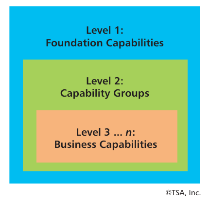

**Figura 2 — Descomposición de capacidades en tres niveles.**
*Texto de la figura:* Nivel 1: Capacidades fundamentales · Nivel 2: Grupos de capacidades · Nivel 3 … n: Capacidades de negocio. © TSA, Inc.

Cada nivel de la Figura 2 tiene un nombre asociado (es decir, capacidades fundamentales, grupos de capacidades y capacidades de negocio). Aunque estas son delimitaciones útiles, el nivel se usa típicamente para describir la profundidad de la descomposición de capacidades (p. ej., Nivel 2) en el uso común.

El concepto de tres niveles puede llevarse más abajo, típicamente hasta un máximo de cinco o seis niveles. En el sexto nivel, una capacidad es muy detallada, pero esto se vuelve más importante cuando se participa en el mapeo de arquitectura Negocio/TI. Las capacidades de Niveles 4-5 alcanzan un nivel de granularidad que se mapea a lógica de negocio desplegada, como servicios de negocio SOA, dentro de arquitecturas de aplicaciones, o a otras automatizaciones. Para fines de planificación y análisis de alto nivel, los mapas de capacidades típicamente no descomponen las capacidades por debajo del Nivel 3. Las capacidades de Nivel 3 pueden usarse como entrada de requisitos para el análisis de TI de alto nivel. La Figura 3 muestra un ejemplo de una capacidad de Nivel 1 llamada «gestión de adquisiciones» que ha sido descompuesta en dos capacidades de Nivel 2 y múltiples capacidades de Nivel 3.

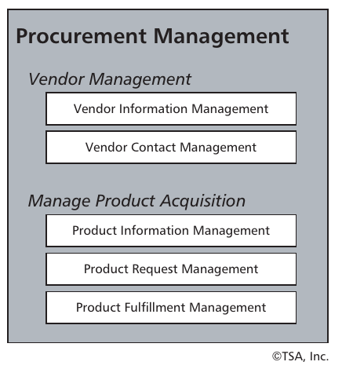

**Figura 3 — Descomposición de capacidades: ejemplo de adquisiciones (Niveles 1-3).**
*Texto de la figura:* **Gestión de adquisiciones** → *Gestión de proveedores:* Gestión de información de proveedores; Gestión de contactos de proveedores. *Gestión de la adquisición de productos:* Gestión de información de productos; Gestión de solicitudes de productos; Gestión del cumplimiento de productos. © TSA, Inc.

Al descomponer una capacidad, debe haber al menos dos o más niveles, como se muestra en la Figura 3. El ejemplo de adquisiciones demuestra cómo cada nivel de descomposición es un refinamiento del nivel padre anterior. También demuestra cómo cada nivel de capacidad sigue siendo una capacidad en la medida en que el término es un sustantivo, no un verbo, y sigue describiendo lo que hace el negocio, no cómo lo hace. La Figura 4 lleva este ejemplo un paso más allá al llevar la descomposición de capacidades hasta un Nivel 4.

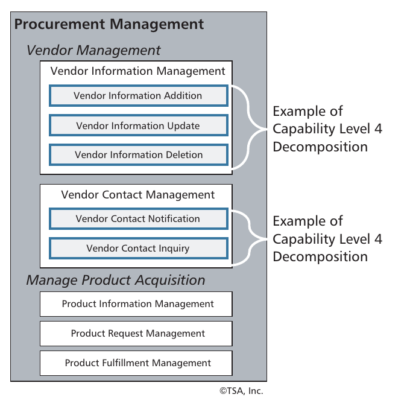

**Figura 4 — Descomposición de capacidades: ejemplo de adquisiciones (Nivel 4).**
*Texto de la figura:* **Gestión de adquisiciones** → *Gestión de proveedores* → Gestión de información de proveedores (Alta de información de proveedores; Actualización de información de proveedores; Baja de información de proveedores) — «Ejemplo de descomposición de capacidad de Nivel 4»; Gestión de contactos de proveedores (Notificación de contacto con proveedores; Consulta de contacto con proveedores) — «Ejemplo de descomposición de capacidad de Nivel 4». *Gestión de la adquisición de productos:* Gestión de información de productos; Gestión de solicitudes de productos; Gestión del cumplimiento de productos. © TSA, Inc.

Muchas organizaciones que usan capacidades solo han llegado hasta el Nivel 3. La descomposición de Nivel 4/5 es importante cuando un negocio quiere articular y alinear (o no alinear) claramente habilidades específicas entre unidades de negocio o LOB. Además, una descomposición de Nivel 4/5 proporciona el motivo de negocio para identificar, reutilizar, consolidar y/o desactivar lógica de negocio en las aplicaciones del estado actual y definir servicios comunes en la arquitectura de TI del estado futuro. El ejemplo de gestión de adquisiciones que hemos estado revisando es solo una capacidad de Nivel 1. En la práctica, los arquitectos de negocio crearían un mapa de capacidades que represente al negocio en su conjunto, incluidas todas las capacidades de Nivel 1 y sus descomposiciones.

### Desglose del mapa de capacidades

El mapa de capacidades es el plano de negocio de uso común para representar un conjunto de capacidades de un negocio. Obsérvese que usamos el término «negocio» en lugar de «empresa» porque un negocio puede extenderse más allá de los límites de una empresa. Consideremos una institución de seguros/financiera que ofrece seguros de salud, de vida y de incapacidad a los clientes, pero que en realidad subcontrata todas las capacidades relacionadas con vida e incapacidad. O consideremos la compañía que ha subcontratado la gestión de recursos humanos, la gestión de TI o la gestión de adquisiciones. Son capacidades que manejan empresas externas. Por lo tanto, un mapa de capacidades debe verse como de alcance de negocio y no solo de alcance empresarial.

La Figura 5 muestra un ejemplo de un mapa de capacidades parcialmente completo para capacidades de Nivel 1. El mapa de capacidades de la Figura 5 pretende ser genérico, pero ciertamente se inclina más hacia el que se encontraría en una organización de servicios que en un negocio de manufactura, transporte, minería o agricultura. Hay varios puntos en común dentro de este mapa de capacidades con los de otros negocios. Por ejemplo, el concepto de gestión de clientes, gestión de cuentas y gestión de productos son conceptos universalmente aceptados, pero no necesariamente aplicables a todos los negocios.

La estructura en capas dentro del ejemplo del mapa de capacidades de la Figura 5 es una forma común de que el negocio estratifique un mapa de capacidades en grupos, donde cada capa representa un conjunto de capacidades según su relación con la viabilidad del negocio y su resultado final. La capa «estratégica» incluye capacidades que reflejan las prioridades ejecutivas. La gestión de inversiones, por ejemplo, entra en esta categoría. Lo que se incorpora a esta capa es único para un conjunto dado de prioridades ejecutivas y la misión relacionada. En la Figura 5, una capacidad estratégica puede destacar como inusual: la gestión de relaciones gubernamentales. Sin embargo, en ciertas industrias de transporte o comunicaciones, esta puede ser una prioridad máxima y un punto focal significativo para los ejecutivos.

El nivel de «valor agregado» del mapa de capacidades llega al corazón de lo que hace una empresa para asegurar su viabilidad y prosperar en el mercado. La gestión de clientes, de productos y de cuentas son áreas principales a las que una empresa dada dedicará recursos significativos, aunque no necesariamente de la manera más eficaz. Estas capacidades orientadas al cliente son centrales para un negocio dado y deben entregar niveles aceptables de valor para que un negocio siga prosperando. La falta de enfoque en las capacidades orientadas al cliente a menudo puede explicar por qué muchas instituciones tienen un conjunto tan fragmentado, altamente redundante e inconsistente de prácticas y tecnologías de apoyo para gestionar clientes, cuentas y productos.

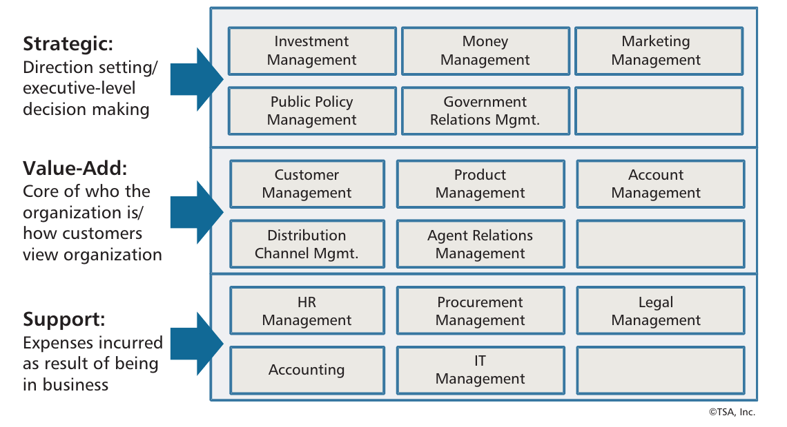

**Figura 5 — Ejemplo de mapa de capacidades de Nivel 1.**
*Texto de la figura:*
- **Estratégico:** definición de rumbo / toma de decisiones a nivel ejecutivo — Gestión de inversiones, Gestión del dinero, Gestión de marketing, Gestión de políticas públicas, Gestión de relaciones gubernamentales.
- **Valor agregado:** núcleo de lo que es la organización / cómo ven los clientes a la organización — Gestión de clientes, Gestión de productos, Gestión de cuentas, Gestión de canales de distribución, Gestión de relaciones con agentes.
- **Soporte:** gastos en que se incurre por estar en el negocio — Gestión de RR. HH., Gestión de adquisiciones, Gestión legal, Contabilidad, Gestión de TI.

© TSA, Inc.

Muchas grandes compañías de seguros y/o financieras multilínea, por ejemplo, gestionan a los clientes en silos independientes, usando procesos de negocio y entornos de aplicación independientes. Esto solo puede ser ignorado por los ejecutivos hasta que impacta el resultado final de una manera que los clientes o los accionistas notan. En ese punto, hay que tomar medidas.

Finalmente, la capa de «soporte» de capacidades representa ciertas habilidades que una organización debe tener para funcionar como negocio. RR. HH., la gestión financiera y la gestión legal son ejemplos principales. Estas capacidades también son objetivos comunes de subcontratación, dado que verdaderamente son capacidades de apoyo.

Un ejemplo interesante mostrado en la Figura 5 involucra la gestión de adquisiciones, la capacidad que descompusimos anteriormente en las Figuras 3 y 4. Las adquisiciones en una entidad financiera, una compañía de seguros o incluso una agencia gubernamental son probablemente una capacidad de soporte, y algunas de estas organizaciones han subcontratado las adquisiciones precisamente por eso. Una industria diferente puede mirar las adquisiciones con un enfoque distinto. Los fabricantes de automóviles, por ejemplo, elevarían la gestión de adquisiciones al menos al papel de valor agregado y posiblemente al nivel estratégico.

El mapa de capacidades es la principal forma en que la dirección y otros profesionales de negocio ven un conjunto de capacidades de una organización. Aunque el mapa es la principal visualización utilizada para entender un negocio a través de capacidades, no es la única forma de visualizarlas. También es importante entender que detrás del mapa hay una representación formal de capacidades, relaciones de descomposición, definiciones concisas para cada capacidad y mapeos a otros aspectos de la arquitectura de negocio y de TI. El concepto de «base de conocimiento» (knowledgebase) para habilitar estas vistas ampliadas de las capacidades se analizará más adelante.

### Construcción del mapa de capacidades

La primera regla para construir el mapa de capacidades se vincula con uno de nuestros principios básicos: hay un solo mapa de capacidades para un negocio. Esto significa que cada unidad de negocio dentro de una empresa determinada debería contribuir al mapa y aprovecharlo. Cuando las organizaciones tienen múltiples mapas, uno por cada división por ejemplo, la planificación y transformación basadas en capacidades a través de unidades de negocio es casi imposible. Consideremos si intentara trazar una ruta por todo el país usando solo una colección de mapas de ciudades como guía. Nunca vería el panorama general. Además de no poder ver el panorama general, los ejecutivos que tienen que evaluar problemas y trazar estrategias no tienen un lenguaje común que puedan usar al mirar a través de unidades de negocio, a menos que se aplique un único mapa de capacidades en toda la empresa. Obsérvese que una excepción a esto puede involucrar a múltiples agencias dentro de un gobierno federal u otra gran entidad gubernamental, o conglomerados con divisiones verdaderamente autónomas.

La segunda regla, impulsada por una combinación de los Principios 5 y 6, es que «toda capacidad se racionaliza en una única ocurrencia». Por ejemplo, solo hay una capacidad de gestión de cuentas, incluso si, por ejemplo, esta capacidad representa habilidades comunes a todas las divisiones de negocio financieras y de seguros dentro de una empresa. Los compromisos en las convenciones de nombres, un requisito clave al crear un mapa de capacidades, pueden resultar en nombres híbridos, como gestión de cuentas y pólizas o gestión de pólizas y contratos. Esto es totalmente aceptable siempre que todos los líderes divisionales de negocio y los gerentes que aportan estén de acuerdo en que esa es la terminología que debe usarse.

Con estas reglas como línea base, hemos esbozado una serie de 10 pasos para construir y validar un mapa de capacidades:

1. **Obtener una plantilla de la industria si es posible.** Si existen ejemplos, plantillas o mapas de capacidades suministrados por consultoras que su organización pueda obtener antes de iniciar un esfuerzo de mapeo, deben incorporarse al proceso de análisis. Tenga presente que las plantillas son solo puntos de partida, no puntos de llegada.

2. **Elaborar un borrador del mapa de capacidades de Nivel 1 específico de la organización.** Este paso implica refinar una plantilla adquirida o elaborar un mapa base usando categorías de capacidades de uso común. Las entradas de este paso incluyen plantillas del Paso 1 (cuando estén disponibles), modelos u organigramas de la organización, definiciones de activos de información (p. ej., cliente, producto, cuenta) y vistas de negocio adicionales de alto nivel. Refine o cree el borrador inicial usando insumos específicos de la empresa y un conjunto de capacidades comúnmente encontradas que incluirían las siguientes categorías:
   - Gestión de clientes o de partes interesadas externas equivalentes
   - Gestión de productos o servicios
   - Gestión de cuentas, pólizas, contratos o similares
   - Gestión de relaciones con otras partes interesadas externas
   - Gestión de inversiones, marketing y otras áreas estratégicas
   - Categorías específicas de la industria, como reclamaciones, enrutamiento o gestión del dinero
   - Capacidades de soporte, incluidas contabilidad, RR. HH., TI y legal

3. **Finalizar el mapa de capacidades de Nivel 1.** Esto implica realizar una sesión facilitada con representantes de negocio sénior de cada LOB. El entregable de este paso será el borrador final de un mapa de capacidades de Nivel 1. Esta sesión incluye:
   - Revisar el borrador inicial o «hombre de paja» (straw man) del mapa de capacidades creado en el Paso 2
   - Establecer definiciones concisas para cada capacidad, específicamente la parte descriptiva de la capacidad (p. ej., producto, cuenta, dinero, cliente)
   - Ver las capacidades y las definiciones relacionadas a través de una lente relacionada con la información (p. ej., la capacidad de gestión de clientes debería alinearse con una definición común de «cliente»)
   - Racionalizar los nombres de las capacidades entre LOB y divisiones (p. ej., póliza frente a contrato)
   - Asegurar que no existan brechas de capacidades dentro del mapa final de Nivel 1

4. **Publicar el mapa de capacidades de Nivel 1.** Muchas organizaciones pueden no estar familiarizadas con las capacidades de negocio y necesitarán un poco de tiempo para acostumbrarse a los conceptos. La mejor forma de hacer esta introducción es con las capacidades de más alto nivel. Aunque las descomposiciones de Nivel 2/3 pueden resultar en refinamientos adicionales de Nivel 1, publicar la versión inicial del mapa puede generar preguntas y comentarios del negocio y presenta una oportunidad para explicar los conceptos, el valor y los beneficios a las partes interesadas clave. Señalamos aquí que publicar, en este contexto, implica socializar y solicitar ideas y comentarios adicionales.

5. **Establecer prioridades de descomposición de capacidades de Nivel 2.** Este paso puede ser priorizado por los ejecutivos que buscan más información o puede avanzar para completar la totalidad de los mapeos de capacidades de Nivel 2 para el negocio. Un enfoque común consiste en dejar las capacidades de soporte hasta que se requieran y enfocarse primero en las capacidades de valor agregado, porque este es el núcleo de un modelo de negocio dado. Las capacidades estratégicas pueden descomponerse por indicación de una iniciativa de gestión o como un paso posterior o interdependiente de la descomposición de las capacidades de valor agregado.

6. **Descomponer las capacidades de Nivel 2.** Usando el mapa de capacidades de Nivel 1 como línea base, descomponer las capacidades de Nivel 1 seleccionadas (priorizadas en el Paso 5) trabajando con profesionales de línea de negocio para cada categoría. Esto implica realizar sesiones de trabajo para cada capacidad de Nivel 1 o conjunto de capacidades relacionadas. Por ejemplo, si se apunta a la gestión de reclamaciones para su descomposición, trabaje con gerentes de negocio de todas las áreas de reclamaciones para recabar la totalidad de lo que se hace dentro de una reclamación. Obsérvese que la descomposición de Nivel 3 puede realizarse de manera concurrente, pero requiere validación por profesionales de negocio con conocimiento de los detalles por debajo del Nivel 2. Si una descomposición de Nivel 2/3 puede lograrse de manera concurrente con los mismos equipos, el proceso puede completarse con mayor eficiencia. Este paso incluye:
   - Realizar sesiones facilitadas para cada nivel de capacidad objetivo de descomposición
   - Asegurar que todas las LOB estén representadas según corresponda al tema (p. ej., reclamaciones de salud, de vida, de automóvil, de hogar)
   - Aprovechar las vistas de activos de información, aunque con un nivel de detalle adicional al usado para el análisis de capacidades de Nivel 1 (p. ej., nombre del cliente, dirección del cliente, número de cliente)
   - Aprovechar los organigramas y otras vistas de negocio de alto nivel

7. **Establecer prioridades de descomposición de capacidades de Nivel 3.** Este paso es similar al paso de establecimiento de prioridades de Nivel 2 (Paso 5). Aunque es importante establecer y documentar las capacidades de Nivel 3 para las capacidades de valor agregado y estratégicas, ciertas prioridades, estrategias o directrices de negocio pueden dictar un enfoque en un subconjunto de capacidades como prioridad. El establecimiento de prioridades debería completarse antes de avanzar con la descomposición de Nivel 3.

8. **Descomponer las capacidades de Nivel 3.** Este paso sigue un enfoque similar al proceso de descomponer las capacidades de Nivel 2, con la excepción del nivel de participación. La descomposición de Nivel 3 puede requerir otro nivel de profesionales de negocio por debajo de la capa gerencial que trabajó en la descomposición de Nivel 2. Como mínimo, estos profesionales tendrán que revisar y validar las capacidades de Nivel 3.

9. **Socializar y refinar el mapa de capacidades.** Cada participante en cada paso del camino debería tener la oportunidad de revisar informalmente el mapa de capacidades y dar retroalimentación a medida que evoluciona. Este paso, sin embargo, implica una revisión formal y la finalización del trabajo realizado hasta este punto. Como mínimo, el equipo ejecutivo original que trabajó en el mapa de capacidades inicial debería reunirse de nuevo para revisar y aprobar el mapa de capacidades final.

10. **Publicar el mapa de capacidades.** Los mapas de capacidades toman mucho tiempo en completarse en su totalidad, y algunas organizaciones no descomponen ciertas capacidades de Nivel 1 hasta que las requieren. Esto es normal y es particularmente cierto para las capacidades de soporte. No espere a que todas las capacidades estén descompuestas. Publique el mapa de capacidades en un lugar donde pueda ser consultado por cualquiera que decida verlo y donde la versión más actual esté disponible a medida que el mapa evoluciona, con las consideraciones internas habituales de privacidad y seguridad.

Una vez publicada la versión inicial del mapa de capacidades, el mapeo de capacidades a otros aspectos de la arquitectura de negocio y de la arquitectura de TI puede avanzar.

### Incorporación de la capacidad a la arquitectura de negocio

La arquitectura de negocio se define como un plano de la empresa que proporciona una comprensión común de la organización y se usa para alinear los objetivos estratégicos y las demandas tácticas.³ Incorporar las capacidades a la arquitectura de negocio más amplia es importante porque los mapeos de negocio a negocio y de negocio a TI proporcionan la base de gran parte del análisis asociado con la transformación Negocio/TI. Tradicionalmente, los mapas de capacidades estaban desconectados de otros modelos y estructuras, y esto no era propicio para la planificación ni el despliegue de la transformación.

Aunque varios mapeos de negocio a negocio caen bajo el paraguas de la arquitectura de negocio, nos centramos únicamente en un subconjunto relevante para la mayoría de las iniciativas de transformación Negocio/TI. Los mapeos de negocio a negocio incluyen los siguientes:⁴

- La unidad organizativa se descompone en unidad organizativa.
- La unidad organizativa es un socio de negocio.
- La unidad organizativa tiene una capacidad (Nivel 1 o Nivel 2) según el nivel de la unidad organizativa.
- La capacidad de Nivel 1 se descompone en capacidad de Nivel 2.
- La capacidad de Nivel 2 se descompone en capacidad de Nivel 3.
- La capacidad de Nivel 3 se descompone en capacidades de Niveles 4, 5 y 6 según se requiera.
- La capacidad de Nivel 3 se mapea a diversas etapas dentro del flujo de valor.
- La etapa del flujo de valor se descompone en proceso de negocio.

Repetimos aquí el mapeo de descomposición de capacidades porque debe estar representado dentro de la base de conocimiento de arquitectura de negocio junto con cada una de las otras categorías de mapeo analizadas en las viñetas anteriores. El mapeo de unidad organizativa a capacidad de negocio es importante porque identifica los grupos de comunidades de negocio que tienen interés en una capacidad dada. Aquí es donde deberían comenzar las discusiones de transformación, porque la transformación Negocio/TI requiere entender la amplitud y profundidad de la comunidad de partes interesadas y las preocupaciones de cada parte interesada. Es más que probable que cualquier enfoque de transformación impacte a múltiples partes interesadas. La Figura 6 muestra el mapeo unidad de negocio/capacidad de negocio en el contexto de un diagrama de red social. Este plano de arquitectura de negocio muestra cómo tres unidades de negocio (es decir, propiedad y accidentes, vida e incapacidad, y salud) comparten capacidades comunes: gestión de reclamaciones, de productos, de cuentas y de clientes (mostradas a la derecha del diagrama).

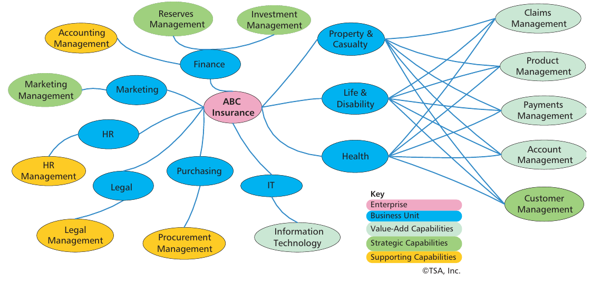

**Figura 6 — Mapeo de unidad organizativa a capacidad de negocio.**
*Texto de la figura:* Empresa central: «ABC Seguros». Unidades de negocio: Finanzas, Marketing, RR. HH., Legal, Compras, TI, Propiedad y accidentes (Property & Casualty), Vida e incapacidad, Salud. Capacidades de apoyo: Gestión contable, Gestión de RR. HH., Gestión legal, Gestión de adquisiciones, Tecnología de la información. Capacidades estratégicas: Gestión de marketing, Gestión de reservas, Gestión de inversiones. Capacidades de valor agregado compartidas por las tres unidades de negocio: Gestión de reclamaciones, Gestión de productos, Gestión de pagos, Gestión de cuentas, Gestión de clientes. *Leyenda:* Empresa · Unidad de negocio · Capacidades de valor agregado · Capacidades estratégicas · Capacidades de apoyo. © TSA, Inc.

El mapeo de capacidad a unidad de negocio (es decir, organización) normalmente es el punto de partida para una discusión de transformación. La razón de comenzar con la capacidad y la unidad de negocio es que es un paso esencial para identificar las capacidades compartidas horizontalmente (p. ej., gestión de clientes) y precisar las áreas de negocio en las que enfocarse primero. Aunque este mapa de alto nivel puede parecer algo que todo gerente debería tener estampado en su conciencia colectiva, no siempre es así. Una razón para ello es que diferentes unidades de negocio a menudo tienen definiciones desalineadas de términos tan básicos como producto, cliente o cuenta. Además, pasar a un análisis de exactamente qué unidades de negocio tienen ciertas capacidades puede resultar bastante complejo. Sin embargo, una vez que esta información se captura en la arquitectura de negocio, la investigación ya está completa. Los mapeos de capacidad a unidad de negocio son particularmente estables. Incluso las reorganizaciones tienen un impacto marginal.

El mapeo de capacidad a unidad de negocio es importante, pero hay otro aspecto de la arquitectura de negocio que se requiere completar para al menos la vista de más alto nivel de la planificación de la transformación del negocio: el flujo de valor. Como discutimos anteriormente, un flujo de valor es una colección de actividades de extremo a extremo que crea un resultado para un cliente. Esto significa que un flujo de valor comienza con una parte interesada que desencadena la primera etapa del flujo de valor y termina cuando se entrega a esa parte interesada un producto o servicio, una notificación, un grado de satisfacción u otra comunicación.

Los flujos de valor se descomponen en una serie de etapas que se mueven de izquierda a derecha con una flecha que conecta cada etapa. El valor se acumula en cada etapa. Las etapas se expresan en formato verbo/sustantivo, como «procesar pago». Consideremos un flujo de valor en el que se prospecta, vende, registra, paga una póliza y se notifica en consecuencia a la parte interesada. Un flujo de valor de ejemplo se muestra en la Figura 7.

Los flujos de valor no deben confundirse con los procesos de negocio porque representan una vista de alto nivel que agrega todas las rutas, resumidas en una vista amigable para los ejecutivos, libre de estructuras de decisión, rutas alternativas o información. Los analistas de procesos a menudo llaman a esto el «camino feliz» (happy path). Los flujos de valor permiten una amplia gama de capacidades, y las capacidades pueden mapearse a cada etapa del flujo de valor. El mapeo de capacidad, flujo de valor y proceso de negocio se muestra en la Figura 8.

La Figura 8 muestra cómo las capacidades de más alto nivel se mapean a todo un flujo de valor. Esto es principalmente para fines de planificación. Por ejemplo, una capacidad de gestión de clientes de Nivel 1 puede mapearse a dos flujos de valor: gestionar la información del cliente y procesar reclamación. Supongamos que la compañía permite que un cliente actualice su información personal al mismo tiempo que envía una reclamación a la aseguradora. La etapa del flujo de valor llamada «actualizar información del cliente» se mapearía entonces a las capacidades de Nivel 3 que la etapa habilitó. Este enfoque de mapeo desempeña un papel importante en las iniciativas de arquitectura de TI front-end/back-end. A medida que los equipos de proyecto alinean, consolidan y automatizan procesos a lo largo de un flujo de valor, es probable que las capacidades de negocio subyacentes habilitadas por ese flujo de valor requieran modernización o habilitación de servicios. Este concepto proporciona una hoja de ruta para la transformación de interfaces de proceso/usuario junto con la transformación sincronizada y el despliegue de arquitecturas de aplicaciones back-end.

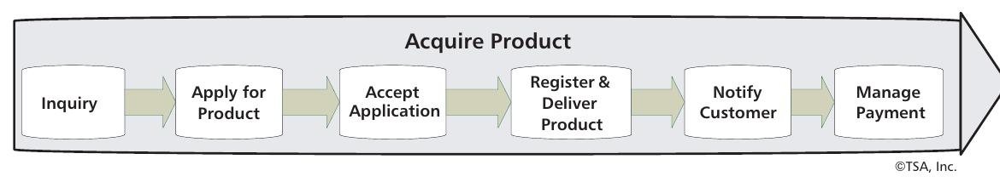

**Figura 7 — Ejemplo de flujo de valor.**
*Texto de la figura:* **Adquirir producto:** Consulta → Solicitar producto → Aceptar solicitud → Registrar y entregar producto → Notificar al cliente → Gestionar pago. © TSA, Inc.

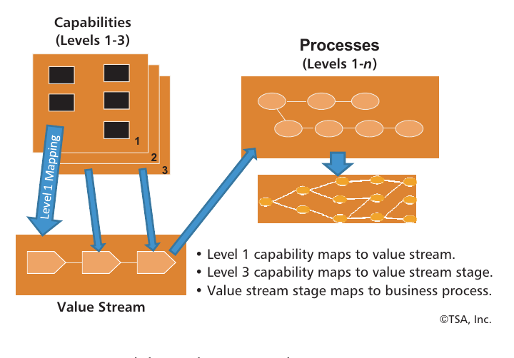

**Figura 8 — Mapeos de capacidad, flujo de valor y proceso de negocio.**
*Texto de la figura:* Capacidades (Niveles 1-3); Procesos (Niveles 1-*n*); Flujo de valor; «Mapeo de Nivel 1». • La capacidad de Nivel 1 se mapea al flujo de valor. • La capacidad de Nivel 3 se mapea a la etapa del flujo de valor. • La etapa del flujo de valor se mapea al proceso de negocio. © TSA, Inc.

Las etapas dentro del flujo de valor se mapean a procesos de negocio, que típicamente no representan implementaciones de extremo a extremo, a diferencia del flujo de valor. El flujo de valor representa todos los procesos, sin importar dónde se realicen ni cuántas etapas abarquen, dentro de una empresa que pueden mapearse a un conjunto particular de etapas de acumulación de valor. El concepto de mapeo de la Figura 8 admite tanto vistas del estado actual como del estado objetivo. Sin embargo, representar el estado actual es un paso importante para entender dónde pueden alinearse, combinarse, sincronizarse, conectarse y, en última instancia, automatizarse los procesos en un estado objetivo. El flujo de valor proporciona a los equipos de transformación una vista del estado actual y del estado objetivo de las oportunidades para transformar organizaciones a través de unidades de negocio, líneas de producto e incluso fronteras empresariales.

En conjunto, puede usar el mapa de capacidades y el flujo de valor para el análisis de causa raíz, la planificación estratégica, la asignación de financiamiento, la planificación de iniciativas y el establecimiento y la gestión de prioridades de despliegue.

### Base de conocimiento de arquitectura de negocio

Muchas capacidades se mapean a múltiples unidades organizativas, flujos de valor, activos de información y despliegues tecnológicos. Aquí es donde las mejores prácticas y los estándares se vuelven importantes. Los mapeos basados en mejores prácticas aprovechan un modelo de datos simple o un metamodelo para mapear capacidad, flujo de valor y otros aspectos de la arquitectura de negocio. Esto permite a los equipos de arquitectura de negocio escalar los esfuerzos de análisis a medida que incorporan más conceptos, unidades de negocio adicionales y los niveles de granularidad requeridos. Este concepto formal de mapeo se implementa mediante la base de conocimiento de arquitectura de negocio.

La base de conocimiento de arquitectura de negocio formaliza la manera en que se almacena, relaciona y visualiza la información sobre el negocio —incluida la estructura organizativa, las capacidades, los flujos de valor, los activos de información, las iniciativas de proyecto, los clientes y socios, y los activos de TI relacionados—. En un libro coescrito con Neal McWhorter, escribimos:

> La base de conocimiento proporciona un vehículo para capturar, asimilar, visualizar y compartir una amplia gama de información que puede transformarse fácilmente en planos de negocio útiles para profesionales de negocio y de TI.⁵

La base de conocimiento puede existir en diversas formas. Algunas organizaciones almacenan esta información en una base de datos. Incluso se usa Microsoft Access en algunos casos. Otras han encontrado que a largo plazo se requiere una solución más robusta. Varios proveedores de herramientas de arquitectura, como MEGA o Troux, ofrecen los repositorios subyacentes que los arquitectos de negocio pueden personalizar para representar información sobre el negocio. La base de conocimiento debería ser personalizable en el grado apropiado para representar los activos de negocio y de TI necesarios para la planificación y gestión de la transformación.

Los activos de TI representados en este repositorio de negocio a nivel de planificación serían mínimos, mientras que vistas más extensas de despliegue de TI podrían asumir la tarea de rastrear los activos de TI que atraviesan una transformación durante una fase paralela. Afortunadamente, las herramientas que hemos mencionado admiten tanto el lado del negocio como el de TI de la ecuación.

### Incorporación de las capacidades a la arquitectura empresarial

Además de su papel fundamental en la arquitectura de negocio, las capacidades de negocio proporcionan un vínculo importante entre los requisitos de negocio y las soluciones de TI en todos los dominios de la arquitectura empresarial (AE), como ilustra la Figura 9.

La pila típica de dominios arquitectónicos de la AE (negocio, información, aplicación y tecnología) se muestra en la parte superior de la figura. Las capacidades de negocio son un entregable primario de la arquitectura de negocio. Podemos ver que las capacidades pueden mapearse a flujos de valor, como se describió anteriormente. Por supuesto, las capacidades requieren procesos (aspectos funcionales) e información. La arquitectura de información es responsable de definir las entidades de negocio fundamentales de una empresa, que deberían relacionarse directamente con la información requerida por las capacidades. Debemos diferenciar, sin embargo, que los activos de información que habilitan las capacidades dentro de la arquitectura de negocio —incluidos cliente, producto, cuenta y conceptos similares— son parte de una vista de negocio que es independiente de las arquitecturas de información (también llamadas de datos) definidas por TI.

La arquitectura de aplicaciones es responsable de definir tres aspectos importantes de las aplicaciones:

1. La arquitectura de referencia fundamental que define cómo se construirán las aplicaciones
2. La integración de las aplicaciones (tanto funciones como datos)
3. El mantenimiento de un portafolio de aplicaciones y sistemas

Las empresas modernas actuales usan SOA como su arquitectura de referencia fundamental. En la parte inferior de la Figura 9 se muestra una arquitectura de referencia en capas. De abajo hacia arriba, las capas son:

- **Recursos operativos.** Esta capa consiste en aplicaciones existentes, sistemas heredados (legacy) y COTS, incluidas las aplicaciones empaquetadas de gestión de relaciones con clientes (CRM) y de planificación de recursos empresariales (ERP). Estas aplicaciones proporcionan operaciones de negocio: transacciones que representan unidades lógicas únicas de trabajo en los sistemas operativos de la empresa. La ejecución de una operación típicamente hará que uno o más registros de datos persistentes sean leídos, escritos o modificados en un sistema de registro (SOR). Las operaciones tienen una interfaz específica y estructurada y estructuras de respuesta devueltas. Los datos de esta capa residen en aplicaciones o bases de datos existentes.

- **Servicios de integración.** Los servicios de integración proporcionan integración y acceso a las aplicaciones existentes. La separación entre los servicios de integración y los servicios de negocio es fundamental para mantener un entorno empresarial flexible. Esto implica transformar los datos y las funciones de los sistemas existentes a lo que se desea en el nivel de servicio de negocio.

- **Servicios de negocio y de información SOA.** Los servicios de negocio proporcionan funcionalidad de negocio de alto nivel en toda la empresa. Los servicios de información proporcionan datos consolidados, depurados y racionalizados sobre las entidades de negocio. Esta capa proporciona una abstracción de interfaz de servicio y una integración de la capa inferior, rompiendo la dependencia directa entre procesos, entidades y sistemas existentes. Los servicios son un conjunto gestionado y gobernado de activos empresariales responsables de asegurar la conformidad con los acuerdos de nivel de servicio (SLA). Los servicios de negocio representan agrupaciones lógicas de operaciones. Por ejemplo, ver perfil del cliente, buscar cliente por número de teléfono, listar clientes por nombre y código postal, y guardar datos de un cliente nuevo representan todas las operaciones asociadas dentro del servicio lógico. Obsérvese que no todas las operaciones o datos provendrán necesariamente de los mismos sistemas operativos o, en algunos casos, las operaciones se replicarán en un conjunto de sistemas similares. Así, los servicios de negocio y de información proporcionan una implementación virtual de operaciones de negocio relacionadas.

- **Procesos de negocio.** Un proceso de negocio consiste en una serie de operaciones que se ejecutan en una secuencia ordenada de acuerdo con un conjunto de reglas de negocio. Los procesos de negocio se componen de servicios de negocio y de información y típicamente abarcan múltiples invocaciones de servicio. Ejemplos de procesos de negocio son: incorporar a un nuevo empleado, vender productos o servicios y cumplir un pedido.

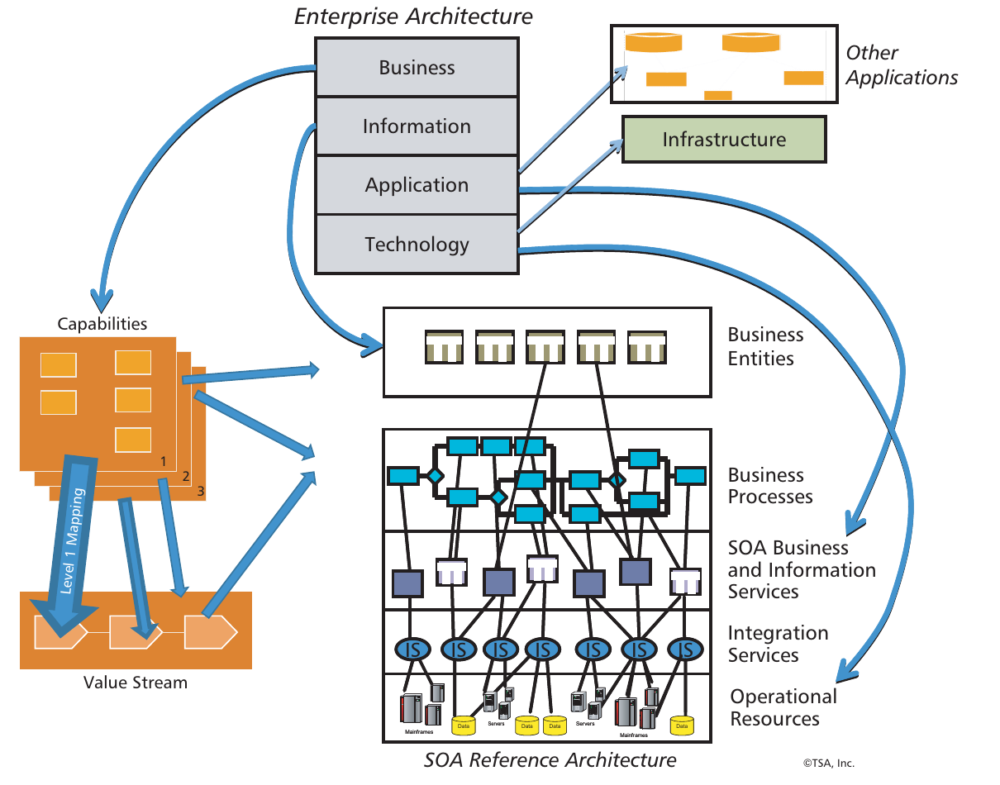

**Figura 9 — El papel de las capacidades de negocio en la AE.**
*Texto de la figura:* **Arquitectura empresarial:** Negocio · Información · Aplicación · Tecnología; Otras aplicaciones; Infraestructura. Capacidades (Niveles 1-3), «Mapeo de Nivel 1», Flujo de valor. **Arquitectura de referencia SOA** (de arriba abajo): Entidades de negocio · Procesos de negocio · Servicios de negocio y de información SOA · Servicios de integración · Recursos operativos. © TSA, Inc.

Anteriormente exploramos el mapeo de capacidades y flujos de valor a procesos de negocio. La Figura 9 ilustra ese mapeo (las capacidades y las etapas de valor pueden ser implementadas por procesos), pero lo amplía para mostrar la relación entre esos procesos y la información y las capas SOA subyacentes.

Para completar nuestra discusión de la AE, la arquitectura tecnológica describe los sistemas y la infraestructura que soportan las aplicaciones e información de la empresa. Esto incluirá una infraestructura específica para soportar SOA, como un Bus de Servicios Empresarial (ESB). Pero la infraestructura particular no es una preocupación en los niveles de arquitectura de negocio y de información. Más bien, es un detalle de la implementación. Es importante entender esta distinción en las interacciones con profesionales de negocio.

Por supuesto, existen muchos sistemas, aplicaciones y datos que no formarán parte de SOA pero que pueden seguir proporcionando funciones e información importantes a la empresa. Como mínimo, estos sistemas serán importantes para entender los requisitos de la planificación de la transformación. Para ser completos, en la parte superior derecha de la Figura 9 mostramos que las arquitecturas de aplicaciones y de tecnología deben dar cuenta de estos sistemas.

---

## El papel de las capacidades en la planificación de la transformación Negocio/TI

La capacidad de negocio desempeña un papel importante en la planificación estratégica del negocio, así como en la alineación Negocio/TI. Varios factores hacen de la capacidad de negocio un aspecto esencial de la planificación estratégica y de transformación.

### La necesidad de una planificación basada en capacidades

Las situaciones que requieren planificación estratégica y análisis de inversión basados en capacidades son comunes. Por ejemplo, ¿qué ocurre si una capacidad es inadecuada o inexistente hasta el punto de causar pérdidas de cuota de mercado, caídas de ingresos, deserción de clientes o violaciones regulatorias? Aprovechar una visión de su negocio orientada a capacidades para abordar estos desafíos proporciona una comunidad de vistas entre las unidades de negocio y entre el negocio y la organización de TI. Esto permite a los equipos ejecutivos ver la situación desde una perspectiva holística, y no como una serie de problemas y soluciones fragmentados en los distintos silos de unidades de negocio.

Consideremos nuestro ejemplo anteriormente presentado de gestión de clientes. Las organizaciones gestionan aspectos de un cliente en muchos lugares y de muchas maneras. Cuando uno reflexiona sobre todas las formas en que un negocio gestiona a un cliente, la complejidad se vuelve abrumadora. Las empresas dedican una cantidad significativa de tiempo, recursos y mentalidad ejecutiva a temas como el análisis de clientes, la retención de clientes, el seguimiento de información de clientes y la gestión de la cartera de clientes. Cuando aumenta la deserción de clientes o escalan las quejas de clientes, se desencadenan considerables debates a nivel ejecutivo.

Las juntas directivas pueden involucrarse, marketing desarrolla nuevas campañas y TI vuelca más dinero en inversiones relacionadas con software para intentar revertir la marea de deserción de clientes. Aunque la causa del problema puede ser generalmente conocida, a menudo es difícil articularla y aún más difícil fijar una estrategia acordada que aborde el problema en el corto plazo. La frustración crece entre los ejecutivos porque la causa subyacente es desconocida o demasiado compleja de entender. Este entorno da lugar a soluciones «a ciegas» (*shot in the dark*) o «de escopeta» (*shotgun*).

Las soluciones a ciegas intentan abordar un problema que no se comprende completamente debido a su complejidad inherente. Este enfoque suele caracterizarse por lanzar múltiples esfuerzos paralelos dentro de varias unidades de negocio para parchear una solución a un problema que requiere un enfoque holístico. Las soluciones de escopeta, por otro lado, tienden a adoptar la forma de iniciativas plurianuales a gran escala que cubren una amplia franja de la arquitectura de TI. Solo el 3 % de este tipo de proyectos, que van desde 10 millones de dólares estadounidenses en adelante, tiene posibilidad de éxito.⁶

Lo que complica aún más las cosas para los equipos de planificación ejecutiva son las soluciones miopes que llevan a la mesa las diversas unidades de negocio o TI. Estas iniciativas propuestas se caracterizan por soluciones que abordan un problema para una LOB determinada pero hacen poco por la implementación de capacidades desde una perspectiva empresarial, o incluso la complican. Esta situación típicamente se manifiesta mediante modelos de financiamiento impulsados por un ejecutivo de unidad de negocio que «solo necesita que se arregle un problema». Con demasiada frecuencia, TI tiende a ver los desafíos de negocio, como el problema de la información de clientes, como uno de mapeo y conciliación de datos, o como un problema de conectividad que puede abordarse mediante un ESB. Sin la debida participación del negocio, el enfoque esquiva el análisis impulsado por el negocio necesario para asegurar que se aborde la causa raíz del problema y, en cambio, resulta en proyectos redundantes, conflictivos y que revientan el presupuesto, y en una proliferación de soluciones.

Lo que empeora las cosas es que la mayoría de las soluciones que se ponen sobre la mesa no adoptan una visión empresarial de un problema. En nuestro ejemplo de información de clientes, donde la gestión de clientes está arraigada en cada división de la empresa e incluso subcontratada en algunos casos, esto es una receta para el desastre. Aun así, los equipos de solución siguen logrando convencer a los ejecutivos de lanzar un esfuerzo plurianual costoso para conciliar datos, desplegar esquemas de integración costosos o incluso invertir en infraestructuras completamente nuevas con poca claridad sobre cómo estas soluciones resolverán el problema. Las unidades de negocio individuales —desafiando un enfoque consolidado y cohesivo ante estos desafíos de toda la empresa— siguen patrocinando y financiando esfuerzos paralelos que abordan solo parte del problema y que finalmente chocan entre sí, consumiendo recursos escasos y entregando poco valor.

Aplicar soluciones a ciegas y de escopeta cuando se requiere una resolución tipo láser es una opción de último recurso. Lamentablemente, el enfoque de último recurso se toma con demasiada frecuencia y típicamente está ligado a la falta de visibilidad de los impactos horizontales y verticales del problema y de las soluciones propuestas. La mejor alternativa es centrarse en la capacidad o capacidades de negocio de bajo desempeño e impulsar el cambio desde ese punto a través de todo el negocio y hacia la arquitectura de TI.

### Análisis y planificación basados en capacidades

Los ejecutivos usan los mapas de capacidades como insumo para el análisis y la planificación estratégica del negocio, particularmente cuando se ven como un «mapa de calor» codificado por colores. La Figura 10 muestra un ejemplo de mapa de calor. En este ejemplo, ciertas capacidades de Nivel 3 han sido codificadas o marcadas como de bajo desempeño (amarillo) o con grave necesidad de atención (rojo). Las capacidades que funcionan como se espera se muestran en verde, mientras que las capacidades sin designación de color o bien no han sido evaluadas o no son de interés (no se muestran en la figura).

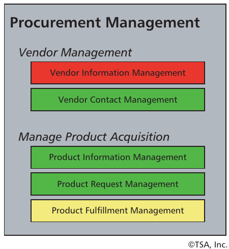

**Figura 10 — Mapa de calor de una capacidad de negocio.**
*Texto de la figura:* **Gestión de adquisiciones** → *Gestión de proveedores:* Gestión de información de proveedores (**rojo**), Gestión de contactos de proveedores (verde). *Gestión de la adquisición de productos:* Gestión de información de productos (verde), Gestión de solicitudes de productos (verde), Gestión del cumplimiento de productos (**amarillo**). © TSA, Inc.

En la Figura 10, la gestión de información de proveedores estaba tan fragmentada que le costaba a la organización millones de dólares al año en pagos en exceso, oportunidades de consolidación perdidas o esfuerzo y gestión excesivos. Consolidar esta capacidad en una única unidad de negocio resolvió el problema, pero esto requirió una comprensión más amplia de dónde existían actualmente esas capacidades. Aunque muchas organizaciones han abordado los desafíos de proveedores y adquisiciones, es mucho más difícil abordar los problemas cuando los problemas y las soluciones son más grandes y están extendidos a través de muchas unidades de negocio, procesos y despliegues tecnológicos.

El análisis de mapa de calor es solo el primer paso para determinar dónde buscar para abordar un problema particular. Las discusiones que resultan de dicho análisis se muestran en la Figura 11.

La Figura 11 ilustra el uso de enfocar el análisis de problemas y las discusiones de resolución en capacidades de negocio y no en una unidad de negocio, persona o despliegue tecnológico determinado. En este ejemplo puede ver que la gestión de contactos de proveedores ha sido marcada como «roja» según el protocolo estándar de mapa de calor, lo que indica que esta capacidad es un área problemática que requiere atención de la dirección. En este ejemplo, los datos de proveedores estaban dispersos en muchas unidades de negocio, gestionados por numerosos equipos, y fueron identificados como un tema prioritario que había que abordar. Como regla, el análisis de problemas típicamente salta a una solución antes de que se haya realizado el análisis adecuado. Precisar las limitaciones o problemas de las capacidades de negocio es un vehículo objetivo para ir más allá de la solución de primera trampa.

Una vez identificados los problemas, el primer paso al planificar una solución es determinar qué se está haciendo hasta ahora para abordar una limitación particular dentro de una capacidad. Normalmente hay numerosas iniciativas «en vuelo» en curso en cualquier empresa dada, y las capacidades pueden señalar el camino también aquí. Al determinar cuántos proyectos en vuelo están impactando actualmente o planean impactar un conjunto de capacidades bajo revisión, los ejecutivos pueden evaluar el monto de las inversiones que ya se están haciendo para abordar un problema particular. Si esos proyectos se ven colectivamente, desde el impacto que tendrán o no sobre una capacidad dada, y el solapamiento, la incompatibilidad o la sinergia que aportan, los ejecutivos pueden determinar si deberían continuar financiando, consolidar o incluso cancelar ciertas iniciativas.

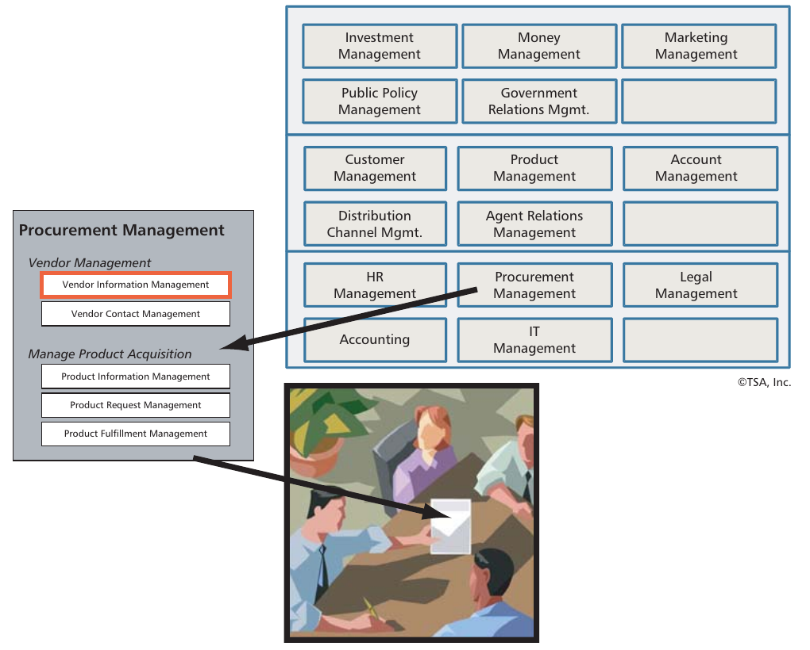

**Figura 11 — Planificación estratégica basada en capacidades.**
*Texto de la figura:* Mapa de capacidades de Nivel 1 (Estratégico / Valor agregado / Soporte; ver Figura 5) con la capacidad «Gestión de adquisiciones» ampliada para mostrar «Gestión de información de proveedores» resaltada, y una flecha hacia una reunión de equipo de trabajo que discute la solución. © TSA, Inc.

Llevando el concepto de análisis de inversión centrado en capacidades al siguiente paso, la planificación estratégica basada en capacidades permite a los ejecutivos discutir dónde enfocar el financiamiento y cómo escalonar una iniciativa para obtener el mayor valor de sus inversiones en la menor cantidad de tiempo. Hoy en día, muchas inversiones en iniciativas importantes están orientadas a alguna gran meta, como renovar por completo el procesamiento y cumplimiento de pedidos. Sin embargo, estas iniciativas tienden a ser de largo plazo y pueden carecer de enfoque en la entrega de valor a corto plazo.

Por ejemplo, si está perdiendo clientes y cuota de mercado, existe una expectativa por parte del equipo ejecutivo de que el problema se abordará rápidamente. Una compañía descubrió que había una iniciativa de 10 años en marcha para repensar la gestión de clientes, mientras que los clientes se alejaban de la empresa. El trabajo completado en este proyecto se incorporó a la nueva estrategia, construyendo así sobre el trabajo ya realizado y entregando valor rápidamente y por una fracción del monto gastado hasta la fecha.

La consideración importante aquí es determinar y revisar todas las áreas principales donde debe hacerse trabajo para rectificar un problema de negocio dado. Esto implica llevar el análisis a niveles crecientes de detalle que permitan que el trabajo comience en una resolución mientras se descubren más detalles como parte de la implementación o durante una fase paralela. La Figura 12 destaca los mapeos de alto a bajo nivel que permiten a la planificación de transformación Negocio/TI pasar de la capacidad a través de flujos de valor y procesos de negocio y hacia diversos aspectos de la arquitectura de TI.

Introdujimos una parte de estos mapeos en la Figura 8 y ahora hemos extendido el análisis hacia la arquitectura de aplicaciones y la capa de interfaz de usuario. Esta vista simple, totalmente respaldada por la base de conocimiento de arquitectura de negocio, adopta un enfoque de negocio primero para el análisis y la planificación de la transformación. El concepto mostrado en la Figura 12 proporciona la base para dos aspectos importantes de la alineación Negocio/TI.

El mapeo de flujo de valor/proceso/interfaz de usuario permite la alineación, consolidación y automatización de procesos de negocio usando nuevas herramientas de automatización BPM front-end y, cuando corresponda, gestión de casos para estados complejos dirigidos por documentos a lo largo de un flujo de valor. Además, el mapeo de capacidad/aplicación/arquitectura de información permite la priorización y el despliegue por fases de nuevos servicios y la modernización de arquitecturas back-end. El punto de conexión es el vínculo entre la capacidad de negocio y el flujo de valor.

Hay varios principios importantes que respaldan el uso de este concepto de mapeo. Estos incluyen:

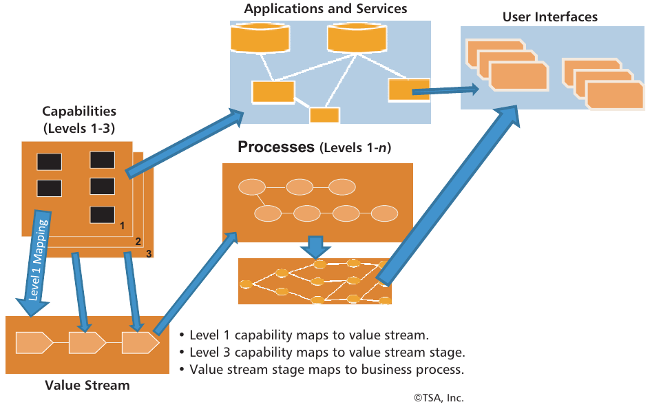

**Figura 12 — Mapeo de capacidad, flujo de valor y proceso de negocio a la arquitectura de TI.**
*Texto de la figura:* Aplicaciones y servicios · Interfaces de usuario · Capacidades (Niveles 1-3) · Procesos (Niveles 1-*n*) · Flujo de valor · «Mapeo de Nivel 1». • La capacidad de Nivel 1 se mapea al flujo de valor. • La capacidad de Nivel 3 se mapea a la etapa del flujo de valor. • La etapa del flujo de valor se mapea al proceso de negocio. © TSA, Inc.

- Las capacidades definen qué flujos de valor requieren análisis y transformación.
- El análisis de alineación de procesos de negocio impulsado por el flujo de valor permite la priorización y el desarrollo de hojas de ruta para la resolución rápida de los problemas de negocio de primera línea.
- El análisis del flujo de valor es la base para la alineación horizontal y vertical de los procesos de negocio.
- Las capacidades de negocio son representaciones robustas de requisitos de negocio fundamentales (y únicos) y, por lo tanto, proporcionan un mapeo conciso a los servicios de negocio y de información SOA del estado objetivo.
- Las capacidades de negocio proporcionan la base para el análisis, el desacoplamiento y la transformación de la arquitectura de aplicaciones del estado actual.
- Las capacidades de negocio forman la base para la transformación a más largo plazo de los activos de información y de las arquitecturas de datos back-end.
- Las arquitecturas de negocio y de TI evolucionan a un ritmo que permite la sincronización continua Negocio/TI.
- Las arquitecturas de negocio y de TI evolucionan a un ritmo que el negocio puede tanto impulsar como absorber.

Estos principios impulsan gran parte del desarrollo de la hoja de ruta de transformación y del despliegue de iniciativas. El concepto se basa en la premisa de que las arquitecturas front-end (donde los procesos se encuentran con las interfaces de usuario y las tecnologías desplegadas al usuario) pueden evolucionar a un ritmo que puede desacoplarse del ritmo evolutivo de las arquitecturas back-end (aplicaciones de TI, middleware y fuentes de datos). Esto significa que los procesos de negocio pueden alinearse, consolidarse, modificarse y automatizarse bajo una estrategia de arquitectura general que proporcione un ROI de negocio rápido. A medida que esto ocurre, las estrategias y planes de arquitectura de aplicaciones y de datos back-end pueden evolucionar, resultando en una migración por fases de estas arquitecturas back-end hacia el nuevo estado objetivo. Aplicaremos estos conceptos a nuestra discusión de la hoja de ruta de transformación en la siguiente sección.

### Desarrollo de la hoja de ruta de transformación Negocio/TI

Una hoja de ruta de transformación Negocio/TI es una visión de alto nivel de las principales fases, pasos y dependencias relacionadas que deben considerarse a medida que evoluciona una estrategia. Los conceptos importantes que intervienen en la construcción de una hoja de ruta incluyen:

- Visión de negocio de lo que debería lograrse
- Capacidades de negocio y flujos de valor impactados por una estrategia determinada o un mandato ejecutivo
- Requisitos de plazos y prioridades de negocio relacionadas
- Análisis de qué aspectos de una estrategia determinada deberían ir primero según las prioridades de negocio
- Visión de TI que corresponda a la visión de negocio
- Infraestructura de servicios, información y tecnología requerida para respaldar la transición
- Requisitos de gobernanza para habilitar una iniciativa de transformación Negocio/TI sostenible

Por ejemplo, analizamos la pérdida de clientes y cómo estaba impactando al negocio. En nuestro ejemplo anterior, la descomposición de la capacidad de gestión de clientes, el mapeo de negocio relacionado y el análisis de causa raíz encontraron que varias capacidades de nivel inferior dentro de la gestión de clientes estaban funcionando en niveles subóptimos. Los mismos clientes eran vistos como múltiples partes interesadas en diferentes unidades de negocio, lo que obligaba a los clientes a recibir información contradictoria de la compañía, enturbiaba el estado de un cliente dado cuando se veía a través de las líneas de producto y, en general, exasperaba a los clientes que realizaban consultas.

Una de las capacidades de nivel inferior en cuestión se llamaba «verificación de información». Esta se iniciaba siempre que un cliente nuevo o recurrente intentaba adquirir un producto de una LOB diferente a aquella con la que el cliente había tratado en el pasado. Varios flujos de valor requerían la capacidad de verificación de información, uno de los cuales era el flujo de valor de adquirir producto. La Figura 13 muestra este flujo de valor y las diversas capacidades que habilita en la parte inferior.

Este análisis determinó que esta capacidad y varias capacidades relacionadas que abarcaban múltiples flujos de valor tenían que incorporarse a la hoja de ruta. Aunque el impacto en el flujo de valor de actualizar la información del cliente fue mucho más significativo y requirió una reelaboración prioritaria de los procesos subyacentes, el impacto en el flujo de valor de la Figura 13 fue mucho más sutil.

El análisis holístico de estos flujos de valor y capacidades permitió a los equipos de planificación identificar los servicios de negocio y de información SOA requeridos para consolidar, agregar y mejorar el sistema existente con el fin de automatizar esta capacidad en particular. El impacto en el flujo de valor y en los procesos subyacentes se limitó a la tercera etapa del flujo de valor, permitiendo a la dirección minimizar la inversión en este flujo de valor. Por otro lado, el análisis mostró que el flujo de valor de actualizar información del cliente requería reelaborar el front-end de varios procesos desplegados en múltiples unidades de negocio.

En el caso del flujo de valor de actualizar información del cliente (no mostrado en nuestro ejemplo), los procesos subyacentes requerían una agregación y consolidación significativas dentro de las etapas inicial y back-end. La etapa inicial, llamada «aceptar solicitud del cliente», tuvo que ampliarse con una segunda etapa llamada «enrutar solicitud del cliente». Este fue un ajuste al flujo de valor impulsado por la necesidad de asegurar que todas las líneas de producto, unidades de negocio y unidades de negocio subcontratadas recibieran las solicitudes de cambio de clientes. Esto requirió la adición de una nueva capacidad de Nivel 3 y de un nuevo servicio SOA correspondiente para gestionar las solicitudes de los clientes y realizar de forma transparente la agregación y consolidación de la información de contacto. Junto con los cambios de proceso y la automatización de la Etapa 1 del flujo de valor, el trabajo para añadir esta capacidad fue mínimo, pero generó beneficios significativos.

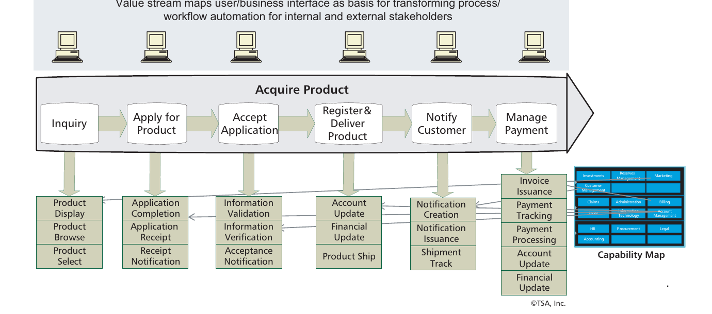

**Figura 13 — Vista impulsada por el flujo de valor de la alineación y automatización de procesos.**
*Texto de la figura:* «El flujo de valor mapea la interfaz usuario/negocio como base para transformar la automatización de procesos/flujos de trabajo para las partes interesadas internas y externas». **Adquirir producto:** Consulta → Solicitar producto → Aceptar solicitud → Registrar y entregar producto → Notificar al cliente → Gestionar pago. Capacidades por etapa: *Consulta* — Mostrar producto, Explorar producto, Seleccionar producto; *Solicitar producto* — Completar solicitud, Recepción de solicitud, Notificación de recepción; *Aceptar solicitud* — Validación de información, Verificación de información, Notificación de aceptación; *Registrar y entregar producto* — Actualización de cuenta, Actualización financiera, Envío del producto; *Notificar al cliente* — Creación de notificación, Emisión de notificación, Seguimiento del envío; *Gestionar pago* — Emisión de factura, Seguimiento de pagos, Procesamiento de pagos, Actualización de cuenta, Actualización financiera. Recuadro: «Mapa de capacidades». © TSA, Inc.

También se identificaron cambios adicionales en las aplicaciones y la arquitectura de datos back-end, como se muestra en la Figura 14. Estos cambios impactaron gran parte del núcleo del flujo de valor y requirieron que las aplicaciones back-end comenzaran a usar un servicio recién creado para gestionar la información de clientes. Estos cambios colectivos se previeron durante un período de tiempo mucho más largo. Sin embargo, el valor entregado a corto plazo, mediante cambios simples en el front-end de un flujo de valor y un pequeño subconjunto de capacidades de negocio asociadas (automatizadas mediante servicios SOA), aportó un valor de negocio significativo.

La hoja de ruta de transformación tuvo que incluir la automatización de flujo de valor/proceso de etapas seleccionadas a corto plazo, pequeños pasos de automatización de capacidades, la creación y el despliegue de SOA a más largo plazo, la consolidación de la arquitectura de datos back-end centrada en la información de clientes, y el desacoplamiento por fases y la migración de los sistemas de aplicaciones back-end para empezar a usar los nuevos servicios cuando corresponda. Además del trabajo de automatización de flujo de valor/proceso, el despliegue de SOA y la modernización back-end, el enfoque de análisis basado en capacidades también permitió a los equipos de planificación identificar los cambios específicos de información de negocio y de arquitectura de datos relacionada que se requerían a largo plazo.

Una hoja de ruta de transformación Negocio/TI impulsada por capacidades, como destaca nuestro ejemplo, permite a los ejecutivos, equipos de planificación y equipos de arquitectura equilibrar las inversiones y los recursos donde proporcionan el mayor retorno a corto plazo y abordar las necesidades de más largo plazo. Así, se despliega una estrategia a largo plazo basada en estos primeros esfuerzos. Esto demuestra la importancia de renunciar a las soluciones de escopeta y a ciegas en favor de estrategias enfocadas que precisen los problemas que requieren resolución y construyan una base para el respaldo y el financiamiento ejecutivos.

### Extensión del mapeo de capacidades a la planificación, creación y diseño de la arquitectura de TI

Un desafío importante de la planificación de TI es lidiar con el estado actual de aplicaciones e información redundantes y solapadas. Por ejemplo, las fusiones y adquisiciones resultan instantáneamente en aplicaciones y datos redundantes. El soporte de TI en silos para las unidades de negocio es otra causa principal (p. ej., en finanzas, no es inusual ver que cada unidad de negocio implemente su propio sistema de «evaluación de riesgos»). Independientemente de las causas, toda organización tiene este problema en cierta medida, y el negocio necesita identificar las redundancias y solapamientos y crear soluciones que eliminen y consoliden funciones e información. Esto es especialmente crítico en escenarios donde el negocio necesita operar a través de unidades de negocio de forma más eficaz.

Un enfoque ha sido mapear los procesos de negocio a los sistemas que los implementan, pero a menudo los propios procesos son redundantes y se solapan. La complejidad (asociaciones de muchos a muchos) de estos mapas no produce un enfoque claro y comprensible. En cambio, usamos la capacidad de negocio como el concepto fundamental, lo que produce una imagen mucho más clara del solapamiento entre sistemas que soportan la misma capacidad.

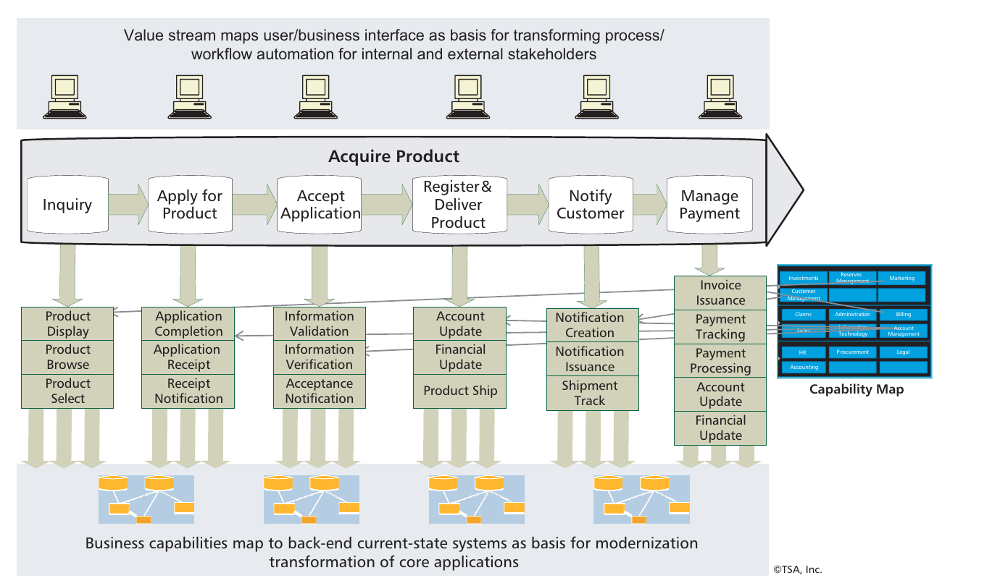

**Figura 14 — Mapeo de flujo de valor/capacidad a la arquitectura de aplicaciones back-end.**
*Texto de la figura:* Igual que la Figura 13 (flujo de valor «Adquirir producto» con sus capacidades por etapa y el «Mapa de capacidades»), con la franja inferior: «Las capacidades de negocio se mapean a los sistemas back-end del estado actual como base para la transformación de modernización de las aplicaciones núcleo». © TSA, Inc.

La Figura 15 ilustra los conceptos de este mapeo. El lado izquierdo del dibujo muestra un estado actual (simplificado), donde las capacidades se mapean a las aplicaciones y los datos que las soportan. Este mapeo permite identificar tres problemas importantes:

1. **Redundancias.** La misma capacidad es implementada por múltiples sistemas. Esperaríamos ver una buena cantidad de redundancia en la mayoría de las empresas. No es inusual ver 10 o 20 sistemas diferentes que soportan la misma capacidad.
2. **Solapamientos.** Algunos sistemas implementan múltiples capacidades o partes de capacidades. Es común tener tanto redundancias como solapamientos.
3. **Brechas.** Las capacidades que se han identificado como necesarias para cumplir los (nuevos) requisitos de negocio aún no existen. Al establecer las nuevas capacidades, es importante evitar crear nuevas redundancias y solapamientos.

La planificación de la arquitectura de TI desea abordar los tres problemas:

1. Eliminar redundancias mediante la eliminación y consolidación de sistemas e información duplicados
2. Reducir solapamientos desglosando las capacidades en sistemas más modulares
3. Cubrir brechas mejorando los sistemas existentes o adquiriendo nuevos

El lado derecho de la Figura 15 muestra el estado futuro, donde las capacidades son implementadas por servicios de negocio y de información y donde se han eliminado las redundancias, los solapamientos y las brechas, lo que resulta en un conjunto simplificado y racionalizado de sistemas operativos.

Por supuesto, es más fácil decirlo que hacerlo, pero las capacidades de negocio proporcionan la abstracción intermedia que aporta claridad a un problema, de otro modo difuso. Las capacidades de negocio proporcionan el vínculo entre dos entornos complejos y dispares: el de las arquitecturas de negocio y de TI. La vista de capacidades del negocio proporciona la base de alto nivel para la alineación entre ellas. Los mapas de capacidades no reducen la complejidad; más bien, la ilustran de maneras que aportan nuevas perspectivas. Los mapas de capacidades vinculan las capacidades hacia arriba con las estrategias, metas y objetivos, y hacia abajo con los procesos, aplicaciones, sistemas, servicios y sourcing que las implementan.

Un paso clave en la planificación e implementación de esta transición es lidiar con las aplicaciones existentes. Una vez más, las capacidades pueden desempeñar un papel clave para habilitar la modernización inteligente y efectiva de las aplicaciones existentes.

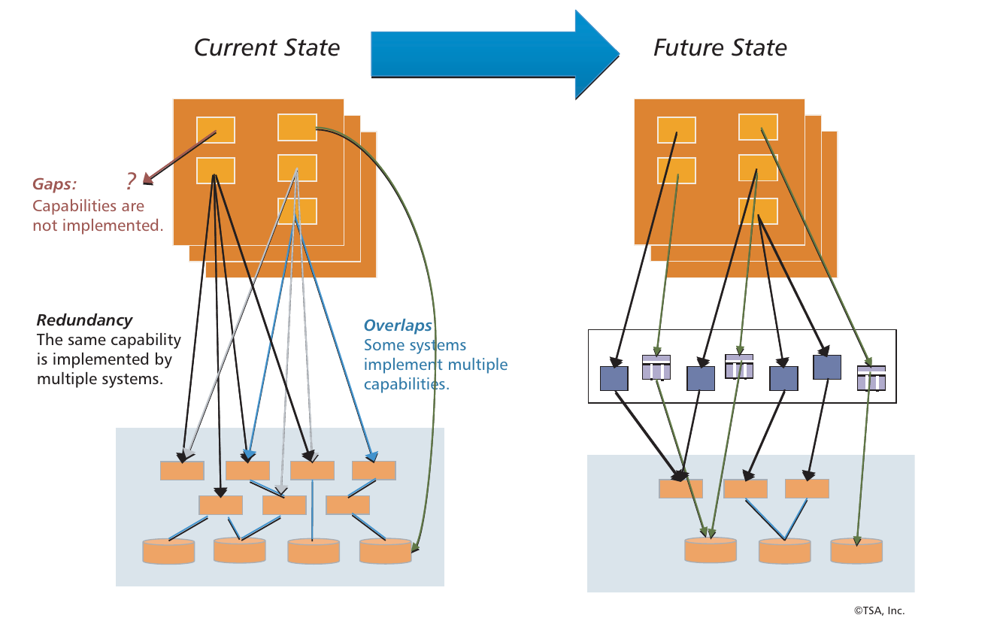

**Figura 15 — Mapeo de capacidades a la arquitectura del estado futuro.**
*Texto de la figura:* **Estado actual → Estado futuro.** *Brechas:* capacidades sin implementar. *Redundancia:* la misma capacidad es implementada por múltiples sistemas. *Solapamientos:* algunos sistemas implementan múltiples capacidades. © TSA, Inc.

### Modernización de la arquitectura de TI impulsada por capacidades

Cuando se trata de la transformación de la arquitectura de aplicaciones back-end, las capacidades realmente son la Piedra de Rosetta que los arquitectos y analistas de TI han estado buscando. Hemos visto equipos de arquitectura intentar mapear aplicaciones a flujos de valor y procesos de negocio solo para frustrarse por la gran cantidad de mapeos de muchos a muchos. En muchas organizaciones, un flujo de valor dado tocará a muchas organizaciones y requerirá automatización de una gran cantidad de aplicaciones diversas y redundantes. Para fines de planificación de la transformación de la arquitectura de aplicaciones, el enfoque de mapeo flujo de valor/aplicación es altamente inadecuado. Sin embargo, cuando se introducen las capacidades en la ecuación, surge la claridad sobre dónde, cuándo y cómo los cambios de flujo de valor/proceso de negocio requieren nuevos despliegues o cambios transformacionales en las arquitecturas de aplicaciones back-end. La clave aquí es identificar dónde, a lo largo de un flujo de valor, existen ciertas capacidades y deben automatizarse o modernizarse de otro modo.

En nuestra sección sobre la hoja de ruta de transformación, discutimos cómo las capacidades se mapean a varias etapas de un flujo de valor y que estas capacidades también se mapean a aplicaciones back-end. Al igual que las iniciativas SOA, que se benefician de entender dónde las capacidades pueden impulsar la necesidad de nuevos servicios, las capacidades también impulsan la evolución (modernización) de las arquitecturas de aplicaciones del estado actual de diversas maneras. La Figura 16 muestra las capacidades de Nivel 4, introducidas en la Figura 4, mapeadas a un conjunto de aplicaciones y subsistemas existentes. Este concepto de mapeo, totalmente respaldado por la base de conocimiento de arquitectura de negocio, proporciona un enfoque de hoja de ruta sobre dónde y cuándo cierta lógica de aplicaciones back-end debería ser consolidada, eliminada o desactivada, migrada, o comenzar a invocar un nuevo servicio en el entorno SOA en evolución.

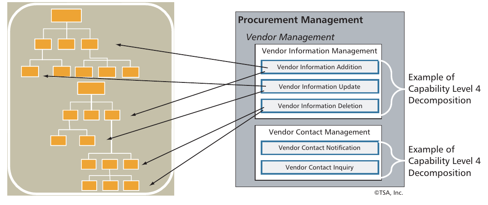

**Figura 16 — Mapeo de capacidades a la arquitectura de aplicaciones back-end.**
*Texto de la figura:* A la izquierda, una jerarquía de componentes de una aplicación existente; a la derecha, la descomposición de «Gestión de adquisiciones» (Gestión de información de proveedores: Alta, Actualización y Baja de información de proveedores; Gestión de contactos de proveedores: Notificación e Consulta de contacto con proveedores), con flechas que vinculan las capacidades de Nivel 4 con los componentes de la aplicación. «Ejemplo de descomposición de capacidad de Nivel 4». © TSA, Inc.

El análisis requerido para realizar este mapeo evoluciona a través de varias etapas de implementación, según lo esbozado por las prioridades establecidas dentro de la hoja de ruta de transformación Negocio/TI. Las arquitecturas de información back-end deben experimentar una evolución incremental similar y deben sincronizarse con este esfuerzo. Bajo este enfoque, la arquitectura de aplicaciones del estado actual experimenta una serie de mejoras evolutivas, avanzando continuamente hacia un nuevo estado objetivo. Este esfuerzo evoluciona hacia una sincronización por fases con la automatización y sincronización de los flujos de valor front-end y los procesos de negocio, y debe respaldar plenamente el desacoplamiento y la evolución de los despliegues de middleware.

SOA proporciona otra ventaja en apoyo de este enfoque evolutivo. Se espera que un servicio experimente continuamente un ciclo evolutivo y que, durante cierto tiempo, se soporten múltiples versiones del mismo servicio. Esto significa que las aplicaciones pueden hacer la transición para usar un servicio ahora, al mismo tiempo que el servicio evoluciona. Se garantizará el soporte de una aplicación sobre una versión dada del servicio durante un marco de tiempo acordado (típicamente 18-24 meses después de la siguiente versión mayor del servicio). Mientras tanto, se mejorarán nuevas versiones del servicio para apoyar la transición de aplicaciones adicionales. En el futuro, cuando las aplicaciones anteriores necesiten someterse a algún tipo de mantenimiento, también actualizarán a la última versión del servicio. Hemos visto este enfoque incremental usado con éxito para migrar 80 líneas de producto diferentes a una representación común de un cliente durante un período de varios años.

La Figura 17 muestra un ejemplo de una ruta de transformación back-end que puede ocurrir para un conjunto de aplicaciones. En este ejemplo, las aplicaciones del estado actual han sido analizadas y mapeadas a ciertas capacidades de negocio. Un conjunto posterior de pasos sirvió para extraer el software que ya no está activo, consolidar la lógica de software que sigue en uso y es crítica para el negocio, y crear un despliegue de aplicación provisional (interim) altamente componentizado. Este concepto está habilitado por poderosas herramientas de modernización que pueden analizar y desacoplar el software de aplicación desde la perspectiva de sistema (en lugar de programa por programa).

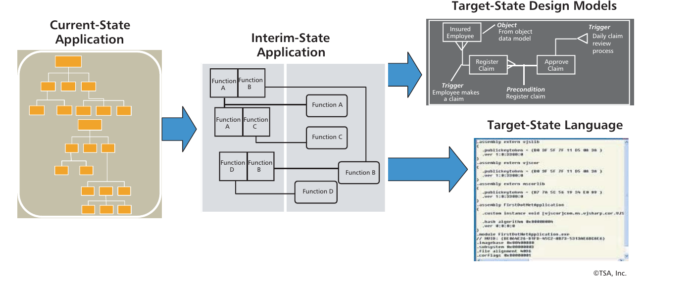

**Figura 17 — Transformación basada en capacidades hacia la arquitectura de aplicaciones back-end mediante modernización.**
*Texto de la figura:* Aplicación del estado actual → Aplicación del estado provisional (Funciones A, B, C, D) → Modelos de diseño del estado objetivo (p. ej., Objeto, Disparador, Precondición: «Registrar reclamación», «Aprobar reclamación», «Empleado asegurado») y Lenguaje del estado objetivo (código ejecutable). © TSA, Inc.

Los conceptos de la Figura 17 pueden implementarse de varias maneras. Esto incluye extraer lógica de negocio de las aplicaciones del estado actual con la intención de reutilizar esa lógica en un servicio desplegado, extraer reglas de negocio con la intención de que estas reglas puedan trasladarse a paradigmas dirigidos por modelos, y volver a desplegar esa lógica en una representación basada en código o en modelos ejecutables. La clave es aprovechar las capacidades de negocio como motor de este esfuerzo, lo que puede incluir llevar esas capacidades hasta los Niveles 4, 5 o incluso 6. Con el tiempo, la arquitectura del estado actual se transforma en una nueva arquitectura objetivo que se alinea con los nuevos despliegues SOA, la información y los cambios front-end centrados en procesos.

---

## Conclusión

Hemos descrito el mapa de capacidades de negocio como la Piedra de Rosetta de la alineación Negocio/TI. La metáfora sugiere que existe una disparidad entre las intenciones del negocio y los sistemas de TI utilizados para automatizarlas. Como cualquiera en el negocio o en TI sabe, esta disparidad es real, y ambos grupos han estado luchando por cerrar la brecha durante décadas. Lamentablemente, estos esfuerzos han tenido poco éxito... hasta ahora.

Lo que ha faltado es una clave capaz de expresar los conceptos importantes y traducir entre ellos. La capacidad de negocio, al describir lo que el negocio necesita hacer, y no cómo debería hacerse, proporciona un vocabulario conciso en términos de negocio que puede impulsar las iniciativas de transformación. La vista de capacidades del negocio proporciona la base de alto nivel para la alineación y tiende un puente sobre el abismo Negocio/TI.

En este *Informe Ejecutivo* hemos cubierto qué es una capacidad, cómo identificar y definir las capacidades, y cómo usarlas para planificar y lograr una transformación de negocio exitosa. Confiamos en que pueden desempeñar un papel clave en sus esfuerzos de transformación del negocio en el futuro.

---

## Notas finales

¹ Homann, Ulrich. «A Business-Oriented Foundation for Service Orientation» (Una base orientada al negocio para la orientación a servicios). Microsoft, febrero de 2006 (http://msdn.microsoft.com/en-us/library/aa479368.aspx).

² Whittle, Ralph, y Conrad B. Myrick. *Enterprise Business Architecture: The Formal Link Between Strategy and Results* (Arquitectura empresarial de negocio: el vínculo formal entre estrategia y resultados). CRC Press, 2004.

³ Véase bawg.omg.org y www.businessarchitectureinstitute.org.

⁴ Ulrich, William. «Capabilities & Value Streams: Business Architecture's Essential Alliance» (Capacidades y flujos de valor: la alianza esencial de la arquitectura de negocio). BPM Institute, 22 de noviembre de 2010 (www.bpminstitute.org/articles/article/article/capabilities-value-streams-business-architecture-s-essential-alliance.html).

⁵ Ulrich, William, y Neal McWhorter. *Business Architecture: The Art and Practice of Business Transformation* (Arquitectura de negocio: el arte y la práctica de la transformación del negocio). Meghan Kiffer Press, 2010, p. 210.

⁶ «Chaos Summary 2008: The 10 Laws of Chaos» (Resumen del Caos 2008: las 10 leyes del caos). The Standish Group, 2008.

---

## Acerca de los autores

**William M. Ulrich** es Consultor Sénior en las prácticas de Estrategias Negocio-TI, Arquitectura Empresarial y Sector Público y Gobierno de Cutter, y presidente de TSG, Inc., una firma de consultoría de gestión especializada en planificación de negocio y de TI. El Sr. Ulrich tiene más de 30 años de experiencia en el campo de la consultoría de gestión de negocio-TI. Se desempeña como asesor estratégico y mentor en iniciativas de alineación negocio-TI y continúa trabajando como líder de talleres y autor. Tiene la capacidad única de cruzar las fronteras entre negocio y TI y de facilitar y agilizar las estrategias de transformación negocio-TI. Sus talleres sobre alineación de la arquitectura negocio-TI han sido ampliamente asistidos por organizaciones de todo el mundo. Su capacidad de comunicarse con fluidez con ejecutivos y profesionales de negocio y con ejecutivos y profesionales de TI le ha permitido ayudar a las organizaciones a elaborar estrategias de transformación que entregan valor de negocio incremental y continuo mientras gestionan el riesgo y los costos en cada etapa del despliegue.

Actualmente, el Sr. Ulrich es copresidente del Grupo de Interés Especial en Arquitectura de Negocio de OMG, director editorial del Business Architecture Institute, copresidente del Grupo de Trabajo de Modernización Dirigida por la Arquitectura de OMG y miembro del Consejo Asesor de AE de Penn State. Sus últimos libros incluyen *Business Architecture: The Art and Practice of Business Transformation* e *Information Systems Transformation: Architecture-Driven Modernization Case Studies*. Los enfoques descritos en estas dos publicaciones proporcionan un equilibrio entre los desafíos inherentes a la entrega de una transformación negocio/TI impulsada por el negocio. Puede contactarse en wulrich@cutter.com.

**Michael Rosen** es Director de la práctica de Arquitectura Empresarial de Cutter Consortium y Consultor Sénior de su práctica de Estrategias Negocio-TI. Es un arquitecto consumado y líder técnico con amplia experiencia en AE, SOA, arquitectura de negocio, estrategia y desarrollo de productos, arquitectura de software, consultoría y mentoría, tecnologías distribuidas y estándares de la industria.

El Sr. Rosen se especializa en arquitectura y estrategia de TI para clientes Global 1000 de finanzas, seguros, gobierno y telecomunicaciones. A lo largo de su carrera ha sido un instructor técnico frecuente, conferencista y escritor sobre temas como AE, integración de aplicaciones con SOA, Arquitectura Dirigida por Modelos (MDA) y Empresa 2.0 y arquitectura de colaboración. Además de su puesto como Director de la Práctica de AE de Cutter, el Sr. Rosen es Científico Jefe en Wilton Consulting Group. Anteriormente fue CTO de Azora Technologies, una startup centrada en análisis SOA, herramientas de diseño y arquitectura de referencia; CTO de M2VP, Inc., una consultora de arquitectura de TI donde desarrolló el área de práctica de la compañía usando MDA; Arquitecto Empresarial Jefe en IONA Technologies, PLC, donde participó en el desarrollo de la arquitectura general de producto para su plataforma de servicios Web de próxima generación y en la creación de la arquitectura de referencia para construir aplicaciones sobre esa plataforma. Antes de IONA, el Sr. Rosen fue Arquitecto Empresarial Jefe en Genesis Development, donde brindó consultoría de arquitectura sobre aplicaciones e infraestructura de gran escala. Antes de unirse a Genesis, fue arquitecto de producto, líder técnico y desarrollador de numerosos servicios Web, agentes, Java, CORBA, COM, mensajería, procesamiento de transacciones, DCE, redes y productos de sistemas operativos para varios proveedores, incluidos BEA y Digital.

El Sr. Rosen ha escrito docenas de artículos e informes y es coautor de *Applied SOA: Service-Oriented Architecture and Design Strategies*; *Developing E-Business Systems and Architectures: A Manager's Guide*; e *Integrating CORBA and COM Applications*. Es miembro fundador del Business Architect's Guild y participa activamente en los estándares de la industria con OMG. Puede contactarse en mrosen@cutter.com.

---

## Anexo: material promocional de Cutter Consortium (incluido en el PDF original)

### Consultoría en Arquitectura Empresarial

Cutter Consortium ofrece asesoría y orientación de consultores de renombre mundial. El Consortium cuenta con un cuerpo docente cuya experiencia y credenciales no tienen igual entre ningún otro proveedor de servicios.

Además, a diferencia de muchas otras firmas de consultoría que usan socios sénior para vender un trabajo pero luego asignan personal junior para realizar realmente el trabajo en el sitio del cliente, Cutter no tiene personal junior y despliega únicamente a sus Consultores Sénior, Fellows, Arquitectos y Coaches Técnicos expertos en cada asignación. La gran fortaleza del Consortium es que puede recurrir a más de 150 consultores de primer nivel para formar el equipo ideal para su organización, abordando cualquier desafío que pueda surgir y ofreciendo una solución completa desde la evaluación hasta la implementación.

Asimismo, Cutter no depende de soluciones estándar como tantas otras firmas de consultoría. Los compromisos de AE personalizados de Cutter están diseñados específicamente para satisfacer las necesidades del cliente individual. Vemos que muchos clientes tienen problemas similares; por lo tanto, hemos desarrollado plantillas en torno a estas áreas comunes para actuar como punto de partida de discusiones que refinarán el enfoque, el producto y la duración del proyecto para ajustarse a las necesidades y circunstancias particulares del cliente.

#### Evaluación de madurez de Arquitectura Empresarial o SOA

Mediante una evaluación cualitativa y cuantitativa de su arquitectura y su organización, el programa de evaluación de madurez de Cutter proporciona una comparación relativa de la organización con las normas de la industria e identifica fortalezas y áreas que requieren atención.

El enfoque de Cutter para la evaluación de arquitectura consiste primero en entender las metas y los impulsores del programa de arquitectura y luego en evaluar la iniciativa en términos del cumplimiento de esas metas. Esto lleva a la selección y priorización de características arquitectónicas específicas y criterios de evaluación a aplicar durante la evaluación. Se identifican mejores prácticas y procesos arquitectónicos específicos que conducen a cumplir las metas del programa. Estos deben ajustarse al entorno, la cultura, la estructura, los procesos, la organización, etc. de la empresa. La madurez general se basa en una evaluación de los criterios, procesos y prácticas.

Cutter aplica una dimensión adicional importante a la evaluación al identificar áreas específicas de valor (o ROI) que pueden entregarse a la empresa con base en el cumplimiento de ciertos objetivos y criterios de madurez. Esto permite a los tomadores de decisiones entender y evaluar el valor que aportará una inversión en el programa de arquitectura.

El paso final del proceso de evaluación es desarrollar una hoja de ruta para que la arquitectura entregue una estrategia y cumpla las metas de la empresa. La hoja de ruta incluye objetivos de madurez específicos y puntos de control que permiten a la organización medir cuantitativamente el progreso del programa de AE con respecto a criterios, procesos, prácticas y resultados específicos.

El compromiso incluye un informe que resume el proceso de evaluación de madurez; el nivel de madurez de la organización cliente; fortalezas, debilidades y recomendaciones; y la hoja de ruta.

#### Habilitación en Arquitectura Empresarial

El programa de habilitación en arquitectura empresarial de Cutter permite a las empresas recibir una opinión experta y objetiva sobre el estado actual de sus iniciativas de arquitectura empresarial u orientada a servicios (SOA) y trabajar con los Consultores Sénior de Cutter para formular una visión de estado final y un plan de acción priorizado.

Debido a que el programa de habilitación está limitado en alcance a cuatro o cinco días, ofrece un enfoque de bajo costo y bajo riesgo que demuestra el valor que Cutter puede aportar a su organización, permitiendo que su organización y Cutter se familiaricen entre sí y determinen cómo maximizar el valor de cualquier consultoría adicional.

La habilitación incluye un informe que resume el compromiso junto con una visión arquitectónica inicial de alto nivel y una hoja de ruta. Aunque cada informe es diferente, un índice de ejemplo podría incluir:

- Resumen ejecutivo
- Impresiones
- Metas, entregables y estrategia
- Evaluación de las preguntas específicas abordadas durante el compromiso
- Recomendaciones
- Plan de acción

#### Desarrollo de un programa de Arquitectura Empresarial, Arquitectura de Negocio o SOA

Cutter trabaja con muchas organizaciones que actualmente tienen o están iniciando programas arquitectónicos. Los escenarios más comunes son:

- Iniciar un nuevo programa de arquitectura, yendo más allá del proyecto piloto
- Desplegar un programa de AE o SOA
- Expandir el alcance y la influencia de la AE con la arquitectura de negocio
- Abordar un programa existente que no está entregando el valor esperado
- Evaluar un programa existente para mantenerlo alineado con las mejores prácticas de la industria

Cutter trabaja con los clientes para abordar los problemas y desarrollar una estrategia adecuada para su organización. Por ejemplo, un programa de despliegue de SOA recomendaría una estrategia de alto nivel y una hoja de ruta para la transición a una SOA. La hoja de ruta especificaría puntos de control, plazos y objetivos de resultados e incluiría la prioridad relativa, el alcance y los entregables de actividades específicas, como:

1. Alineación de la arquitectura con la estrategia de negocio y organizacional
2. Proyectos piloto
3. Mejoras o despliegue de infraestructura y herramientas
4. Desarrollo o mejora de procesos arquitectónicos específicos
5. Metas y estructura organizacional
6. Gobernanza arquitectónica
7. Métricas
8. Desarrollo de artefactos arquitectónicos específicos
9. Comunicaciones
10. Educación y mentoría

#### Revisión de arquitectura y plan de acción

La Revisión de Arquitectura y Plan de Acción proporciona una evaluación en profundidad de la arquitectura de su empresa. Adopta un enfoque arquitectónico para abordar preguntas e inquietudes específicas que usted pueda tener. Está pensada para aclarar las discusiones de negocio, aplicaciones y tecnología y ayudar a su organización a tomar decisiones tecnológicas específicas.

Este enfoque analiza la arquitectura empresarial y la infraestructura que se requerirán para cumplir sus objetivos, ya sea que involucren una AE, una transición organizacional o la implementación de una única aplicación usando técnicas de desarrollo centradas en la arquitectura. El enfoque articula las metas de negocio, tecnología y desarrollo, así como los requisitos arquitectónicos que estas metas implican. Y destaca los problemas técnicos que podrían impedir el logro de estos requisitos y metas.

Un entregable importante de una Revisión y Evaluación de Arquitectura es el diseño inicial de una arquitectura objetivo. Esta podría ser una SOA de alto nivel, un borrador de arquitectura de negocio o una arquitectura de aplicación o tecnología. Por ejemplo, un borrador de arquitectura tecnológica podría presentar los servicios, marcos y patrones de diseño que constituyen una verdadera arquitectura de escala empresarial adaptada a la situación actual y las metas futuras de su empresa.

La Evaluación incluye un informe en profundidad, típicamente del orden de 75 páginas, que toma de 20 a 25 días investigar y producir. Un índice de ejemplo podría incluir:

- Resumen ejecutivo
- Metas y estrategia
- Evaluación de la arquitectura actual
- Arquitectura objetivo
- Requisitos específicos abordados por la arquitectura objetivo
- Recomendaciones
- Plan de acción

#### Una muestra de ofertas adicionales de consultoría y capacitación

- **Desarrollo arquitectónico.** Cutter creará entregables de arquitectura específicos, incluidas arquitecturas objetivo, especificaciones y modelos.
- **Revisión de diseño independiente.** Nuestro equipo de AE puede realizar una evaluación detallada y proporcionar recomendaciones sobre arquitecturas y diseños de proyectos. Esto brinda a su organización un análisis experto independiente de los proyectos frente a las mejores prácticas y estándares de la industria, así como a los requisitos y metas específicos de cada proyecto. Se usa a menudo para validar el diseño de un proyecto que se está subcontratando.
- **Revisiones periódicas.** Las revisiones periódicas de arquitecturas y programas realizadas por un Consultor Sénior de Cutter típicamente ocurren de dos a cuatro veces al año y proporcionan al CIO, al Arquitecto Jefe o al Director de Arquitectura revisiones y recomendaciones específicas.
- **Asesoría estratégica y alineación.** Estos compromisos de asesoría estratégica y alineación, que ocurren periódicamente como las revisiones, se centran en brindar asesoría de tecnología estratégica al CIO u otros a nivel ejecutivo.
- **Capacitación y mentoría a la medida.** Las opciones de capacitación de Cutter van desde seminarios ejecutivos de medio día, hasta talleres de uno o dos días, y un currículo integral de seis cursos. Nuestras técnicas incluyen presentaciones, talleres prácticos y mentoría en el trabajo.

*Cutter Consortium | 37 Broadway, Suite 1, Arlington, MA 02474-5552, EE. UU. | Tel.: +1 781 648 8700 | Fax: +1 781 648 8707 | www.cutter.com | sales@cutter.com*

### Práctica de Arquitectura Empresarial

Hoy las exigencias sobre la TI corporativa nunca han sido mayores. Reducir costos y acelerar el tiempo de llegada al mercado de proyectos individuales de línea de negocio siguen siendo prioridades, pero ni siquiera eso es ya suficiente. Las empresas buscan ahora estrategias para aprovechar mejor toda su infraestructura de TI. Quieren que TI entregue aplicaciones empresariales sofisticadas que puedan aportar valor en muchas líneas de negocio y proporcionar una diferenciación marcada frente a sus competidores. La Práctica de Arquitectura Empresarial proporciona la información, el análisis y la asesoría estratégica para ayudar a las organizaciones a comprometerse con y desarrollar un plan global que asegure que todo su sistema encaje y funcione sin fisuras.

La Práctica de Arquitectura Empresarial ofrece investigación continua sobre los últimos desarrollos en esta área, incluidos servicios Web, integración de aplicaciones empresariales, XML, seguridad, metodologías emergentes y establecidas, Arquitectura Dirigida por Modelos, cómo construir una arquitectura empresarial, además de informes imparciales sobre los proveedores y productos de este mercado. Las ofertas de consultoría y capacitación, que se personalizan, pueden ir desde el mapeo de una arquitectura de infraestructura hasta la transición a un entorno de computación distribuida.

**Productos y servicios disponibles de la Práctica de Arquitectura Empresarial**

- El Servicio de Asesoría en Arquitectura Empresarial
- Consultoría
- Talleres internos (in-house)
- Mentoría
- Informes de investigación

**Otras prácticas de Cutter Consortium**

Cutter Consortium alinea sus productos y servicios en las nueve áreas de práctica siguientes. Cada una de estas prácticas incluye un servicio periódico por suscripción, además de servicios de consultoría y capacitación.

- Gestión Ágil de Productos y Proyectos
- Inteligencia de Negocio
- Estrategias Negocio-TI
- Tendencias e Impactos de la Tecnología de Negocio
- Arquitectura Empresarial
- Gestión de Riesgos Empresariales y Gobernanza
- Gobierno y Sector Público
- Innovación y Agilidad Empresarial
- Gestión de TI
- Estrategias de Medición y Benchmarking
- Redes Sociales
- Sourcing y Relaciones con Proveedores

### Equipo de Consultores Sénior

Nuestro equipo de especialistas de reconocimiento internacional ofrece experiencia en temas de seguridad, implementación de e-business, XML, metodologías de e-business, agentes, servicios Web, Java EE, .NET, planificación de arquitectura de alto nivel e integración de sistemas, gestión de sistemas distribuidos, realización de evaluaciones de arquitectura, provisión de mentoría y capacitación, supervisión o ejecución de proyectos piloto y más. El equipo incluye a:

Michael Rosen (Director de la Práctica), Paul Allen, Scott Ambler, Douglas Barry, Dan Berglove, Udi Dahan, Max Dolgicer, Don Estes, Pierfranco Ferronato, Clive Finkelstein, Jerry Grochow, Michael Guttman, David Hay, Tushar K. Hazra, Dave Higgins, Bartosz Kiepuszewski, Sebastian Konkol, Arun K. Majumdar, Terry Merriman, James Odell, Ken Orr, Mark Peterson, Jorge V. A. Ronchese, Oliver Sims, Borys Stokalski, William Ulrich, Mitchell Ummel, Jeroen van Tyn, Jim Watson y Tom Welsh.
