# Presentación de casos de uso · July

**ID:** CU-07 · **Versión:** 1.0 · **Fecha:** 2026-10-21 · **Estado:** Obsoleto  

> **Reemplazado por [CU-08 · Especificaciones de casos de uso](especificaciones-casos-de-uso.md).** CU-08 separa cada paso en una oración con un solo verbo, por eso sus números de paso no coinciden con los de esta presentación. Para trazar un paso, un método o una entidad, use CU-08. Esta presentación se conserva solo por sus diagramas de secuencia.

**Deriva de:** CU-06 (`casos-de-uso-por-flujo.md`), CU-03 a CU-05 (diagramas de draw.io por flujo de valor) y CAP-02 (mapa de capacidades)  
**Proyecto:** July, asistente virtual de captación de prospectos de la Cooperativa Padre Julián Lorente  

---

## Cómo leer esta presentación

### Regla de encadenamiento

Cada paso es una oración con un **sujeto** que actúa y un **receptor** al final. El receptor con el que termina un paso es el sujeto que empieza el siguiente. Así el flujo se lee de arriba abajo sin saltos, como en este ejemplo:

| Paso | Interacción |
|---|---|
| 1 | **Cliente** verifica disponibilidad con **Aerolínea**. |
| 2 | **Aerolínea** le confirma el pasaje al **Cliente**. |
| 3 | **Cliente** reserva el pasaje con **Aerolínea**. |
| 4 | **Aerolínea** le asigna un pasaje al **Cliente**. |

En los diagramas de secuencia los participantes aparecen de izquierda a derecha en el orden en que entran al caso, y los mensajes se leen de arriba abajo con el mismo número de paso de la tabla.

### Niveles

| Nivel | Qué representa | Cómo se presenta |
|---|---|---|
| 1 | Etapa del flujo de valor. La inicia el actor principal. | Flujo resumido que encadena sus casos de nivel 2. |
| 2 | Caso de uso que incluye («include») tres casos de nivel 3. | Especificación completa, flujo principal, diagrama de secuencia y flujos alternativos. |
| 3 | Capacidad de nivel 3 del mapa, vista como caso de uso. | Tabla de trazabilidad: en qué pasos del caso de nivel 2 ocurre. |

### Convenciones

- **Actores de configuración.** El Equipo de marketing, el Administrador del asistente, el Área de productos y crédito, el Comité de crédito y el Jefe comercial no conversan en tiempo real: participan con lo que dejaron configurado (guiones, catálogo, reglas, criterios). Cuando July les «consulta» algo, lee esa configuración vigente.
- **Flujos alternativos.** Se numeran con el paso del que salen y una letra (`3a`). Indican dónde se retoma el flujo principal y respetan la misma regla de encadenamiento.
- **Columna «CU nivel 3».** Indica qué caso de nivel 3 cubre cada paso, para seguir la trazabilidad hasta la capacidad del mapa.

---

## Índice

| Flujo de valor | Nivel 1 | Nivel 2 | Actor principal |
|---|---|---|---|
| 1 · Atracción y primer contacto | [CU 1.1 Contactar a July por un canal digital](#cu-1-1) | [CU 1.1.1 Recibir la consulta por WhatsApp o web](#cu-1-1-1) · [CU 1.1.2 Unificar los mensajes entrantes](#cu-1-1-2) | Prospecto |
| | [CU 1.2 Recibir el primer contacto](#cu-1-2) | [CU 1.2.1 Recibir atención inmediata](#cu-1-2-1) · [CU 1.2.2 Identificar al prospecto y su necesidad](#cu-1-2-2) | Prospecto |
| 2 · Captura, simulación y precalificación | [CU 2.1 Completar el perfil del crédito](#cu-2-1) | [CU 2.1.1 Entregar los datos conversando](#cu-2-1-1) · [CU 2.1.2 Validar los datos y mantener la continuidad](#cu-2-1-2) | Prospecto |
| | [CU 2.2 Simular el crédito](#cu-2-2) | [CU 2.2.1 Calcular las condiciones del crédito](#cu-2-2-1) · [CU 2.2.2 Consultar productos y condiciones](#cu-2-2-2) | Prospecto |
| | [CU 2.3 Obtener la precalificación](#cu-2-3) | [CU 2.3.1 Evaluar al prospecto con reglas](#cu-2-3-1) · [CU 2.3.2 Recibir orientación sobre el resultado](#cu-2-3-2) | Prospecto |
| 3 · Entrega, seguimiento y conversión | [CU 3.1 Recibir la oportunidad precalificada](#cu-3-1) | [CU 3.1.1 Revisar la ficha del prospecto](#cu-3-1-1) · [CU 3.1.2 Registrar el lead en el CRM](#cu-3-1-2) | Asesor comercial |
| | [CU 3.2 Dar seguimiento al lead hasta su cierre](#cu-3-2) | [CU 3.2.1 Recibir el lead asignado](#cu-3-2-1) · [CU 3.2.2 Hacer seguimiento y cerrar el lead](#cu-3-2-2) | Asesor comercial |

Al final está la [matriz de trazabilidad](#matriz) con los 42 casos de nivel 3.

## Actores

| Actor | Tipo | Rol |
|---|---|---|
| Prospecto | Persona | Interesado en un crédito, socio o no. Actor principal de los flujos 1 y 2. |
| Asesor comercial | Persona | Atiende los leads asignados y los cierra. Actor principal del flujo 3. |
| July | Sistema en diseño | Asistente virtual de captación por WhatsApp y web. |
| Equipo de marketing | Persona (configuración) | Define campañas y recibe el origen de cada conversación. |
| Administrador del asistente | Persona (configuración) | Edita guiones, intenciones, preguntas frecuentes y plantillas. |
| Área de productos y crédito | Persona (configuración) | Mantiene el catálogo de líneas, tasas, plazos y requisitos. |
| Comité de crédito | Persona (configuración) | Aprueba las reglas de precalificación y resuelve los créditos. |
| Jefe comercial | Persona (configuración) | Define prioridad y enrutamiento de leads y supervisa el embudo. |
| Personal de agencia | Persona | Gestiona la agenda y confirma las citas. |
| WhatsApp Business API | Sistema externo | Canal de mensajería. |
| Widget web | Sistema externo | Chat del sitio web. |
| Sistema core | Sistema externo | Datos de socios de la cooperativa. |
| CRM de la cooperativa | Sistema externo | Registro comercial de los leads. |

---

## Flujo de valor 1 · Atracción y primer contacto

Objetivo del flujo: recibir la demanda digital y responder en menos de 2 minutos. Diagrama fuente: [`casos-de-uso-flujo-01-atraccion-y-primer-contacto.drawio`](casos-de-uso-flujo-01-atraccion-y-primer-contacto.drawio).

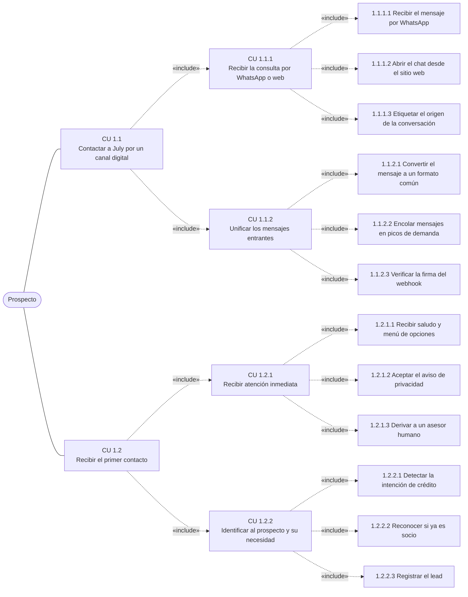

### CU 1.1 · Contactar a July por un canal digital (nivel 1)

**Etapa:** Canales de contacto · **Capacidad:** 1.1 Canales de contacto · **Actor principal:** Prospecto · **Incluye:** CU 1.1.1 y CU 1.1.2

| Paso | Interacción | Caso incluido |
|---|---|---|
| 1 | **Prospecto** envía su consulta por WhatsApp o por la web a **July**. | CU 1.1.1 |
| 2 | **July** unifica el mensaje en un formato común y le acusa recibo al **Prospecto**. | CU 1.1.2 |

#### CU 1.1.1 · Recibir la consulta por WhatsApp o web

| Campo | Especificación |
|---|---|
| Nivel | 2 · incluido por [CU 1.1](#cu-1-1) |
| Capacidad | 1.1.1 Recepción multicanal |
| Actor principal | Prospecto |
| Actores secundarios | WhatsApp Business API, Widget web, Equipo de marketing |
| Objetivo | Que la consulta llegue a July desde cualquier canal y quede registrado de dónde vino. |
| Disparador | El prospecto escribe al número de WhatsApp de la cooperativa o abre el chat del sitio web. |
| Precondiciones | El número de WhatsApp y el widget están conectados a July. El Equipo de marketing tiene definidas las campañas activas. |
| Postcondiciones | La consulta está en July con su canal y su campaña de origen etiquetados. |

**Flujo principal**

| Paso | Interacción | CU nivel 3 |
|---|---|---|
| 1 | **Prospecto** escribe su consulta al número de la cooperativa en **WhatsApp Business API**. | 1.1.1.1 |
| 2 | **WhatsApp Business API** entrega el mensaje recibido a **July**. | 1.1.1.1 |
| 3 | **July** etiqueta la conversación con su canal y campaña de origen y se la reporta al **Equipo de marketing**. | 1.1.1.3 |

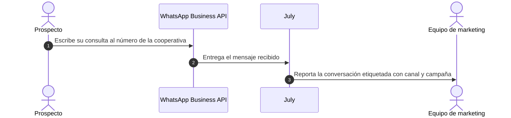

**Flujos alternativos**

| Paso | Interacción | CU nivel 3 |
|---|---|---|
| | *A1 · El prospecto llega por el sitio web (reemplaza los pasos 1 y 2)* | |
| 1a | **Prospecto** abre el chat y escribe su consulta en el **Widget web**. | 1.1.1.2 |
| 2a | **Widget web** envía el mensaje con la página de origen a **July**. Continúa en el paso 3. | 1.1.1.2 |
| | *A2 · El mensaje no trae campaña (paso 3)* | |
| 3a | **July** etiqueta la conversación como «origen directo» y se la reporta al **Equipo de marketing**. Fin. | 1.1.1.3 |

**Casos de nivel 3 incluidos**

| ID | Caso de uso | Actor externo | Capacidad nivel 3 | Pasos |
|---|---|---|---|---|
| 1.1.1.1 | Recibir el mensaje por WhatsApp | WhatsApp Business API | 1.1.1.1 WhatsApp Business API | 1, 2 |
| 1.1.1.2 | Abrir el chat desde el sitio web | Widget web | 1.1.1.2 Widget web | 1a, 2a |
| 1.1.1.3 | Etiquetar el origen de la conversación | Equipo de marketing | 1.1.1.3 Registro de origen | 3, 3a |

#### CU 1.1.2 · Unificar los mensajes entrantes

| Campo | Especificación |
|---|---|
| Nivel | 2 · incluido por [CU 1.1](#cu-1-1) |
| Capacidad | 1.1.2 Unificación de mensajes |
| Actor principal | Prospecto |
| Actores secundarios | WhatsApp Business API, Widget web |
| Objetivo | Que todo mensaje, venga del canal que venga, llegue a July verificado y en un mismo formato, aun en picos de demanda. |
| Disparador | Llega un mensaje nuevo desde WhatsApp o desde el widget web. |
| Precondiciones | July tiene la clave para verificar los webhooks de WhatsApp Business API. |
| Postcondiciones | El mensaje está verificado, convertido al formato común y atendido o en cola. |

**Flujo principal**

| Paso | Interacción | CU nivel 3 |
|---|---|---|
| 1 | **Prospecto** envía un mensaje de texto, audio o imagen a **WhatsApp Business API**. | 1.1.2.1 |
| 2 | **WhatsApp Business API** notifica el mensaje con un webhook firmado a **July**. | 1.1.2.3 |
| 3 | **July** verifica la firma del webhook y le confirma la recepción a **WhatsApp Business API**. | 1.1.2.3 |
| 4 | **WhatsApp Business API** entrega el contenido y los adjuntos del mensaje a **July**. | 1.1.2.1 |
| 5 | **July** convierte el mensaje al formato común y le responde de inmediato al **Prospecto**. | 1.1.2.1 |

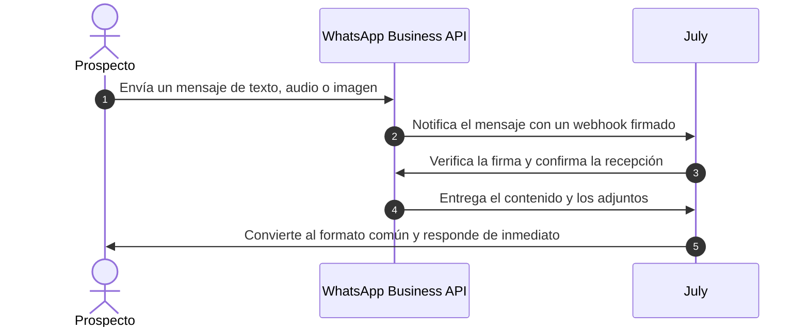

**Flujos alternativos**

| Paso | Interacción | CU nivel 3 |
|---|---|---|
| | *A1 · El mensaje llega por el sitio web (reemplaza los pasos 1 a 4)* | |
| 1a | **Prospecto** envía su mensaje desde el **Widget web**. | 1.1.2.1 |
| 2a | **Widget web** envía el mensaje con su token de sesión a **July**. Continúa en el paso 5. | 1.1.2.1 |
| | *A2 · Firma inválida (paso 3)* | |
| 3a | **July** rechaza la notificación con firma inválida y le devuelve un error a **WhatsApp Business API**. Fin. | 1.1.2.3 |
| | *A3 · Pico de demanda (paso 5)* | |
| 5a | **July** convierte el mensaje, lo coloca en la cola de atención y le avisa que será atendido en breve al **Prospecto**. Fin. | 1.1.2.2 |

**Casos de nivel 3 incluidos**

| ID | Caso de uso | Actor externo | Capacidad nivel 3 | Pasos |
|---|---|---|---|---|
| 1.1.2.1 | Convertir el mensaje a un formato común | WhatsApp Business API, Widget web | 1.1.2.1 Formato común por canal | 1, 4, 5, 1a, 2a |
| 1.1.2.2 | Encolar mensajes en picos de demanda | Ninguno, lo resuelve July | 1.1.2.2 Absorción de picos | 5a |
| 1.1.2.3 | Verificar la firma del webhook | WhatsApp Business API | 1.1.2.3 Verificación de webhooks | 2, 3, 3a |

### CU 1.2 · Recibir el primer contacto (nivel 1)

**Etapa:** Primer contacto · **Capacidad:** 1.2 Primer contacto · **Actor principal:** Prospecto · **Incluye:** CU 1.2.1 y CU 1.2.2

| Paso | Interacción | Caso incluido |
|---|---|---|
| 1 | **Prospecto** inicia la conversación con **July**. | CU 1.2.1 |
| 2 | **July** lo saluda, obtiene su consentimiento y le muestra el menú al **Prospecto**. | CU 1.2.1 |
| 3 | **Prospecto** cuenta qué necesita a **July**. | CU 1.2.2 |
| 4 | **July** identifica la necesidad, registra el lead y le entrega su número de seguimiento al **Prospecto**. | CU 1.2.2 |

#### CU 1.2.1 · Recibir atención inmediata

| Campo | Especificación |
|---|---|
| Nivel | 2 · incluido por [CU 1.2](#cu-1-2) |
| Capacidad | 1.2.1 Atención inmediata |
| Actor principal | Prospecto |
| Actores secundarios | Administrador del asistente, Asesor comercial |
| Objetivo | Responder al instante, obtener el consentimiento de datos y orientar al prospecto con un menú, o pasarlo a una persona si lo pide. |
| Disparador | El prospecto envía su primer mensaje. |
| Precondiciones | El mensaje ya pasó por CU 1.1. El Administrador del asistente publicó el guion de bienvenida y el menú. |
| Postcondiciones | El consentimiento quedó registrado (o rechazado) y el prospecto eligió una opción o fue derivado a un asesor. |

**Flujo principal**

| Paso | Interacción | CU nivel 3 |
|---|---|---|
| 1 | **Prospecto** saluda a **July**. | 1.2.1.1 |
| 2 | **July** consulta el guion de bienvenida vigente al **Administrador del asistente**. | 1.2.1.1 |
| 3 | **Administrador del asistente** entrega, mediante su configuración publicada, el saludo y el menú a **July**. | 1.2.1.1 |
| 4 | **July** saluda y le presenta el aviso de privacidad al **Prospecto**. | 1.2.1.2 |
| 5 | **Prospecto** acepta el aviso de privacidad ante **July**. | 1.2.1.2 |
| 6 | **July** registra el consentimiento y le muestra el menú de opciones al **Prospecto**. | 1.2.1.1, 1.2.1.2 |
| 7 | **Prospecto** elige una opción del menú y se la indica a **July**. | 1.2.1.1 |

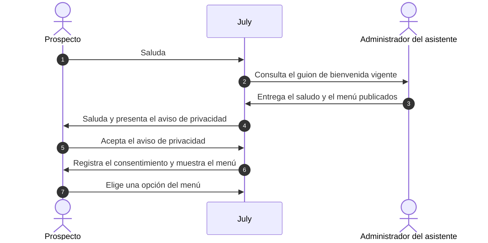

**Flujos alternativos**

| Paso | Interacción | CU nivel 3 |
|---|---|---|
| | *A1 · El prospecto no acepta el aviso (paso 5)* | |
| 5a | **Prospecto** rechaza el aviso de privacidad ante **July**. | 1.2.1.2 |
| 6a | **July** le explica que sin consentimiento solo puede darle información general y le ofrece el menú básico al **Prospecto**. Fin. | 1.2.1.2 |
| | *A2 · El prospecto pide hablar con una persona (paso 7)* | |
| 7a | **Prospecto** pide hablar con una persona a **July**. | 1.2.1.3 |
| 8a | **July** deriva la conversación con su historial al **Asesor comercial**. | 1.2.1.3 |
| 9a | **Asesor comercial** toma la conversación y saluda al **Prospecto**. Fin. | 1.2.1.3 |

**Casos de nivel 3 incluidos**

| ID | Caso de uso | Actor externo | Capacidad nivel 3 | Pasos |
|---|---|---|---|---|
| 1.2.1.1 | Recibir saludo y menú de opciones | Administrador del asistente | 1.2.1.1 Respuesta automática | 1, 2, 3, 6, 7 |
| 1.2.1.2 | Aceptar el aviso de privacidad | Ninguno, lo resuelve July | 1.2.1.2 Consentimiento de datos | 4, 5, 6, 5a, 6a |
| 1.2.1.3 | Derivar a un asesor humano | Asesor comercial | 1.2.1.3 Derivación a asesor | 7a, 8a, 9a |

#### CU 1.2.2 · Identificar al prospecto y su necesidad

| Campo | Especificación |
|---|---|
| Nivel | 2 · incluido por [CU 1.2](#cu-1-2) |
| Capacidad | 1.2.2 Identificación del prospecto |
| Actor principal | Prospecto |
| Actores secundarios | Sistema core |
| Objetivo | Saber qué línea de crédito busca la persona, si ya es socia, y dejar el lead registrado desde el primer contacto. |
| Disparador | El prospecto elige una opción del menú o escribe lo que necesita. |
| Precondiciones | El prospecto aceptó el aviso de privacidad (CU 1.2.1). |
| Postcondiciones | El lead está registrado con su intención, su condición de socio y un número de seguimiento. |

**Flujo principal**

| Paso | Interacción | CU nivel 3 |
|---|---|---|
| 1 | **Prospecto** cuenta qué necesita a **July**. | 1.2.2.1 |
| 2 | **July** identifica la intención de crédito y le confirma la línea que entendió al **Prospecto**. | 1.2.2.1 |
| 3 | **Prospecto** confirma la línea de crédito a **July**. | 1.2.2.1 |
| 4 | **July** consulta si el número de teléfono pertenece a un socio al **Sistema core**. | 1.2.2.2 |
| 5 | **Sistema core** responde si es socio y desde cuándo a **July**. | 1.2.2.2 |
| 6 | **July** registra el lead con su intención y condición de socio y le entrega el número de seguimiento al **Prospecto**. | 1.2.2.3 |

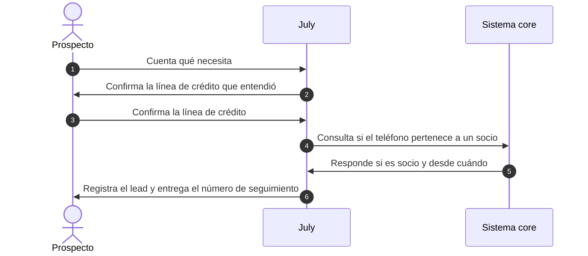

**Flujos alternativos**

| Paso | Interacción | CU nivel 3 |
|---|---|---|
| | *A1 · July no reconoce la intención (paso 2)* | |
| 2a | **July** reformula la pregunta con opciones cerradas para el **Prospecto**. Vuelve al paso 3. | 1.2.2.1 |
| | *A2 · Es una pregunta frecuente, no una solicitud de crédito (paso 2)* | |
| 2b | **July** responde la pregunta frecuente y le ofrece el menú al **Prospecto**. Fin. | 1.2.2.1 |
| | *A3 · El Sistema core no responde a tiempo (paso 5)* | |
| 5a | **Sistema core** devuelve un error de tiempo de espera a **July**. | 1.2.2.2 |
| 6a | **July** registra el lead como «socio por verificar» y le entrega el número de seguimiento al **Prospecto**. Fin. | 1.2.2.3 |

**Casos de nivel 3 incluidos**

| ID | Caso de uso | Actor externo | Capacidad nivel 3 | Pasos |
|---|---|---|---|---|
| 1.2.2.1 | Detectar la intención de crédito | Ninguno, lo resuelve July | 1.2.2.1 Detección de intención | 1, 2, 3, 2a, 2b |
| 1.2.2.2 | Reconocer si ya es socio | Sistema core | 1.2.2.2 Reconocimiento de socio | 4, 5, 5a |
| 1.2.2.3 | Registrar el lead | Ninguno, lo resuelve July | 1.2.2.3 Registro del lead | 6, 6a |

---

## Flujo de valor 2 · Captura, simulación y precalificación

Objetivo del flujo: convertir la conversación en un prospecto evaluado. Diagrama fuente: [`casos-de-uso-flujo-02-captura-simulacion-y-precalificacion.drawio`](casos-de-uso-flujo-02-captura-simulacion-y-precalificacion.drawio).

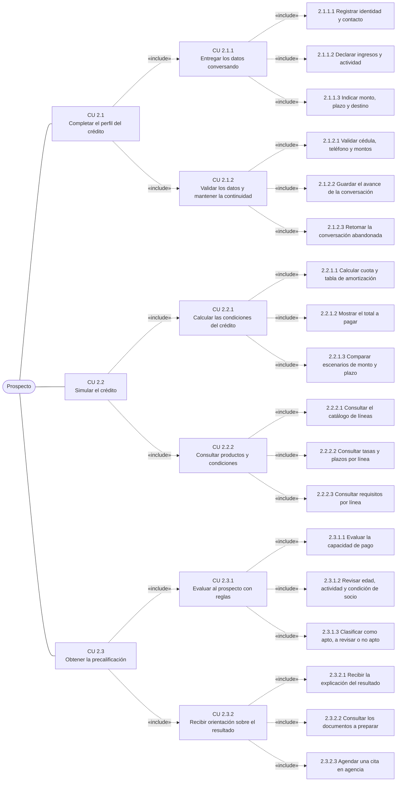

### CU 2.1 · Completar el perfil del crédito (nivel 1)

**Etapa:** Perfilamiento · **Capacidad:** 2.1 Perfilamiento · **Actor principal:** Prospecto · **Incluye:** CU 2.1.1 y CU 2.1.2

| Paso | Interacción | Caso incluido |
|---|---|---|
| 1 | **Prospecto** entrega sus datos conversando a **July**. | CU 2.1.1 |
| 2 | **July** valida los datos, guarda el avance y le confirma el perfil completo al **Prospecto**. | CU 2.1.2 |

#### CU 2.1.1 · Entregar los datos conversando

| Campo | Especificación |
|---|---|
| Nivel | 2 · incluido por [CU 2.1](#cu-2-1) |
| Capacidad | 2.1.1 Captura conversacional |
| Actor principal | Prospecto |
| Actores secundarios | Ninguno, lo resuelve July |
| Objetivo | Reunir, conversando y sin formularios, los datos que necesitan la simulación y la precalificación. |
| Disparador | El prospecto pide iniciar su solicitud de crédito. |
| Precondiciones | El lead está registrado y aceptó el aviso de privacidad (flujo 1). |
| Postcondiciones | July tiene identidad, contacto, ingresos, actividad, monto, plazo y destino confirmados por el prospecto. |

**Flujo principal**

| Paso | Interacción | CU nivel 3 |
|---|---|---|
| 1 | **Prospecto** pide iniciar su solicitud de crédito a **July**. | 2.1.1.1 |
| 2 | **July** le pide sus nombres, cédula y correo al **Prospecto**. | 2.1.1.1 |
| 3 | **Prospecto** entrega sus datos de identidad y contacto a **July**. | 2.1.1.1 |
| 4 | **July** le pregunta por sus ingresos mensuales y su actividad económica al **Prospecto**. | 2.1.1.2 |
| 5 | **Prospecto** declara sus ingresos y su actividad a **July**. | 2.1.1.2 |
| 6 | **July** le pregunta el monto, el plazo y el destino del crédito al **Prospecto**. | 2.1.1.3 |
| 7 | **Prospecto** indica el monto, el plazo y el destino a **July**. | 2.1.1.3 |
| 8 | **July** resume los datos y le pide confirmarlos al **Prospecto**. | 2.1.1.1, 2.1.1.2, 2.1.1.3 |
| 9 | **Prospecto** confirma el resumen a **July**. | 2.1.1.1, 2.1.1.2, 2.1.1.3 |

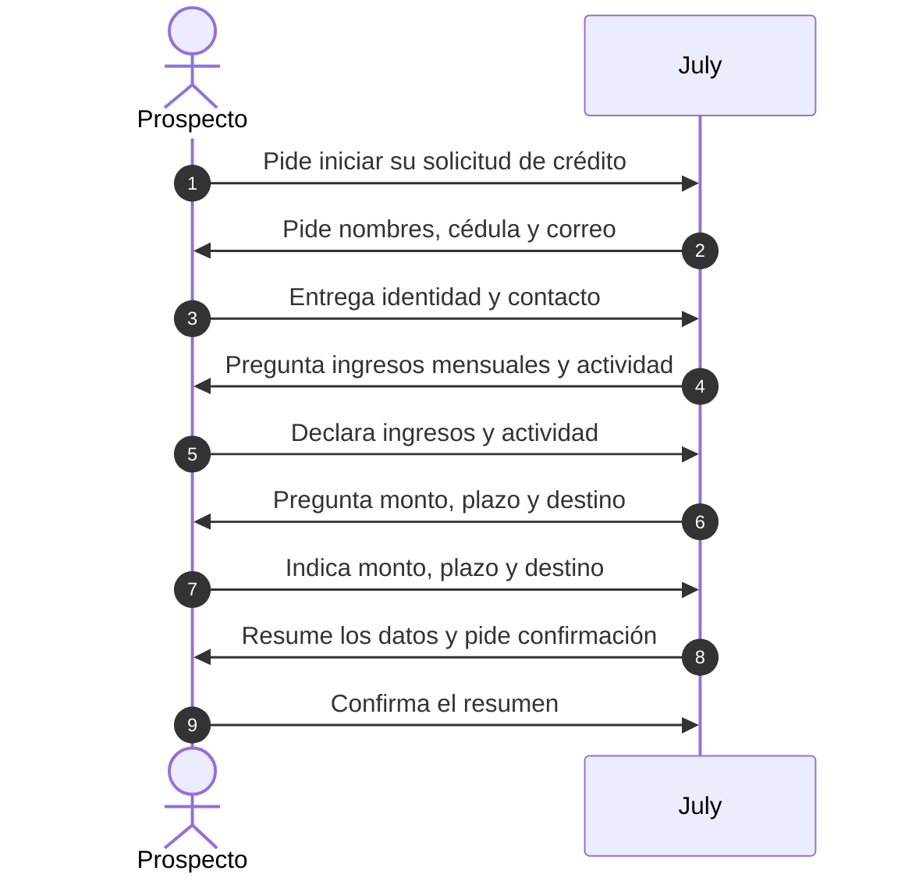

**Flujos alternativos**

| Paso | Interacción | CU nivel 3 |
|---|---|---|
| | *A1 · El prospecto ya es socio (paso 2)* | |
| 2a | **July** le muestra los datos de identidad que ya conoce y le pide confirmarlos al **Prospecto**. Continúa en el paso 3. | 2.1.1.1 |
| | *A2 · El prospecto corrige un dato (paso 9)* | |
| 9a | **Prospecto** corrige el dato equivocado ante **July**. Vuelve al paso 8. | 2.1.1.1, 2.1.1.2, 2.1.1.3 |

**Casos de nivel 3 incluidos**

| ID | Caso de uso | Actor externo | Capacidad nivel 3 | Pasos |
|---|---|---|---|---|
| 2.1.1.1 | Registrar identidad y contacto | Ninguno, lo resuelve July | 2.1.1.1 Identidad y contacto | 1, 2, 3, 8, 9, 2a, 9a |
| 2.1.1.2 | Declarar ingresos y actividad | Ninguno, lo resuelve July | 2.1.1.2 Ingresos y actividad | 4, 5, 8, 9, 9a |
| 2.1.1.3 | Indicar monto, plazo y destino | Ninguno, lo resuelve July | 2.1.1.3 Monto, plazo y destino | 6, 7, 8, 9, 9a |

#### CU 2.1.2 · Validar los datos y mantener la continuidad

| Campo | Especificación |
|---|---|
| Nivel | 2 · incluido por [CU 2.1](#cu-2-1) |
| Capacidad | 2.1.2 Validación y continuidad |
| Actor principal | Prospecto |
| Actores secundarios | Sistema core, WhatsApp Business API |
| Objetivo | Validar cada dato al recibirlo, guardar el avance y retomar la conversación si el prospecto la abandona, sin volver a pedirle lo que ya dio. |
| Disparador | El prospecto entrega un dato durante CU 2.1.1. |
| Precondiciones | Hay una conversación de captura en curso. |
| Postcondiciones | El dato quedó validado y guardado, o el prospecto recibió un recordatorio para retomar. |

**Flujo principal**

| Paso | Interacción | CU nivel 3 |
|---|---|---|
| 1 | **Prospecto** entrega un dato (cédula, teléfono o monto) a **July**. | 2.1.2.1 |
| 2 | **July** valida el formato y verifica la cédula con el **Sistema core**. | 2.1.2.1 |
| 3 | **Sistema core** confirma que la cédula es válida a **July**. | 2.1.2.1 |
| 4 | **July** guarda el avance de la conversación y le confirma el dato al **Prospecto**. | 2.1.2.2 |

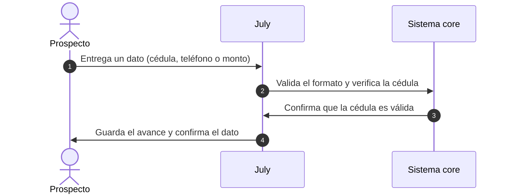

**Flujos alternativos**

| Paso | Interacción | CU nivel 3 |
|---|---|---|
| | *A1 · El dato no es válido (paso 3)* | |
| 3a | **Sistema core** informa que la cédula no es válida a **July**. | 2.1.2.1 |
| 4a | **July** le explica el error y le vuelve a pedir el dato al **Prospecto**. Vuelve al paso 1. | 2.1.2.1 |
| | *A2 · El prospecto abandona la conversación (después del paso 4)* | |
| 5a | **Prospecto** deja de responder a **July**. | 2.1.2.3 |
| 6a | **July** envía, al vencer el tiempo de espera, una plantilla de retoma a **WhatsApp Business API**. | 2.1.2.3 |
| 7a | **WhatsApp Business API** entrega la plantilla de retoma al **Prospecto**. | 2.1.2.3 |
| 8a | **Prospecto** responde al recordatorio a **July**. | 2.1.2.3 |
| 9a | **July** retoma desde el último dato guardado y le pide el siguiente al **Prospecto**. Vuelve al paso 1. | 2.1.2.2, 2.1.2.3 |

**Casos de nivel 3 incluidos**

| ID | Caso de uso | Actor externo | Capacidad nivel 3 | Pasos |
|---|---|---|---|---|
| 2.1.2.1 | Validar cédula, teléfono y montos | Sistema core | 2.1.2.1 Validación de formatos | 1, 2, 3, 3a, 4a |
| 2.1.2.2 | Guardar el avance de la conversación | Ninguno, lo resuelve July | 2.1.2.2 Guardado del avance | 4, 9a |
| 2.1.2.3 | Retomar la conversación abandonada | WhatsApp Business API | 2.1.2.3 Retoma tras abandono | 5a, 6a, 7a, 8a, 9a |

### CU 2.2 · Simular el crédito (nivel 1)

**Etapa:** Simulación financiera · **Capacidad:** 2.2 Simulación financiera · **Actor principal:** Prospecto · **Incluye:** CU 2.2.1 y CU 2.2.2

Primero se elige la línea (CU 2.2.2) y luego se calcula con sus condiciones (CU 2.2.1).

| Paso | Interacción | Caso incluido |
|---|---|---|
| 1 | **Prospecto** consulta las líneas de crédito y sus condiciones a **July**. | CU 2.2.2 |
| 2 | **July** le informa la tasa, los plazos y los requisitos de la línea elegida al **Prospecto**. | CU 2.2.2 |
| 3 | **Prospecto** pide simular su crédito a **July**. | CU 2.2.1 |
| 4 | **July** le presenta la cuota, el total a pagar y los escenarios comparados al **Prospecto**. | CU 2.2.1 |

#### CU 2.2.1 · Calcular las condiciones del crédito

| Campo | Especificación |
|---|---|
| Nivel | 2 · incluido por [CU 2.2](#cu-2-2) |
| Capacidad | 2.2.1 Cálculo del crédito |
| Actor principal | Prospecto |
| Actores secundarios | Ninguno, lo resuelve July |
| Objetivo | Mostrar cuánto pagaría la persona según la línea, el monto y el plazo, y dejarla comparar opciones. |
| Disparador | El prospecto pide simular su crédito. |
| Precondiciones | Hay una línea elegida con su tasa y plazos vigentes (CU 2.2.2) y un monto y plazo declarados (CU 2.1.1). |
| Postcondiciones | El prospecto eligió un escenario y July lo guardó para la precalificación. |

**Flujo principal**

| Paso | Interacción | CU nivel 3 |
|---|---|---|
| 1 | **Prospecto** pide simular su crédito a **July**. | 2.2.1.1 |
| 2 | **July** le presenta la cuota mensual y la tabla de amortización al **Prospecto**. | 2.2.1.1 |
| 3 | **Prospecto** pide el detalle del costo total a **July**. | 2.2.1.2 |
| 4 | **July** le muestra el total a pagar con intereses, seguros y cargos al **Prospecto**. | 2.2.1.2 |
| 5 | **Prospecto** pide comparar con otro monto o plazo a **July**. | 2.2.1.3 |
| 6 | **July** le presenta los escenarios lado a lado al **Prospecto**. | 2.2.1.3 |
| 7 | **Prospecto** elige el escenario que le conviene y se lo confirma a **July**. | 2.2.1.3 |

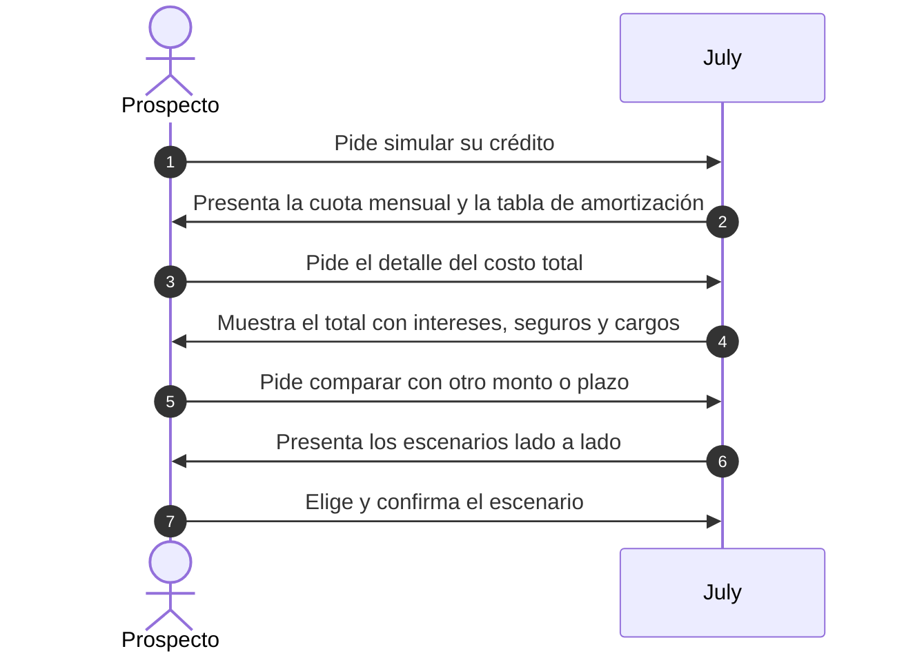

**Flujos alternativos**

| Paso | Interacción | CU nivel 3 |
|---|---|---|
| | *A1 · El monto está fuera del rango de la línea (paso 2)* | |
| 2a | **July** le informa los montos mínimo y máximo de la línea al **Prospecto**. Vuelve al paso 1. | 2.2.1.1 |
| | *A2 · El prospecto no quiere comparar (paso 5)* | |
| 5a | **Prospecto** acepta la simulación inicial ante **July**. Fin. | 2.2.1.1 |

**Casos de nivel 3 incluidos**

| ID | Caso de uso | Actor externo | Capacidad nivel 3 | Pasos |
|---|---|---|---|---|
| 2.2.1.1 | Calcular cuota y tabla de amortización | Ninguno, lo resuelve July | 2.2.1.1 Cuota y amortización | 1, 2, 2a, 5a |
| 2.2.1.2 | Mostrar el total a pagar | Ninguno, lo resuelve July | 2.2.1.2 Total a pagar | 3, 4 |
| 2.2.1.3 | Comparar escenarios de monto y plazo | Ninguno, lo resuelve July | 2.2.1.3 Comparación de escenarios | 5, 6, 7 |

#### CU 2.2.2 · Consultar productos y condiciones

| Campo | Especificación |
|---|---|
| Nivel | 2 · incluido por [CU 2.2](#cu-2-2) |
| Capacidad | 2.2.2 Productos y condiciones |
| Actor principal | Prospecto |
| Actores secundarios | Área de productos y crédito |
| Objetivo | Que el prospecto conozca las líneas de crédito vigentes con su tasa, plazos y requisitos. |
| Disparador | El prospecto pregunta qué créditos ofrece la cooperativa. |
| Precondiciones | El Área de productos y crédito publicó el catálogo vigente. |
| Postcondiciones | El prospecto eligió una línea y conoce sus condiciones. |

**Flujo principal**

| Paso | Interacción | CU nivel 3 |
|---|---|---|
| 1 | **Prospecto** pregunta qué créditos ofrece la cooperativa a **July**. | 2.2.2.1 |
| 2 | **July** consulta el catálogo vigente de líneas al **Área de productos y crédito**. | 2.2.2.1 |
| 3 | **Área de productos y crédito** entrega, mediante el catálogo publicado, las líneas disponibles a **July**. | 2.2.2.1 |
| 4 | **July** le presenta las líneas de crédito al **Prospecto**. | 2.2.2.1 |
| 5 | **Prospecto** elige una línea y pregunta sus condiciones a **July**. | 2.2.2.2 |
| 6 | **July** consulta la tasa, los plazos y los requisitos de la línea al **Área de productos y crédito**. | 2.2.2.2, 2.2.2.3 |
| 7 | **Área de productos y crédito** entrega la tasa, los plazos y los requisitos vigentes a **July**. | 2.2.2.2, 2.2.2.3 |
| 8 | **July** le informa la tasa, los plazos y los requisitos de la línea al **Prospecto**. | 2.2.2.2, 2.2.2.3 |

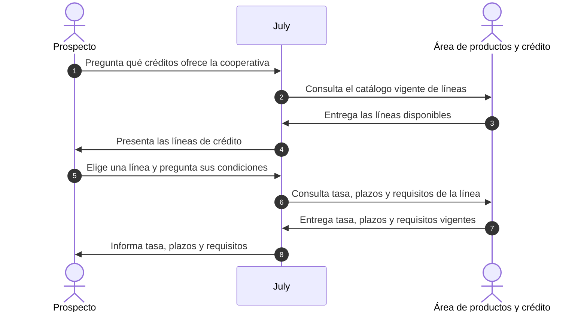

**Flujos alternativos**

| Paso | Interacción | CU nivel 3 |
|---|---|---|
| | *A1 · La línea elegida ya no está vigente (paso 7)* | |
| 7a | **Área de productos y crédito** marca la línea como no vigente para **July**. | 2.2.2.2 |
| 8a | **July** le ofrece las líneas alternativas al **Prospecto**. Vuelve al paso 5. | 2.2.2.1 |

**Casos de nivel 3 incluidos**

| ID | Caso de uso | Actor externo | Capacidad nivel 3 | Pasos |
|---|---|---|---|---|
| 2.2.2.1 | Consultar el catálogo de líneas | Área de productos y crédito | 2.2.2.1 Catálogo de líneas | 1, 2, 3, 4, 8a |
| 2.2.2.2 | Consultar tasas y plazos por línea | Área de productos y crédito | 2.2.2.2 Tasas y plazos por línea | 5, 6, 7, 8, 7a |
| 2.2.2.3 | Consultar requisitos por línea | Área de productos y crédito | 2.2.2.3 Requisitos por línea | 6, 7, 8 |

### CU 2.3 · Obtener la precalificación (nivel 1)

**Etapa:** Precalificación · **Capacidad:** 2.3 Precalificación · **Actor principal:** Prospecto · **Incluye:** CU 2.3.1 y CU 2.3.2

| Paso | Interacción | Caso incluido |
|---|---|---|
| 1 | **Prospecto** pide saber si califica a **July**. | CU 2.3.1 |
| 2 | **July** le comunica el resultado preliminar al **Prospecto**. | CU 2.3.1 |
| 3 | **Prospecto** pide orientación y una cita a **July**. | CU 2.3.2 |
| 4 | **July** le explica el resultado, le envía los documentos y le confirma la cita al **Prospecto**. | CU 2.3.2 |

#### CU 2.3.1 · Evaluar al prospecto con reglas

| Campo | Especificación |
|---|---|
| Nivel | 2 · incluido por [CU 2.3](#cu-2-3) |
| Capacidad | 2.3.1 Evaluación por reglas |
| Actor principal | Prospecto |
| Actores secundarios | Comité de crédito, Sistema core |
| Objetivo | Dar una respuesta preliminar y no vinculante sobre la viabilidad del crédito con las reglas aprobadas por el Comité de crédito. |
| Disparador | El prospecto pide saber si califica, después de simular. |
| Precondiciones | El perfil está completo (CU 2.1) y hay un escenario elegido (CU 2.2). El Comité de crédito aprobó la tabla de decisión vigente. |
| Postcondiciones | El prospecto quedó clasificado como apto, a revisar o no apto, y conoce el resultado. |

**Flujo principal**

| Paso | Interacción | CU nivel 3 |
|---|---|---|
| 1 | **Prospecto** pide saber si califica a **July**. | 2.3.1.1 |
| 2 | **July** consulta las reglas de precalificación vigentes al **Comité de crédito**. | 2.3.1.1, 2.3.1.3 |
| 3 | **Comité de crédito** entrega, mediante la tabla de decisión aprobada, los límites de capacidad de pago y los criterios de clasificación a **July**. | 2.3.1.1, 2.3.1.3 |
| 4 | **July** solicita la edad, la actividad y la condición de socio del prospecto al **Sistema core**. | 2.3.1.2 |
| 5 | **Sistema core** responde con la edad, la actividad registrada y la condición de socio a **July**. | 2.3.1.2 |
| 6 | **July** calcula la capacidad de pago, clasifica al prospecto como apto o no apto y le comunica el resultado preliminar al **Prospecto**. | 2.3.1.1, 2.3.1.3 |

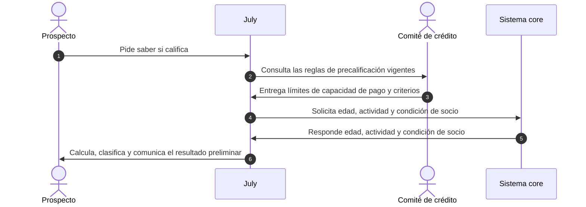

**Flujos alternativos**

| Paso | Interacción | CU nivel 3 |
|---|---|---|
| | *A1 · El Sistema core no tiene registro del prospecto (paso 5)* | |
| 5a | **Sistema core** responde que no tiene registro de la persona a **July**. | 2.3.1.2 |
| 6a | **July** evalúa solo con los datos declarados y le comunica un resultado condicionado al **Prospecto**. Fin. | 2.3.1.1, 2.3.1.3 |
| | *A2 · El caso queda «a revisar» (paso 6)* | |
| 6b | **July** clasifica el caso como «a revisar» y lo envía para revisión al **Comité de crédito**. | 2.3.1.3 |
| 7b | **Comité de crédito** registra el caso en su bandeja de revisión y confirma la recepción a **July**. | 2.3.1.3 |
| 8b | **July** le informa que un analista revisará su caso al **Prospecto**. Fin. | 2.3.1.3 |

**Casos de nivel 3 incluidos**

| ID | Caso de uso | Actor externo | Capacidad nivel 3 | Pasos |
|---|---|---|---|---|
| 2.3.1.1 | Evaluar la capacidad de pago | Comité de crédito | 2.3.1.1 Capacidad de pago | 1, 2, 3, 6, 6a |
| 2.3.1.2 | Revisar edad, actividad y condición de socio | Sistema core | 2.3.1.2 Edad, actividad y socio | 4, 5, 5a |
| 2.3.1.3 | Clasificar como apto, a revisar o no apto | Comité de crédito | 2.3.1.3 Clasificación final | 2, 3, 6, 6a, 6b, 7b, 8b |

#### CU 2.3.2 · Recibir orientación sobre el resultado

| Campo | Especificación |
|---|---|
| Nivel | 2 · incluido por [CU 2.3](#cu-2-3) |
| Capacidad | 2.3.2 Orientación y requisitos |
| Actor principal | Prospecto |
| Actores secundarios | Personal de agencia |
| Objetivo | Que el prospecto entienda su resultado, sepa qué documentos preparar (y cómo hacerse socio si no lo es) y reserve una cita en agencia. |
| Disparador | El prospecto recibe su resultado de precalificación (CU 2.3.1). |
| Precondiciones | Existe un resultado de precalificación. El Personal de agencia mantiene su agenda publicada. |
| Postcondiciones | El prospecto tiene la lista de documentos y una cita confirmada en agencia. |

**Flujo principal**

| Paso | Interacción | CU nivel 3 |
|---|---|---|
| 1 | **Prospecto** pide entender su resultado a **July**. | 2.3.2.1 |
| 2 | **July** le explica el resultado y los factores que pesaron al **Prospecto**. | 2.3.2.1 |
| 3 | **Prospecto** pregunta qué debe preparar a **July**. | 2.3.2.2 |
| 4 | **July** le envía la lista de documentos según su línea y su condición de socio al **Prospecto**. | 2.3.2.2 |
| 5 | **Prospecto** pide una cita en agencia a **July**. | 2.3.2.3 |
| 6 | **July** consulta los horarios disponibles al **Personal de agencia**. | 2.3.2.3 |
| 7 | **Personal de agencia** entrega, mediante su agenda, los horarios libres a **July**. | 2.3.2.3 |
| 8 | **July** le ofrece los horarios al **Prospecto**. | 2.3.2.3 |
| 9 | **Prospecto** elige un horario y se lo indica a **July**. | 2.3.2.3 |
| 10 | **July** reserva la cita y se la notifica al **Personal de agencia**. | 2.3.2.3 |
| 11 | **Personal de agencia** confirma la reserva a **July**. | 2.3.2.3 |
| 12 | **July** le envía la confirmación de la cita al **Prospecto**. | 2.3.2.3 |

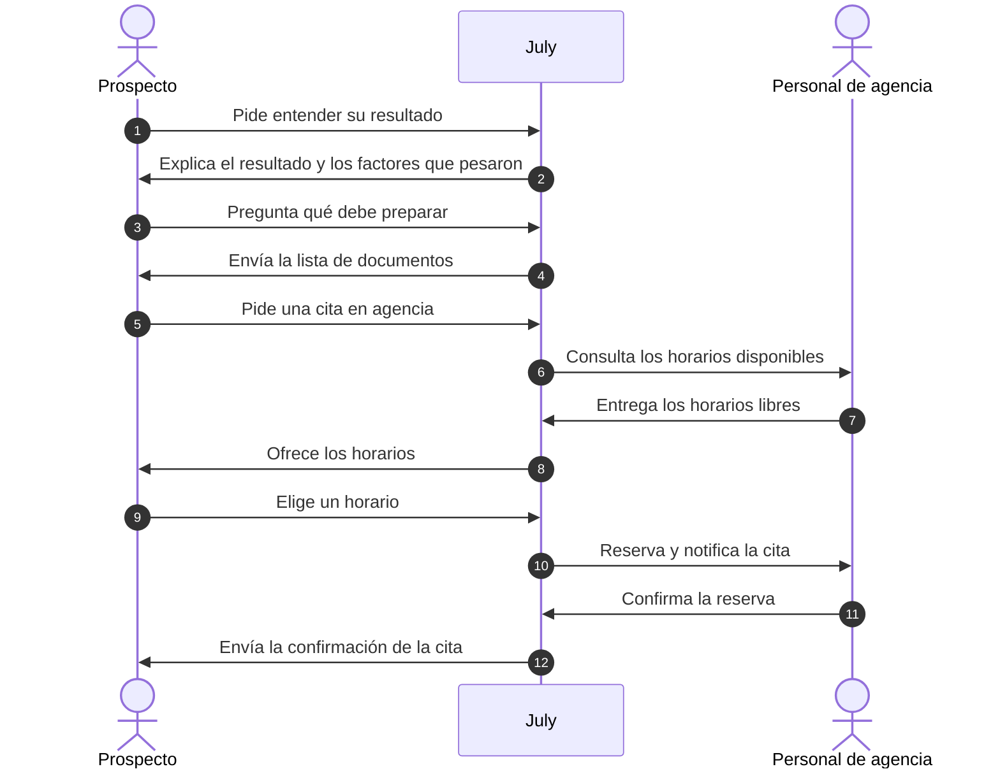

**Flujos alternativos**

| Paso | Interacción | CU nivel 3 |
|---|---|---|
| | *A1 · El resultado es «no apto» (paso 2)* | |
| 2a | **July** le explica el motivo y le sugiere otro monto o plazo al **Prospecto**. Fin, o vuelve a CU 2.2.1. | 2.3.2.1 |
| | *A2 · El prospecto no es socio (paso 4)* | |
| 4a | **July** le envía, junto con la lista de documentos, los pasos para hacerse socio al **Prospecto**. Continúa en el paso 5. | 2.3.2.2, 2.3.2.3 |
| | *A3 · No hay horarios libres (paso 7)* | |
| 7a | **Personal de agencia** informa que no tiene horarios libres en la fecha pedida a **July**. | 2.3.2.3 |
| 8a | **July** le ofrece las fechas libres más cercanas al **Prospecto**. Vuelve al paso 9. | 2.3.2.3 |

**Casos de nivel 3 incluidos**

| ID | Caso de uso | Actor externo | Capacidad nivel 3 | Pasos |
|---|---|---|---|---|
| 2.3.2.1 | Recibir la explicación del resultado | Ninguno, lo resuelve July | 2.3.2.1 Explicación del resultado | 1, 2, 2a |
| 2.3.2.2 | Consultar los documentos a preparar | Ninguno, lo resuelve July | 2.3.2.2 Documentos a preparar | 3, 4, 4a |
| 2.3.2.3 | Agendar una cita en agencia | Personal de agencia | 2.3.2.3 Afiliación y cita | 5 a 12, 4a, 7a, 8a |

---

## Flujo de valor 3 · Entrega, seguimiento y conversión

Objetivo del flujo: llevar el prospecto al asesor y al CRM hasta el desembolso. Diagrama fuente: [`casos-de-uso-flujo-03-entrega-seguimiento-y-conversion.drawio`](casos-de-uso-flujo-03-entrega-seguimiento-y-conversion.drawio).

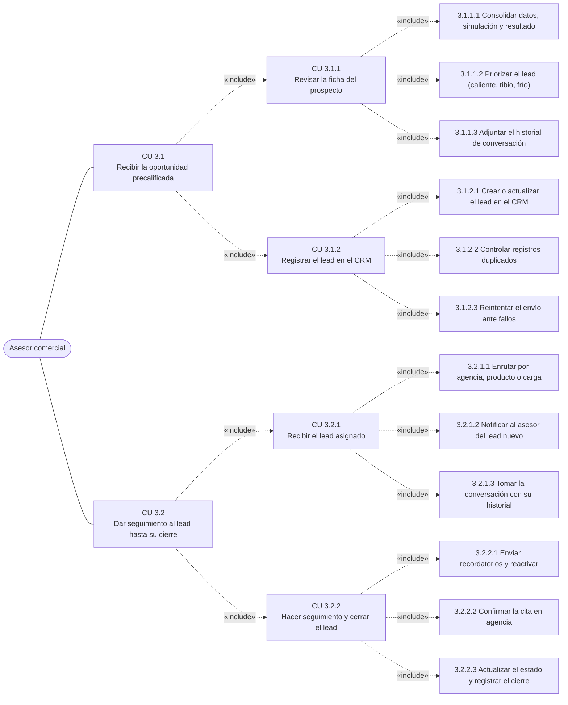

### CU 3.1 · Recibir la oportunidad precalificada (nivel 1)

**Etapa:** Entrega de oportunidades · **Capacidad:** 3.1 Entrega de oportunidades · **Actor principal:** Asesor comercial · **Incluye:** CU 3.1.1 y CU 3.1.2

| Paso | Interacción | Caso incluido |
|---|---|---|
| 1 | **Asesor comercial** abre la ficha del prospecto en **July**. | CU 3.1.1 |
| 2 | **July** le presenta la ficha consolidada, priorizada y con su historial al **Asesor comercial**. | CU 3.1.1 |
| 3 | **Asesor comercial** solicita registrar el lead en el CRM a **July**. | CU 3.1.2 |
| 4 | **July** registra el lead sin duplicados y le confirma el registro al **Asesor comercial**. | CU 3.1.2 |

#### CU 3.1.1 · Revisar la ficha del prospecto

| Campo | Especificación |
|---|---|
| Nivel | 2 · incluido por [CU 3.1](#cu-3-1) |
| Capacidad | 3.1.1 Generación de la ficha |
| Actor principal | Asesor comercial |
| Actores secundarios | Jefe comercial |
| Objetivo | Darle al asesor, en una sola ficha, todo lo que July sabe del prospecto, con su prioridad y su historial. |
| Disparador | El asesor abre un lead precalificado. |
| Precondiciones | El prospecto completó la precalificación (flujo 2). El Jefe comercial definió los criterios de prioridad. |
| Postcondiciones | El asesor tiene la ficha consolidada, priorizada y con el historial completo. |

**Flujo principal**

| Paso | Interacción | CU nivel 3 |
|---|---|---|
| 1 | **Asesor comercial** abre la ficha del prospecto en **July**. | 3.1.1.1 |
| 2 | **July** consulta los criterios de prioridad vigentes al **Jefe comercial**. | 3.1.1.2 |
| 3 | **Jefe comercial** entrega, mediante su configuración de priorización, los criterios de lead caliente, tibio o frío a **July**. | 3.1.1.2 |
| 4 | **July** le presenta la ficha consolidada (datos, simulación, resultado y prioridad) al **Asesor comercial**. | 3.1.1.1, 3.1.1.2 |
| 5 | **Asesor comercial** pide el historial de la conversación a **July**. | 3.1.1.3 |
| 6 | **July** le adjunta el historial completo de la conversación en la ficha al **Asesor comercial**. | 3.1.1.3 |

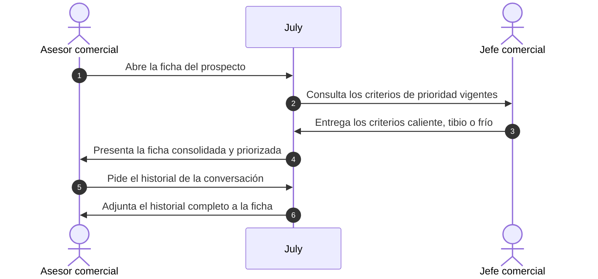

**Flujos alternativos**

| Paso | Interacción | CU nivel 3 |
|---|---|---|
| | *A1 · La ficha tiene datos incompletos (paso 4)* | |
| 4a | **July** le presenta la ficha con los datos faltantes marcados al **Asesor comercial**. Continúa en el paso 5. | 3.1.1.1 |

**Casos de nivel 3 incluidos**

| ID | Caso de uso | Actor externo | Capacidad nivel 3 | Pasos |
|---|---|---|---|---|
| 3.1.1.1 | Consolidar datos, simulación y resultado | Ninguno, lo resuelve July | 3.1.1.1 Consolidación de datos | 1, 4, 4a |
| 3.1.1.2 | Priorizar el lead (caliente, tibio, frío) | Jefe comercial | 3.1.1.2 Priorización del lead | 2, 3, 4 |
| 3.1.1.3 | Adjuntar el historial de conversación | Ninguno, lo resuelve July | 3.1.1.3 Historial de conversación | 5, 6 |

#### CU 3.1.2 · Registrar el lead en el CRM

| Campo | Especificación |
|---|---|
| Nivel | 2 · incluido por [CU 3.1](#cu-3-1) |
| Capacidad | 3.1.2 Integración con CRM |
| Actor principal | Asesor comercial |
| Actores secundarios | CRM de la cooperativa |
| Objetivo | Crear o actualizar el lead en el CRM sin intervención manual, sin duplicados y sin perderlo si el CRM falla. |
| Disparador | El asesor solicita registrar la ficha revisada en el CRM. |
| Precondiciones | La ficha del prospecto está generada (CU 3.1.1). |
| Postcondiciones | El lead existe una sola vez en el CRM, con su identificador enlazado en July. |

**Flujo principal**

| Paso | Interacción | CU nivel 3 |
|---|---|---|
| 1 | **Asesor comercial** solicita registrar la ficha en el CRM a **July**. | 3.1.2.1 |
| 2 | **July** busca si el lead ya existe por cédula y teléfono en el **CRM de la cooperativa**. | 3.1.2.2 |
| 3 | **CRM de la cooperativa** responde que no hay un registro previo a **July**. | 3.1.2.2 |
| 4 | **July** crea el lead con su ficha en el **CRM de la cooperativa**. | 3.1.2.1 |
| 5 | **CRM de la cooperativa** devuelve el identificador del lead a **July**. | 3.1.2.1 |
| 6 | **July** le confirma el registro con el enlace al CRM al **Asesor comercial**. | 3.1.2.1 |

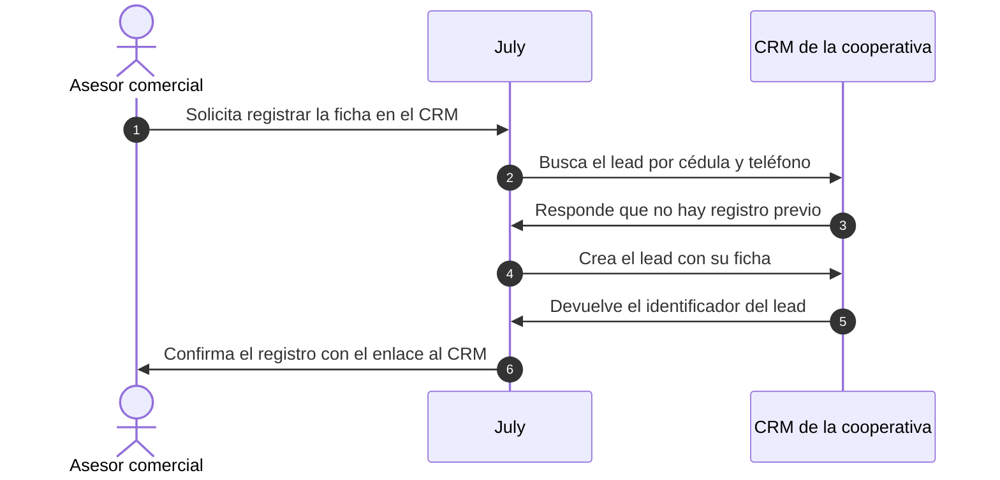

**Flujos alternativos**

| Paso | Interacción | CU nivel 3 |
|---|---|---|
| | *A1 · El lead ya existe en el CRM (paso 3)* | |
| 3a | **CRM de la cooperativa** responde con el registro existente a **July**. | 3.1.2.2 |
| 4a | **July** actualiza el registro existente en el **CRM de la cooperativa**. Continúa en el paso 5. | 3.1.2.1, 3.1.2.2 |
| | *A2 · El CRM falla (paso 5)* | |
| 5a | **CRM de la cooperativa** responde con un error a **July**. | 3.1.2.3 |
| 6a | **July** reintenta el envío con espera progresiva al **CRM de la cooperativa**. Vuelve al paso 5. | 3.1.2.3 |
| | *A3 · Se agotan los reintentos (en lugar del paso 6a)* | |
| 6b | **July** le avisa que el registro quedó pendiente al **Asesor comercial**. Fin. | 3.1.2.3 |

**Casos de nivel 3 incluidos**

| ID | Caso de uso | Actor externo | Capacidad nivel 3 | Pasos |
|---|---|---|---|---|
| 3.1.2.1 | Crear o actualizar el lead en el CRM | CRM de la cooperativa | 3.1.2.1 Alta o actualización | 1, 4, 5, 6, 4a |
| 3.1.2.2 | Controlar registros duplicados | CRM de la cooperativa | 3.1.2.2 Control de duplicados | 2, 3, 3a, 4a |
| 3.1.2.3 | Reintentar el envío ante fallos | CRM de la cooperativa | 3.1.2.3 Reintentos ante fallos | 5a, 6a, 6b |

### CU 3.2 · Dar seguimiento al lead hasta su cierre (nivel 1)

**Etapa:** Asignación y seguimiento · **Capacidad:** 3.2 Asignación y seguimiento · **Actor principal:** Asesor comercial · **Incluye:** CU 3.2.1 y CU 3.2.2

| Paso | Interacción | Caso incluido |
|---|---|---|
| 1 | **Asesor comercial** marca su disponibilidad para recibir leads en **July**. | CU 3.2.1 |
| 2 | **July** le asigna y le notifica el lead nuevo al **Asesor comercial**. | CU 3.2.1 |
| 3 | **Asesor comercial** programa los recordatorios y registra el avance del lead en **July**. | CU 3.2.2 |
| 4 | **July** sincroniza el estado y el cierre del lead con el **CRM de la cooperativa**. | CU 3.2.2 |

#### CU 3.2.1 · Recibir el lead asignado

| Campo | Especificación |
|---|---|
| Nivel | 2 · incluido por [CU 3.2](#cu-3-2) |
| Capacidad | 3.2.1 Asignación a asesor |
| Actor principal | Asesor comercial |
| Actores secundarios | Jefe comercial, Prospecto |
| Objetivo | Poner cada lead en manos del asesor correcto, avisarle y que continúe la conversación sin volver a pedir datos. |
| Disparador | Hay un lead registrado en el CRM sin asesor asignado. |
| Precondiciones | El lead está en el CRM (CU 3.1.2). El Jefe comercial definió las reglas de enrutamiento. |
| Postcondiciones | El lead tiene un asesor asignado que ya continúa la conversación con el prospecto. |

**Flujo principal**

| Paso | Interacción | CU nivel 3 |
|---|---|---|
| 1 | **Asesor comercial** marca su disponibilidad para recibir leads en **July**. | 3.2.1.1 |
| 2 | **July** consulta las reglas de enrutamiento por agencia, producto y carga al **Jefe comercial**. | 3.2.1.1 |
| 3 | **Jefe comercial** entrega, mediante su configuración de enrutamiento, la regla aplicable a **July**. | 3.2.1.1 |
| 4 | **July** asigna el lead y se lo notifica al **Asesor comercial**. | 3.2.1.1, 3.2.1.2 |
| 5 | **Asesor comercial** toma la conversación con su historial en **July**. | 3.2.1.3 |
| 6 | **July** traspasa la conversación y le avisa del cambio al **Prospecto**. | 3.2.1.3 |
| 7 | **Prospecto** continúa la conversación con el **Asesor comercial**. | 3.2.1.3 |

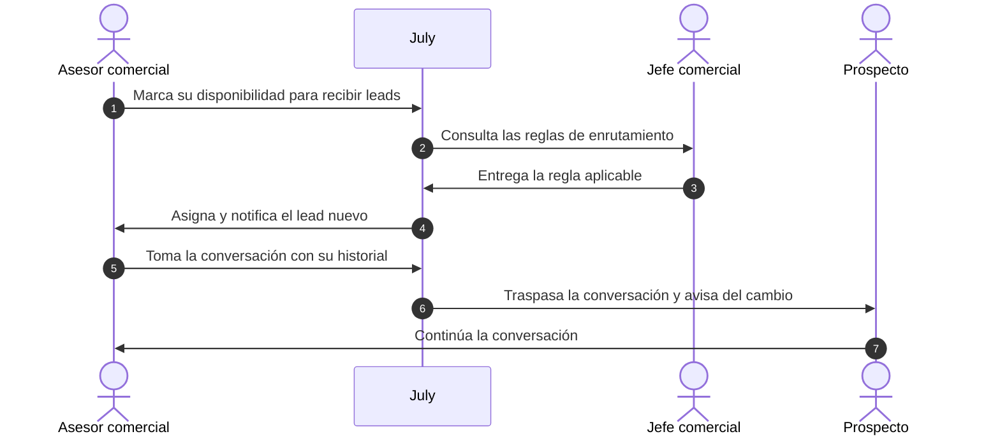

**Flujos alternativos**

| Paso | Interacción | CU nivel 3 |
|---|---|---|
| | *A1 · El asesor no toma el lead a tiempo (paso 5)* | |
| 5a | **Asesor comercial** deja vencer el plazo de atención en **July**. | 3.2.1.2 |
| 6a | **July** reasigna el lead al siguiente asesor disponible y se lo informa al **Jefe comercial**. Fin. | 3.2.1.1 |

**Casos de nivel 3 incluidos**

| ID | Caso de uso | Actor externo | Capacidad nivel 3 | Pasos |
|---|---|---|---|---|
| 3.2.1.1 | Enrutar por agencia, producto o carga | Jefe comercial | 3.2.1.1 Enrutamiento | 1, 2, 3, 4, 6a |
| 3.2.1.2 | Notificar al asesor del lead nuevo | Ninguno, lo resuelve July | 3.2.1.2 Notificación al asesor | 4, 5a |
| 3.2.1.3 | Tomar la conversación con su historial | Prospecto | 3.2.1.3 Traspaso con contexto | 5, 6, 7 |

#### CU 3.2.2 · Hacer seguimiento y cerrar el lead

| Campo | Especificación |
|---|---|
| Nivel | 2 · incluido por [CU 3.2](#cu-3-2) |
| Capacidad | 3.2.2 Seguimiento y cierre |
| Actor principal | Asesor comercial |
| Actores secundarios | Prospecto, WhatsApp Business API, Personal de agencia, Comité de crédito, CRM de la cooperativa, Jefe comercial |
| Objetivo | Llevar el lead hasta el desembolso o la pérdida: recordar pendientes, confirmar la cita, resolver el crédito y registrar el cierre con su motivo. |
| Disparador | El asesor tiene un lead asignado con documentos o cita pendientes. |
| Precondiciones | El lead está asignado (CU 3.2.1) y tiene una cita reservada (CU 2.3.2). |
| Postcondiciones | El lead quedó cerrado (desembolsado o perdido, con motivo) en July y en el CRM, y el embudo del Jefe comercial está actualizado. |

**Flujo principal**

| Paso | Interacción | CU nivel 3 |
|---|---|---|
| 1 | **Asesor comercial** programa un recordatorio de documentos y cita en **July**. | 3.2.2.1 |
| 2 | **July** envía la plantilla de recordatorio a **WhatsApp Business API**. | 3.2.2.1 |
| 3 | **WhatsApp Business API** entrega el recordatorio al **Prospecto**. | 3.2.2.1 |
| 4 | **Prospecto** confirma que asistirá a la cita a **July**. | 3.2.2.2 |
| 5 | **July** le confirma la asistencia del prospecto al **Personal de agencia**. | 3.2.2.2 |
| 6 | **Personal de agencia** atiende al prospecto en agencia y le reporta los documentos recibidos al **Asesor comercial**. | 3.2.2.2 |
| 7 | **Asesor comercial** envía la solicitud completa para su resolución al **Comité de crédito**. | 3.2.2.3 |
| 8 | **Comité de crédito** le comunica la resolución del crédito al **Asesor comercial**. | 3.2.2.3 |
| 9 | **Asesor comercial** registra el estado final del lead (desembolsado o perdido, con motivo) en **July**. | 3.2.2.3 |
| 10 | **July** sincroniza el estado y el cierre del lead con el **CRM de la cooperativa**. | 3.2.2.3 |
| 11 | **CRM de la cooperativa** actualiza el embudo comercial del **Jefe comercial**. | 3.2.2.3 |

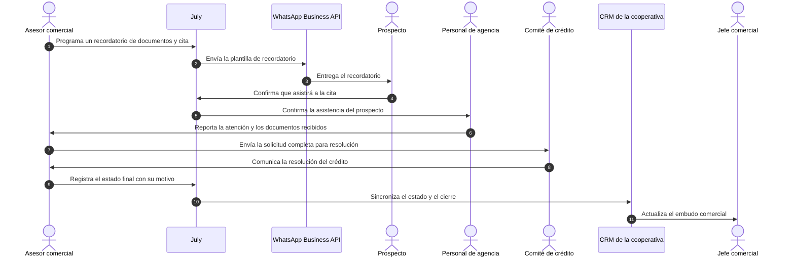

**Flujos alternativos**

| Paso | Interacción | CU nivel 3 |
|---|---|---|
| | *A1 · El prospecto no responde al recordatorio (paso 4)* | |
| 4a | **Prospecto** deja sin respuesta el recordatorio enviado por **July**. | 3.2.2.1 |
| 5a | **July** envía un mensaje de reactivación a **WhatsApp Business API**. Vuelve al paso 3. | 3.2.2.1 |
| | *A2 · Se agotan los intentos de reactivación (en lugar del paso 5a)* | |
| 5b | **July** marca el lead como frío y se lo informa al **Asesor comercial**. Continúa en el paso 9. | 3.2.2.1, 3.2.2.3 |
| | *A3 · El prospecto pide cambiar la cita (paso 4)* | |
| 4c | **Prospecto** pide cambiar la fecha de la cita a **July**. | 3.2.2.2 |
| 5c | **July** consulta un nuevo horario al **Personal de agencia**. | 3.2.2.2 |
| 6c | **Personal de agencia** confirma el nuevo horario a **July**. | 3.2.2.2 |
| 7c | **July** le envía la nueva cita al **Prospecto**. Vuelve al paso 4. | 3.2.2.2 |

**Casos de nivel 3 incluidos**

| ID | Caso de uso | Actor externo | Capacidad nivel 3 | Pasos |
|---|---|---|---|---|
| 3.2.2.1 | Enviar recordatorios y reactivar | Prospecto, WhatsApp Business API | 3.2.2.1 Recordatorios y reactivación | 1, 2, 3, 4a, 5a, 5b |
| 3.2.2.2 | Confirmar la cita en agencia | Prospecto, Personal de agencia | 3.2.2.2 Confirmación de citas | 4, 5, 6, 4c, 5c, 6c, 7c |
| 3.2.2.3 | Actualizar el estado y registrar el cierre | CRM de la cooperativa, Jefe comercial, Comité de crédito | 3.2.2.3 Estados y cierre | 7, 8, 9, 10, 11, 5b |

---

## Matriz de trazabilidad

Cada caso de nivel 3 con el caso de nivel 2 y de nivel 1 que lo incluyen, la capacidad del mapa que realiza y los actores que participan.

| Nivel 3 | Caso de uso | Nivel 2 | Nivel 1 | Capacidad nivel 3 | Actores externos |
|---|---|---|---|---|---|
| 1.1.1.1 | Recibir el mensaje por WhatsApp | [CU 1.1.1](#cu-1-1-1) | CU 1.1 | WhatsApp Business API | WhatsApp Business API |
| 1.1.1.2 | Abrir el chat desde el sitio web | [CU 1.1.1](#cu-1-1-1) | CU 1.1 | Widget web | Widget web |
| 1.1.1.3 | Etiquetar el origen de la conversación | [CU 1.1.1](#cu-1-1-1) | CU 1.1 | Registro de origen | Equipo de marketing |
| 1.1.2.1 | Convertir el mensaje a un formato común | [CU 1.1.2](#cu-1-1-2) | CU 1.1 | Formato común por canal | WhatsApp Business API, Widget web |
| 1.1.2.2 | Encolar mensajes en picos de demanda | [CU 1.1.2](#cu-1-1-2) | CU 1.1 | Absorción de picos | — |
| 1.1.2.3 | Verificar la firma del webhook | [CU 1.1.2](#cu-1-1-2) | CU 1.1 | Verificación de webhooks | WhatsApp Business API |
| 1.2.1.1 | Recibir saludo y menú de opciones | [CU 1.2.1](#cu-1-2-1) | CU 1.2 | Respuesta automática | Administrador del asistente |
| 1.2.1.2 | Aceptar el aviso de privacidad | [CU 1.2.1](#cu-1-2-1) | CU 1.2 | Consentimiento de datos | — |
| 1.2.1.3 | Derivar a un asesor humano | [CU 1.2.1](#cu-1-2-1) | CU 1.2 | Derivación a asesor | Asesor comercial |
| 1.2.2.1 | Detectar la intención de crédito | [CU 1.2.2](#cu-1-2-2) | CU 1.2 | Detección de intención | — |
| 1.2.2.2 | Reconocer si ya es socio | [CU 1.2.2](#cu-1-2-2) | CU 1.2 | Reconocimiento de socio | Sistema core |
| 1.2.2.3 | Registrar el lead | [CU 1.2.2](#cu-1-2-2) | CU 1.2 | Registro del lead | — |
| 2.1.1.1 | Registrar identidad y contacto | [CU 2.1.1](#cu-2-1-1) | CU 2.1 | Identidad y contacto | — |
| 2.1.1.2 | Declarar ingresos y actividad | [CU 2.1.1](#cu-2-1-1) | CU 2.1 | Ingresos y actividad | — |
| 2.1.1.3 | Indicar monto, plazo y destino | [CU 2.1.1](#cu-2-1-1) | CU 2.1 | Monto, plazo y destino | — |
| 2.1.2.1 | Validar cédula, teléfono y montos | [CU 2.1.2](#cu-2-1-2) | CU 2.1 | Validación de formatos | Sistema core |
| 2.1.2.2 | Guardar el avance de la conversación | [CU 2.1.2](#cu-2-1-2) | CU 2.1 | Guardado del avance | — |
| 2.1.2.3 | Retomar la conversación abandonada | [CU 2.1.2](#cu-2-1-2) | CU 2.1 | Retoma tras abandono | WhatsApp Business API |
| 2.2.1.1 | Calcular cuota y tabla de amortización | [CU 2.2.1](#cu-2-2-1) | CU 2.2 | Cuota y amortización | — |
| 2.2.1.2 | Mostrar el total a pagar | [CU 2.2.1](#cu-2-2-1) | CU 2.2 | Total a pagar | — |
| 2.2.1.3 | Comparar escenarios de monto y plazo | [CU 2.2.1](#cu-2-2-1) | CU 2.2 | Comparación de escenarios | — |
| 2.2.2.1 | Consultar el catálogo de líneas | [CU 2.2.2](#cu-2-2-2) | CU 2.2 | Catálogo de líneas | Área de productos y crédito |
| 2.2.2.2 | Consultar tasas y plazos por línea | [CU 2.2.2](#cu-2-2-2) | CU 2.2 | Tasas y plazos por línea | Área de productos y crédito |
| 2.2.2.3 | Consultar requisitos por línea | [CU 2.2.2](#cu-2-2-2) | CU 2.2 | Requisitos por línea | Área de productos y crédito |
| 2.3.1.1 | Evaluar la capacidad de pago | [CU 2.3.1](#cu-2-3-1) | CU 2.3 | Capacidad de pago | Comité de crédito |
| 2.3.1.2 | Revisar edad, actividad y condición de socio | [CU 2.3.1](#cu-2-3-1) | CU 2.3 | Edad, actividad y socio | Sistema core |
| 2.3.1.3 | Clasificar como apto, a revisar o no apto | [CU 2.3.1](#cu-2-3-1) | CU 2.3 | Clasificación final | Comité de crédito |
| 2.3.2.1 | Recibir la explicación del resultado | [CU 2.3.2](#cu-2-3-2) | CU 2.3 | Explicación del resultado | — |
| 2.3.2.2 | Consultar los documentos a preparar | [CU 2.3.2](#cu-2-3-2) | CU 2.3 | Documentos a preparar | — |
| 2.3.2.3 | Agendar una cita en agencia | [CU 2.3.2](#cu-2-3-2) | CU 2.3 | Afiliación y cita | Personal de agencia |
| 3.1.1.1 | Consolidar datos, simulación y resultado | [CU 3.1.1](#cu-3-1-1) | CU 3.1 | Consolidación de datos | — |
| 3.1.1.2 | Priorizar el lead (caliente, tibio, frío) | [CU 3.1.1](#cu-3-1-1) | CU 3.1 | Priorización del lead | Jefe comercial |
| 3.1.1.3 | Adjuntar el historial de conversación | [CU 3.1.1](#cu-3-1-1) | CU 3.1 | Historial de conversación | — |
| 3.1.2.1 | Crear o actualizar el lead en el CRM | [CU 3.1.2](#cu-3-1-2) | CU 3.1 | Alta o actualización | CRM de la cooperativa |
| 3.1.2.2 | Controlar registros duplicados | [CU 3.1.2](#cu-3-1-2) | CU 3.1 | Control de duplicados | CRM de la cooperativa |
| 3.1.2.3 | Reintentar el envío ante fallos | [CU 3.1.2](#cu-3-1-2) | CU 3.1 | Reintentos ante fallos | CRM de la cooperativa |
| 3.2.1.1 | Enrutar por agencia, producto o carga | [CU 3.2.1](#cu-3-2-1) | CU 3.2 | Enrutamiento | Jefe comercial |
| 3.2.1.2 | Notificar al asesor del lead nuevo | [CU 3.2.1](#cu-3-2-1) | CU 3.2 | Notificación al asesor | — |
| 3.2.1.3 | Tomar la conversación con su historial | [CU 3.2.1](#cu-3-2-1) | CU 3.2 | Traspaso con contexto | Prospecto |
| 3.2.2.1 | Enviar recordatorios y reactivar | [CU 3.2.2](#cu-3-2-2) | CU 3.2 | Recordatorios y reactivación | Prospecto, WhatsApp Business API |
| 3.2.2.2 | Confirmar la cita en agencia | [CU 3.2.2](#cu-3-2-2) | CU 3.2 | Confirmación de citas | Prospecto, Personal de agencia |
| 3.2.2.3 | Actualizar el estado y registrar el cierre | [CU 3.2.2](#cu-3-2-2) | CU 3.2 | Estados y cierre | CRM de la cooperativa, Jefe comercial, Comité de crédito |
