# Guía del negocio: cooperativa de ahorro y crédito y captación de prospectos

**ID:** NEG-01 · **Versión:** 1.0 · **Fecha:** 2026-10-24 · **Estado:** Borrador  
**Deriva de:** CAP-03 (mapa de capacidades y flujo de valor), CU-08 (especificaciones de casos de uso), CLS-01 (diccionario de datos)  
**Propósito:** preparar al equipo para conversar con los directivos de la Cooperativa Padre Julián Lorente: cómo funciona el negocio, cómo se capta y convierte a un prospecto, y qué términos se usarán en el reto de July.

> **Nota sobre las cifras.** Las tasas, porcentajes y montos de esta guía son **ilustrativos**, para entender la mecánica. Las tasas máximas, la segmentación y los umbrales vigentes los fijan la Junta de Política y Regulación Financiera (JPRF) y la SEPS, y las políticas internas las define cada cooperativa. Antes de la reunión, confírmalos con la cooperativa (ver [sección 12](#12-preguntas-para-llevar-a-la-reunión)).

## Contenido

1. [La idea en un minuto](#1-la-idea-en-un-minuto)
2. [Qué es una cooperativa de ahorro y crédito](#2-qué-es-una-cooperativa-de-ahorro-y-crédito)
3. [Quién manda: gobierno de la cooperativa](#3-quién-manda-gobierno-de-la-cooperativa)
4. [Marco regulatorio en Ecuador](#4-marco-regulatorio-en-ecuador)
5. [Cómo gana dinero: el modelo de negocio](#5-cómo-gana-dinero-el-modelo-de-negocio)
6. [Productos y servicios](#6-productos-y-servicios)
7. [El ciclo de vida del crédito](#7-el-ciclo-de-vida-del-crédito)
8. [Cómo se evalúa a un solicitante](#8-cómo-se-evalúa-a-un-solicitante)
9. [Matemática del crédito: tasas, cuotas y amortización](#9-matemática-del-crédito-tasas-cuotas-y-amortización)
10. [Salud financiera: indicadores que vigilan los dueños](#10-salud-financiera-indicadores-que-vigilan-los-dueños)
11. [Captación de prospectos: del interés al desembolso](#11-captación-de-prospectos-del-interés-al-desembolso)
12. [Preguntas para llevar a la reunión](#12-preguntas-para-llevar-a-la-reunión)
13. [Ejemplo completo: el caso de María](#13-ejemplo-completo-el-caso-de-maría)
14. [Diccionario de términos](#14-diccionario-de-términos)
15. [Fuentes para verificar](#15-fuentes-para-verificar)

---

## 1. La idea en un minuto

Una cooperativa de ahorro y crédito (COAC) es una **empresa financiera cuyos dueños son sus propios clientes**, los **socios**. Recibe el ahorro de unos socios y lo presta a otros. La diferencia entre lo que cobra por prestar y lo que paga por el ahorro es su **margen financiero**; con él cubre sus gastos, las pérdidas por créditos que no se pagan y crece su patrimonio.

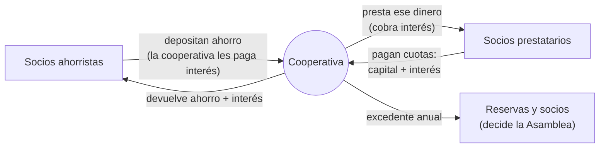

Tres ideas que hay que tener claras antes de hablar con los dueños:

| Idea | Por qué importa para July |
|---|---|
| **El crédito es el principal motor de ingresos.** Sin colocación no hay margen. | July existe para que entren más solicitudes buenas al embudo de crédito. |
| **Prestar mal cuesta más que no prestar.** Un crédito que cae en mora genera provisiones y pérdidas. | July **precalifica**, no aprueba: filtra y prioriza, pero la decisión es del área de crédito o el comité. |
| **El socio es dueño, no solo cliente.** La relación es de largo plazo. | La atención de July debe cuidar la confianza, la privacidad y la experiencia, no solo «vender». |

---

## 2. Qué es una cooperativa de ahorro y crédito

Una COAC es una organización del **sector financiero popular y solidario**. Se forma por personas que se unen voluntariamente para ahorrar y obtener crédito en condiciones que no conseguirían solas, sin fines de lucro en el sentido de repartir utilidades a inversionistas externos.

### 2.1 Cooperativa frente a banco

| Aspecto | Cooperativa de ahorro y crédito | Banco privado |
|---|---|---|
| Dueños | Los socios (clientes y dueños a la vez) | Accionistas, que pueden no ser clientes |
| Voto | **Un socio, un voto**, sin importar cuánto aporte | Un voto por acción |
| Quién recibe el excedente | Reservas de la cooperativa y socios, según decida la Asamblea | Accionistas, como dividendos |
| Para operar con ella | Hay que hacerse **socio** (aportar certificados de aportación) | Basta con ser cliente |
| Supervisor en Ecuador | SEPS | Superintendencia de Bancos |
| Enfoque típico | Microempresarios, comerciantes, agricultores, empleados, zonas fuera de las grandes ciudades | Segmentos diversos, más corporativo |
| Lenguaje | Socio, aporte, excedente | Cliente, acción, utilidad |

### 2.2 Principios cooperativos

Los siete principios de la Alianza Cooperativa Internacional orientan cómo se comporta la cooperativa. Sirven para entender por qué los dueños hablan de «servicio al socio» y de «inclusión»:

1. Membresía abierta y voluntaria.
2. Control democrático (un socio, un voto).
3. Participación económica de los socios (aportan capital y reciben el excedente).
4. Autonomía e independencia.
5. Educación, formación e información.
6. Cooperación entre cooperativas.
7. Compromiso con la comunidad.

> **Para la reunión:** cuando se presente July, conviene enmarcarla como una forma de **acercar la cooperativa al socio** (inclusión, atención 24/7, menos filas), no solo como una herramienta de ventas.

### 2.3 Socio, cliente, prospecto y lead

| Término | Quién es | Ejemplo |
|---|---|---|
| **Prospecto** | Persona que podría necesitar un producto y todavía no lo tiene | Alguien que escribe por WhatsApp preguntando por un crédito |
| **Lead** | El registro de ese prospecto con sus datos de contacto y su interés, listo para gestionarse | La ficha que July crea en el CRM |
| **Socio** | Persona que ya aportó sus certificados de aportación y tiene cuenta en la cooperativa | Quien tiene su cuenta de ahorros abierta |
| **Socio prestatario** | Socio con un crédito vigente | Quien paga su cuota cada mes |

En muchas cooperativas, **para recibir un crédito hay que ser socio**: si el prospecto no lo es, la apertura de la cuenta y el aporte inicial forman parte del proceso. Por eso July verifica la condición de socio (CU 1.2.2.2).

---

## 3. Quién manda: gobierno de la cooperativa

Los «dueños» con los que te vas a reunir pueden ser directivos de distintos órganos. Conviene saber qué decide cada uno.

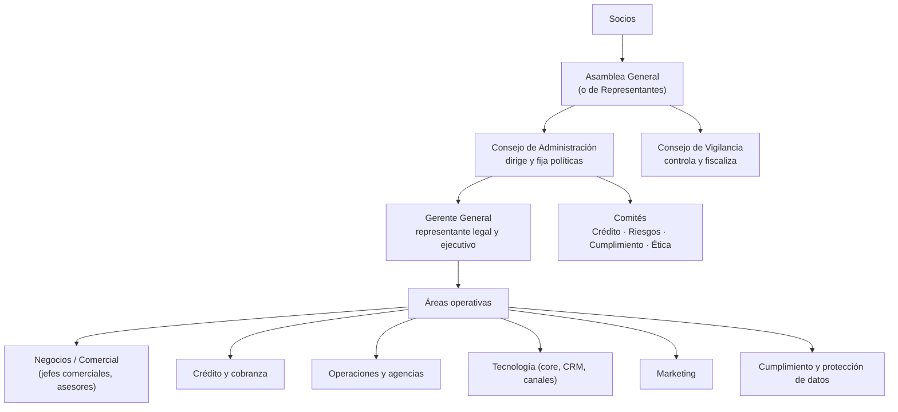

| Órgano o rol | Qué le importa | Cómo hablarle de July |
|---|---|---|
| **Asamblea / Consejo de Administración** | Crecimiento sano, imagen, riesgo, cumplimiento normativo | Más colocación con riesgo controlado y protección de datos garantizada |
| **Consejo de Vigilancia** | Que se cumplan la ley y las políticas | Trazabilidad: cada paso queda registrado; July no aprueba créditos |
| **Gerente General** | Metas de cartera, eficiencia, costo operativo | Menor costo por lead, respuesta inmediata, asesores enfocados en leads buenos |
| **Comité de Crédito** | Calidad de la cartera, morosidad | La precalificación usa sus reglas; los casos dudosos van «a revisar» |
| **Jefe comercial** | Metas por asesor y agencia | Priorización caliente/tibio/frío, enrutamiento por carga, seguimiento |
| **Marketing** | Origen de los leads, retorno de campañas | Etiquetado del origen de cada conversación |
| **Tecnología** | Integración con el core y el CRM, seguridad | Integraciones definidas, webhooks firmados, reintentos ante fallos |
| **Oficial de cumplimiento / Delegado de protección de datos** | LOPDP, prevención de lavado | Aviso de privacidad, consentimiento y retiro del consentimiento (reglas R1 y R2 de CU-08) |

---

## 4. Marco regulatorio en Ecuador

Ecuador está **dolarizado**: todo se opera en dólares estadounidenses, no hay riesgo cambiario y la **liquidez** es una preocupación permanente, porque no se puede emitir moneda.

| Norma o entidad | Qué es | Qué implica para el negocio |
|---|---|---|
| **Código Orgánico Monetario y Financiero (COMF)** | Ley marco del sistema financiero | Define tipos de entidades, tasas, segmentos de crédito |
| **Ley Orgánica de Economía Popular y Solidaria (LOEPS)** | Ley de las cooperativas y organizaciones solidarias | Gobierno cooperativo, socios, excedentes, reservas |
| **SEPS** (Superintendencia de Economía Popular y Solidaria) | Supervisor y controlador de las cooperativas | Publica el catastro, las estadísticas y las normas de control |
| **JPRF** (Junta de Política y Regulación Financiera) | Regulador | Fija las **tasas máximas** por segmento de crédito, la segmentación de cooperativas, la calificación de cartera y las provisiones |
| **Banco Central del Ecuador (BCE)** | Autoridad monetaria | Publica las tasas efectivas máximas y referenciales vigentes |
| **COSEDE** | Corporación del Seguro de Depósitos | Protege los depósitos de los socios hasta un tope por persona |
| **UAFE** | Unidad de Análisis Financiero y Económico | Prevención de lavado de activos: conocer al cliente, reportar operaciones inusuales |
| **LOPDP** (Ley Orgánica de Protección de Datos Personales, 2021) | Protección de datos personales | Consentimiento, finalidad, derechos del titular, delegado de protección de datos |
| **Burós de información crediticia** | Empresas que consolidan el historial de pagos | Se consultan para evaluar al solicitante, con su autorización |

### 4.1 Segmentación de cooperativas

La SEPS clasifica las cooperativas por el tamaño de sus **activos**. El segmento define cuánto se le exige en controles, reportes y capital.

| Segmento | Activos (USD) | Lectura |
|---|---|---|
| Segmento 1 | Más de 80 millones | Las más grandes; supervisión más estricta |
| Segmento 2 | 20 a 80 millones | Medianas |
| Segmento 3 | 5 a 20 millones | Pequeñas |
| Segmento 4 | 1 a 5 millones | Muy pequeñas |
| Segmento 5 | Hasta 1 millón (e incluye cajas de ahorro y bancos comunales) | Micro |

> Confirma en el catastro de la SEPS el segmento vigente de la Cooperativa Padre Julián Lorente (Loja). Saberlo te permite hablar con propiedad de su tamaño y sus exigencias regulatorias.

### 4.2 Segmentos de crédito

La regulación agrupa los créditos en **segmentos**, cada uno con su propia tasa máxima. Los principales para una cooperativa son:

| Segmento de crédito | Para qué | Quién lo pide normalmente |
|---|---|---|
| **Consumo** | Gastos personales: bienes, viajes, salud, deudas | Empleados dependientes, jubilados |
| **Microcrédito** (minorista, de acumulación simple y de acumulación ampliada, según las ventas del negocio) | Capital de trabajo o activos para un negocio pequeño | Comerciantes, agricultores, artesanos, emprendedores |
| **Inmobiliario** | Comprar, construir o remodelar vivienda (no de interés social) | Familias de ingresos medios |
| **Vivienda de interés social y público** | Primera vivienda de bajo valor, con condiciones preferentes | Familias de ingresos bajos y medios |
| **Productivo** | Proyectos de empresas más grandes | Pymes y empresas |
| **Educativo** | Estudios y formación | Estudiantes y familias |

---

## 5. Cómo gana dinero: el modelo de negocio

### 5.1 La intermediación financiera

El negocio central es la **intermediación**: captar ahorro barato y colocarlo en créditos a una tasa mayor, cuidando que se recupere.

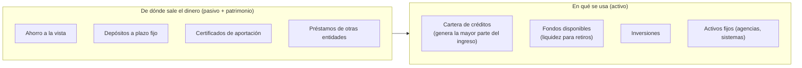

### 5.2 De los intereses al excedente

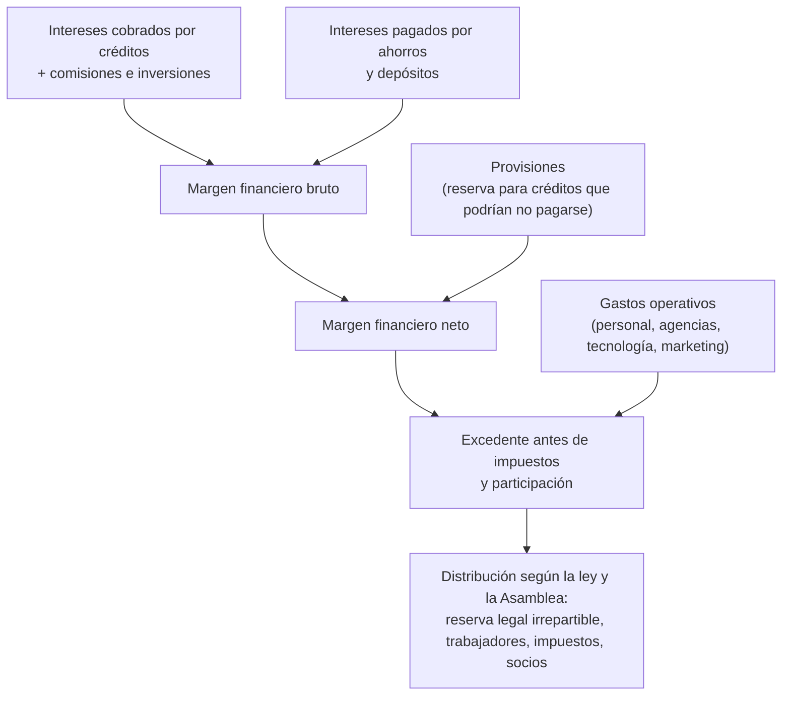

**Ejemplo numérico (ilustrativo, anual):**

| Concepto | Cálculo | USD |
|---|---|---|
| Cartera de créditos promedio | — | 8 000 000 |
| Depósitos de socios promedio | — | 10 000 000 |
| (+) Intereses ganados | 8 000 000 × 17 % | 1 360 000 |
| (−) Intereses pagados | 10 000 000 × 6 % | −600 000 |
| **= Margen financiero bruto** | | **760 000** |
| (−) Provisiones | 3 % de la cartera | −240 000 |
| (−) Gastos operativos | | −400 000 |
| **= Excedente** | | **120 000** |

Lo que muestra el ejemplo:

- Si la morosidad sube y las provisiones pasan del 3 % al 5 %, el excedente baja de 120 000 a **−40 000**: la cooperativa pierde. Por eso **prestar bien** es tan importante como prestar mucho.
- Si July baja el costo de atender y precalificar cada solicitud, reduce los gastos operativos y deja más excedente.

### 5.3 Composición típica del ingreso

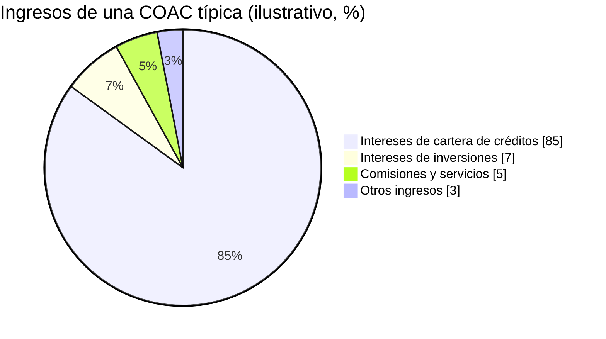

---

## 6. Productos y servicios

### 6.1 Captaciones (pasivo): lo que la cooperativa recibe

> Ojo con la palabra **captación**: en banca significa **recibir ahorro**. En el reto, «captación de prospectos» significa **atraer personas interesadas**. Conviene aclararlo al hablar con los dueños.

| Producto | Cómo funciona | Para la cooperativa |
|---|---|---|
| **Certificados de aportación** | Aporte de capital que convierte a la persona en socio; no se retira mientras sea socio | Patrimonio estable |
| **Ahorro a la vista** | Cuenta de libre disponibilidad, baja tasa | Fondeo barato pero volátil |
| **Ahorro programado** | El socio se compromete a depositar un monto periódico por un plazo (por ejemplo, ahorro navideño o escolar) | Fondeo estable y hábito de ahorro |
| **Depósito a plazo fijo (DPF)** | Dinero inmovilizado por un plazo (30, 90, 180, 360 días…) a una tasa mayor | Fondeo estable pero caro |
| **Ahorro encaje** | Porcentaje del crédito que el socio debe mantener ahorrado (no todas lo exigen) | Garantía parcial y fondeo |

### 6.2 Colocaciones (activo): lo que la cooperativa presta

| Producto (ejemplo) | Segmento | Monto y plazo típicos (ilustrativos) | Garantía habitual |
|---|---|---|---|
| Microcrédito para capital de trabajo | Microcrédito | 500 a 20 000 USD · 6 a 36 meses | Garante, sobre firma o prendaria |
| Crédito de consumo para empleados | Consumo | 1 000 a 30 000 USD · 12 a 60 meses | Sobre firma con rol de pagos o garante |
| Crédito agrícola o pecuario | Microcrédito / Productivo | Ajustado al ciclo de cosecha; puede tener **periodo de gracia** | Garante o prendaria |
| Crédito de vivienda | Inmobiliario / Vivienda social | 10 000 a 100 000 USD · 5 a 20 años | Hipotecaria |
| Crédito educativo | Educativo | Según el programa | Garante |

### 6.3 Servicios complementarios

Pago de servicios básicos, transferencias, recepción de remesas, tarjetas de débito, banca móvil, seguros (de desgravamen, de vida, médicos), servicios funerarios y fondos mortuorios, entre otros. Generan comisiones y, sobre todo, **fidelizan** al socio.

---

## 7. El ciclo de vida del crédito

El crédito es un proceso largo. July cubre **el principio** (atracción, captura, simulación, precalificación y entrega del lead). El resto lo hacen las personas y los sistemas de la cooperativa.

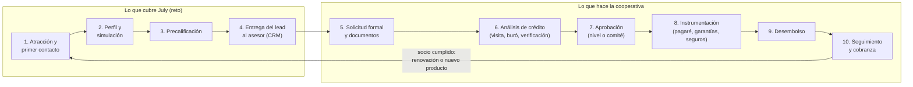

| Etapa | Qué pasa | Quién | Riesgo si falla |
|---|---|---|---|
| 1. Atracción | El prospecto conoce la oferta y escribe | Marketing, July | No llegan prospectos |
| 2. Perfil y simulación | Se piden monto, plazo, destino, ingresos; se calcula la cuota | July | El prospecto abandona por fricción |
| 3. Precalificación | Reglas rápidas: capacidad de pago, edad, actividad, condición de socio | July con reglas del Comité | Se pasan leads malos o se descartan buenos |
| 4. Entrega del lead | Ficha completa, prioridad y asignación al asesor | July, CRM, Jefe comercial | El lead se enfría sin atención |
| 5. Solicitud formal | Se completa la solicitud y se reciben los documentos | Asesor | Expedientes incompletos |
| 6. Análisis | Se verifica la información, se consulta el buró, se visita el negocio | Analista / asesor | Se aprueba un mal crédito |
| 7. Aprobación | Se decide según el monto (niveles de aprobación) | Jefe de agencia, Comité de crédito | Decisiones lentas o laxas |
| 8. Instrumentación | Firma del pagaré, tabla de amortización, garantías, seguros | Operaciones | Garantías mal constituidas |
| 9. Desembolso | El dinero se acredita en la cuenta del socio | Operaciones | Fraude, errores |
| 10. Seguimiento y cobranza | Recordatorios, gestión de mora, refinanciamiento o recuperación judicial | Cobranzas | Morosidad y pérdidas |

### 7.1 Estados del lead en July

Así se ve el ciclo de un lead dentro del modelo de July (enumeración `EstadoLead` de CLS-01):

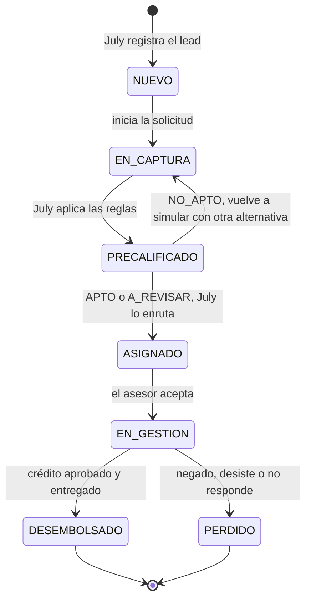

---

## 8. Cómo se evalúa a un solicitante

### 8.1 Las 5 C del crédito

Es el marco clásico que usa cualquier analista. July aplica una versión simplificada en la precalificación.

| C | Pregunta | Cómo se mide | ¿Lo ve July? |
|---|---|---|---|
| **Carácter** | ¿Es una persona que paga? | Historial en el buró, referencias, antigüedad como socio | No (lo revisa el analista) |
| **Capacidad** | ¿Le alcanza para pagar la cuota? | Ingresos − gastos − otras deudas | **Sí**, con los ingresos declarados |
| **Capital** | ¿Qué patrimonio tiene? | Bienes, ahorros, inventario del negocio | No |
| **Colateral** (garantía) | Si no paga, ¿con qué se recupera? | Garante, hipoteca, prenda, ahorro encaje | No |
| **Condiciones** | ¿El contexto favorece el pago? | Sector económico, estacionalidad, destino del crédito | Parcialmente (actividad y destino) |

### 8.2 Capacidad de pago (lo más importante en la precalificación)

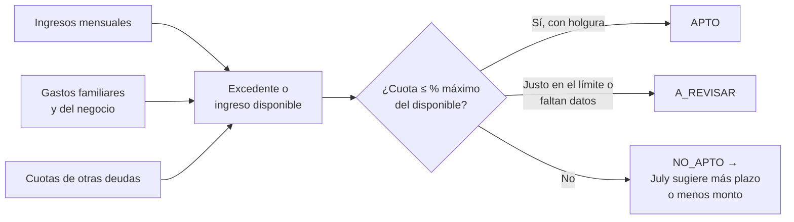

**Ejemplo:**

| Dato | Valor |
|---|---|
| Ingresos mensuales del negocio | 1 400 USD |
| Gastos del negocio y familiares | −950 USD |
| Cuotas de otras deudas | −150 USD |
| **Disponible** | **300 USD** |
| Porcentaje máximo del disponible que puede ir a la cuota (parámetro del Comité, `porcentajeMaximoCuota`) | 70 % |
| **Cuota máxima aceptable** | **210 USD** |

Si el prospecto pide 5 000 USD a 24 meses, la cuota sería de unos 249,62 USD (ver [sección 9](#9-matemática-del-crédito-tasas-cuotas-y-amortización)): **supera** los 210 USD. A 36 meses la cuota baja a unos 180,76 USD y **entra**. Eso es lo que hace July al sugerir una alternativa (`Simulacion.sugerirAlternativa()`).

Otras medidas que el analista usa y conviene reconocer:

- **Relación cuota/ingreso:** cuota ÷ ingreso total. Muchas políticas la limitan a un 30 % – 40 %.
- **Nivel de endeudamiento:** total de deudas ÷ patrimonio o ÷ ingresos.
- **Score crediticio:** puntaje del buró que resume el riesgo de impago.

### 8.3 Garantías

| Tipo | Qué es | Ejemplo |
|---|---|---|
| **Quirografaria / sobre firma** | Solo la firma del deudor en el pagaré | Empleado público con rol de pagos estable |
| **Personal (garante)** | Otra persona se obliga a pagar si el deudor no lo hace | Un familiar con ingresos firma como garante |
| **Prendaria** | Un bien mueble respalda el crédito | Un vehículo o maquinaria |
| **Hipotecaria** | Un inmueble respalda el crédito | La casa que se compra |
| **Ahorro encaje / pignoración** | Ahorros bloqueados que respaldan el crédito | 10 % del monto queda ahorrado |

---

## 9. Matemática del crédito: tasas, cuotas y amortización

### 9.1 Tasa nominal y tasa efectiva

- **Tasa nominal anual:** la tasa «de etiqueta». Si es 18 % anual con pagos mensuales, cada mes se cobra 18 % ÷ 12 = **1,5 %**.
- **Tasa efectiva anual (TEA):** lo que realmente cuesta en un año, porque el interés se capitaliza. Con 1,5 % mensual: (1 + 0,015)¹² − 1 = **19,56 %**.
- La regulación fija **tasas efectivas máximas** por segmento: ninguna cooperativa puede cobrar por encima.
- **Costo total del crédito:** intereses + seguros (por ejemplo, de **desgravamen**, que cancela la deuda si el deudor fallece) + cargos permitidos. July muestra el **total a pagar** (CU 2.2.1.2) para que el prospecto vea el costo real.

### 9.2 Sistema francés y sistema alemán

Son las dos formas de amortización más usadas. **Ejemplo: 1 200 USD a 6 meses, 18 % nominal anual (1,5 % mensual).**

**Sistema francés (cuota fija).** Se paga siempre lo mismo; al principio la cuota es casi todo interés y al final casi todo capital.

| Mes | Cuota | Capital | Interés | Saldo |
|---|---|---|---|---|
| 1 | 210,63 | 192,63 | 18,00 | 1 007,37 |
| 2 | 210,63 | 195,52 | 15,11 | 811,85 |
| 3 | 210,63 | 198,45 | 12,18 | 613,40 |
| 4 | 210,63 | 201,43 | 9,20 | 411,97 |
| 5 | 210,63 | 204,45 | 6,18 | 207,52 |
| 6 | 210,63 | 207,52 | 3,11 | 0,00 |
| **Total** | **1 263,78** | **1 200,00** | **63,78** | |

**Sistema alemán (capital fijo, cuota decreciente).** Se paga siempre el mismo capital; la cuota empieza más alta y baja cada mes.

| Mes | Cuota | Capital | Interés | Saldo |
|---|---|---|---|---|
| 1 | 218,00 | 200,00 | 18,00 | 1 000,00 |
| 2 | 215,00 | 200,00 | 15,00 | 800,00 |
| 3 | 212,00 | 200,00 | 12,00 | 600,00 |
| 4 | 209,00 | 200,00 | 9,00 | 400,00 |
| 5 | 206,00 | 200,00 | 6,00 | 200,00 |
| 6 | 203,00 | 200,00 | 3,00 | 0,00 |
| **Total** | **1 263,00** | **1 200,00** | **63,00** | |

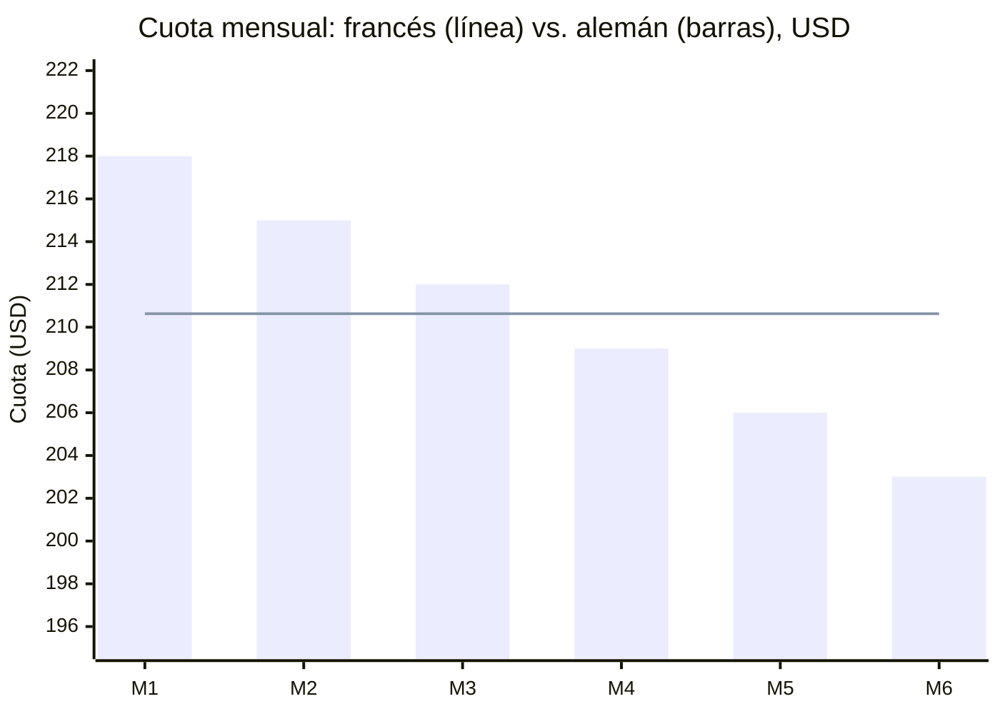

| | Francés | Alemán |
|---|---|---|
| Cuota | Fija, fácil de presupuestar | Decreciente; la primera es la más alta |
| Intereses totales | Algo mayores | Algo menores |
| Para la capacidad de pago | Se evalúa una sola cuota | Se evalúa la **primera** cuota (la mayor) |
| Uso típico | Consumo y microcrédito | Vivienda y créditos largos |

**Fórmula de la cuota francesa:**

$$\text{Cuota} = P \cdot \frac{i}{1 - (1 + i)^{-n}}$$

donde *P* es el monto, *i* la tasa del periodo y *n* el número de cuotas. Con *P* = 5 000, *i* = 0,015 y *n* = 24: cuota ≈ **249,62 USD**; total pagado ≈ 5 990,89 USD; intereses ≈ 990,89 USD.

### 9.3 Efecto del plazo

Alargar el plazo baja la cuota pero sube el costo total. Es la palanca principal para que un prospecto «entre» en su capacidad de pago.

| 5 000 USD al 18 % nominal | 24 meses | 36 meses |
|---|---|---|
| Cuota mensual | 249,62 | 180,76 |
| Total pagado | 5 990,89 | 6 507,43 |
| Intereses | 990,89 | 1 507,43 |

---

## 10. Salud financiera: indicadores que vigilan los dueños

Los directivos miran estos indicadores cada mes. Si los nombras con propiedad, la conversación cambia.

| Indicador | Fórmula simplificada | Qué dice | Señal de alerta (orientativa) |
|---|---|---|---|
| **Morosidad de cartera** | Cartera improductiva ÷ cartera total | Qué parte de los créditos no se está pagando | Que suba mes a mes; en microcrédito suele ser más alta que en consumo |
| **Cobertura de cartera problemática** | Provisiones ÷ cartera improductiva | Cuánto de la mora ya está «cubierta» con provisiones | Menos de 100 % |
| **Liquidez** | Fondos disponibles ÷ depósitos de corto plazo | Si puede devolver el ahorro que le pidan | Que caiga bajo el mínimo regulatorio |
| **Solvencia** | Patrimonio técnico ÷ activos ponderados por riesgo | Colchón de capital frente a pérdidas | Que se acerque al mínimo exigido |
| **Eficiencia operativa** | Gastos operativos ÷ activo promedio (o ÷ margen) | Cuánto cuesta operar | Que crezca más rápido que el margen |
| **ROA** | Excedente ÷ activo promedio | Rentabilidad de los activos | Negativo |
| **ROE** | Excedente ÷ patrimonio promedio | Rentabilidad del patrimonio de los socios | Negativo o muy bajo |
| **Crecimiento de cartera** | (Cartera actual − anterior) ÷ anterior | Ritmo de colocación | Estancamiento, o crecimiento muy rápido con mora creciente |

### 10.1 Cartera por vencer, vencida y que no devenga intereses

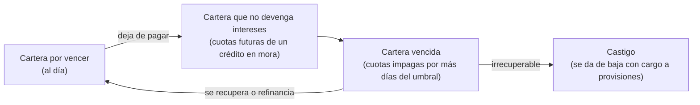

**Cartera improductiva** = cartera que no devenga intereses + cartera vencida.

### 10.2 Calificación de cartera y provisiones

Cada crédito se califica según sus **días de mora**, y a cada categoría le corresponde un porcentaje de **provisión**. Los días exactos y los porcentajes dependen del segmento de crédito y de la norma vigente; el esquema general es:

| Categoría | Riesgo | Mora (orientativa) | Provisión |
|---|---|---|---|
| A1, A2, A3 | Normal | Al día a pocas semanas | Baja |
| B1, B2 | Potencial | Uno a dos meses | Moderada |
| C1, C2 | Deficiente | Dos a tres meses | Alta |
| D | Dudoso recaudo | Tres a cuatro meses | Muy alta |
| E | Pérdida | Más de cuatro meses | Total (100 %) |

> **Mensaje para la reunión:** cada punto de morosidad cuesta dinero en provisiones. Por eso July **no promete aprobaciones**, aplica las reglas del Comité y deja los casos dudosos como «a revisar».

### 10.3 Ejemplo de evolución (ilustrativo)

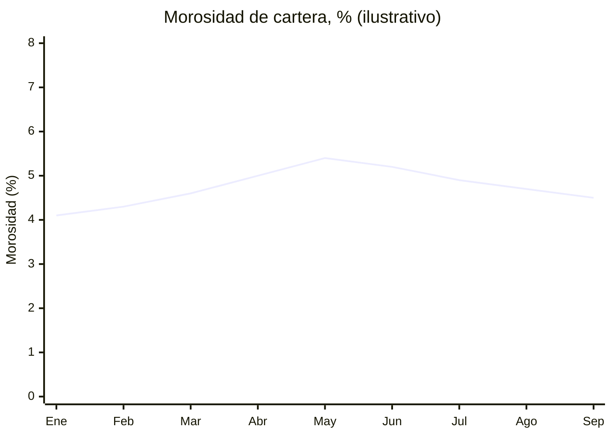

Una lectura posible: la mora subió en el primer semestre (por ejemplo, por créditos mal evaluados o por una mala temporada agrícola) y bajó después con más gestión de cobranza y criterios más estrictos.

---

## 11. Captación de prospectos: del interés al desembolso

Este es el corazón del reto. Captar prospectos es **atraer a personas con una necesidad real**, entender esa necesidad, filtrar a las que tienen posibilidad de calificar y entregárselas al asesor **a tiempo y con información completa**.

### 11.1 El embudo de conversión

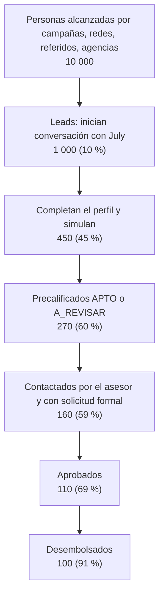

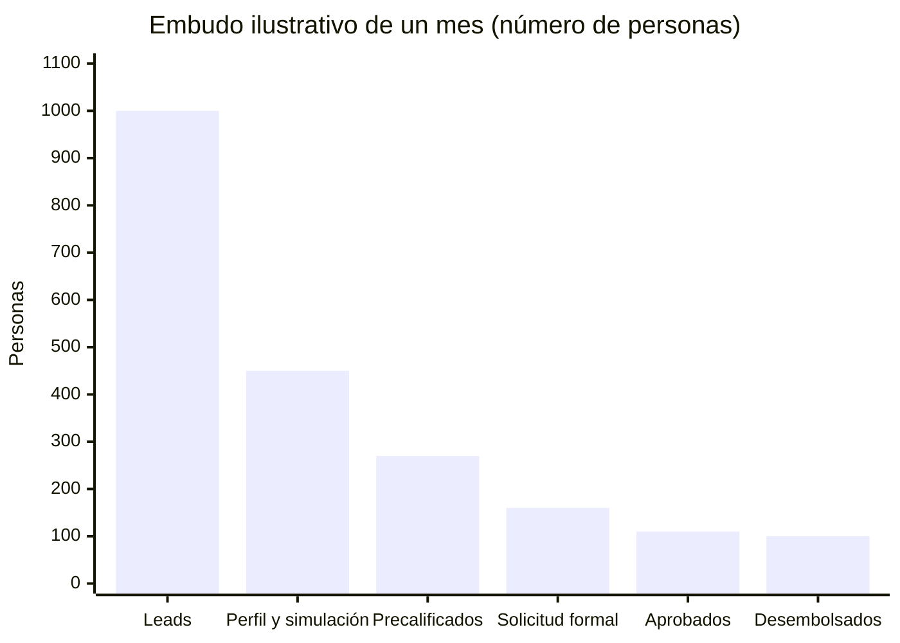

**Cómo leerlo:** de 1 000 leads salieron 100 créditos (**10 % de conversión lead → desembolso**). La mayor fuga está entre el lead y el perfil completo (−55 %): ahí July tiene más impacto, con preguntas cortas, monto primero, simulación antes de pedir datos personales y **retoma** de conversaciones abandonadas.

### 11.2 Canales de captación

| Canal | Ventaja | Limitación | Relación con July |
|---|---|---|---|
| **Agencia** (ventanilla, oficial de crédito) | Confianza, atención personal | Horario y filas | July agenda citas en agencia (CU 2.3.2.3) |
| **Asesores de campo** | Llegan al negocio del prospecto, típico en microcrédito | Costoso, poco escalable | July les entrega leads ya precalificados |
| **Referidos** de socios | Leads de alta calidad | Volumen limitado | El origen se etiqueta |
| **Ferias, eventos, convenios** con empresas o gremios | Volumen concentrado | Esporádico | Los leads pueden entrar por un código o enlace de campaña |
| **Redes sociales y anuncios** | Alcance masivo y medible | Muchos curiosos | Llevan al WhatsApp o web de July |
| **WhatsApp y sitio web** | Inmediato, 24/7, el canal preferido del público | Requiere respuesta rápida | Son los canales de July (CU 1.1.1) |

### 11.3 Calificación y priorización de leads

No todos los leads valen lo mismo. Se prioriza combinando **qué tan probable es que califique** (capacidad, perfil) y **qué tan pronto lo necesita** (urgencia, interés).

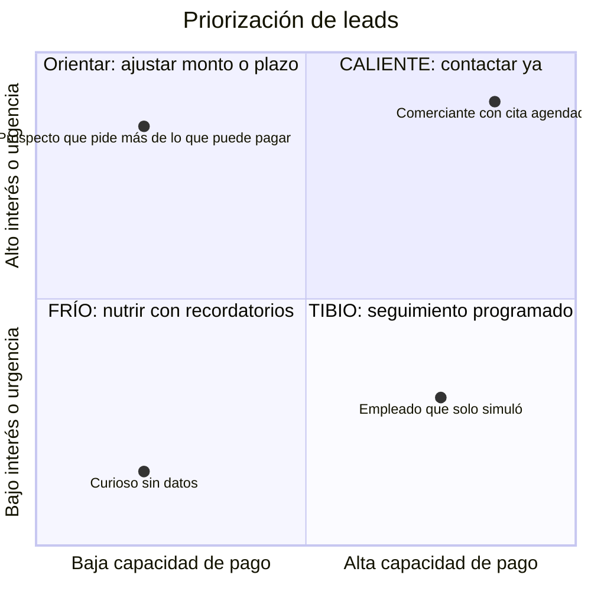

| Prioridad | Criterio de ejemplo (lo define el Jefe comercial) | Acción |
|---|---|---|
| **CALIENTE** | APTO, perfil completo, pidió cita o quiere el crédito pronto | El asesor lo contacta en minutos u horas |
| **TIBIO** | APTO o A_REVISAR, sin urgencia o con datos por completar | Contacto en uno o dos días |
| **FRÍO** | Solo simuló, no dejó datos o lo necesita más adelante | Recordatorios y reactivación |

### 11.4 Indicadores comerciales (KPI) de la captación

| KPI | Fórmula | Por qué importa |
|---|---|---|
| **Tiempo de primera respuesta** (*speed to lead*) | Momento de la respuesta − momento del primer mensaje | La probabilidad de contacto cae mucho si se tarda horas en responder; July responde al instante |
| **Tasa de conversión por etapa** | Pasan a la etapa siguiente ÷ entran a la etapa | Muestra dónde se fuga el embudo |
| **Tasa de abandono** | Conversaciones abandonadas ÷ iniciadas | Mide la fricción de la captura |
| **Tasa de retoma** | Conversaciones retomadas ÷ abandonadas | Mide el efecto de los recordatorios |
| **Costo por lead (CPL)** | Gasto en marketing ÷ leads obtenidos | Eficiencia de las campañas |
| **Costo de adquisición (CAC)** | (Marketing + costo comercial) ÷ créditos desembolsados | Cuánto cuesta cada nuevo crédito |
| **Tiempo hasta el desembolso** (*time to cash*) | Desembolso − primer contacto | Un proceso lento hace que el prospecto se vaya a otra entidad |
| **Leads por asesor** y **tiempo de atención del asesor** | Leads asignados ÷ asesores; asignación − aceptación | Carga de trabajo y disciplina comercial |
| **Calidad de la colocación** | Morosidad de los créditos originados por July frente a otros canales | Comprueba que July trae buenos socios, no solo más socios |

**Ejemplo de costo de adquisición:** una campaña de 2 000 USD trae 1 000 leads (**CPL = 2 USD**). Si el costo comercial de los asesores es de 3 000 USD y se desembolsan 100 créditos, **CAC = (2 000 + 3 000) ÷ 100 = 50 USD por crédito**. Si July eleva la conversión del 10 % al 13 % con el mismo gasto, el CAC baja a unos **38 USD**.

### 11.5 Recorrido del prospecto con July

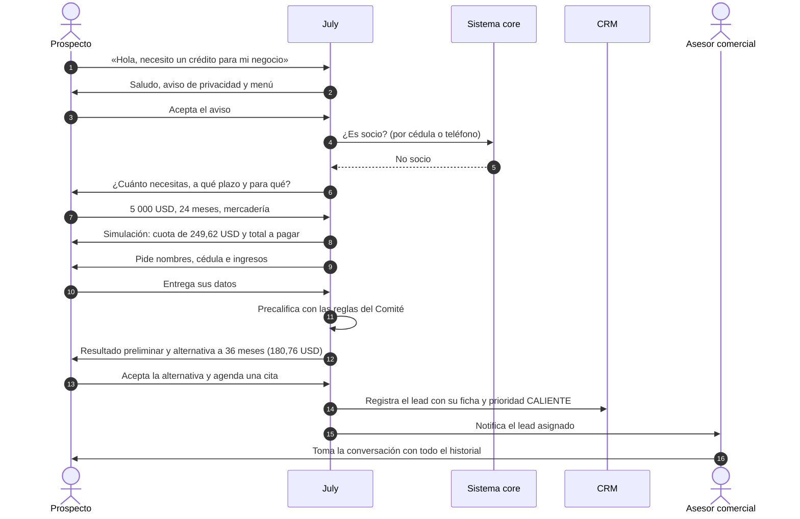

### 11.6 Buenas prácticas y límites

| Hacer | Evitar |
|---|---|
| Decir «**precalificación preliminar**» y explicar que la aprobación la da la cooperativa | Decir «tu crédito está aprobado» |
| Mostrar cuota, **tasa efectiva** y **total a pagar** | Mostrar solo la cuota (oculta el costo real) |
| Pedir el **consentimiento** antes de los datos personales y explicar para qué se usan | Pedir la cédula como primera pregunta |
| Pedir solo lo necesario y no repetir lo que ya se sabe | Formularios largos dentro del chat |
| Ofrecer alternativas (más plazo, menos monto) cuando no califica | Rechazar sin explicar el motivo |
| Derivar a un humano cuando el prospecto lo pide | Atrapar al prospecto en el bot |
| Respetar el retiro del consentimiento y avisar al Delegado de protección de datos | Seguir escribiéndole a quien pidió que no |
| Etiquetar el origen de cada lead | Leads sin trazabilidad de campaña |

---

## 12. Preguntas para llevar a la reunión

Estas preguntas muestran que entiendes el negocio y además levantan los datos que July necesita como configuración (catálogo, reglas, criterios).

**Negocio y estrategia**

1. ¿Cuál es la meta de colocación de este año y en qué segmentos (consumo, microcrédito, vivienda)?
2. ¿Qué perfil de socio quieren atraer más: microempresarios, empleados, agricultores, jóvenes?
3. ¿Cuál es hoy la morosidad por producto y qué canales o agencias originan los créditos más sanos?

**Producto y crédito**

4. ¿Qué líneas de crédito debería ofrecer July y con qué montos, plazos, tasas y requisitos vigentes?
5. ¿Qué sistema de amortización usan por línea (francés o alemán)? ¿Cobran seguro de desgravamen u otros cargos que deban mostrarse?
6. ¿Qué reglas usa el Comité para una primera evaluación: porcentaje máximo de cuota, edad mínima y máxima, actividades no financiables, antigüedad del negocio?
7. ¿Se exige ser socio para pedir un crédito? ¿Cuál es el aporte inicial? ¿Exigen ahorro encaje?
8. ¿Cuáles son los niveles de aprobación (cuánto aprueba el jefe de agencia y cuánto el Comité)?

**Proceso comercial**

9. ¿Cómo llegan hoy los prospectos y cuánto tarda la primera respuesta?
10. ¿Cuántos asesores hay por agencia y cómo se reparten los leads?
11. ¿Qué consideran un lead caliente, tibio y frío?
12. ¿Cuánto tarda hoy un crédito desde el primer contacto hasta el desembolso?

**Tecnología y cumplimiento**

13. ¿Qué core financiero y qué CRM usan? ¿Exponen servicios (API) para consultar si una persona es socia?
14. ¿Tienen WhatsApp Business API y plantillas aprobadas?
15. ¿Quién es el Delegado de protección de datos y qué texto de aviso de privacidad usan?
16. ¿Qué no debe decir nunca July (promesas, tasas sin respaldo, temas sensibles)?

---

## 13. Ejemplo completo: el caso de María

> **María**, 38 años, tiene una tienda de abarrotes en Loja. Vio un anuncio de la cooperativa en Facebook y quiere 5 000 USD para comprar mercadería antes de las fiestas.

| Paso | Qué pasa | Concepto del negocio | Caso de uso |
|---|---|---|---|
| 1 | Toca el anuncio y abre WhatsApp. July la saluda y le muestra el aviso de privacidad; María lo acepta. | Canal digital, consentimiento (LOPDP) | CU 1.1.1, CU 1.2.1 |
| 2 | July detecta que quiere un crédito y verifica en el core que **no es socia**. | Condición de socio | CU 1.2.2 |
| 3 | July le pregunta monto, plazo y destino: 5 000 USD, 24 meses, capital de trabajo. | Segmento **microcrédito** | CU 2.1.1 |
| 4 | July simula: cuota de **249,62 USD**, total a pagar **5 990,89 USD**. | Sistema francés, tasa, costo total | CU 2.2.1 |
| 5 | María da sus datos: ingresos de 1 400 USD, gastos de 950 USD y otra deuda de 150 USD. | **Capacidad de pago**: disponible de 300 USD | CU 2.1.1 |
| 6 | Con el 70 % del disponible, la cuota máxima es de 210 USD. A 24 meses **no entra**. | Regla de precalificación del Comité | CU 2.3.1 |
| 7 | July le explica el motivo y le ofrece 36 meses: cuota de **180,76 USD**. María acepta. Queda **APTO**. | Alternativa de plazo, precalificación | CU 2.3.2 |
| 8 | July le dice qué documentos llevar (cédula, planilla de servicio básico, RUC o RISE, facturas) y agenda una cita en la agencia. | Requisitos por línea | CU 2.3.2.3 |
| 9 | July genera la ficha, la registra en el CRM con prioridad **CALIENTE** y la asigna a un asesor de la agencia más cercana. | Lead scoring, enrutamiento | CU 3.1, CU 3.2.1 |
| 10 | El asesor toma la conversación, confirma la cita y la atiende. María abre su cuenta, aporta sus certificados de aportación y entrega la solicitud formal. | Socio, certificados de aportación | CU 3.2.2 |
| 11 | El analista consulta el buró, visita la tienda y presenta el caso; se aprueba con un garante. | 5 C, garantía personal | Fuera de July |
| 12 | Se firma el pagaré, se contrata el seguro de desgravamen y se desembolsa. El asesor marca el lead como **DESEMBOLSADO**. | Instrumentación, desembolso | CU 3.2.2.3 |

**Qué gana cada parte:** María obtiene el crédito sin hacer filas para informarse y con una cuota que puede pagar. La cooperativa recibe una socia nueva, con un crédito bien dimensionado (menos riesgo de mora) y un asesor que dedicó su tiempo a un lead ya filtrado.

---

## 14. Diccionario de términos

Los términos marcados con ★ son los que más se usan en el reto de July.

### A

- **Activo:** todo lo que la cooperativa posee o le deben: fondos disponibles, inversiones, cartera de créditos, edificios.
- **Actividad económica:** a qué se dedica el solicitante (comercio, agricultura, empleo dependiente). Influye en el segmento de crédito y en el riesgo.
- **Agencia:** oficina física de atención de la cooperativa.
- **Ahorro a la vista:** cuenta de ahorros de libre disponibilidad.
- **Ahorro encaje:** porcentaje del crédito que el socio debe mantener ahorrado como respaldo.
- **Ahorro programado:** ahorro con depósitos periódicos comprometidos a un plazo.
- **Amortización:** pago gradual del capital de una deuda a lo largo de las cuotas. ★
- **Análisis de crédito:** evaluación completa que hace el analista (verificación, buró, visita, garantías).
- **APTO / A_REVISAR / NO_APTO:** resultados posibles de la precalificación de July. ★
- **Asamblea General (o de Representantes):** máximo órgano de gobierno, formado por los socios o sus representantes elegidos.
- **Asesor comercial (oficial de crédito, asesor de negocios):** persona que atiende al prospecto, arma la solicitud y le da seguimiento. ★

### B

- **Buró de crédito:** empresa que reúne el historial de pagos de las personas y entrega reportes y puntajes a las entidades financieras.

### C

- **CAC (costo de adquisición de cliente):** lo que cuesta conseguir un nuevo crédito o socio. ★
- **Capacidad de pago:** dinero disponible cada mes para pagar la cuota después de gastos y otras deudas. ★
- **Capital (del crédito):** el monto prestado, sin intereses.
- **Capital de trabajo:** dinero para la operación diaria de un negocio (mercadería, insumos).
- **Cartera de créditos:** el total de créditos otorgados que aún se están pagando.
- **Cartera improductiva:** cartera que no devenga intereses más cartera vencida.
- **Cartera por vencer:** créditos al día.
- **Cartera vencida:** cuotas impagas por más días que el umbral normativo.
- **Castigo de cartera:** dar de baja un crédito irrecuperable con cargo a las provisiones.
- **Certificados de aportación:** aportes de capital que hacen a una persona socia de la cooperativa.
- **COAC:** cooperativa de ahorro y crédito.
- **Cobranza:** gestión para recuperar cuotas atrasadas (preventiva, administrativa, extrajudicial, judicial).
- **Colocación:** otorgar créditos; también, el monto total prestado en un periodo. ★
- **Comité de Crédito:** órgano que aprueba los créditos sobre cierto monto y fija las políticas de evaluación. ★
- **Consejo de Administración:** órgano directivo que fija políticas y nombra al gerente.
- **Consejo de Vigilancia:** órgano de control interno de la cooperativa.
- **Consentimiento:** autorización libre, informada y expresa de la persona para tratar sus datos personales (LOPDP). ★
- **Conversión:** paso de un lead de una etapa del embudo a la siguiente; en especial, de lead a crédito desembolsado. ★
- **Core financiero (sistema core):** sistema central que registra socios, cuentas, créditos y movimientos. ★
- **COSEDE:** Corporación del Seguro de Depósitos, que protege los ahorros hasta un tope por persona.
- **CPL (costo por lead):** gasto de marketing dividido entre los leads obtenidos.
- **CRM:** sistema de gestión de la relación con clientes, donde se registran y siguen los leads. ★
- **Cuota:** pago periódico del crédito; incluye capital, interés y, a veces, seguros. ★

### D

- **Delegado de protección de datos:** responsable de velar por el cumplimiento de la LOPDP y atender los derechos de los titulares. ★
- **Depósito a plazo fijo (DPF):** dinero que el socio deja inmovilizado un tiempo a cambio de una tasa mayor.
- **Desembolso:** entrega del dinero del crédito al socio. ★
- **Destino del crédito:** para qué se usará el dinero; determina el segmento y la línea. ★
- **Días de mora:** días transcurridos desde que una cuota debió pagarse.

### E

- **Embudo (funnel) de conversión:** representación de cuántos prospectos pasan por cada etapa hasta el desembolso. ★
- **Encaje:** ver «ahorro encaje».
- **Enrutamiento:** regla que decide a qué asesor o agencia se asigna un lead (por zona, producto o carga). ★
- **Excedente:** resultado positivo del ejercicio de una cooperativa (equivale a la «utilidad» de una empresa).

### F

- **Ficha del prospecto:** resumen que July entrega al asesor con datos, simulación, precalificación, prioridad e historial. ★
- **Fondeo:** origen de los recursos que la cooperativa presta.
- **Fondo irrepartible de reserva legal:** parte del excedente que por ley se acumula y no se reparte entre los socios.

### G

- **Garante:** persona que se obliga a pagar si el deudor no lo hace.
- **Garantía:** respaldo del crédito: quirografaria, personal, prendaria o hipotecaria.

### H

- **Hipoteca:** garantía sobre un inmueble.

### I

- **Inclusión financiera:** acceso de personas excluidas a productos financieros formales; parte de la misión cooperativa.
- **Instrumentación:** firma de documentos del crédito (pagaré, tabla de amortización, garantías, seguros).
- **Interés:** precio del dinero prestado.
- **Intermediación financiera:** captar ahorro y colocarlo en créditos.

### J

- **JPRF:** Junta de Política y Regulación Financiera; fija tasas máximas, segmentos y normas prudenciales.

### K

- **KPI:** indicador clave de desempeño.
- **KYC (conoce a tu cliente):** procedimiento para identificar y verificar al cliente, parte de la prevención de lavado de activos.

### L

- **Lead:** registro de un prospecto interesado, con sus datos y su interés, listo para gestionarse. ★
- **Lead scoring:** asignación de una prioridad o puntaje al lead (caliente, tibio, frío). ★
- **Línea de crédito:** producto de crédito específico con sus montos, plazos, tasa y requisitos. ★
- **Liquidez:** capacidad de atender los retiros de los socios con dinero disponible.
- **LOEPS:** Ley Orgánica de Economía Popular y Solidaria.
- **LOPDP:** Ley Orgánica de Protección de Datos Personales. ★

### M

- **Margen financiero:** intereses ganados menos intereses pagados.
- **Microcrédito:** crédito para pequeños negocios, pagado con los ingresos de esa actividad. ★
- **Monto:** cantidad de dinero solicitada o prestada. ★
- **Morosidad:** proporción de la cartera que está atrasada en sus pagos. ★

### N

- **Nutrición de leads:** contacto periódico con leads fríos para mantenerlos interesados hasta que estén listos.

### O

- **Omnicanalidad:** que el prospecto pueda empezar por un canal y seguir en otro sin repetir información.
- **Origen del lead:** campaña o canal por el que llegó el prospecto. ★

### P

- **Pagaré:** documento en el que el deudor se compromete a pagar el crédito.
- **Pasivo:** lo que la cooperativa debe: principalmente los depósitos de sus socios.
- **Patrimonio:** recursos propios: certificados de aportación, reservas y excedentes.
- **Periodo de gracia:** tiempo inicial en que no se paga capital (o nada), típico en créditos agrícolas.
- **Plantilla de WhatsApp:** mensaje preaprobado por Meta para escribir a un usuario fuera de la ventana de 24 horas. ★
- **Plazo:** tiempo total para pagar el crédito, normalmente en meses. ★
- **Precalificación:** evaluación preliminar y automática del prospecto con reglas simples; **no es una aprobación**. ★
- **Prospecto:** persona que podría necesitar un producto y aún no lo tiene. ★
- **Provisión:** reserva contable para cubrir créditos que podrían no recuperarse.

### R

- **Reactivación:** mensaje para recuperar a un lead que dejó de responder. ★
- **Refinanciamiento / reestructuración:** cambio de las condiciones de un crédito (plazo, cuota) para que el deudor pueda seguir pagando.
- **Requisitos:** documentos y condiciones que pide cada línea de crédito. ★
- **Retoma:** volver a contactar a quien abandonó la conversación, continuando desde el último paso guardado. ★
- **ROA / ROE:** rentabilidad sobre activos / sobre patrimonio.

### S

- **Score crediticio:** puntaje de riesgo del buró.
- **Seguro de desgravamen:** seguro que cancela la deuda si el deudor fallece o queda incapacitado.
- **Segmento de cooperativa:** clasificación por tamaño de activos (1 a 5).
- **Segmento de crédito:** clasificación del crédito por su destino (consumo, microcrédito, inmobiliario…), cada uno con su tasa máxima.
- **SEPS:** Superintendencia de Economía Popular y Solidaria, supervisora de las cooperativas.
- **Simulación:** cálculo de la cuota, el total a pagar y la tabla de amortización para un monto y un plazo. ★
- **Sistema alemán:** amortización con capital constante y cuota decreciente.
- **Sistema francés:** amortización con cuota constante. ★
- **Socio:** persona dueña de la cooperativa por sus certificados de aportación. ★
- **Solicitud de crédito:** pedido formal con los datos y documentos del solicitante. ★
- **Solvencia:** capacidad de absorber pérdidas con el patrimonio.
- **Speed to lead:** tiempo que tarda la primera respuesta a un lead. ★

### T

- **Tabla de amortización:** detalle de cada cuota con su capital, interés y saldo. ★
- **Tasa activa:** la que cobra la cooperativa por prestar.
- **Tasa efectiva anual (TEA):** costo real anual del crédito, considerando la capitalización. ★
- **Tasa máxima:** tope legal de tasa por segmento de crédito.
- **Tasa nominal:** tasa anual «de etiqueta», sin capitalización.
- **Tasa pasiva:** la que paga la cooperativa por el ahorro.
- **Time to cash:** tiempo desde el primer contacto hasta el desembolso.
- **Total a pagar:** suma de todas las cuotas, con intereses, seguros y cargos. ★

### U

- **UAFE:** Unidad de Análisis Financiero y Económico (prevención de lavado de activos).

### V

- **Ventana de 24 horas (WhatsApp):** periodo tras el último mensaje del usuario en que se le puede responder libremente; fuera de él solo se usan plantillas. ★
- **Visita de verificación:** visita del asesor al negocio o domicilio para confirmar la información.

### W

- **Webhook:** aviso automático que un sistema envía a otro cuando ocurre un evento (por ejemplo, un mensaje nuevo de WhatsApp). ★
- **WhatsApp Business API:** servicio de Meta que permite a una empresa automatizar conversaciones de WhatsApp. ★

---

## 15. Fuentes para verificar

Antes de la reunión, revisa en las fuentes oficiales los datos que esta guía deja como ilustrativos:

| Qué verificar | Dónde |
|---|---|
| Segmento, cifras e indicadores de la cooperativa | Portal estadístico y catastro de la SEPS |
| Tasas efectivas máximas vigentes por segmento de crédito | Banco Central del Ecuador (tasas de interés) y resoluciones de la JPRF |
| Calificación de cartera y provisiones por segmento | Normas de la JPRF y la SEPS |
| Cobertura del seguro de depósitos | COSEDE |
| Obligaciones de protección de datos | LOPDP y su reglamento |
| Productos, tasas y requisitos de la cooperativa | Sitio web de la Cooperativa Padre Julián Lorente y su Área de productos y crédito |

**Documentos del proyecto relacionados:** [CAP-03](../02-mapa-capacidades/Archi/mapa-capacidades-y-casos-de-uso-etapa3.archimate) (mapa de capacidades), [CU-06](../03-casos-de-uso/casos-de-uso-por-flujo.md) (casos de uso por flujo), [CU-08](../03-casos-de-uso/especificaciones-casos-de-uso.md) (especificaciones) y [CLS-01](../04-diagrama-de-clase/diccionario-de-datos-etapa3.md) (diccionario de datos).
