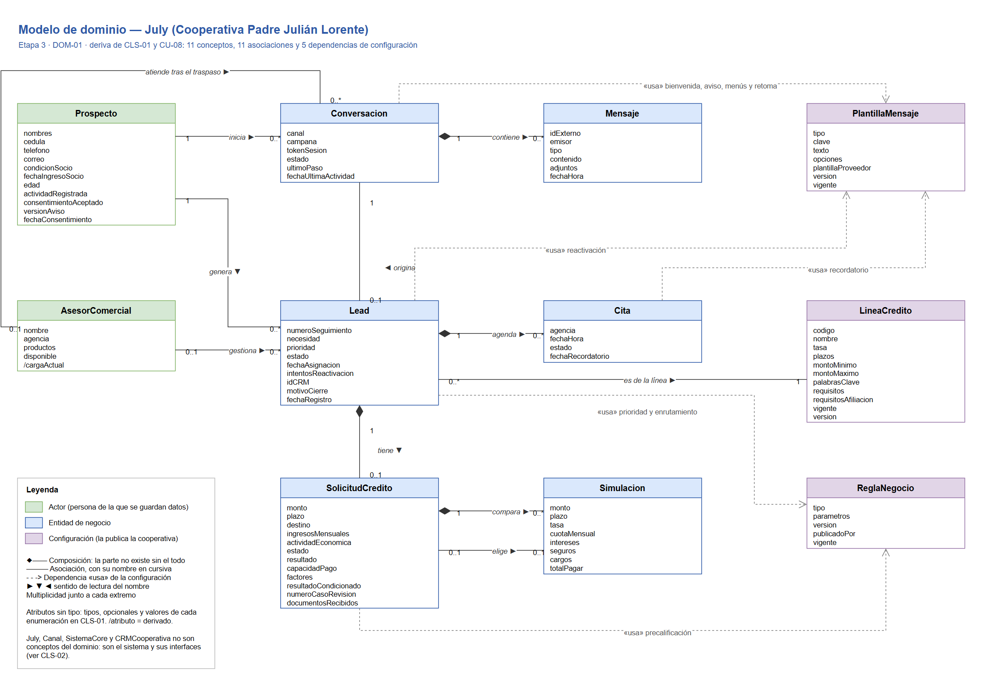

# Modelo de dominio — etapa 3

| Campo | Valor |
|---|---|
| **ID** | DOM-02 |
| **Versión** | 1.0 |
| **Fecha** | 2026-11-03 |
| **Deriva de** | [DOM-01 · Diagrama del modelo de dominio](modelo-de-dominio-etapa3.drawio), [CLS-01 · Diccionario de datos](../04-diagrama-de-clase/diccionario-de-datos-etapa3.md) |
| **Estado** | Borrador |

Guía breve del modelo de dominio del asistente July (Cooperativa Padre Julián Lorente). El modelo muestra **los conceptos del negocio y cómo se relacionan**, sin métodos, sin tipos y sin las clases que forman el sistema. Es la vista que se usa para conversar con la cooperativa; el diseño detallado está en el diagrama de clases (CLS-02).

## 1. Criterios

- **Solo conceptos del negocio.** Entran las 11 clases «entidad» de CLS-01. Quedan fuera `July`, que es el sistema que se diseña, y `Canal`, `SistemaCore` y `CRMCooperativa`, que son interfaces con sistemas externos.
- **Atributos sin tipo.** Se muestran solo los nombres de los atributos. Los tipos, los atributos opcionales y los valores de cada enumeración están en CLS-01. `/atributo` es un dato derivado, que se calcula y no se guarda.
- **Relaciones como asociaciones.** Los atributos que apuntan a otra clase (por ejemplo, `Lead.prospecto`) no aparecen como atributos: se dibujan como la asociación con nombre y multiplicidad.
- **La configuración se lee, no se posee.** Las clases de configuración las publica la cooperativa por versiones. Por eso se unen a las demás con una dependencia «usa» y no con una asociación.

## 2. Conceptos

| Concepto | Categoría | Qué representa |
|---|---|---|
| `Prospecto` | Actor | Persona que contacta a la cooperativa: identidad, condición de socio y consentimiento de datos. |
| `AsesorComercial` | Actor | Colaborador que atiende leads; su agencia, sus productos y su disponibilidad deciden el enrutamiento. |
| `Conversacion` | Entidad de negocio | Hilo de mensajes por un canal, con su origen de campaña y el último paso del flujo. |
| `Mensaje` | Entidad de negocio | Un mensaje en formato común, sin importar el canal. |
| `Lead` | Entidad de negocio | Oportunidad comercial: un prospecto con una intención de crédito y su etapa en el embudo. |
| `SolicitudCredito` | Entidad de negocio | Datos del crédito que pide el prospecto y el resultado de su precalificación. |
| `Simulacion` | Entidad de negocio | Un escenario de monto y plazo con su cuota, costos y total a pagar. |
| `Cita` | Entidad de negocio | Cita en una agencia, con su estado y su recordatorio. |
| `LineaCredito` | Configuración | Producto del catálogo, con su tasa, plazos, montos y requisitos. |
| `PlantillaMensaje` | Configuración | Contenido conversacional: bienvenida, aviso de privacidad, menús, preguntas frecuentes y plantillas. |
| `ReglaNegocio` | Configuración | Parámetros de precalificación, prioridad y enrutamiento. |

## 3. Asociaciones

Se leen de izquierda a derecha. La multiplicidad va en el mismo orden que los conceptos.

| Asociación | Tipo | Multiplicidad | CLS-01 |
|---|---|---|---|
| `Prospecto` inicia `Conversacion` | Asociación | 1 — 0..* | 5 |
| `Conversacion` contiene `Mensaje` | Composición | 1 — 0..* | 1 |
| `Conversacion` origina `Lead` | Asociación | 1 — 0..1 | 8 |
| `Prospecto` genera `Lead` | Asociación | 1 — 0..* | 7 |
| `AsesorComercial` gestiona `Lead` | Asociación | 0..1 — 0..* | 9 |
| `AsesorComercial` atiende tras el traspaso `Conversacion` | Asociación | 0..1 — 0..* | 6 |
| `Lead` es de la línea `LineaCredito` | Asociación | 0..* — 1 | 10 |
| `Lead` tiene `SolicitudCredito` | Composición | 1 — 0..1 | 2 |
| `Lead` agenda `Cita` | Composición | 1 — 0..* | 4 |
| `SolicitudCredito` compara `Simulacion` | Composición | 1 — 0..* | 3 |
| `SolicitudCredito` elige `Simulacion` | Asociación | 0..1 — 0..1 | 11 |

La columna «CLS-01» es el número de la relación en la sección 5 del diccionario de datos.

## 4. Dependencias de configuración

| Concepto | Usa | Para qué | CLS-01 |
|---|---|---|---|
| `Conversacion` | `PlantillaMensaje` | Bienvenida, aviso de privacidad, menús y retoma. | 18 |
| `Lead` | `PlantillaMensaje` | Plantilla de reactivación. | 22 |
| `Cita` | `PlantillaMensaje` | Plantilla de recordatorio. | 24 |
| `Lead` | `ReglaNegocio` | Criterios de prioridad y reglas de enrutamiento. | 21 |
| `SolicitudCredito` | `ReglaNegocio` | Reglas de precalificación. | 23 |

## 5. Cómo leerlo

El diagrama sigue el embudo de captación de arriba abajo:

1. **Primer contacto.** El prospecto inicia una conversación, que guarda sus mensajes y usa las plantillas de bienvenida y menús.
2. **Intención.** Cuando el prospecto expresa una necesidad de crédito, la conversación origina un lead de una línea de crédito.
3. **Captura, simulación y precalificación.** El lead tiene una solicitud, que compara simulaciones, elige una y se precalifica con las reglas del comité.
4. **Entrega y seguimiento.** El lead se prioriza y se asigna a un asesor, que lo gestiona y puede recibir la conversación por traspaso. El lead agenda citas en una agencia.

## 6. Mantenimiento

La fuente es el archivo [`modelo-de-dominio-etapa3.drawio`](modelo-de-dominio-etapa3.drawio) (DOM-01), y el PNG se exporta desde él. Si cambia una clase «entidad», un atributo o una relación de CLS-01, se actualizan en el mismo cambio el diagrama, su PNG y este documento.
