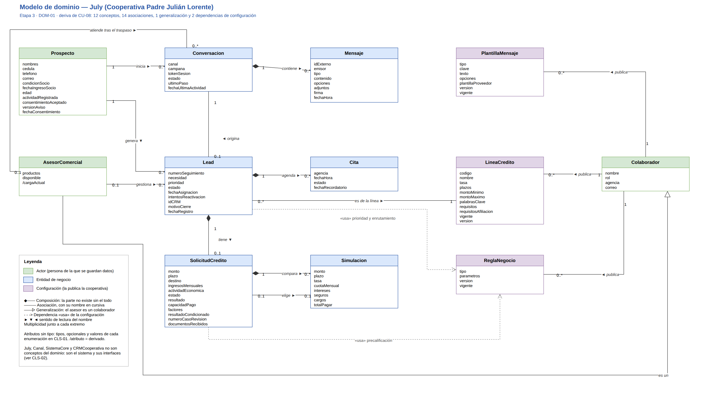

# Modelo de dominio — etapa 3

| Campo | Valor |
|---|---|
| **ID** | DOM-02 |
| **Versión** | 2.0 |
| **Fecha** | 2026-11-04 |
| **Deriva de** | [DOM-01 · Diagrama del modelo de dominio](modelo-de-dominio-etapa3.drawio), [CU-08 · Especificaciones de casos de uso](../03-especificacion-casos-de-uso/especificaciones-casos-de-uso.md) |
| **Estado** | Borrador |

Guía breve del modelo de dominio del asistente July (Cooperativa Padre Julián Lorente). El modelo muestra **los conceptos del negocio y cómo se relacionan**, sin métodos, sin tipos y sin las clases que forman el sistema. Sale de la especificación unificada (CU-08) y es la entrada del diccionario de datos ([CLS-01](../05-diccionario-de-datos/diccionario-de-datos-etapa3.md)), que le agrega tipos, métodos y las clases del sistema.

## 1. Criterios

- **Los conceptos salen de la especificación.** Es concepto todo sustantivo de un paso de CU-08 y todo participante que es una persona o una entidad del negocio. Quedan fuera July, que es el sistema que se diseña, y `Canal`, `SistemaCore` y `CRMCooperativa`, que son sistemas externos.
- **Las asociaciones salen de quién trabaja con quién.** Las parejas sujeto → receptor de los pasos y los sustantivos que se intercambian dicen qué conceptos se relacionan y con qué multiplicidad.
- **Atributos sin tipo.** Se muestran solo los nombres de los atributos que nombran los pasos. Los tipos, los atributos opcionales y los valores de cada enumeración están en CLS-01. `/atributo` es un dato derivado, que se calcula y no se guarda.
- **Relaciones como asociaciones.** Los atributos que apuntan a otro concepto (por ejemplo, `Lead.prospecto`) no aparecen como atributos: se dibujan como la asociación con nombre y multiplicidad.
- **La configuración la publica un colaborador.** Las líneas de crédito, las plantillas y las reglas las publica la cooperativa por versiones; por eso se asocian al `Colaborador` que las publica, y las entidades que las aplican las *usan* con una dependencia.

## 2. Conceptos

| Concepto | Categoría | Qué representa | Participante o sustantivo en CU-08 |
|---|---|---|---|
| `Prospecto` | Actor | Persona que contacta a la cooperativa: identidad, condición de socio y consentimiento de datos. | Participante «Prospecto»; sustantivo en los pasos que leen o guardan sus datos (por ejemplo, flujo 1, pasos 20 y 30) |
| `Colaborador` | Actor | Persona de la cooperativa que publica configuración, recibe avisos o registra la atención: marketing, administrador, áreas, comité, jefe comercial, agencia y delegado de datos. | Participantes de configuración |
| `AsesorComercial` | Actor | Colaborador que atiende leads; sus productos, su disponibilidad y su carga deciden el enrutamiento. Es un `Colaborador`. | Participante «Asesor comercial» |
| `Conversacion` | Entidad de negocio | Hilo de mensajes por un canal, con su origen de campaña y el último paso del flujo. | Participante «Conversación» |
| `Mensaje` | Entidad de negocio | Un mensaje en formato común, sin importar el canal. | Sustantivo de todo paso entre personas, canales y July |
| `Lead` | Entidad de negocio | Oportunidad comercial: un prospecto con una intención de crédito y su etapa en el embudo. | Participante «Lead» |
| `SolicitudCredito` | Entidad de negocio | Datos del crédito que pide el prospecto y el resultado de su precalificación. | Participante «Solicitud de crédito» |
| `Simulacion` | Entidad de negocio | Un escenario de monto y plazo con su cuota, costos y total a pagar. | Participante «Simulación» |
| `Cita` | Entidad de negocio | Cita en una agencia, con su estado y su recordatorio. | Participante «Cita» |
| `LineaCredito` | Configuración | Producto del catálogo, con su tasa, plazos, montos y requisitos. | Participante «Línea de crédito» |
| `PlantillaMensaje` | Configuración | Contenido conversacional: bienvenida, aviso de privacidad, menús, preguntas frecuentes y plantillas. | Participante «Plantilla de mensaje» |
| `ReglaNegocio` | Configuración | Parámetros de precalificación, prioridad y enrutamiento. | Sustantivo de los pasos 64 (flujo 2), 1 y 13 (flujo 3) |

## 3. Asociaciones

Se leen en el sentido de la flecha del nombre. La multiplicidad va en el mismo orden que los conceptos.

| Asociación | Tipo | Multiplicidad | De dónde sale en CU-08 | CLS-01 |
|---|---|---|---|---|
| `Prospecto` inicia `Conversacion` | Asociación | 1 — 0..* | Flujo 1, pasos 1 a 6: el mensaje del prospecto abre la conversación | 5 |
| `Conversacion` contiene `Mensaje` | Composición | 1 — 0..* | Flujo 1, paso 5: July registra cada mensaje en la conversación | 1 |
| `Conversacion` origina `Lead` | Asociación | 1 — 0..1 | Flujo 1, paso 32: el lead se registra con su conversación | 8 |
| `Prospecto` genera `Lead` | Asociación | 1 — 0..* | Flujo 1, paso 32: el lead se registra con su prospecto | 7 |
| `AsesorComercial` gestiona `Lead` | Asociación | 0..1 — 0..* | Flujo 3, pasos 15 a 19: el lead se asigna al asesor | 9 |
| `AsesorComercial` atiende tras el traspaso `Conversacion` | Asociación | 0..1 — 0..* | Flujo 1, A6, y flujo 3, paso 21: la conversación se traspasa al asesor | 6 |
| `Lead` es de la línea `LineaCredito` | Asociación | 0..* — 1 | Flujo 1, paso 32, y flujo 2, paso 58 | 10 |
| `Lead` tiene `SolicitudCredito` | Composición | 1 — 0..1 | Flujo 2, paso 2: la solicitud se inicia para el lead | 2 |
| `Lead` agenda `Cita` | Composición | 1 — 0..* | Flujo 2, paso 82: la cita se reserva para el lead | 4 |
| `SolicitudCredito` compara `Simulacion` | Composición | 1 — 0..* | Flujo 2, pasos 38 y 46 | 3 |
| `SolicitudCredito` elige `Simulacion` | Asociación | 0..1 — 0..1 | Flujo 2, paso 50 | 11 |
| `Colaborador` publica `LineaCredito` | Asociación | 1 — 0..* | Flujo 2, pasos 54 y 55: el Área de productos y crédito devuelve su catálogo | 12 |
| `Colaborador` publica `PlantillaMensaje` | Asociación | 1 — 0..* | Flujo 1, pasos 14, 15, 22 y 23: el Administrador devuelve sus guiones y menús | 12 |
| `Colaborador` publica `ReglaNegocio` | Asociación | 1 — 0..* | Flujo 2, pasos 64 y 65, y flujo 3, pasos 1, 2, 13 y 14 | 12 |

**Generalización:** `AsesorComercial` es un `Colaborador` (relación 13 de CLS-01). Comparte con los demás colaboradores el nombre, el rol, la agencia y el correo, y suma lo que necesita el enrutamiento.

La columna «CLS-01» es el número de la relación en la sección 5 del diccionario de datos. Las tres asociaciones «publica» son una sola en CLS-01, porque allí las tres configuraciones heredan de `Configuracion`.

## 4. Dependencias de configuración

| Concepto | Usa | Para qué | De dónde sale en CU-08 | CLS-01 |
|---|---|---|---|---|
| `Lead` | `ReglaNegocio` | Criterios de prioridad y reglas de enrutamiento. | Flujo 3, pasos 3 y 15 | 17 |
| `SolicitudCredito` | `ReglaNegocio` | Reglas de precalificación. | Flujo 2, paso 68 | 18 |

Las plantillas no tienen dependencia: las compone July (`PlantillaMensaje.componer(datos)`) y las envía por el canal; ninguna entidad del negocio las usa directamente.

## 5. Cómo leerlo

El diagrama sigue el embudo de captación de arriba abajo:

1. **Primer contacto.** El prospecto inicia una conversación, que guarda sus mensajes. Las plantillas de bienvenida y menús las publica un colaborador.
2. **Intención.** Cuando el prospecto expresa una necesidad de crédito, la conversación origina un lead de una línea de crédito.
3. **Captura, simulación y precalificación.** El lead tiene una solicitud, que compara simulaciones, elige una y se precalifica con las reglas que publica el comité.
4. **Entrega y seguimiento.** El lead se prioriza y se asigna a un asesor, que es un colaborador, lo gestiona y puede recibir la conversación por traspaso. El lead agenda citas en una agencia.

## 6. Mantenimiento

La fuente es el archivo [`modelo-de-dominio-etapa3.drawio`](modelo-de-dominio-etapa3.drawio) (DOM-01), y el PNG se exporta desde él. Si un paso de CU-08 agrega o cambia un sustantivo, un participante o una pareja sujeto → receptor, se actualizan en el mismo cambio el diagrama, su PNG, este documento y después CLS-01. La regla V3 de [`verificar-trazabilidad.py`](../../Complementarios/revisiones/verificar-trazabilidad.py) comprueba que todo sustantivo y participante de CU-08 sea un concepto de este modelo o una clase del sistema.
