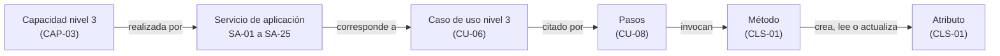
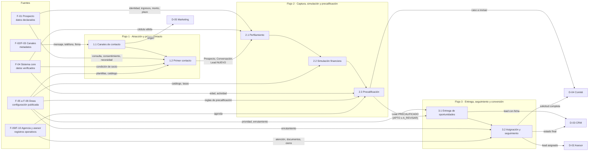
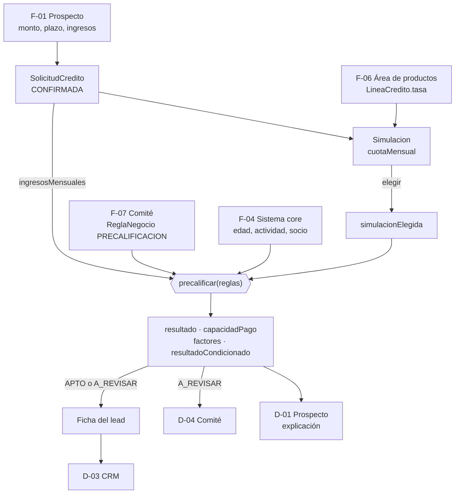

# Linaje de datos de July a partir del mapa de capacidades

| Campo | Valor |
|---|---|
| **ID** | LIN-01 |
| **Versión** | 1.0 |
| **Fecha** | 2026-11-12 |
| **Estado** | Borrador |
| **Deriva de** | [CAP-03 · Modelo ArchiMate, etapa 3](../../0-escenarios/01-mapa-capacidades/Archi/mapa-capacidades-y-casos-de-uso-etapa3.archimate) (mapa de capacidades validado, base del análisis), [CAP-04 · Imagen del mapa](../../0-escenarios/01-mapa-capacidades/mapa-capacidades-y-casos-de-uso-etapa3.png), [CU-08 · Especificaciones de casos de uso](../../0-escenarios/03-especificacion-casos-de-uso/especificaciones-casos-de-uso.md), [DOM-01 · Modelo de dominio](../04-modelo-de-dominio/modelo-de-dominio-etapa3.drawio), [CLS-01 · Diccionario de datos](../05-diccionario-de-datos/diccionario-de-datos-etapa3.md) |
| **Relacionado con** | [SAD-01 · Documento de arquitectura](../../../Complementarios/arquitectura/documento-arquitectura-software-july.docx) (vista de datos), [SAD-02 · Seguridad, suplantación y veracidad](../../../Complementarios/arquitectura/seguridad-bots-suplantacion-y-veracidad.md) (hallazgo H4 y clasificación de datos), [PRE-02 · Apuntes de presentación](../../../Complementarios/presentacion/apuntes-presentacion-cooperativa.md) (fórmulas del prototipo) |
| **Alimenta a** | SAD-01, sección «Vista de datos» |

> **Propósito.** Este documento establece, de forma trazable, **de dónde sale cada dato** que maneja July (Cooperativa Padre Julián Lorente), **qué capacidad de negocio lo crea, lo transforma o lo consume** y **a dónde llega**. El eje del análisis es el mapa de capacidades vigente (CAP-03): cada dato se ancla a una capacidad de nivel 3, a su servicio de aplicación (SA-01 a SA-25), a los pasos de CU-08 que lo mueven y al atributo de CLS-01 donde queda.
>
> **Lo que no es.** No modifica la cadena de trazabilidad. Las brechas de la [sección 11](#11-brechas-del-linaje-y-propuestas) son propuestas por aprobar; si se aprueban, se propagan por CU-08 → CLS-01 → CLS-02 → SEC-01 → ROB-01 y se verifican con REV-02.

## Contenido

1. [Resumen ejecutivo](#1-resumen-ejecutivo)
2. [Alcance, marco de referencia y definiciones](#2-alcance-marco-de-referencia-y-definiciones)
3. [Método de derivación](#3-método-de-derivación)
4. [Fuentes, sistemas de registro y destinos](#4-fuentes-sistemas-de-registro-y-destinos)
5. [Dominios de datos y clasificación](#5-dominios-de-datos-y-clasificación)
6. [Linaje por etapa del flujo de valor](#6-linaje-por-etapa-del-flujo-de-valor)
7. [Linaje por capacidad de nivel 3](#7-linaje-por-capacidad-de-nivel-3)
8. [Matriz capacidad × entidad (crear, leer, actualizar)](#8-matriz-capacidad--entidad-crear-leer-actualizar)
9. [Linaje por atributo](#9-linaje-por-atributo)
10. [Linajes críticos de punta a punta](#10-linajes-críticos-de-punta-a-punta)
11. [Brechas del linaje y propuestas](#11-brechas-del-linaje-y-propuestas)
12. [Puntos de control de calidad del dato](#12-puntos-de-control-de-calidad-del-dato)
13. [Datos personales y transferencias](#13-datos-personales-y-transferencias)
14. [Mantenimiento del documento](#14-mantenimiento-del-documento)

---

## 1. Resumen ejecutivo

- **Cobertura.** Se analizaron los 63 elementos de capacidad de CAP-03 (7 de nivel 1, 14 de nivel 2 y 42 de nivel 3), los 3 flujos de valor con sus 7 etapas, los 25 servicios de aplicación, los 9 actores de negocio, los 6 componentes de aplicación y el evento «Temporizador: pendiente vencido». Las 42 capacidades de nivel 3 tienen linaje asignado: **37 crean o actualizan datos** y **5 solo los leen** (1.1.2.3 y 2.1.2.1, que son puntos de control; 3.1.1.1 y 3.1.1.3, que arman la ficha sin guardarla; y 3.1.2.2, que consulta duplicados en el CRM; ver [sección 8](#8-matriz-capacidad--entidad-crear-leer-actualizar)).
- **Fuentes.** Los datos de July nacen en **12 fuentes** ([sección 4.1](#41-fuentes-de-datos)): el prospecto (datos declarados), los dos canales, el Sistema core, cuatro áreas que publican configuración, tres roles que registran hechos operativos y el propio July (datos generados y calculados).
- **Destinos.** Salen hacia **8 destinos** ([sección 4.3](#43-destinos-y-consumidores)); el principal es el **CRM de la cooperativa**, que recibe el lead dos veces: al entregarse (flujo 3, paso 9) y al cerrarse (flujo 3, paso 53).
- **Linaje crítico.** El dato de mayor impacto es el **resultado de precalificación**: combina 4 datos declarados, 1 dato de configuración del Área de productos, 3 parámetros del Comité de crédito y 3 datos del Sistema core ([L-01](#l-01-resultado-de-precalificación)).
- **Brechas.** El modelo actual permite seguir el linaje **hacia adelante** (qué produce cada capacidad), pero no siempre **hacia atrás** (de qué fuente y versión salió un valor guardado). Se identifican **10 brechas** (B-01 a B-10), entre ellas: los datos no guardan su origen (B-01, coincide con H4 de SAD-02), los resultados no guardan la versión de la regla que los produjo (B-02), no hay bitácora de cambios de estado (B-03) y la campaña de origen no llega al CRM (B-06).

## 2. Alcance, marco de referencia y definiciones

### 2.1 Alcance

| Incluido | Excluido |
|---|---|
| Datos de negocio de las 13 clases «entidad» de CLS-01 y los que entran o salen por las 3 clases «interfaz» (`Canal`, `SistemaCore`, `CRMCooperativa`) | Datos internos de los sistemas externos (cómo el core o el CRM guardan sus registros) |
| Los 3 flujos de valor y sus 7 etapas, las 42 capacidades de nivel 3 y los 282 pasos de CU-08 | La edición de configuración desde un back-office (SA-20 a SA-23) y el tablero del embudo (SA-24), que CU-08 deja fuera del alcance del reto; su linaje empieza en los «datos iniciales versionados» |
| Las reglas transversales R1 y R2 (consentimiento) | Los derechos de acceso, rectificación y eliminación, que atiende el Delegado de protección de datos fuera de July |
| Parámetros técnicos que condicionan el flujo del dato (plazos, reintentos, capacidad) | Secretos e infraestructura (llaves, despliegue), tratados en SAD-02 |

### 2.2 Marco de referencia

| Referencia | Uso en este documento |
|---|---|
| **DAMA-DMBOK, 2.ª ed.** (DAMA International, 2017), áreas de gestión de metadatos y calidad de datos | Definición de linaje, sistema de registro, puntos de control y dominios de datos |
| **W3C PROV-DM** (*The PROV Data Model*, Recomendación W3C, 2013) | Vocabulario de procedencia: **entidad** (el dato), **actividad** (la capacidad o el método que lo produce) y **agente** (el actor o sistema responsable) |
| **ArchiMate 3.1** (The Open Group) | Lectura del mapa: capacidades, flujos de valor, servicios de aplicación y la relación de realización entre ellos |
| **LOPDP** (Ley Orgánica de Protección de Datos Personales, Ecuador, 2021) | Datos personales, consentimiento y transferencias a terceros ([sección 13](#13-datos-personales-y-transferencias)) |

### 2.3 Definiciones

| Término | Definición |
|---|---|
| **Linaje de datos** | Registro del recorrido de un dato: su **origen**, cada **transformación** que sufre y cada **destino** donde se usa o se guarda. |
| **Linaje hacia adelante** | Desde una fuente: qué datos y capacidades dependen de ella (análisis de impacto). |
| **Linaje hacia atrás** | Desde un dato guardado: de qué fuentes y transformaciones salió (análisis de causa y auditoría). |
| **Fuente** | Agente que introduce un dato por primera vez en July. Se identifica como F-NN. |
| **Destino** | Agente o sistema que recibe un dato de July para usarlo fuera de él. Se identifica como D-NN. |
| **Sistema de registro** | Sistema que tiene la versión oficial de un dato. |
| **Transformación** | Operación que cambia un dato o crea uno nuevo a partir de otros: captura, validación, cálculo, clasificación, consolidación o sincronización. En July cada transformación es un método de CLS-01. |
| **Dato declarado** | Valor que da el prospecto sin verificación externa. |
| **Dato verificado** | Valor confirmado por un sistema de registro (el core) o por una persona de la cooperativa. |
| **Dato derivado** | Valor calculado a partir de otros; puede guardarse (por ejemplo, `cuotaMensual`) o no (`/cargaActual`, la ficha). |
| **Punto de control** | Lugar del linaje donde el dato se valida, se confirma o se rechaza. Se identifica como PC-NN. |

### 2.4 Convenciones

- Los pasos se citan como **F*n*: paso** (flujo *n* de CU-08 y número de paso), igual que en CLS-01.
- Los atributos se escriben `Clase.atributo`; los métodos, `Clase.metodo(parametros)`, con la firma de CLS-01.
- Las capacidades se citan con su número y nombre de CAP-03 (por ejemplo, **2.3.1.1 Capacidad de pago**).
- En la matriz CRUD: **C** = crea la instancia, **A** = actualiza atributos, **L** = lee.

## 3. Método de derivación

CAP-03 no contiene objetos de negocio ni objetos de datos (*Business Object*, *Data Object*): describe **qué sabe hacer** la cooperativa, no **qué información maneja**. Por eso el linaje se obtiene recorriendo la cadena de trazabilidad ya aprobada, desde cada capacidad hasta el atributo que modifica:

**Reglas aplicadas:**

| # | Regla |
|---|---|
| M1 | Una capacidad **crea** un dato si alguno de los pasos de su caso de nivel 3 invoca un método «estático» que crea la instancia (`registrar()`, `iniciar()`, `calcular()`, `reservar()`) o el método que abre la conversación (`registrarMensaje()`). |
| M2 | Una capacidad **actualiza** un dato si alguno de sus pasos invoca un método que cambia un atributo de esa instancia. |
| M3 | Una capacidad **lee** un dato si alguno de sus pasos lo pasa como parámetro o lo consulta (`consultarPublicacion()`, `consultarAgenda()`, `buscar()`). |
| M4 | El **origen** de un dato es el sujeto del paso en que el dato aparece por primera vez como contenido de un mensaje o como retorno de un sistema externo. |
| M5 | El **destino** de un dato es el receptor externo (persona o sistema) de un paso que lo entrega: `recibir(mensaje)`, `enviar(mensaje)` o `sincronizarLead(lead)`. |
| M6 | Un retorno de CU-08 no es una transformación: es la salida del método que lo provoca (regla 3 de CLS-01). |
| M7 | Cuando CU-08 cita una capacidad de nivel 3 en un paso, ese paso pertenece a su linaje aunque el método sea de otra entidad (por ejemplo, F2: 16 registra datos del `Prospecto` mediante `SolicitudCredito.registrarDato()` y pertenece a 2.1.2.1). |

## 4. Fuentes, sistemas de registro y destinos

### 4.1 Fuentes de datos

| ID | Fuente (agente PROV) | Elemento de CAP-03 | Datos que introduce | Naturaleza | Capacidades por las que entra |
|---|---|---|---|---|---|
| F-01 | Prospecto | Actor de negocio «Prospecto» | Texto de la consulta, necesidad, confirmaciones, monto, plazo, destino, nombres, cédula, correo, teléfono (web), ingresos, actividad declarada, elección de escenario, de línea, de agencia y de horario, respuesta al aviso | Declarado | 1.1.1.1, 1.1.1.2, 1.2.1.2, 1.2.2.1, 2.1.1.1 a 2.1.1.3, 2.2.1.3, 2.2.2.2, 2.3.2.3, 3.2.2.2 |
| F-02 | WhatsApp Business API | Componente de aplicación externo | Teléfono del remitente, `idExterno`, firma del webhook, fecha y hora, adjuntos | Metadato del canal | 1.1.1.1, 1.1.2.1, 1.1.2.3 |
| F-03 | Widget web | Componente de aplicación externo | Página de origen, token de sesión | Metadato del canal | 1.1.1.2, 1.1.2.1 |
| F-04 | Sistema core | Componente de aplicación externo | Condición de socio, fecha de ingreso, edad, actividad registrada; nombres, cédula y correo del socio; validez de la cédula | Verificado (sistema de registro) | 1.2.2.2, 2.1.2.1, 2.3.1.2 |
| F-05 | Administrador del asistente | Actor de negocio | Plantillas: bienvenida, aviso de privacidad (con su versión), menús, preguntas frecuentes, retoma, recordatorio, reactivación | Configuración publicada (SA-20) | 1.2.1.1, 1.2.1.2, 1.2.2.1, 2.1.2.3, 3.2.2.1 |
| F-06 | Área de productos y crédito | Actor de negocio | Catálogo de líneas: código, nombre, tasa, plazos, montos, palabras clave, requisitos | Configuración publicada (SA-21) | 1.2.2.1, 2.1.2.1, 2.2.1.1, 2.2.2.1 a 2.2.2.3, 2.3.2.2 |
| F-07 | Comité de crédito | Actor de negocio | Reglas de precalificación (porcentaje máximo de cuota, edad mínima y máxima); resolución APROBADA o NEGADA | Configuración publicada (SA-22) y registro operativo | 2.3.1.1, 2.3.1.3, 3.2.2.3 |
| F-08 | Jefe comercial | Actor de negocio | Criterios de prioridad (incluye `maxReactivaciones`), reglas de enrutamiento (`cargaMaxima`, `plazoAtencion`) | Configuración publicada (SA-23) | 3.1.1.2, 3.2.1.1, 3.2.1.2, 3.2.2.1 |
| F-09 | Personal de agencia | Actor de negocio | Horarios libres de la agenda; atención de la cita | Registro operativo | 2.3.2.3, 3.2.2.2 |
| F-10 | Asesor comercial | Actor de negocio | Aceptación de la derivación y de la asignación, disponibilidad, fecha del recordatorio, documentos recibidos, estado final y motivo de cierre | Registro operativo | 1.2.1.3, 3.2.1.2, 3.2.1.3, 3.2.2.1 a 3.2.2.3 |
| F-11 | Equipo de marketing | Actor de negocio | Definición de las campañas cuya etiqueta llega en el enlace o la página de origen | Configuración externa (no modelada; ver B-06) | 1.1.1.3 |
| F-12 | July | Componente «July · asistente virtual» y evento «Temporizador: pendiente vencido» | Identificadores, número de seguimiento, fechas del sistema, estados, cálculos (cuota, capacidad de pago, resultado, prioridad), asignación y vencimientos | Generado o derivado | Todas |

### 4.2 Sistemas de registro

| Dato | Sistema de registro | Copia en July | Regla de reconciliación |
|---|---|---|---|
| Identidad y condición de un **socio** (nombres, cédula, correo, edad, actividad registrada, fecha de ingreso) | Sistema core | Sí, en `Prospecto` (F1: 30 · F2: 66) | El core prevalece; el prospecto socio confirma los datos registrados en lugar de declararlos (F2: 14a). |
| Identidad de un **no socio** | Ninguno durante la captación (dato declarado) | Sí, en `Prospecto` | Se valida el formato (F2: 16) y la cédula contra el core (F2: 18). Pasa a ser verificada en la agencia, fuera de July. |
| Conversación, mensajes, solicitud, simulaciones, cita | July | — | July es la fuente; no hay otra copia salvo lo que viaja en la ficha. |
| Lead como oportunidad comercial | July hasta la entrega; **CRM** después de la sincronización | El CRM devuelve `idCRM` (F3: 10) | El estado final se sincroniza al cierre (F3: 53). Entre ambos puntos, July y el CRM pueden divergir (ver B-03). |
| Catálogo de líneas, plantillas y reglas | Publicación de cada área, versionada (`Configuracion.version`, `vigente`, `publicadoPor`) | July solo lee la versión vigente | Solo una versión vigente por tipo y clave (CLS-01). |
| Resolución del crédito | Comité de crédito | Sí, en `SolicitudCredito.estado` (F3: 47) | El Comité la comunica; July no la decide. |
| Agenda de la agencia | Personal de agencia | No; July consulta los horarios libres en cada reserva (F2: 78) | La cita reservada se avisa a la agencia (F2: 84). |

### 4.3 Destinos y consumidores

| ID | Destino | Elemento de CAP-03 | Qué recibe | Pasos | Capacidad |
|---|---|---|---|---|---|
| D-01 | Prospecto | Actor de negocio | Respuestas, menús, número de seguimiento, simulaciones, total a pagar, resultado y explicación, requisitos, cita, recordatorios | F1: 12, 18, 24, 34 · F2: 42, 44, 48, 72, 76, 86 · F3: 23, 31 | 1.1.1.1, 1.2.1.x, 1.2.2.3, 2.2.x, 2.3.2.x, 3.2.x |
| D-02 | Asesor comercial | Actor de negocio | Derivación con historial, lead asignado con ficha y plazo, cita atendida, resolución, confirmación de cierre | F1: 26f · F3: 17, 39, 49, 55 | 1.2.1.3, 3.2.1.2, 3.2.2.2, 3.2.2.3 |
| D-03 | CRM de la cooperativa | Componente de aplicación externo | Lead con su ficha (alta o actualización) y estado final con motivo | F3: 9, 53 | 3.1.2.1, 3.2.2.3 |
| D-04 | Comité de crédito | Actor de negocio | Caso de revisión con la precalificación; solicitud completa con documentos | F2: 72k · F3: 45 | 2.3.1.3, 3.2.2.3 |
| D-05 | Equipo de marketing | Actor de negocio | Canal y campaña de origen de cada conversación | F1: 9 | 1.1.1.3 |
| D-06 | Jefe comercial | Actor de negocio | Lead pendiente en el CRM; reasignación por plazo vencido | F3: 11c, 21d | 3.1.2.3, 3.2.1.1 |
| D-07 | Personal de agencia | Actor de negocio | Cita reservada (fecha, hora, prospecto); asistencia confirmada | F2: 84 · F3: 35 | 2.3.2.3, 3.2.2.2 |
| D-08 | Delegado de protección de datos | Actor de negocio | Aviso del retiro del consentimiento | Regla R2 | 1.2.1.2 |

## 5. Dominios de datos y clasificación

Los datos se agrupan en siete dominios. La clase de protección sigue la clasificación de SAD-02 (sección de base de datos).

| Dominio | Entidades (CLS-01) | Responsable de negocio | Capacidades de nivel 1 que lo mantienen | Clase (SAD-02) |
|---|---|---|---|---|
| DD-1 Interacción | `Conversacion`, `Mensaje` | Administrador del asistente | 1.1, 1.2, 2.1, 3.2 | Operacional (el contenido puede llevar datos personales) |
| DD-2 Identidad y consentimiento | `Prospecto` | Delegado de protección de datos | 1.1, 1.2, 2.1, 2.3 | Personal |
| DD-3 Oportunidad comercial | `Lead` | Jefe comercial | 1.2, 2.1, 2.2, 2.3, 3.1, 3.2 | Operacional |
| DD-4 Solicitud y evaluación | `SolicitudCredito`, `Simulacion` | Área de productos y crédito y Comité de crédito | 2.1, 2.2, 2.3, 3.2 | Financiera declarada |
| DD-5 Agenda | `Cita` | Personal de agencia | 2.3, 3.2 | Operacional |
| DD-6 Configuración | `Configuracion`, `LineaCredito`, `PlantillaMensaje`, `ReglaNegocio` | El área que publica cada tipo | 1.2, 2.2, 2.3, 3.1, 3.2 (lectura); SA-20 a SA-23 (publicación, fuera del alcance) | Configuración (integridad) |
| DD-7 Personas de la cooperativa | `Colaborador`, `AsesorComercial` | Jefe comercial (asesores); administración de la cooperativa (resto) | 3.2 | Personal (interna) |

## 6. Linaje por etapa del flujo de valor

Cada etapa de CAP-03 recibe datos de la anterior y entrega datos a la siguiente. Esta tabla es el **contrato de datos** entre etapas: lo que debe existir al terminar cada una.

| Flujo · etapa | Capacidad nivel 1 | Datos de entrada | Datos de salida (contrato con la etapa siguiente) | Fuentes nuevas | Destinos |
|---|---|---|---|---|---|
| 1 · Canales de contacto | 1.1 Canales de contacto | Mensaje del proveedor | `Mensaje` normalizado y autenticado; `Conversacion` ACTIVA con `canal`, `campana`, `tokenSesion` (web); `Prospecto` con `telefono` (WhatsApp) | F-01, F-02, F-03, F-11 | D-05 |
| 1 · Primer contacto | 1.2 Primer contacto | Conversación abierta | `Prospecto.consentimientoAceptado`, `versionAviso`, `fechaConsentimiento`, `condicionSocio`; `Lead` NUEVO con `lineaCredito`, `necesidad`, `numeroSeguimiento`; o `Conversacion` DERIVADA | F-01, F-04, F-05, F-06 | D-01, D-02, D-08 |
| 2 · Perfilamiento | 2.1 Perfilamiento | Lead NUEVO y consentimiento aceptado (precondición del flujo 2, regla R1) | `SolicitudCredito` CONFIRMADA con `monto`, `plazo`, `destino`, `ingresosMensuales`, `actividadEconomica`; `Prospecto` con `nombres`, `cedula`, `correo`, `telefono` validados; `Lead` EN_CAPTURA; `Conversacion.ultimoPaso` | F-01, F-04, F-06 | D-01 |
| 2 · Simulación financiera | 2.2 Simulación financiera | Solicitud confirmada y línea del lead | `Simulacion` (una o más) con `tasa`, `cuotaMensual`, `intereses`, `seguros`, `cargos`, `totalPagar`; `SolicitudCredito.simulacionElegida`; `Lead.lineaCredito` definitiva | F-01, F-06 | D-01 |
| 2 · Precalificación | 2.3 Precalificación | Simulación elegida, ingresos, reglas vigentes, datos del core | `SolicitudCredito.resultado`, `capacidadPago`, `factores`, `resultadoCondicionado`, `numeroCasoRevision`; `Lead` PRECALIFICADO; `Cita` RESERVADA (opcional) | F-04, F-07, F-09 | D-01, D-04, D-07 |
| 3 · Entrega de oportunidades | 3.1 Entrega de oportunidades | Lead PRECALIFICADO con resultado APTO o A_REVISAR | `Lead.prioridad`, ficha consolidada (no persistida), `Lead.idCRM` | F-08, CRM | D-03, D-06 |
| 3 · Asignación y seguimiento | 3.2 Asignación y seguimiento | Lead con `idCRM` y prioridad | `Lead.asesor`, `fechaAsignacion`, `estado` (ASIGNADO → EN_GESTION → DESEMBOLSADO o PERDIDO), `motivoCierre`, `intentosReactivacion`; `Conversacion` DERIVADA y luego CERRADA; `Cita` CONFIRMADA, REPROGRAMADA o ATENDIDA con `fechaRecordatorio`; `SolicitudCredito.documentosRecibidos` y resolución | F-07, F-08, F-09, F-10 | D-01, D-02, D-03, D-04, D-06, D-07 |

**Condiciones de paso entre flujos** (filtros del linaje):

| Paso | Condición | Fuente de la condición |
|---|---|---|
| Flujo 1 → flujo 2 | Lead registrado y `Prospecto.consentimientoAceptado = true` | Precondición del flujo 2 en CU-08; regla R1 |
| Flujo 2 → flujo 3 | `SolicitudCredito.resultado` ∈ {APTO, A_REVISAR} | Transiciones de `EstadoLead` en CLS-01; disparador del flujo 3 en CU-08 |
| Un NO_APTO | Se queda en el flujo 2 (PRECALIFICADO); puede volver a simular (F2: 37) o pedir revisión con un asesor (F1: 25f) | CLS-01, sección 3 |

## 7. Linaje por capacidad de nivel 3

Para cada capacidad de nivel 3: servicio que la realiza, datos de entrada con su fuente, transformación (método de CLS-01), datos de salida y destino. Los pasos son los que CU-08 cita para esa capacidad.

### 7.1 Flujo 1 · Atracción y primer contacto

#### 1.1 Canales de contacto

| Capacidad nivel 3 | SA | Entradas (fuente) | Transformación | Salidas (entidad.atributo) | Destino | Pasos |
|---|---|---|---|---|---|---|
| **1.1.1.1 WhatsApp Business API** | SA-01 | Texto, tipo y adjuntos (F-01); `idExterno`, teléfono del remitente, fecha y hora (F-02) | `Canal.recibir(mensaje)` recibe y notifica a July | `Mensaje.contenido`, `tipo`, `adjuntos`, `idExterno`, `fechaHora` | July; la respuesta vuelve a D-01 | F1: 1, 12 |
| **1.1.1.2 Widget web** | SA-01 | Página de origen (F-03); texto (F-01) | `Canal.abrirSesion(paginaOrigen)` emite el token; `Canal.recibir(mensaje)` | `Conversacion.tokenSesion`; `Mensaje.contenido`, `firma` (= token) | July | F1: 1a, 2a, 3a |
| **1.1.1.3 Registro de origen** | SA-01 | Etiqueta de campaña del enlace o la página (F-11, F-03); `TipoCanal` | `Conversacion.etiquetarOrigen(campana)`; null = origen directo | `Conversacion.campana`, `canal` | D-05 Equipo de marketing (aviso con canal y campaña) | F1: 7, 8, 9, 10 · 7b, 8b |
| **1.1.2.1 Formato común por canal** | SA-01 | Mensaje del proveedor (F-02, F-03) | `Conversacion.registrarMensaje(mensaje)`: normaliza al formato común, lo añade al historial y, si es el primero, abre la conversación y crea el prospecto | `Mensaje` completo; `Conversacion.idConversacion`, `prospecto`, `canal`, `estado` = ACTIVA, `fechaUltimaActividad`, `historial`; `Prospecto.idProspecto`, `telefono` (WhatsApp) | July | F1: 5, 6, 11 · 4a, 5a, 6a |
| **1.1.2.2 Absorción de picos** | SA-01 | `July.capacidadMaxima` (F-12) | `Conversacion.encolar()` | `Conversacion.estado` = EN_COLA; tiempo de espera estimado (`Duration`, no se guarda) | D-01 (aviso de espera) | F1: 11d, 12d, 13d, 14d |
| **1.1.2.3 Verificación de webhooks** | SA-01 | `Mensaje.firma` (F-02); `Canal.credencial` | `Canal.verificarAutenticidad(mensaje)` → `Boolean` | Ningún dato de negocio; decide si el mensaje entra al linaje (PC-01) | WhatsApp Business API (error de integración si la firma es inválida) | F1: 2, 3, 4 · 4c, 5c |

#### 1.2 Primer contacto

| Capacidad nivel 3 | SA | Entradas (fuente) | Transformación | Salidas (entidad.atributo) | Destino | Pasos |
|---|---|---|---|---|---|---|
| **1.2.1.1 Respuesta automática** | SA-01 | `PlantillaMensaje` BIENVENIDA y MENU vigentes (F-05) | `Colaborador.consultarPublicacion(tipo)`; `PlantillaMensaje.componer(datos)` | `Mensaje.contenido`, `opciones` | D-01 | F1: 13, 14, 15, 16, 22, 23, 24 |
| **1.2.1.2 Consentimiento de datos** | SA-02 | Aviso de privacidad con su versión (F-05); respuesta del prospecto (F-01); reloj (F-12) | `Prospecto.registrarConsentimiento(aceptado, versionAviso)` | `Prospecto.consentimientoAceptado`, `versionAviso`, `fechaConsentimiento` | Habilita la captura de datos personales (R1); D-08 en caso de retiro (R2) | F1: 17 a 21 · 19e a 24e |
| **1.2.1.3 Derivación a asesor** | SA-06 | Pedido del prospecto (F-01); historial; aceptación del asesor (F-10) | `Colaborador.recibir(mensaje)` con la derivación; `Conversacion.traspasar(asesor)` | `Conversacion.asesorAsignado`, `estado` = DERIVADA | D-02 (derivación con historial) | F1: 25f a 31f |
| **1.2.2.1 Detección de intención** | SA-04 | Necesidad en texto libre (F-01); `LineaCredito.codigo`, `nombre`, `palabrasClave` (F-06); preguntas frecuentes (F-05) | `LineaCredito.buscar(criterio)` → línea o null; `PlantillaMensaje.buscarRespuesta(texto)`; confirmación del prospecto | Línea detectada y confirmada (pasa a `Lead.lineaCredito` en 1.2.2.3); necesidad (pasa a `Lead.necesidad`) | D-01 | F1: 25 a 29 · 27g, 28g · 26h, 27h, 28h |
| **1.2.2.2 Reconocimiento de socio** | SA-05 | `Prospecto.telefono` (F-02) o `cedula` | `SistemaCore.consultarSocio(prospecto)` → `CondicionSocio`; POR_VERIFICAR si vence `tiempoMaximoRespuesta` | `Prospecto.condicionSocio`, `fechaIngresoSocio` y, si es socio, `nombres`, `cedula`, `correo`, `edad`, `actividadRegistrada` (F-04) | July | F1: 30, 31 · 31i |
| **1.2.2.3 Registro del lead** | SA-03 | `Prospecto`, `Conversacion`, línea confirmada, necesidad | `Lead.registrar(prospecto, conversacion, linea, necesidad)` | `Lead.idLead`, `numeroSeguimiento`, `prospecto`, `conversacion`, `lineaCredito`, `necesidad`, `estado` = NUEVO, `fechaRegistro` | D-01 (número de seguimiento) | F1: 32, 33, 34 · 30j |

### 7.2 Flujo 2 · Captura, simulación y precalificación

#### 2.1 Perfilamiento

| Capacidad nivel 3 | SA | Entradas (fuente) | Transformación | Salidas (entidad.atributo) | Destino | Pasos |
|---|---|---|---|---|---|---|
| **2.1.1.1 Identidad y contacto** | SA-07 | Nombres, cédula, correo y teléfono declarados (F-01) o datos registrados del socio confirmados (F-04) | `SolicitudCredito.campoPendiente()`; `SolicitudCredito.registrarDato(campo, valor)`; `resumir()`; `actualizarEstado(CONFIRMADA)` | `Prospecto.nombres`, `cedula`, `correo`, `telefono`; resumen (no se guarda); `SolicitudCredito.estado` = CONFIRMADA | D-01 (resumen y confirmación) | F2: 12 a 15, 28 a 33, 36 · 14a, 15a · 31d, 32d, 33d |
| **2.1.1.2 Ingresos y actividad** | SA-07 | Ingresos mensuales y actividad económica declarados (F-01) | `SolicitudCredito.registrarDato(campo, valor)` | `SolicitudCredito.ingresosMensuales`, `actividadEconomica` | July | F2: 22 a 27 |
| **2.1.1.3 Monto, plazo y destino** | SA-07 | Lead (F-12); monto, plazo y destino declarados (F-01) | `SolicitudCredito.iniciar(lead)`; `registrarDato(campo, valor)` | `SolicitudCredito.idSolicitud`, `lead`, `estado` = EN_CAPTURA, `monto`, `plazo`, `destino`; `Lead.estado` = EN_CAPTURA | July | F2: 1 a 8 |
| **2.1.2.1 Validación de formatos** | SA-07 | Valores capturados; rango de la línea (F-06); registro de cédulas (F-04) | Reglas de formato en `registrarDato()` (cédula de 10 dígitos con dígito verificador, teléfono de 10 dígitos que empieza con 09, correo); rango de monto y plazo; `SistemaCore.validarCedula(cedula)` | Motivo del error o null (no se guarda); el valor solo se guarda si es válido | D-01 (explicación del error) | F2: 9, 16 a 19 · 17b, 18b, 19b · 19c, 20c, 21c |
| **2.1.2.2 Guardado del avance** | SA-07 | Paso completado y reloj (F-12) | `Conversacion.guardarAvance(paso)`; `Conversacion.retomar()` | `Conversacion.ultimoPaso`, `fechaUltimaActividad`; `estado` = ACTIVA al retomar | July | F2: 10, 11, 20, 21, 34, 35 · 32e, 33e |
| **2.1.2.3 Retoma tras abandono** | SA-08 | `Conversacion.fechaUltimaActividad`; `July.tiempoAbandono`; plantilla RETOMA con `plantillaProveedor` (F-05) | `July.vencerPlazo(RESPUESTA_PROSPECTO)`; `Conversacion.marcarAbandonada()`; `PlantillaMensaje.componer(datos)`; `Canal.enviar(mensaje)` | `Conversacion.estado` = ABANDONADA; `Mensaje` tipo PLANTILLA | D-01 vía WhatsApp | F2: 24e a 31e |

#### 2.2 Simulación financiera

| Capacidad nivel 3 | SA | Entradas (fuente) | Transformación | Salidas (entidad.atributo) | Destino | Pasos |
|---|---|---|---|---|---|---|
| **2.2.1.1 Cuota y amortización** | SA-09 | `SolicitudCredito.monto`, `plazo` (F-01); `LineaCredito.tasa`, `montoMinimo`, `montoMaximo`, `plazos` (F-06) | `Simulacion.calcular(solicitud, monto, plazo)`: sistema francés de cuota fija; `generarTablaAmortizacion()`; `LineaCredito.validarCondiciones(monto, plazo)` si está fuera de rango | `Simulacion.idSimulacion`, `monto`, `plazo`, `tasa` (copia), `cuotaMensual`, `intereses`, `seguros`, `cargos`, `totalPagar`; tabla de amortización (no se guarda) | D-01 | F2: 37 a 42 · 39f a 42f · 45g · 61i |
| **2.2.1.2 Total a pagar** | SA-09 | `Simulacion.intereses`, `seguros`, `cargos`, `totalPagar` | Presentación (sin cálculo nuevo; el total se calcula en `calcular()`) | — | D-01 | F2: 43, 44 |
| **2.2.1.3 Comparación de escenarios** | SA-10 | Otro monto o plazo (F-01) | `Simulacion.calcular()` del escenario alternativo; `Simulacion.elegir()` | Nueva `Simulacion`; `SolicitudCredito.simulacionElegida` | D-01 | F2: 45 a 52 |
| **2.2.2.1 Catálogo de líneas** | SA-21 (publica) | Catálogo vigente (F-06) | `Colaborador.consultarPublicacion(CATALOGO)` → `List<Configuracion>` | — (lectura) | D-01 (líneas vigentes) | F2: 53 a 56 · 60h |
| **2.2.2.2 Tasas y plazos por línea** | SA-21 (publica) | Línea elegida (F-01); vigencia (F-06) | `Lead.elegirLinea(linea)` → `Boolean` | `Lead.lineaCredito` (solo si la línea está vigente) | D-01 (tasa y plazos) | F2: 57 a 60 · 59h |
| **2.2.2.3 Requisitos por línea** | SA-21 (publica) | `LineaCredito.requisitos` (F-06) | Lectura | — | D-01 | F2: 61, 62 |

#### 2.3 Precalificación

| Capacidad nivel 3 | SA | Entradas (fuente) | Transformación | Salidas (entidad.atributo) | Destino | Pasos |
|---|---|---|---|---|---|---|
| **2.3.1.1 Capacidad de pago** | SA-11 | `ReglaNegocio` PRECALIFICACION vigente: `porcentajeMaximoCuota`, `edadMinima`, `edadMaxima` (F-07); `SolicitudCredito.ingresosMensuales` (F-01); `simulacionElegida.cuotaMensual` | `SolicitudCredito.precalificar(reglas)` | `SolicitudCredito.capacidadPago`; `Lead.estado` = PRECALIFICADO | July | F2: 63, 64, 65, 68 |
| **2.3.1.2 Edad, actividad y socio** | SA-11 | Registro del socio (F-04) | `SistemaCore.consultarSocio(prospecto)` | `Prospecto.edad`, `actividadRegistrada`, `condicionSocio`; si no hay registro, `SolicitudCredito.resultadoCondicionado` = true | July | F2: 66, 67 · 67j |
| **2.3.1.3 Clasificación final** | SA-11 | Capacidad de pago, cuota elegida, edad, reglas | Clasificación dentro de `precalificar()`; `SolicitudCredito.derivarARevision()` para A_REVISAR | `SolicitudCredito.resultado`, `factores`, `numeroCasoRevision` | D-04 (caso a revisar); D-01 (número de caso) | F2: 69 · 69k a 74k · 69l |
| **2.3.2.1 Explicación del resultado** | SA-11 | `resultado`, `factores`, `capacidadPago` | `SolicitudCredito.explicarResultado()`; `Simulacion.sugerirAlternativa(capacidadPago)` para NO_APTO | Explicación (texto, no se guarda fuera del historial); `Simulacion` alternativa | D-01 | F2: 70, 71, 72 · 70l a 74l |
| **2.3.2.2 Documentos a preparar** | SA-12 | `Prospecto.condicionSocio` (F-04); `LineaCredito.requisitos`, `requisitosAfiliacion` (F-06) | `LineaCredito.requisitosPara(condicion)` | Lista de documentos (no se guarda) | D-01 | F2: 73 a 76 · 75m |
| **2.3.2.3 Afiliación y cita** | SA-12 | Agencia preferida y horario elegido (F-01); horarios libres (F-09) | `Colaborador.consultarAgenda(agencia, desde, hasta)`; `Cita.reservar(lead, agencia, fechaHora)` | `Cita.idCita`, `lead`, `agencia`, `fechaHora`, `estado` = RESERVADA; `Lead.citas` | D-07 (cita reservada); D-01 (confirmación) | F2: 77 a 86 · 79n a 82n |

### 7.3 Flujo 3 · Entrega, seguimiento y conversión

#### 3.1 Entrega de oportunidades

| Capacidad nivel 3 | SA | Entradas (fuente) | Transformación | Salidas (entidad.atributo) | Destino | Pasos |
|---|---|---|---|---|---|---|
| **3.1.1.1 Consolidación de datos** | SA-13 | `Prospecto`, `SolicitudCredito` (con `simulacionElegida` y resultado), `Lead.prioridad` | `Lead.generarFicha()` → `String`, con los datos faltantes marcados | Ficha del prospecto (no se guarda en July; viaja al CRM) | D-03 (con el lead), D-02 (con la asignación) | F3: 5 · 6a |
| **3.1.1.2 Priorización del lead** | SA-13 | `ReglaNegocio` PRIORIDAD vigente (F-08); `SolicitudCredito.resultado`; `Lead.citas` | `Lead.priorizar(criterios)` | `Lead.prioridad` | July; D-03 | F3: 1, 2, 3, 4 |
| **3.1.1.3 Historial de conversación** | SA-13 | `Conversacion.historial` | Se adjunta a la ficha dentro de `generarFicha()` | Ficha con historial | D-03, D-02 | F3: 6 |
| **3.1.2.1 Alta o actualización** | SA-14 | `Lead` con su ficha | `CRMCooperativa.sincronizarLead(lead)` → `idCRM`; `Lead.vincularCRM(idCRM)` | `Lead.idCRM`; registro del lead en el CRM | D-03 | F3: 9, 10, 11, 12 |
| **3.1.2.2 Control de duplicados** | SA-14 | `Prospecto.cedula`, `telefono` | `CRMCooperativa.buscarLead(cedula, telefono)` → `idCRM` o null | `idCRM` existente (si lo hay), que `sincronizarLead()` actualiza en lugar de crear | July | F3: 7, 8 · 8b |
| **3.1.2.3 Reintentos ante fallos** | SA-14 | `CRMCooperativa.maxIntentos` | Reintentos con espera progresiva dentro de `sincronizarLead()` | `Lead.idCRM` sigue en null; aviso de lead pendiente | D-06 | F3: 10c, 11c, 12c |

#### 3.2 Asignación y seguimiento

| Capacidad nivel 3 | SA | Entradas (fuente) | Transformación | Salidas (entidad.atributo) | Destino | Pasos |
|---|---|---|---|---|---|---|
| **3.2.1.1 Enrutamiento** | SA-15 | `ReglaNegocio` ENRUTAMIENTO vigente: `cargaMaxima`, `plazoAtencion` (F-08); `AsesorComercial.productos`, `disponible`, `agencia`, `/cargaActual` (F-10 y cooperativa); `Lead.lineaCredito`; agencia de la cita | `Lead.asignar(enrutamiento, asesores)`; al vencer el plazo, reasigna sin el asesor anterior | `Lead.asesor`, `estado` = ASIGNADO, `fechaAsignacion`; `AsesorComercial.leads` | D-06 (reasignación) | F3: 13 a 16 · 19d a 22d |
| **3.2.1.2 Notificación al asesor** | SA-15 | Ficha y plazo de atención; `Lead.fechaAsignacion` | `Colaborador.recibir(mensaje)`; `July.vencerPlazo(ATENCION_ASESOR)` si no acepta | — (aviso) | D-02 | F3: 17, 18 · 18d |
| **3.2.1.3 Traspaso con contexto** | SA-16 | Aceptación del asesor (F-10); historial | `Lead.aceptarAsignacion()`; `Conversacion.traspasar(asesor)` | `Lead.estado` = EN_GESTION; `Conversacion.asesorAsignado`, `estado` = DERIVADA | D-01 (aviso del cambio), D-02 | F3: 19 a 24 |
| **3.2.2.1 Recordatorios y reactivación** | SA-17 | Fecha del recordatorio (F-10); plantillas RECORDATORIO y REACTIVACION (F-05); `maxReactivaciones` (F-08); evento «Temporizador: pendiente vencido» | `Cita.programarRecordatorio(fecha)`; `PlantillaMensaje.componer(datos)`; `Canal.enviar(mensaje)`; `July.vencerPlazo(RECORDATORIO)`; `Lead.reactivar()`; `Lead.priorizar()` = FRIO al agotarse | `Cita.fechaRecordatorio`; `Lead.intentosReactivacion`, `prioridad` | D-01 vía WhatsApp | F3: 25 a 31 · 32e a 38e · 35f, 36f |
| **3.2.2.2 Confirmación de citas** | SA-18 | Confirmación o cambio del prospecto (F-01); horarios (F-09); atención (F-09); documentos (F-10) | `Cita.actualizarEstado(estado)`; `Cita.reprogramar(fechaHora)`; `SolicitudCredito.registrarDocumento(documento)` | `Cita.estado` (CONFIRMADA, REPROGRAMADA, ATENDIDA), `fechaHora`; `SolicitudCredito.documentosRecibidos` | D-07, D-02, D-01 | F3: 32 a 42 · 32g a 37g |
| **3.2.2.3 Estados y cierre** | SA-19 | Resolución del Comité (F-07); estado final y motivo (F-10) | `SolicitudCredito.actualizarEstado(estado)`; `Lead.actualizarEstado(estado, motivo)`; `CRMCooperativa.sincronizarLead(lead)` | `SolicitudCredito.estado` (EN_RESOLUCION, APROBADA, NEGADA); `Lead.estado` (DESEMBOLSADO, PERDIDO), `motivoCierre`; `Conversacion.estado` = CERRADA | D-04 (solicitud completa), D-02, D-03 (estado final) | F3: 43 a 55 · 37f |

## 8. Matriz capacidad × entidad (crear, leer, actualizar)

**C** = crea la instancia · **A** = actualiza atributos · **L** = lee · vacío = no la usa. Columnas: Pro = `Prospecto`, Con = `Conversacion`, Men = `Mensaje`, Lea = `Lead`, Sol = `SolicitudCredito`, Sim = `Simulacion`, Cit = `Cita`, Lín = `LineaCredito`, Pla = `PlantillaMensaje`, Reg = `ReglaNegocio`, Col = `Colaborador` / `AsesorComercial`.

| Capacidad nivel 3 | Pro | Con | Men | Lea | Sol | Sim | Cit | Lín | Pla | Reg | Col |
|---|---|---|---|---|---|---|---|---|---|---|---|
| 1.1.1.1 WhatsApp Business API | | | C | | | | | | | | |
| 1.1.1.2 Widget web | | A | C | | | | | | | | |
| 1.1.1.3 Registro de origen | | A | C | | | | | | | | |
| 1.1.2.1 Formato común por canal | C | C | C | | | | | | | | |
| 1.1.2.2 Absorción de picos | | A | C | | | | | | | | |
| 1.1.2.3 Verificación de webhooks | | | L | | | | | | | | |
| 1.2.1.1 Respuesta automática | | | C | | | | | | L | | |
| 1.2.1.2 Consentimiento de datos | A | | C | | | | | | L | | |
| 1.2.1.3 Derivación a asesor | | A | C | | | | | | | | L |
| 1.2.2.1 Detección de intención | | | C | | | | | L | L | | |
| 1.2.2.2 Reconocimiento de socio | A | | | | | | | | | | |
| 1.2.2.3 Registro del lead | L | L | C | C | | | | L | | | |
| 2.1.1.1 Identidad y contacto | A | | C | | A | | | | | | |
| 2.1.1.2 Ingresos y actividad | | | C | | A | | | | | | |
| 2.1.1.3 Monto, plazo y destino | | | C | A | C | | | | | | |
| 2.1.2.1 Validación de formatos | L | | | | L | | | L | | | |
| 2.1.2.2 Guardado del avance | | A | | | | | | | | | |
| 2.1.2.3 Retoma tras abandono | | A | C | | | | | | L | | |
| 2.2.1.1 Cuota y amortización | | | C | | L | C | | L | | | |
| 2.2.1.2 Total a pagar | | | C | | | L | | | | | |
| 2.2.1.3 Comparación de escenarios | | | C | | A | C | | | | | |
| 2.2.2.1 Catálogo de líneas | | | C | | | | | L | | | L |
| 2.2.2.2 Tasas y plazos por línea | | | C | A | | | | L | | | |
| 2.2.2.3 Requisitos por línea | | | C | | | | | L | | | |
| 2.3.1.1 Capacidad de pago | | | | A | A | L | | | | L | L |
| 2.3.1.2 Edad, actividad y socio | A | | | | A | | | | | | |
| 2.3.1.3 Clasificación final | | | C | | A | | | | | | |
| 2.3.2.1 Explicación del resultado | | | C | | L | C | | | | | |
| 2.3.2.2 Documentos a preparar | L | | C | | | | | L | | | |
| 2.3.2.3 Afiliación y cita | | | C | L | | | C | | | | L |
| 3.1.1.1 Consolidación de datos | L | | | L | L | L | | | | | |
| 3.1.1.2 Priorización del lead | | | | A | L | | L | | | L | L |
| 3.1.1.3 Historial de conversación | | L | L | | | | | | | | |
| 3.1.2.1 Alta o actualización | | | | A | | | | | | | |
| 3.1.2.2 Control de duplicados | L | | | L | | | | | | | |
| 3.1.2.3 Reintentos ante fallos | | | C | L | | | | | | | |
| 3.2.1.1 Enrutamiento | | | C | A | | | L | L | | L | L |
| 3.2.1.2 Notificación al asesor | | | C | L | | | | | | | |
| 3.2.1.3 Traspaso con contexto | | A | C | A | | | | | | | |
| 3.2.2.1 Recordatorios y reactivación | | | C | A | | | A | | L | L | |
| 3.2.2.2 Confirmación de citas | | | C | | A | | A | | | | L |
| 3.2.2.3 Estados y cierre | | A | C | A | A | | | | | | |

**Lectura de la matriz:**

- **Creación única.** Cada entidad de negocio la crea una sola capacidad: `Prospecto` y `Conversacion` (1.1.2.1), `Lead` (1.2.2.3), `SolicitudCredito` (2.1.1.3), `Cita` (2.3.2.3). `Simulacion` la crean tres (2.2.1.1, 2.2.1.3 y 2.3.2.1), todas con `Simulacion.calcular()` o `sugerirAlternativa()`. `Mensaje` lo crean casi todas, porque es el portador de todo intercambio.
- **Configuración de solo lectura.** `LineaCredito`, `PlantillaMensaje` y `ReglaNegocio` nunca tienen C ni A en el alcance del reto: las crean SA-20 a SA-23, fuera de él.
- **Entidad más disputada.** `Lead` se crea o actualiza en 10 capacidades de 6 etapas; es la entidad con más riesgo de inconsistencia y la que más necesita bitácora (B-03).
- **Capacidades de solo lectura.** 1.1.2.3 y 2.1.2.1 son puntos de control; 3.1.1.1 y 3.1.1.3 arman la ficha, que no se guarda (B-07); 3.1.2.2 solo consulta el CRM. 2.2.1.2 y 2.2.2.3 no calculan nada nuevo: solo crean el `Mensaje` que presenta datos ya calculados o publicados.

## 9. Linaje por atributo

Para cada atributo de las entidades de negocio: origen, capacidad que lo crea, transformación, capacidades que lo modifican después, consumidores y destino final. Columna «Tipo»: **D** declarado, **V** verificado, **G** generado por July, **C** calculado, **P** publicado (configuración), **O** registrado por un rol operativo.

### 9.1 `Prospecto` (DD-2)

| Atributo | Tipo | Origen | Crea (capacidad · paso) | Transformación | Modifican después | Consumidores | Destino final |
|---|---|---|---|---|---|---|---|
| `idProspecto` | G | F-12 | 1.1.2.1 · F1: 5 | Generación de UUID | — | Todas las relaciones con `Prospecto` | — |
| `nombres` | D o V | F-01 o F-04 | 1.2.2.2 · F1: 30 (socio) o 2.1.1.1 · F2: 16 | Validación de formato; confirmación del resumen (F2: 31) | 2.1.1.1 (corrección, F2: 32d) | 3.1.1.1 | D-03, D-02 |
| `cedula` | D o V | F-01 o F-04 | 1.2.2.2 (socio) o 2.1.1.1 · F2: 16 | Dígito verificador (PC-05); existencia en el core (PC-06) | 2.1.1.1 (corrección) | 2.3.1.2 (búsqueda en el core), 3.1.2.2 (duplicados), 3.1.1.1 | D-03 |
| `telefono` | D o metadato | F-02 (WhatsApp) o F-01 (web) | 1.1.2.1 · F1: 5 o 2.1.1.1 · F2: 16 | Formato de 10 dígitos que empieza con 09 | 2.1.1.1 | 1.2.2.2 (búsqueda del socio), 3.1.2.2, 3.1.1.1 | D-03 |
| `correo` | D o V | F-01 o F-04 | 1.2.2.2 (socio) o 2.1.1.1 · F2: 16 | Formato de correo | 2.1.1.1 | 3.1.1.1 | D-03 |
| `condicionSocio` | V | F-04 | Valor inicial POR_VERIFICAR (1.1.2.1); 1.2.2.2 · F1: 30 | Consulta al core; POR_VERIFICAR si vence el tiempo | 2.3.1.2 · F2: 66 | 2.1.1.1 (A1), 2.3.1.1, 2.3.2.2, 3.1.1.1 | D-03 |
| `fechaIngresoSocio` | V | F-04 | 1.2.2.2 · F1: 30 | Copia del core | — | 3.1.1.1 | D-03 |
| `edad` | V | F-04 | 1.2.2.2 o 2.3.1.2 · F2: 66 | Copia del core | 2.3.1.2 | 2.3.1.3 (`edadMinima`, `edadMaxima`) | — |
| `actividadRegistrada` | V | F-04 | 1.2.2.2 o 2.3.1.2 · F2: 66 | Copia del core | 2.3.1.2 | 2.3.1.1, 3.1.1.1 | D-03 |
| `consentimientoAceptado` | D | F-01 | 1.2.1.2 · F1: 20 o 20e | Registro de la respuesta | 1.2.1.2 por R2 (retiro) | Puerta R1 en `July.atender()` para 2.1.1.x | D-08 (retiro) |
| `versionAviso` | P | F-05 | 1.2.1.2 · F1: 20 | Copia de la versión publicada del aviso | R2 | Evidencia ante la LOPDP | D-08 |
| `fechaConsentimiento` | G | F-12 | 1.2.1.2 · F1: 20 | Fecha del sistema | R2 | Evidencia ante la LOPDP | D-08 |

### 9.2 `Conversacion` y `Mensaje` (DD-1)

| Atributo | Tipo | Origen | Crea (capacidad · paso) | Transformación | Modifican después | Consumidores | Destino final |
|---|---|---|---|---|---|---|---|
| `Conversacion.idConversacion` | G | F-12 | 1.1.2.1 · F1: 5 | UUID | — | `Lead.conversacion` | — |
| `Conversacion.prospecto` | G | F-12 | 1.1.2.1 · F1: 5 | Vínculo | — | 1.2.2.3 | — |
| `Conversacion.canal` | metadato | F-02 o F-03 | 1.1.2.1 · F1: 5 | Normalización a `TipoCanal` | — | Salida de cada respuesta; 1.1.1.3 | D-05 |
| `Conversacion.campana` | metadato | F-11 vía F-02/F-03 | 1.1.1.3 · F1: 7 | null = origen directo | — | Aviso a marketing | D-05 (no llega a D-03; ver B-06) |
| `Conversacion.tokenSesion` | G | F-03 | 1.1.1.2 · F1: 1a | Emisión del token | — | PC-01 (web) | — |
| `Conversacion.estado` | G | F-12 | 1.1.2.1 (ACTIVA) | Máquina de estados de CLS-01 | 1.1.2.2 (EN_COLA), 1.2.1.3 y 3.2.1.3 (DERIVADA), 2.1.2.3 (ABANDONADA), 2.1.2.2 (ACTIVA), 3.2.2.3 (CERRADA) | Enrutamiento de `July.atender()` | — |
| `Conversacion.ultimoPaso` | G | F-12 | 2.1.2.2 · F2: 10 | Registro del último paso completado | 2.1.2.2 | 2.1.2.3 (plantilla de retoma), `retomar()` | — |
| `Conversacion.fechaUltimaActividad` | G | F-12 | 1.1.2.1 · F1: 5 | Fecha del sistema | 1.1.2.1, 2.1.2.2 | 2.1.2.3 (`tiempoAbandono`) | — |
| `Conversacion.asesorAsignado` | O | F-10 / resultado de 3.2.1.1 | 1.2.1.3 · F1: 28f o 3.2.1.3 · F3: 21 | `traspasar(asesor)` | 3.2.1.3 | Panel del asesor | D-02 |
| `Conversacion.historial` | — | Todos los mensajes | 1.1.2.1 (cada `registrarMensaje()`) | Orden cronológico | Cada mensaje nuevo (ver B-08) | 1.2.1.3, 3.1.1.3, 3.2.1.3 | D-02, D-03 (en la ficha) |
| `Mensaje.idMensaje` | G | F-12 | 1.1.2.1 | UUID | — | — | — |
| `Mensaje.idExterno` | metadato | F-02 | 1.1.1.1 · F1: 2 | Copia del identificador del proveedor | — | PC-02 (idempotencia) | — |
| `Mensaje.emisor` | G | F-12 | 1.1.2.1 | Según quién envía | — | Historial | D-02 |
| `Mensaje.tipo` | metadato o G | F-02 / F-12 | 1.1.2.1 | Normalización a `TipoMensaje` | — | Historial | — |
| `Mensaje.contenido` | D, G u O | F-01, F-12, F-07, F-09, F-10 | Cualquier capacidad que intercambia mensajes | Texto o transcripción; July interpreta el texto para extraer los datos (ver B-04) | — | Todas las capturas de datos declarados | D-01, D-02, D-04, D-05, D-06, D-07 |
| `Mensaje.opciones` | P o G | F-05 / F-12 | 1.2.1.1, 1.2.2.1, 2.2.1.3, 2.3.2.3 | Opciones de menú o de horario | — | Prospecto | D-01 |
| `Mensaje.adjuntos` | D | F-01 | 1.1.1.1 | Enlace al archivo | — | Historial | D-02 |
| `Mensaje.firma` | metadato | F-02 / F-03 | 1.1.2.3 · F1: 2 | — | — | PC-01 | — |
| `Mensaje.fechaHora` | metadato o G | F-02 / F-12 | 1.1.2.1 | — | — | `fechaUltimaActividad`, orden del historial | — |

### 9.3 `Lead` (DD-3)

| Atributo | Tipo | Origen | Crea (capacidad · paso) | Transformación | Modifican después | Consumidores | Destino final |
|---|---|---|---|---|---|---|---|
| `idLead` | G | F-12 | 1.2.2.3 · F1: 32 | UUID | — | Todas las relaciones con `Lead` | — |
| `numeroSeguimiento` | G | F-12 | 1.2.2.3 · F1: 32 | Código único | — | Prospecto, asesor | D-01, D-02, D-03 |
| `prospecto` | G | F-12 | 1.2.2.3 | Vínculo | — | 3.1.1.1 | — |
| `conversacion` | G | F-12 | 1.2.2.3 | Vínculo | — | 3.1.1.3 | — |
| `lineaCredito` | D + P | F-01 (confirmación) sobre F-06 (catálogo) | 1.2.2.3 · F1: 32 (línea de 1.2.2.1) | `LineaCredito.buscar()` y confirmación | 2.2.2.2 · F2: 58 (`elegirLinea()`, solo si está vigente) | 2.1.2.1 (rangos), 2.2.1.1 (tasa), 2.3.2.2 (requisitos), 3.2.1.1 (productos del asesor), 3.1.1.1 | D-03 |
| `necesidad` | D | F-01 | 1.2.2.3 · F1: 32 (texto de F1: 25) | Texto libre del prospecto | — | 3.1.1.1 | D-03 |
| `prioridad` | C | F-12 con F-08 | 3.1.1.2 · F3: 3 | `priorizar(criterios)`: en el prototipo, CALIENTE = APTO con cita; TIBIO = APTO sin cita o A_REVISAR; FRIO = el resto | 3.2.2.1 · F3: 35f (FRIO al agotar reactivaciones) | 3.2.1.1, asesor | D-03, D-02 |
| `estado` | G | F-12 | 1.2.2.3 (NUEVO) | Máquina de estados de CLS-01 | 2.1.1.3 (EN_CAPTURA), 2.3.1.1 (PRECALIFICADO), 3.2.1.1 (ASIGNADO), 3.2.1.3 (EN_GESTION), 3.2.2.3 (DESEMBOLSADO o PERDIDO) | `/cargaActual`, filtro hacia el flujo 3 | D-03 (F3: 9 y 53) |
| `asesor` | C | F-12 con F-08 | 3.2.1.1 · F3: 15 | `asignar()`: disponible, atiende la línea, carga menor que `cargaMaxima`, preferencia por la agencia de la cita, menor carga | 3.2.1.1 · F3: 19d (reasignación) | `AsesorComercial.leads`, 3.2.1.3 | D-02 |
| `solicitud` | G | F-12 | 2.1.1.3 · F2: 2 | Vínculo de composición | — | 3.1.1.1 | — |
| `citas` | G | F-12 | 2.3.2.3 · F2: 82 | Vínculo de composición | — | 3.1.1.2, 3.2.1.1 | — |
| `fechaAsignacion` | G | F-12 | 3.2.1.1 · F3: 15 | Fecha del sistema | 3.2.1.1 · F3: 19d | 3.2.1.2 (`plazoAtencion`) | — |
| `intentosReactivacion` | C | F-12 | 3.2.2.1 · F3: 33e | Suma de intentos | 3.2.2.1 | Comparación con `maxReactivaciones` (F-08) | D-02 (F3: 37f) |
| `idCRM` | V | CRM | 3.1.2.1 · F3: 11 (si el registro ya existía, 3.1.2.2 lo encuentra en F3: 8b y `sincronizarLead()` lo actualiza) | `vincularCRM(idCRM)` | — | 3.2.2.3 (F3: 53) | D-03 |
| `motivoCierre` | O | F-10 | 3.2.2.3 · F3: 51 | Obligatorio para PERDIDO (PC-15) | — | — | D-03 |
| `fechaRegistro` | G | F-12 | 1.2.2.3 · F1: 32 | Fecha del sistema | — | Embudo (en el CRM) | D-03 |

### 9.4 `SolicitudCredito` y `Simulacion` (DD-4)

| Atributo | Tipo | Origen | Crea (capacidad · paso) | Transformación | Modifican después | Consumidores | Destino final |
|---|---|---|---|---|---|---|---|
| `SolicitudCredito.idSolicitud` | G | F-12 | 2.1.1.3 · F2: 2 | UUID | — | — | — |
| `SolicitudCredito.lead` | G | F-12 | 2.1.1.3 · F2: 2 | Vínculo | — | Línea de la solicitud | — |
| `monto` | D | F-01 | 2.1.1.3 · F2: 8 | Rango de la línea (PC-07) | 2.1.1.1 (corrección) | 2.2.1.1, 3.1.1.1 | D-03, D-04 |
| `plazo` | D | F-01 | 2.1.1.3 · F2: 8 | Uno de los plazos de la línea (PC-07) | 2.1.1.1 | 2.2.1.1, 3.1.1.1 | D-03, D-04 |
| `destino` | D | F-01 | 2.1.1.3 · F2: 8 | Texto libre | 2.1.1.1 | 3.1.1.1 | D-03, D-04 |
| `ingresosMensuales` | D | F-01 | 2.1.1.2 · F2: 26 | Formato numérico | 2.1.1.1 | 2.3.1.1 (capacidad de pago), 3.1.1.1 | D-03, D-04 |
| `actividadEconomica` | D | F-01 | 2.1.1.2 · F2: 26 | Texto | 2.1.1.1 | 2.3.1.1 cuando no hay registro del core; 3.1.1.1 | D-03 |
| `estado` | G y O | F-12, F-07 | 2.1.1.3 (EN_CAPTURA) | Máquina de estados de CLS-01 | 2.1.1.1 (CONFIRMADA), 3.2.2.3 (EN_RESOLUCION; APROBADA o NEGADA según F-07) | Filtro de precalificación | D-04, D-03 |
| `simulacionElegida` | D | F-01 | 2.2.1.3 · F2: 50 | `Simulacion.elegir()` | 2.2.1.3 (nueva elección) | 2.3.1.1, 3.1.1.1 | D-03 |
| `resultado` | C | F-12 | 2.3.1.3 · F2: 69 (calculado en F2: 68) | Clasificación (prototipo): edad fuera de rango → NO_APTO; cuota ≤ 90 % de la capacidad → APTO; entre 90 % y 100 % → A_REVISAR; mayor → NO_APTO | 2.3.1.3 al volver a simular | 2.3.2.1, 3.1.1.2, filtro hacia el flujo 3 | D-01, D-03, D-04 |
| `capacidadPago` | C | F-12 con F-01 y F-07 | 2.3.1.1 · F2: 68 | `ingresosMensuales × porcentajeMaximoCuota` (15 % en el prototipo, supuesto por confirmar) | 2.3.1.1 | 2.3.1.3, 2.3.2.1 (`sugerirAlternativa`) | D-03 |
| `factores` | C | F-12 | 2.3.1.3 · F2: 68 | Lista de factores que pesaron | 2.3.1.3 | 2.3.2.1 | D-01, D-03 |
| `resultadoCondicionado` | C | F-12 con F-04 | 2.3.1.2 · F2: 67j | true si se precalificó solo con datos declarados | — | 3.1.1.1 | D-03, D-02 |
| `numeroCasoRevision` | G | F-12 | 2.3.1.3 · F2: 70k | `derivarARevision()` | — | Prospecto, Comité | D-01, D-04 |
| `documentosRecibidos` | O | F-10 | 3.2.2.2 · F3: 41 | `registrarDocumento(documento)` | 3.2.2.2 | 3.2.2.3 | D-04 |
| `Simulacion.idSimulacion`, `solicitud` | G | F-12 | 2.2.1.1 · F2: 38 | UUID y vínculo | — | — | — |
| `Simulacion.monto`, `plazo` | D o C | F-01 (2.2.1.1, 2.2.1.3) o F-12 (2.3.2.1) | 2.2.1.1 · F2: 38, 2.2.1.3 · F2: 46, 2.3.2.1 · F2: 72l | Copia del valor pedido; o búsqueda del plazo mayor o del monto mayor que caben en la capacidad | — | `calcular()` | D-01 |
| `Simulacion.tasa` | P | F-06 | 2.2.1.1 · F2: 38 | Copia de `LineaCredito.tasa` al calcular (conserva la tasa que vio el prospecto) | — | Cuota, intereses | D-01, D-03 |
| `Simulacion.cuotaMensual` | C | F-12 | 2.2.1.1 · F2: 38 | `i = tasa / 12`; `cuota = monto × i / (1 − (1 + i)^−plazo)` | — | 2.3.1.1, 2.3.1.3, 3.1.1.2 | D-01, D-03 |
| `Simulacion.intereses` | C | F-12 | 2.2.1.1 · F2: 38 | `cuota × plazo − monto` | — | 2.2.1.2 | D-01 |
| `Simulacion.seguros`, `cargos` | C | **Sin fuente modelada** (0 en el prototipo) | 2.2.1.1 · F2: 38 | — | — | 2.2.1.2 | D-01 (ver B-05) |
| `Simulacion.totalPagar` | C | F-12 | 2.2.1.1 · F2: 38 | `monto + intereses + seguros + cargos` | — | 2.2.1.2 | D-01 |

### 9.5 `Cita` (DD-5)

| Atributo | Tipo | Origen | Crea (capacidad · paso) | Transformación | Modifican después | Consumidores | Destino final |
|---|---|---|---|---|---|---|---|
| `idCita`, `lead` | G | F-12 | 2.3.2.3 · F2: 82 | UUID y vínculo | — | — | — |
| `agencia` | D | F-01 sobre la agenda de F-09 | 2.3.2.3 · F2: 82 | Elección entre agencias con horarios libres | — | 3.1.1.2, 3.2.1.1 (agencia preferida) | D-07 |
| `fechaHora` | D | F-01 sobre horarios de F-09 | 2.3.2.3 · F2: 82 | Elección entre horarios libres | 3.2.2.2 · F3: 35g | Recordatorio | D-07, D-01 |
| `estado` | G y O | F-12, F-01, F-09 | 2.3.2.3 (RESERVADA) | Máquina de estados de CLS-01 | 3.2.2.2 (CONFIRMADA por F-01, REPROGRAMADA, ATENDIDA por F-09) | 3.1.1.2 (cita agendada), asesor | D-02, D-07 |
| `fechaRecordatorio` | O | F-10 | 3.2.2.1 · F3: 26 | `programarRecordatorio(fecha)` | — | Evento «Temporizador: pendiente vencido» | — |

### 9.6 Configuración (DD-6)

| Atributo | Tipo | Origen | Publica (servicio) | Consumidores (capacidad · paso) |
|---|---|---|---|---|
| `Configuracion.version`, `vigente`, `publicadoPor` | P | El colaborador que publica | SA-20 a SA-23 (fuera del alcance: datos iniciales versionados) | Toda consulta con `consultarPublicacion()`; `versionAviso` se copia al prospecto (1.2.1.2) |
| `LineaCredito.codigo`, `nombre`, `palabrasClave` | P | F-06 | SA-21 | 1.2.2.1 · F1: 26; 2.2.2.1 · F2: 54; 3.2.1.1 (`AsesorComercial.productos`) |
| `LineaCredito.tasa` | P | F-06 | SA-21 | 2.2.1.1 · F2: 38 (se copia a `Simulacion.tasa`); 2.2.2.2 · F2: 60 |
| `LineaCredito.plazos`, `montoMinimo`, `montoMaximo` | P | F-06 | SA-21 | 2.1.2.1 · F2: 9; 2.2.1.1 · F2: 40f; 2.2.2.2 |
| `LineaCredito.requisitos`, `requisitosAfiliacion` | P | F-06 | SA-21 | 2.2.2.3 · F2: 62; 2.3.2.2 · F2: 74 |
| `PlantillaMensaje.tipo`, `clave`, `texto`, `opciones` | P | F-05 | SA-20 | 1.2.1.1, 1.2.1.2, 1.2.2.1 (preguntas frecuentes), 2.1.2.3, 3.2.2.1 |
| `PlantillaMensaje.plantillaProveedor` | P | F-05, aprobada por el proveedor de WhatsApp | SA-20 | 2.1.2.3 · F2: 27e; 3.2.2.1 · F3: 28, 35e |
| `ReglaNegocio` PRECALIFICACION: `porcentajeMaximoCuota`, `edadMinima`, `edadMaxima` | P | F-07 | SA-22 | 2.3.1.1 · F2: 64, 68; 2.3.1.3 |
| `ReglaNegocio` PRIORIDAD: condiciones de caliente, tibio y frío, `maxReactivaciones` | P | F-08 | SA-23 | 3.1.1.2 · F3: 1, 3; 3.2.2.1 · F3: 33e, 35f |
| `ReglaNegocio` ENRUTAMIENTO: `cargaMaxima`, `plazoAtencion` | P | F-08 | SA-23 | 3.2.1.1 · F3: 13, 15; 3.2.1.2 · F3: 18d |

### 9.7 Personas de la cooperativa (DD-7) y parámetros técnicos

| Atributo | Tipo | Origen | Consumidores |
|---|---|---|---|
| `Colaborador.idColaborador`, `nombre`, `rol`, `correo` | P | Administración de la cooperativa (sin servicio en CAP-03; ver B-10) | Avisos `Colaborador.recibir()`; `Configuracion.publicadoPor` |
| `Colaborador.agencia` | P | Administración de la cooperativa | 2.3.2.3 (agenda), 3.2.1.1 (agencia preferida) |
| `AsesorComercial.productos` | P | Jefe comercial o administración (sin servicio en CAP-03; ver B-10) | 3.2.1.1 |
| `AsesorComercial.disponible` | O | F-10 (lo marca el asesor en su panel) | 3.2.1.1 |
| `AsesorComercial.leads` | C | 3.2.1.1 (`Lead.asesor`, extremo de la relación 9) | `/cargaActual` |
| `AsesorComercial./cargaActual` | C | Derivado: cantidad de `leads` en ASIGNADO o EN_GESTION; no se guarda | 3.2.1.1 |
| `July.capacidadMaxima`, `tiempoRespuestaObjetivo`, `tiempoAbandono` | Parámetro técnico | Configuración del despliegue | 1.1.2.2, 1.2.1.1 (2 minutos), 2.1.2.3 |
| `SistemaCore.tiempoMaximoRespuesta` | Parámetro técnico | Configuración de la integración | 1.2.2.2 (POR_VERIFICAR), 2.3.1.2 |
| `CRMCooperativa.maxIntentos` | Parámetro técnico | Configuración de la integración | 3.1.2.3 |
| `Canal.credencial` | Secreto | Proveedor del canal | PC-01 (fuera del linaje de negocio; ver SAD-02) |

## 10. Linajes críticos de punta a punta

Se eligieron los datos que **deciden algo sobre el prospecto** o que **salen de la cooperativa**. Cada linaje se lee de arriba abajo: cada salto es un paso de CU-08 y cada flecha, una transformación.

### L-01 Resultado de precalificación

**Por qué es crítico:** decide si el prospecto pasa al flujo 3, se comunica al prospecto y llega al CRM y al Comité.

| Salto | Paso | Capacidad | Dato | Origen o transformación |
|---|---|---|---|---|
| 1 | F2: 7 → 8 | 2.1.1.3 | `SolicitudCredito.monto`, `plazo` | Declarado (F-01), validado contra la línea (PC-07) |
| 2 | F2: 25 → 26 | 2.1.1.2 | `SolicitudCredito.ingresosMensuales` | Declarado (F-01) |
| 3 | F2: 31 → 32 | 2.1.1.1 | `SolicitudCredito.estado` = CONFIRMADA | Confirmación del prospecto (PC-08) |
| 4 | F2: 38 | 2.2.1.1 | `Simulacion.tasa`, `cuotaMensual` | Copia de `LineaCredito.tasa` (F-06) y fórmula francesa |
| 5 | F2: 50 | 2.2.1.3 | `SolicitudCredito.simulacionElegida` | Elección del prospecto (F-01) |
| 6 | F2: 64 → 65 | 2.3.1.1 | `ReglaNegocio` PRECALIFICACION vigente | Publicada por el Comité (F-07) |
| 7 | F2: 66 → 67 | 2.3.1.2 | `Prospecto.edad`, `actividadRegistrada`, `condicionSocio` | Sistema core (F-04); si no hay registro, `resultadoCondicionado` = true |
| 8 | F2: 68 | 2.3.1.1 | `SolicitudCredito.capacidadPago` | `ingresosMensuales × porcentajeMaximoCuota` |
| 9 | F2: 68 → 69 | 2.3.1.3 | `SolicitudCredito.resultado`, `factores` | Clasificación por edad y por cuota frente a la capacidad |
| 10 | F2: 70 → 72 | 2.3.2.1 | Explicación | `explicarResultado()` → D-01 (preliminar y no vinculante) |
| 11 | F2: 72k | 2.3.1.3 | Caso de revisión (si A_REVISAR) | → D-04 |
| 12 | F3: 5 | 3.1.1.1 | Ficha | `generarFicha()` |
| 13 | F3: 9 | 3.1.2.1 | Lead con ficha | `sincronizarLead()` → D-03 |

**Riesgos del linaje:** el resultado no guarda la versión de la regla ni de la línea usadas (B-02); ingresos y actividad son declarados y la ficha no lo distingue (B-01).

### L-02 Prioridad del lead

| Salto | Paso | Capacidad | Dato | Origen o transformación |
|---|---|---|---|---|
| 1 | F2: 69 | 2.3.1.3 | `SolicitudCredito.resultado` | L-01 |
| 2 | F2: 82 | 2.3.2.3 | `Cita` RESERVADA | Elección del prospecto sobre la agenda (F-01, F-09) |
| 3 | F3: 1 → 2 | 3.1.1.2 | `ReglaNegocio` PRIORIDAD | Jefe comercial (F-08) |
| 4 | F3: 3 | 3.1.1.2 | `Lead.prioridad` | `priorizar(criterios)` |
| 5 | F3: 33e, 35f | 3.2.2.1 | `Lead.intentosReactivacion`; `prioridad` = FRIO | Al superar `maxReactivaciones` |
| 6 | F3: 9, 53 | 3.1.2.1, 3.2.2.3 | Prioridad en el CRM | → D-03 |

**Riesgo:** la prioridad se sobrescribe (CALIENTE → FRIO) sin historial (B-03) y sin la versión del criterio (B-02).

### L-03 Asignación del asesor

| Salto | Paso | Capacidad | Dato | Origen o transformación |
|---|---|---|---|---|
| 1 | F1: 32 · F2: 58 | 1.2.2.3, 2.2.2.2 | `Lead.lineaCredito` | L-05 |
| 2 | F2: 82 | 2.3.2.3 | `Cita.agencia` | Prospecto (F-01) |
| 3 | — | — | `AsesorComercial.productos`, `agencia`, `disponible`, `/cargaActual` | Cooperativa y asesor (F-10) |
| 4 | F3: 13 → 14 | 3.2.1.1 | `ReglaNegocio` ENRUTAMIENTO | Jefe comercial (F-08) |
| 5 | F3: 15 | 3.2.1.1 | `Lead.asesor`, `fechaAsignacion`, `estado` = ASIGNADO | `asignar(enrutamiento, asesores)` |
| 6 | F3: 18d → 19d | 3.2.1.2 → 3.2.1.1 | Reasignación | `fechaAsignacion + plazoAtencion` vencido |
| 7 | F3: 19, 21 | 3.2.1.3 | `Lead.estado` = EN_GESTION; `Conversacion.asesorAsignado` | Aceptación del asesor (F-10) |

### L-04 Origen de la conversación (campaña)

| Salto | Paso | Capacidad | Dato | Origen o transformación |
|---|---|---|---|---|
| 1 | F1: 1 o 1a | 1.1.1.1, 1.1.1.2 | Etiqueta en el enlace o la página | Campaña definida por el Equipo de marketing (F-11) |
| 2 | F1: 5 | 1.1.2.1 | `Conversacion.canal` | Canal de llegada |
| 3 | F1: 7 | 1.1.1.3 | `Conversacion.campana` | `etiquetarOrigen(campana)`; null = directo |
| 4 | F1: 9 | 1.1.1.3 | Aviso con canal y campaña | → D-05 |
| 5 | F3: 5, 9 | 3.1.1.1, 3.1.2.1 | — | **El linaje se corta:** `generarFicha()` no incluye la campaña y el `Lead` no la referencia salvo por su conversación (B-06) |

**Consecuencia:** no se puede medir, en el CRM, qué campaña produjo cada desembolso.

### L-05 Línea de crédito del lead

| Salto | Paso | Capacidad | Dato | Origen o transformación |
|---|---|---|---|---|
| 1 | F1: 25 | 1.2.2.1 | Necesidad en texto libre | Prospecto (F-01) |
| 2 | F1: 26 → 27 | 1.2.2.1 | Línea detectada | `LineaCredito.buscar(criterio)` sobre `palabrasClave` (F-06) |
| 3 | F1: 28 → 29 | 1.2.2.1 | Línea confirmada | Confirmación del prospecto (PC-04) |
| 4 | F1: 32 | 1.2.2.3 | `Lead.lineaCredito` | `Lead.registrar()` |
| 5 | F2: 57 → 58 | 2.2.2.2 | `Lead.lineaCredito` | `elegirLinea()`, solo si está vigente (PC-09) |
| 6 | F2: 9, 38, 74 · F3: 15 | 2.1.2.1, 2.2.1.1, 2.3.2.2, 3.2.1.1 | Rangos, tasa, requisitos, productos del asesor | Lecturas de la línea |

### L-06 Consentimiento de datos personales

| Salto | Paso | Capacidad | Dato | Origen o transformación |
|---|---|---|---|---|
| 1 | F1: 14 → 16 | 1.2.1.1 | Aviso de privacidad y su versión | Administrador (F-05) |
| 2 | F1: 18 → 19 | 1.2.1.2 | Respuesta | Prospecto (F-01) |
| 3 | F1: 20 | 1.2.1.2 | `consentimientoAceptado`, `versionAviso`, `fechaConsentimiento` | `registrarConsentimiento()` |
| 4 | Todo el flujo 2 | 2.1.1.x | Puerta R1 | `July.atender()` no pide ni guarda datos personales sin consentimiento |
| 5 | R2 | 1.2.1.2 | `consentimientoAceptado` = false | Retiro → D-08 |

**Fortaleza:** es el único linaje que ya guarda la **versión** de la configuración aplicada (`versionAviso`); sirve de patrón para B-02.

### L-07 Estado final del lead

| Salto | Paso | Capacidad | Dato | Origen o transformación |
|---|---|---|---|---|
| 1 | F3: 40 → 41 | 3.2.2.2 | `SolicitudCredito.documentosRecibidos` | Asesor (F-10) |
| 2 | F3: 43, 45 | 3.2.2.3 | `SolicitudCredito.estado` = EN_RESOLUCION; solicitud completa | → D-04 |
| 3 | F3: 46 → 47 | 3.2.2.3 | `SolicitudCredito.estado` = APROBADA o NEGADA | Resolución del Comité (F-07) |
| 4 | F3: 50 → 51 | 3.2.2.3 | `Lead.estado` = DESEMBOLSADO o PERDIDO; `motivoCierre`; `Conversacion.estado` = CERRADA | Asesor (F-10); motivo obligatorio (PC-15) |
| 5 | F3: 53 | 3.2.2.3 | Estado final en el CRM | `sincronizarLead(lead)` → D-03 |

## 11. Brechas del linaje y propuestas

Ningún cambio está aplicado. Cada propuesta, si se aprueba, se propaga por la cadena y se verifica con REV-02.

| ID | Brecha | Evidencia | Impacto | Propuesta | Documentos afectados |
|---|---|---|---|---|---|
| **B-01** | Los datos no guardan su **origen** (declarado o verificado). | `Prospecto.nombres`, `cedula` y `correo` pueden llegar del core (F1: 30) o declarados (F2: 16) y se guardan en el mismo atributo; `generarFicha()` no los distingue. | El asesor y el Comité confían en un dato que nadie verificó. | Enumeración `OrigenDato` (DECLARADO, CORE, VERIFICADO_AGENCIA) por atributo sensible. Coincide con el hallazgo **H4** de SAD-02. | CLS-01, CLS-02, CU-08 |
| **B-02** | Los resultados no guardan la **versión** de la configuración que los produjo. | `SolicitudCredito.resultado` no referencia la versión de `ReglaNegocio`; `Lead.prioridad` y `Lead.asesor` tampoco; `Simulacion` copia la tasa pero no la versión de la línea. En cambio, `Prospecto.versionAviso` sí lo hace. | No se puede explicar ni auditar un resultado después de que la regla cambie. | Atributos `versionReglas` en `SolicitudCredito`, `versionCriterios` y `versionEnrutamiento` en `Lead`, `versionLinea` en `Simulacion`, siguiendo el patrón de `versionAviso`. | CLS-01, CLS-02 |
| **B-03** | No hay **bitácora** de cambios de estado. | `Lead.estado`, `Lead.prioridad`, `SolicitudCredito.estado`, `Cita.estado` y `Conversacion.estado` se sobrescriben. El CRM solo recibe dos instantáneas (F3: 9 y 53). | SA-24 «Consultar trazabilidad y embudo» (CAP-03: «reconstruir el recorrido de cada lead») no puede cumplirse desde July. | Registro de eventos de solo inserción (entidad, atributo, valor anterior, valor nuevo, paso, fecha, agente), como la bitácora que propone SAD-02. | CLS-01, CLS-02, SAD-01 |
| **B-04** | No se guarda **qué mensaje originó cada dato**. | `registrarDato(campo, valor)` no recibe el mensaje; la interpretación del texto ocurre dentro de `July.atender()` y no está especificada. | Ante un reclamo no se puede mostrar la frase exacta con la que el prospecto declaró un valor. | Parámetro o atributo `idMensajeOrigen` en el registro de cada dato, o en el evento de B-03. | CU-08, CLS-01 |
| **B-05** | **Seguros y cargos** sin fuente. | `Simulacion.seguros` y `cargos` entran en `totalPagar`, pero `LineaCredito` no tiene atributos de donde salgan (en el prototipo valen 0). | El total a pagar comunicado (2.2.1.2) puede ser incompleto. | Atributos de seguros y cargos en `LineaCredito`, publicados por el Área de productos y crédito. | CLS-01, CLS-02 |
| **B-06** | La **campaña** no llega al CRM y no tiene catálogo. | `Conversacion.campana` es texto libre; CAP-03 dice que el Equipo de marketing «define las campañas», pero no hay entidad que las registre; `generarFicha()` no incluye la campaña. | No se puede atribuir un desembolso a una campaña (retorno de la inversión en marketing). | Incluir la campaña en la ficha y en la sincronización con el CRM; validar la etiqueta contra un catálogo publicado por marketing. | CU-08, CLS-01 |
| **B-07** | La **ficha** no se guarda en July. | `generarFicha()` devuelve un `String`. | No se puede reconstruir qué recibió el CRM o el asesor en un momento dado. | Aceptable si el CRM es el sistema de registro; si no, guardar la ficha o su huella (hash) con la fecha de envío. | CLS-01 (decisión) |
| **B-08** | El registro de los **mensajes salientes** en el historial es implícito. | CU-08 solo invoca `registrarMensaje()` en F1: 5; CLS-01 dice que el historial guarda también lo que responde July. | Puede faltar en el historial lo que July comunicó (por ejemplo, el resultado preliminar), que es evidencia ante el prospecto. | Declarar en CU-08 (regla de lectura) que todo `recibir()` y `enviar()` registra el mensaje en la conversación. | CU-08 |
| **B-09** | La **resolución del Comité**, los documentos y el motivo de cierre llegan como texto libre. | F3: 40, 46 y 50 usan `July.atender(mensaje)` con contenido escrito por una persona. | Errores de digitación; el valor no se valida contra la enumeración hasta que July lo interpreta. | Captura estructurada en el panel de la cooperativa (opciones cerradas). | CU-08, ROB-01 |
| **B-10** | Los datos de **colaboradores y asesores** no tienen capacidad ni servicio fuente. | `Colaborador.agencia`, `rol` y `AsesorComercial.productos` se usan en el enrutamiento, pero CAP-03 no tiene un servicio que los mantenga. | El enrutamiento depende de un dato sin dueño ni proceso. | Añadir a CAP-03 un servicio de gestión de colaboradores (dentro de «Paquete 4 · Administración y cumplimiento») o declarar el origen como dato inicial. | CAP-03, CAP-05, CLS-01 |

**Recomendación sobre el modelo fuente.** CAP-03 no tiene objetos de datos. Para que el linaje viva en el modelo y no solo en este documento, se recomienda añadir a Archi los objetos de negocio de la [sección 5](#5-dominios-de-datos-y-clasificación) y las relaciones de **acceso** (*access*: lectura, escritura) desde cada servicio SA-NN, siguiendo la [sección 8](#8-matriz-capacidad--entidad-crear-leer-actualizar). La exportación XML (CAP-05) debería regenerarse después.

## 12. Puntos de control de calidad del dato

| ID | Punto de control | Capacidad | Pasos | Dimensión de calidad | Acción si falla |
|---|---|---|---|---|---|
| PC-01 | Firma del webhook o token de la sesión web | 1.1.2.3, 1.1.2.1 | F1: 3 · 5a | Autenticidad | Rechaza el mensaje (F1: 4c, 5c) |
| PC-02 | `idExterno` del proveedor | 1.1.2.1 | F1: 5 | Unicidad | No procesa dos veces el mismo mensaje |
| PC-03 | Consentimiento previo (R1) | 1.2.1.2 | F1: 20 | Licitud | Solo menú básico (F1: 22e a 24e) |
| PC-04 | Confirmación de la línea detectada | 1.2.2.1 | F1: 28, 29 | Exactitud | Ofrece las líneas como opciones cerradas (F1: 28g) |
| PC-05 | Formato de cédula, teléfono y correo | 2.1.2.1 | F2: 16, 17 | Validez | Explica el error y pide corregir (F2: 17b a 19b) |
| PC-06 | Cédula existente y habilitada en el core | 2.1.2.1 | F2: 18, 19 | Exactitud | Pide corregir (F2: 19c a 21c) |
| PC-07 | Monto y plazo dentro de la línea | 2.1.2.1, 2.2.1.1 | F2: 9 · 40f | Validez | Informa los valores permitidos (F2: 42f) |
| PC-08 | Confirmación del resumen por el prospecto | 2.1.1.1 | F2: 30 a 33 | Exactitud | Corrección del dato (F2: 31d a 33d) |
| PC-09 | Vigencia de la línea elegida | 2.2.2.2 | F2: 58, 59 | Actualidad | Ofrece líneas vigentes (F2: 59h, 60h) |
| PC-10 | Versión vigente de la configuración | Todas las que consultan configuración | F1: 14, 22 · F2: 54, 64 · F3: 1, 13 | Actualidad, consistencia | Solo una versión vigente por tipo y clave |
| PC-11 | Resultado condicionado | 2.3.1.2 | F2: 67j | Completitud | Marca `resultadoCondicionado` = true |
| PC-12 | Control de duplicados en el CRM | 3.1.2.2 | F3: 7, 8 | Unicidad | Actualiza el registro existente (F3: 8b) |
| PC-13 | Reintentos con espera progresiva | 3.1.2.3 | F3: 10c | Disponibilidad | Avisa al Jefe comercial (F3: 11c) |
| PC-14 | Ficha con datos faltantes marcados | 3.1.1.1 | F3: 6a | Completitud | El asesor ve qué falta |
| PC-15 | Motivo obligatorio para PERDIDO | 3.2.2.3 | F3: 51 | Completitud | No cierra sin motivo |

## 13. Datos personales y transferencias

**Datos personales tratados por capacidad** (LOPDP):

| Categoría | Atributos | Capacidades que los capturan | Base | Consentimiento previo |
|---|---|---|---|---|
| Contacto del canal | `Prospecto.telefono` (WhatsApp), `Mensaje.contenido` | 1.1.1.1, 1.1.2.1 (F1: 1 a 12) | Responder a una consulta iniciada por el titular | **No**: ocurre antes de F1: 20 (ver observación) |
| Identidad | `nombres`, `cedula`, `correo`, `telefono` | 1.2.2.2 (socio), 2.1.1.1 | Consentimiento | Sí (R1) |
| Relación con la cooperativa | `condicionSocio`, `fechaIngresoSocio`, `edad`, `actividadRegistrada` | 1.2.2.2, 2.3.1.2 | Consentimiento | Sí: F1: 30 ocurre después de F1: 20 |
| Financieros declarados | `ingresosMensuales`, `actividadEconomica`, `monto`, `plazo`, `destino` | 2.1.1.2, 2.1.1.3 | Consentimiento | Sí (R1) |
| Evaluación automatizada | `resultado`, `capacidadPago`, `factores` | 2.3.1.1, 2.3.1.3 | Consentimiento; derecho a revisión humana | Sí; ante NO_APTO se ofrece revisión con un asesor (F2: 74l → F1: 25f) |

**Transferencias fuera de July** (donde el dato personal sale del sistema):

| Destino | Datos | Capacidad · paso | Observación |
|---|---|---|---|
| Proveedor de WhatsApp | Contenido de los mensajes, teléfono | 1.1.1.1, 2.1.2.3, 3.2.2.1 | Encargado del tratamiento; plantillas aprobadas fuera de la ventana de 24 horas |
| Sistema core | Teléfono o cédula para la búsqueda | 1.2.2.2, 2.1.2.1, 2.3.1.2 | Sistema propio de la cooperativa |
| CRM de la cooperativa | Ficha completa: identidad, datos financieros, resultado, historial | 3.1.2.1, 3.2.2.3 | Si el CRM es de un tercero, es una transferencia a un encargado |
| Correo de los colaboradores | Avisos con datos del prospecto (por ejemplo, la cita) | 2.3.2.3, 3.2.1.2 | `Colaborador.correo` se usa cuando no está en el panel |

**Observación para el Delegado de protección de datos.** El teléfono y el primer mensaje se guardan (F1: 5) y la campaña se etiqueta (F1: 7) antes de que el prospecto acepte el aviso (F1: 20). Conviene confirmar que la base para ese tratamiento es la atención de la consulta y fijar su plazo de conservación si el prospecto no acepta (pregunta abierta en SAD-02, «Retención»).

## 14. Mantenimiento del documento

| Si cambia… | Revisar en este documento |
|---|---|
| Una capacidad o un servicio en CAP-03 | Secciones 4, 6, 7 y 8 |
| Un paso de CU-08 | Las columnas «Pasos» de las secciones 7, 9, 10 y 12 |
| Un atributo o un método de CLS-01 | Secciones 7 y 9 |
| Una regla publicada (precalificación, prioridad, enrutamiento) | Sección 9.6 y los linajes L-01 a L-03 |
| Se aprueba una brecha B-NN | Marcarla como aplicada en la sección 11 y actualizar las tablas afectadas |

Después de cualquier cambio en la cadena de trazabilidad se ejecuta `python3 Complementarios/revisiones/verificar-trazabilidad.py` (REV-02) y este documento se registra con su nueva versión en [`Documentacion/README.md`](../../../README.md).
