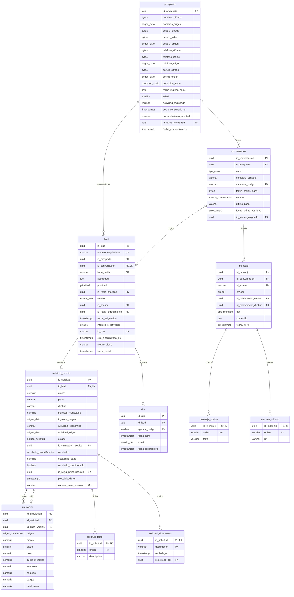
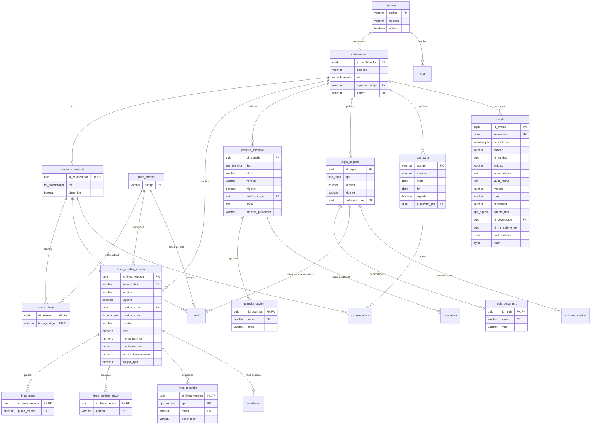

# Modelo de datos de July

| Campo | Valor |
|---|---|
| **ID** | DAT-01 |
| **Versión** | 1.1 |
| **Fecha** | 2026-11-18 |
| **Estado** | Borrador |
| **Deriva de** | [LIN-01 · Linaje de datos](../09-linaje-de-datos/linaje-de-datos-july.md), [CLS-01 · Diccionario de datos](../05-diccionario-de-datos/diccionario-de-datos-etapa3.md) (v3.2), [DOM-01 · Modelo de dominio](../04-modelo-de-dominio/modelo-de-dominio-etapa3.drawio) y las decisiones de datos de [REV-01, sección 5](../../../Complementarios/revisiones/revision-consistencia-etapa3.md) |
| **Implementación** | [DAT-02 · Script DDL para PostgreSQL 16](modelo-de-datos-july.sql) |
| **Diagrama** | [DAT-03 · Diagrama entidad-relación en draw.io](modelo-de-datos-july.drawio): las 26 tablas con todas sus columnas, las relaciones con notación pata de gallo y los tipos enumerados, en una sola página |
| **Relacionado con** | [SAD-02 · Seguridad](../../../Complementarios/arquitectura/seguridad-bots-suplantacion-y-veracidad.md) (cifrado, índice ciego, bitácora), [SAD-01](../../../Complementarios/arquitectura/documento-arquitectura-software-july.docx) (vista de datos) |

> **Propósito.** Este documento lleva el diccionario de datos (CLS-01) a un **modelo lógico y físico relacional**, guiado por el linaje de datos (LIN-01): cada tabla sale de una clase «entidad», cada columna de un atributo o de una brecha de linaje (B-NN), y cada restricción de un punto de control de calidad (PC-NN) o de una regla de CLS-01. El script DAT-02 lo implementa y fue ejecutado en PostgreSQL 16 ([sección 11](#11-verificación)).
>
> **Lo que no es.** No cambia CLS-01 ni CLS-02. Las columnas que vienen de las brechas de LIN-01 son propuestas: si se aprueban, también deben llegar a CLS-01 y CLS-02 ([sección 7.4](#74-diferencias-con-cls-01)).

## Contenido

1. [Resumen](#1-resumen)
2. [Alcance y niveles del modelo](#2-alcance-y-niveles-del-modelo)
3. [Criterios de transformación](#3-criterios-de-transformación)
4. [Qué incorpora del linaje](#4-qué-incorpora-del-linaje)
5. [Diagramas entidad-relación](#5-diagramas-entidad-relación)
6. [Diccionario de tablas](#6-diccionario-de-tablas)
7. [Correspondencia con CLS-01](#7-correspondencia-con-cls-01)
8. [Reglas de integridad](#8-reglas-de-integridad)
9. [Vistas](#9-vistas)
10. [Seguridad y datos personales](#10-seguridad-y-datos-personales)
11. [Verificación](#11-verificación)
12. [Decisiones abiertas](#12-decisiones-abiertas)
13. [Mantenimiento](#13-mantenimiento)

---

## 1. Resumen

| Elemento | Cantidad | Detalle |
|---|---|---|
| Tablas | 26 | 13 principales (las 12 clases «entidad» persistentes de CLS-01; `LineaCredito` se divide en identidad y versión), 10 tablas hijas de listas y mapas, 3 catálogos y registros nuevos (`agencia`, `campana`, `evento`) |
| Tipos enumerados | 17 | 13 de CLS-01 y 4 nuevos de LIN-01 |
| Claves foráneas | 39 | Las 12 asociaciones y composiciones de CLS-01, la generalización del asesor, las dependencias «usa» que el linaje pide guardar y las tablas hijas |
| Restricciones `CHECK` con nombre | 28 | Invariantes de CLS-01 y puntos de control de LIN-01 |
| Triggers | 6 | Bitácora encadenada e inalterable (3), configuración publicada inmutable (3) |
| Vistas | 4 | Carga del asesor, línea vigente, regla vigente y ficha del lead |
| Brechas de LIN-01 resueltas en el modelo | 9 de 10 | B-01 a B-08 y B-10; B-09 se resuelve en el panel, no en la base ([sección 4](#4-qué-incorpora-del-linaje)) |

## 2. Alcance y niveles del modelo

| Nivel | Documento | Qué describe |
|---|---|---|
| Conceptual | DOM-01 | Conceptos del negocio, sus atributos y asociaciones, sin tipos |
| Lógico de clases | CLS-01, CLS-02 | Clases, atributos tipados, métodos y relaciones |
| **Lógico relacional** | **DAT-01 (este documento)** | Tablas, columnas, claves, cardinalidades y restricciones, normalizado a tercera forma normal |
| **Físico** | **DAT-02** | DDL para PostgreSQL 16: tipos, índices, triggers, vistas y comentarios |

**Sistema gestor.** PostgreSQL 16, como decidió REV-01 (sección 5, «Datos»): enumeraciones como `ENUM`, dinero en `NUMERIC(14,2)`, tasas en `NUMERIC(7,4)`, versiones de configuración con índice único parcial y registro de auditoría de los cambios de estado.

**Fuera del modelo.**

- Las clases «control» e «interfaz» de CLS-01 (`July`, `Canal`, `SistemaCore`, `CRMCooperativa`): no guardan datos de negocio. Sus parámetros técnicos (`capacidadMaxima`, `tiempoAbandono`, `tiempoMaximoRespuesta`, `maxIntentos`, `credencial`) van en la configuración del despliegue y en el gestor de secretos, no en la base.
- La clase «interfaz» `PanelCooperativa` (añadida en CLS-01 v3.2 con las relaciones 40 y 41): es la vista de los colaboradores; sus atributos (`urlPanel`, `rolesConAcceso`, `tiempoRefresco`) son de despliegue y no datos de negocio.
- Los datos que viven en el Sistema core y en el CRM: July guarda solo la copia que el linaje justifica (`condicion_socio`, `id_crm`).

## 3. Criterios de transformación

| # | Criterio | Aplicación |
|---|---|---|
| T1 | **Cada clase «entidad» persistente es una tabla**, con nombre en `snake_case` y en singular. | `Prospecto` → `prospecto`, `SolicitudCredito` → `solicitud_credito` |
| T2 | **Clave primaria sustituta `UUID`** generada por la base (`gen_random_uuid()`), igual que los `id*` de CLS-01. Los catálogos usan su código como clave natural. | `id_lead`; `agencia.codigo`; `linea_credito.codigo` |
| T3 | **Generalización `AsesorComercial` → `Colaborador`:** una tabla por clase; la subclase comparte la clave de la superclase y un discriminador constante (`rol = 'ASESOR'`) en la clave foránea garantiza que solo un colaborador con rol de asesor sea asesor. | `asesor_comercial (id_colaborador, rol)` → `colaborador (id_colaborador, rol)` |
| T4 | **Clase abstracta `Configuracion`:** no tiene tabla; sus atributos (`version`, `vigente`, `publicado_por`) se repiten en cada clase concreta, más `publicado_en`. | `linea_credito_version`, `plantilla_mensaje`, `regla_negocio` |
| T5 | **Versionado de configuración:** una fila por versión publicada; un índice único parcial (`WHERE vigente`) permite una sola versión vigente por tipo y clave. La línea de crédito separa su **identidad** (`linea_credito`) de sus **versiones** (`linea_credito_version`), porque el lead y el asesor apuntan a la línea y la simulación apunta a la versión. | `ux_linea_vigente`, `ux_plantilla_vigente`, `ux_regla_vigente` |
| T6 | **Listas y mapas a tablas hijas** (primera forma normal), con `orden` cuando el orden importa. | `LineaCredito.plazos` → `linea_plazo`; `ReglaNegocio.parametros` → `regla_parametro` |
| T7 | **Asociación:** clave foránea en el lado «muchos». **0..1 — 1:** clave foránea con `UNIQUE`. **Composición:** clave foránea `NOT NULL` con `ON DELETE CASCADE`. | `lead.id_conversacion UNIQUE`; `mensaje.id_conversacion … ON DELETE CASCADE` |
| T8 | **Extremos navegables inversos** (`Conversacion.historial`, `Lead.solicitud`, `Lead.citas`, `AsesorComercial.leads`) no son columnas: se obtienen por la clave foránea del otro lado. | `AsesorComercial.leads` = `lead.id_asesor` |
| T9 | **Datos derivados** (`/cargaActual`, la ficha, la tabla de amortización, la explicación del resultado) no se guardan; los que se consultan seguido son vistas. | `v_asesor_carga`, `v_ficha_lead` |
| T10 | **Enumeraciones a `ENUM`.** Las que solo son parámetros de un método (`TipoPublicacion`, `TipoPlazo`, `CampoSolicitud`) no se guardan. | 13 de las 16 de CLS-01 |
| T11 | **Tipos:** `Decimal` de dinero → `NUMERIC(14,2)`; tasa → `NUMERIC(7,4)` como fracción; `Integer` de plazo o edad → `SMALLINT`; `DateTime` → `TIMESTAMPTZ`; `String` → `VARCHAR(n)` o `TEXT` para texto libre. | `simulacion.tasa = 0.1800` |
| T12 | **Integridad cruzada con claves compuestas:** cuando dos referencias deben ser coherentes entre sí, la clave foránea incluye ambas columnas. | La simulación elegida es de la misma solicitud; el lead y su conversación tienen el mismo prospecto; una regla referida como «prioridad» es de tipo PRIORIDAD |
| T13 | **Datos personales de identidad cifrados en la aplicación** (SAD-02): la base guarda `BYTEA` cifrado y, para buscar, un índice ciego HMAC. | `cedula_cifrada`, `cedula_indice` |
| T14 | **Linaje en el modelo:** cada dato cuyo origen o versión importa guarda ese origen o esa versión, y cada cambio de estado deja un evento en la bitácora. | Columnas `*_origen`, `id_regla_*`, `id_linea_version`; tabla `evento` |

## 4. Qué incorpora del linaje

### 4.1 Brechas de LIN-01

| Brecha (LIN-01) | Solución en el modelo | Tablas y columnas |
|---|---|---|
| **B-01** Los datos no guardan su origen | Enumeración `origen_dato` (DECLARADO, CORE, VERIFICADO_AGENCIA) junto a cada dato sensible a la veracidad; un `CHECK` exige que el origen exista cuando existe el dato | `prospecto.nombres_origen`, `cedula_origen`, `telefono_origen`, `correo_origen`; `solicitud_credito.ingresos_origen`, `actividad_origen` |
| **B-02** Los resultados no guardan la versión de la configuración | Clave foránea a la **versión** publicada que produjo cada resultado, con tipo de regla verificado (T12), siguiendo el patrón de `versionAviso` | `solicitud_credito.id_regla_precalificacion`; `lead.id_regla_prioridad`, `id_regla_enrutamiento`; `simulacion.id_linea_version`; `prospecto.id_aviso_privacidad` |
| **B-03** No hay bitácora de cambios de estado | Tabla `evento` de solo inserción: cada fila guarda entidad, atributo, valor anterior y nuevo, método, paso de CU-08, capacidad de nivel 3 y agente; encadenada por huella SHA-256 | `evento`; `fn_evento_verificar()` |
| **B-04** No se sabe qué mensaje originó cada dato | Referencia al mensaje de origen en cada evento | `evento.id_mensaje_origen` |
| **B-05** Seguros y cargos sin fuente | Parámetros de seguros y cargos en la versión de la línea, publicados por el Área de productos y crédito | `linea_credito_version.seguro_tasa_mensual`, `cargos_fijos` |
| **B-06** La campaña no llega al CRM y no tiene catálogo | Catálogo `campana` publicado por marketing; la conversación guarda la etiqueta tal como llegó y la campaña reconocida; la ficha incluye ambas | `campana`; `conversacion.campana_etiqueta`, `campana_codigo`; `v_ficha_lead` |
| **B-07** La ficha no se guarda | Se mantiene como dato derivado (vista `v_ficha_lead`); el momento de cada envío al CRM queda en `lead.crm_sincronizado_en` y en la bitácora | `v_ficha_lead`; `lead.crm_sincronizado_en` |
| **B-08** Los mensajes salientes no se registran de forma explícita | La tabla `mensaje` guarda también lo que envía July y los avisos a colaboradores, con su emisor y su destinatario | `mensaje.emisor`, `id_colaborador_emisor`, `id_colaborador_destino` |
| **B-09** Resolución, documentos y cierre como texto libre | **No se resuelve en la base:** requiere opciones cerradas en el panel. El modelo sí guarda quién registró cada documento | `solicitud_documento.registrado_por` |
| **B-10** Colaboradores y asesores sin fuente | Catálogo `agencia` y relación `asesor_linea` con integridad referencial. Falta todavía el servicio de CAP-03 que los mantenga | `agencia`; `asesor_linea`; `colaborador.agencia_codigo` |

### 4.2 Puntos de control de LIN-01 que implementa la base

| PC (LIN-01) | Restricción |
|---|---|
| PC-02 Unicidad del mensaje del proveedor | Índice único parcial `ux_mensaje_id_externo` |
| PC-03 Consentimiento previo | `ck_prospecto_consentimiento`: aceptado exige versión del aviso y fecha; `fk_prospecto_aviso` exige que la versión sea un AVISO_PRIVACIDAD |
| PC-07 Monto y plazo válidos | `CHECK` de positividad en `solicitud_credito` y `simulacion`; el rango contra la línea vigente lo valida la aplicación |
| PC-08 Solicitud completa al confirmar | `ck_solicitud_completa` |
| PC-10 Una versión vigente de cada configuración | `ux_linea_vigente`, `ux_plantilla_vigente`, `ux_regla_vigente`; triggers de inmutabilidad |
| PC-11 Resultado condicionado | `solicitud_credito.resultado_condicionado` |
| PC-12 Duplicados en el CRM | `lead.id_crm UNIQUE` |
| PC-13 Lead pendiente en el CRM | Índice `ix_lead_pendiente_crm` para la cola de reintentos |
| PC-14 Ficha con faltantes marcados | Columna `datos_faltantes` de `v_ficha_lead` |
| PC-15 Motivo obligatorio para PERDIDO | `ck_lead_motivo` |

PC-01, PC-04, PC-05, PC-06 y PC-09 ocurren antes de que el dato llegue a la base (en el canal, en la conversación o contra el core) y quedan en la aplicación.

## 5. Diagramas entidad-relación

Las dos vistas Mermaid de esta sección resumen el modelo para leerlo en el repositorio. La vista completa, con el tipo y la clave de cada columna, los dominios de datos y los tipos enumerados, es [DAT-03](modelo-de-datos-july.drawio).

### 5.1 Operación: prospecto, conversación, lead, solicitud y cita

### 5.2 Configuración, personas de la cooperativa y bitácora

Las entidades que aparecen sin atributos (`lead`, `simulacion`, `solicitud_credito`, `prospecto`, `conversacion`, `cita`) son las de la vista 5.1, repetidas para mostrar de dónde reciben sus referencias.

## 6. Diccionario de tablas

Columnas: **Nulo** = admite nulo; **Origen** = atributo de CLS-01 o brecha de LIN-01; **Linaje** = tipo de dato según LIN-01, sección 9 (D declarado, V verificado, G generado, C calculado, P publicado, O registrado por un rol operativo), y la capacidad de nivel 3 que lo escribe primero.

### 6.1 Identidad y consentimiento (DD-2)

#### `prospecto`

Persona que contacta a la cooperativa. Se crea con el primer mensaje (1.1.2.1, paso 1·5).

| Columna | Tipo | Nulo | Restricción | Origen | Linaje |
|---|---|---|---|---|---|
| `id_prospecto` | `UUID` | No | PK | `idProspecto` | G · 1.1.2.1 |
| `nombres_cifrado` | `BYTEA` | Sí | Con `nombres_origen` | `nombres` | D o V · 1.2.2.2, 2.1.1.1 |
| `nombres_origen` | `origen_dato` | Sí | `ck_prospecto_nombres` | B-01 | — |
| `cedula_cifrada` | `BYTEA` | Sí | Con origen e índice | `cedula` | D o V · 2.1.1.1 |
| `cedula_indice` | `BYTEA` | Sí | Índice `ix_prospecto_cedula` | `cedula` (búsqueda) | HMAC de la cédula normalizada |
| `cedula_origen` | `origen_dato` | Sí | `ck_prospecto_cedula` | B-01 | — |
| `telefono_cifrado` | `BYTEA` | Sí | Con origen e índice | `telefono` | Metadato del canal (WhatsApp) o D · 1.1.2.1, 2.1.1.1 |
| `telefono_indice` | `BYTEA` | Sí | Índice `ix_prospecto_telefono` | `telefono` (búsqueda) | HMAC del teléfono normalizado |
| `telefono_origen` | `origen_dato` | Sí | `ck_prospecto_telefono` | B-01 | — |
| `correo_cifrado` | `BYTEA` | Sí | Con `correo_origen` | `correo` | D o V · 2.1.1.1 |
| `correo_origen` | `origen_dato` | Sí | `ck_prospecto_correo` | B-01 | — |
| `condicion_socio` | `condicion_socio` | No | Por defecto POR_VERIFICAR | `condicionSocio` | V · 1.2.2.2, 2.3.1.2 |
| `fecha_ingreso_socio` | `DATE` | Sí | Solo si SOCIO (`ck_prospecto_socio`) | `fechaIngresoSocio` | V · 1.2.2.2 |
| `edad` | `SMALLINT` | Sí | 0 a 120 | `edad` | V · 2.3.1.2 |
| `actividad_registrada` | `VARCHAR(150)` | Sí | — | `actividadRegistrada` | V · 2.3.1.2 |
| `socio_consultado_en` | `TIMESTAMPTZ` | Sí | — | LIN-01, F-04 | G · momento de la última respuesta del core |
| `consentimiento_aceptado` | `BOOLEAN` | No | Por defecto false | `consentimientoAceptado` | D · 1.2.1.2 |
| `id_aviso_privacidad` | `UUID` | Sí | FK compuesta a `plantilla_mensaje` de tipo AVISO_PRIVACIDAD | `versionAviso` (B-02) | P · 1.2.1.2 |
| `tipo_aviso` | `tipo_plantilla` | No | Constante AVISO_PRIVACIDAD (T12) | — | — |
| `fecha_consentimiento` | `TIMESTAMPTZ` | Sí | Obligatoria si aceptó (`ck_prospecto_consentimiento`) | `fechaConsentimiento` | G · 1.2.1.2 |
| `creado_en` | `TIMESTAMPTZ` | No | Por defecto `now()` | — | G · 1.1.2.1 |

### 6.2 Interacción (DD-1)

#### `conversacion`

| Columna | Tipo | Nulo | Restricción | Origen | Linaje |
|---|---|---|---|---|---|
| `id_conversacion` | `UUID` | No | PK; `UNIQUE (id_conversacion, id_prospecto)` | `idConversacion` | G · 1.1.2.1 |
| `id_prospecto` | `UUID` | No | FK → `prospecto` | `prospecto` (relación 5) | G · 1.1.2.1 |
| `canal` | `tipo_canal` | No | — | `canal` | Metadato · 1.1.2.1 |
| `campana_etiqueta` | `VARCHAR(120)` | Sí | — | `campana` (valor recibido, B-06) | Metadato · 1.1.1.3 |
| `campana_codigo` | `VARCHAR(60)` | Sí | FK → `campana`; exige etiqueta | B-06 | P · 1.1.1.3 |
| `token_sesion_hash` | `BYTEA` | Sí | Solo en WEB | `tokenSesion` (solo su huella) | G · 1.1.1.2 |
| `estado` | `estado_conversacion` | No | Por defecto ACTIVA; DERIVADA exige asesor | `estado` | G · 1.1.2.1 y siguientes |
| `ultimo_paso` | `VARCHAR(12)` | No | Por defecto «1·5» | `ultimoPaso` | G · 2.1.2.2 |
| `fecha_ultima_actividad` | `TIMESTAMPTZ` | No | Índice parcial de abandono | `fechaUltimaActividad` | G · 1.1.2.1, 2.1.2.2 |
| `id_asesor_asignado` | `UUID` | Sí | FK → `asesor_comercial` | `asesorAsignado` (relación 6) | O · 1.2.1.3, 3.2.1.3 |
| `abierta_en` | `TIMESTAMPTZ` | No | Por defecto `now()` | — | G · 1.1.2.1 |

#### `mensaje`

| Columna | Tipo | Nulo | Restricción | Origen | Linaje |
|---|---|---|---|---|---|
| `id_mensaje` | `UUID` | No | PK | `idMensaje` | G · 1.1.2.1 |
| `id_conversacion` | `UUID` | No | FK → `conversacion`, en cascada | Composición (relación 1) | G |
| `id_externo` | `VARCHAR(128)` | Sí | Único si existe (PC-02) | `idExterno` | Metadato · 1.1.1.1 |
| `emisor` | `emisor` | No | — | `emisor` | G |
| `id_colaborador_emisor` | `UUID` | Sí | FK → `colaborador`; obligatorio si el emisor es ASESOR o COLABORADOR | B-08 (fuentes F-07, F-09, F-10) | O |
| `id_colaborador_destino` | `UUID` | Sí | FK → `colaborador`; nulo = al prospecto | B-08 (destinos D-02, D-04 a D-08) | G |
| `tipo` | `tipo_mensaje` | No | — | `tipo` | Metadato o G |
| `contenido` | `TEXT` | No | Por defecto '' | `contenido` | D, G u O |
| `fecha_hora` | `TIMESTAMPTZ` | No | Índice del historial | `fechaHora` | Metadato o G |

`Mensaje.firma` no se guarda: solo sirve para verificar la autenticidad en tránsito (PC-01) y LIN-01 la clasifica como dato sin valor de negocio.

**Tablas hijas:** `mensaje_opcion (id_mensaje, orden, texto)` ← `Mensaje.opciones`; `mensaje_adjunto (id_mensaje, orden, url)` ← `Mensaje.adjuntos`. Ambas con PK compuesta y borrado en cascada.

### 6.3 Oportunidad comercial (DD-3)

#### `lead`

| Columna | Tipo | Nulo | Restricción | Origen | Linaje |
|---|---|---|---|---|---|
| `id_lead` | `UUID` | No | PK | `idLead` | G · 1.2.2.3 |
| `numero_seguimiento` | `VARCHAR(20)` | No | `UNIQUE` | `numeroSeguimiento` | G · 1.2.2.3 |
| `id_prospecto` | `UUID` | No | FK compuesta con la conversación | `prospecto` (relación 7) | G · 1.2.2.3 |
| `id_conversacion` | `UUID` | No | `UNIQUE`; FK compuesta → `conversacion (id_conversacion, id_prospecto)` | `conversacion` (relación 8) | G · 1.2.2.3 |
| `linea_codigo` | `VARCHAR(20)` | No | FK → `linea_credito` | `lineaCredito` (relación 10) | D + P · 1.2.2.3, 2.2.2.2 |
| `necesidad` | `TEXT` | No | — | `necesidad` | D · 1.2.2.3 |
| `prioridad` | `prioridad` | Sí | Exige `id_regla_prioridad` | `prioridad` | C · 3.1.1.2, 3.2.2.1 |
| `id_regla_prioridad` | `UUID` | Sí | FK compuesta → `regla_negocio` de tipo PRIORIDAD | Relación 17 (B-02) | P · 3.1.1.2 |
| `tipo_regla_prioridad` | `tipo_regla` | No | Constante PRIORIDAD (T12) | — | — |
| `estado` | `estado_lead` | No | Por defecto NUEVO; ASIGNADO y EN_GESTION exigen asesor | `estado` | G · seis etapas |
| `id_asesor` | `UUID` | Sí | FK → `asesor_comercial`; va junto con fecha y regla | `asesor` (relación 9) | C · 3.2.1.1 |
| `id_regla_enrutamiento` | `UUID` | Sí | FK compuesta → `regla_negocio` de tipo ENRUTAMIENTO | Relación 17 (B-02) | P · 3.2.1.1 |
| `tipo_regla_enrutamiento` | `tipo_regla` | No | Constante ENRUTAMIENTO (T12) | — | — |
| `fecha_asignacion` | `TIMESTAMPTZ` | Sí | `ck_lead_asignacion` | `fechaAsignacion` | G · 3.2.1.1 |
| `intentos_reactivacion` | `SMALLINT` | No | ≥ 0; por defecto 0 | `intentosReactivacion` | C · 3.2.2.1 |
| `id_crm` | `VARCHAR(64)` | Sí | `UNIQUE` (PC-12) | `idCRM` | V · 3.1.2.1 |
| `crm_sincronizado_en` | `TIMESTAMPTZ` | Sí | Exige `id_crm` | LIN-01, D-03 | G · 3.1.2.1, 3.2.2.3 |
| `motivo_cierre` | `VARCHAR(300)` | Sí | Obligatorio si PERDIDO (PC-15) | `motivoCierre` | O · 3.2.2.3 |
| `fecha_registro` | `TIMESTAMPTZ` | No | Por defecto `now()` | `fechaRegistro` | G · 1.2.2.3 |

### 6.4 Solicitud y evaluación (DD-4)

#### `solicitud_credito`

| Columna | Tipo | Nulo | Restricción | Origen | Linaje |
|---|---|---|---|---|---|
| `id_solicitud` | `UUID` | No | PK | `idSolicitud` | G · 2.1.1.3 |
| `id_lead` | `UUID` | No | `UNIQUE`; FK → `lead`, en cascada | Composición (relación 2) | G · 2.1.1.3 |
| `monto` | `NUMERIC(14,2)` | Sí | > 0 | `monto` | D · 2.1.1.3 |
| `plazo` | `SMALLINT` | Sí | > 0 | `plazo` | D · 2.1.1.3 |
| `destino` | `VARCHAR(300)` | Sí | — | `destino` | D · 2.1.1.3 |
| `ingresos_mensuales` | `NUMERIC(14,2)` | Sí | ≥ 0; con origen | `ingresosMensuales` | D · 2.1.1.2 |
| `ingresos_origen` | `origen_dato` | Sí | `ck_solicitud_ingresos` | B-01 | — |
| `actividad_economica` | `VARCHAR(150)` | Sí | Con origen | `actividadEconomica` | D · 2.1.1.2 |
| `actividad_origen` | `origen_dato` | Sí | `ck_solicitud_actividad` | B-01 | — |
| `estado` | `estado_solicitud` | No | Por defecto EN_CAPTURA; fuera de EN_CAPTURA exige captura completa (PC-08); EN_RESOLUCION, APROBADA y NEGADA exigen APTO o A_REVISAR | `estado` | G y O · 2.1.1.1, 3.2.2.3 |
| `id_simulacion_elegida` | `UUID` | Sí | FK compuesta → `simulacion (id_simulacion, id_solicitud)` | `simulacionElegida` (relación 11) | D · 2.2.1.3 |
| `resultado` | `resultado_precalificacion` | Sí | Exige capacidad, simulación, regla y fecha | `resultado` | C · 2.3.1.3 |
| `capacidad_pago` | `NUMERIC(14,2)` | Sí | ≥ 0 | `capacidadPago` | C · 2.3.1.1 |
| `resultado_condicionado` | `BOOLEAN` | No | Por defecto false | `resultadoCondicionado` | C · 2.3.1.2 |
| `id_regla_precalificacion` | `UUID` | Sí | FK compuesta → `regla_negocio` de tipo PRECALIFICACION | Relación 18 (B-02) | P · 2.3.1.1 |
| `tipo_regla_precalificacion` | `tipo_regla` | No | Constante PRECALIFICACION (T12) | — | — |
| `precalificado_en` | `TIMESTAMPTZ` | Sí | — | LIN-01, L-01 | G · 2.3.1.1 |
| `numero_caso_revision` | `VARCHAR(20)` | Sí | `UNIQUE` | `numeroCasoRevision` | G · 2.3.1.3 |
| `creada_en` | `TIMESTAMPTZ` | No | Por defecto `now()` | — | G · 2.1.1.3 |

**Tablas hijas:** `solicitud_factor (id_solicitud, orden, descripcion)` ← `factores` (C · 2.3.1.3); `solicitud_documento (id_solicitud, documento, recibido_en, registrado_por)` ← `documentosRecibidos` (O · 3.2.2.2), con FK del colaborador que lo registró (B-09).

#### `simulacion`

| Columna | Tipo | Nulo | Restricción | Origen | Linaje |
|---|---|---|---|---|---|
| `id_simulacion` | `UUID` | No | PK; `UNIQUE (id_simulacion, id_solicitud)` | `idSimulacion` | G |
| `id_solicitud` | `UUID` | No | FK → `solicitud_credito`, en cascada | Composición (relación 3) | G |
| `id_linea_version` | `UUID` | No | FK → `linea_credito_version` | B-02 | P · 2.2.1.1 |
| `origen` | `origen_simulacion` | No | SOLICITADA, COMPARADA o SUGERIDA | LIN-01: 2.2.1.1, 2.2.1.3, 2.3.2.1 | — |
| `monto` | `NUMERIC(14,2)` | No | > 0 | `monto` | D o C |
| `plazo` | `SMALLINT` | No | > 0 | `plazo` | D o C |
| `tasa` | `NUMERIC(7,4)` | No | 0 ≤ tasa < 1 | `tasa` | P (copia) · 2.2.1.1 |
| `cuota_mensual` | `NUMERIC(14,2)` | No | > 0 | `cuotaMensual` | C: `monto × i / (1 − (1 + i)^−plazo)`, con `i = tasa / 12` |
| `intereses` | `NUMERIC(14,2)` | No | ≥ 0 | `intereses` | C: `cuota × plazo − monto` |
| `seguros` | `NUMERIC(14,2)` | No | ≥ 0; por defecto 0 | `seguros` | C con `seguro_tasa_mensual` (B-05) |
| `cargos` | `NUMERIC(14,2)` | No | ≥ 0; por defecto 0 | `cargos` | C con `cargos_fijos` (B-05) |
| `total_pagar` | `NUMERIC(14,2)` | No | = monto + intereses + seguros + cargos | `totalPagar` | C · 2.2.1.1 |
| `calculada_en` | `TIMESTAMPTZ` | No | Por defecto `now()` | — | G |

### 6.5 Agenda (DD-5)

#### `cita`

| Columna | Tipo | Nulo | Restricción | Origen | Linaje |
|---|---|---|---|---|---|
| `id_cita` | `UUID` | No | PK | `idCita` | G · 2.3.2.3 |
| `id_lead` | `UUID` | No | FK → `lead`, en cascada | Composición (relación 4) | G · 2.3.2.3 |
| `agencia_codigo` | `VARCHAR(10)` | No | FK → `agencia` | `agencia` | D sobre la agenda de F-09 · 2.3.2.3 |
| `fecha_hora` | `TIMESTAMPTZ` | No | — | `fechaHora` | D · 2.3.2.3, 3.2.2.2 |
| `estado` | `estado_cita` | No | Por defecto RESERVADA | `estado` | G y O · 2.3.2.3, 3.2.2.2 |
| `fecha_recordatorio` | `TIMESTAMPTZ` | Sí | Antes de `fecha_hora` | `fechaRecordatorio` | O · 3.2.2.1 |
| `reservada_en` | `TIMESTAMPTZ` | No | Por defecto `now()` | — | G · 2.3.2.3 |

### 6.6 Configuración (DD-6)

Las tres tablas de configuración comparten `version VARCHAR(20)`, `vigente BOOLEAN`, `publicado_por UUID` (FK → `colaborador`, relación 12) y `publicado_en TIMESTAMPTZ`; una versión publicada no se modifica ni se borra (trigger `fn_configuracion_inmutable`), solo cambia su vigencia.

| Tabla | Columnas propias | Clave única | Origen | Linaje |
|---|---|---|---|---|
| `linea_credito` | `codigo` (PK) | — | `LineaCredito.codigo` | P · F-06 |
| `linea_credito_version` | `id_linea_version` (PK), `linea_codigo` (FK), `nombre`, `tasa`, `monto_minimo`, `monto_maximo`, `seguro_tasa_mensual`, `cargos_fijos` | `(linea_codigo, version)`; una vigente por `linea_codigo` | `LineaCredito` + `Configuracion`; B-05 | P · F-06 (SA-21) |
| `linea_plazo` | `plazo_meses` | `(id_linea_version, plazo_meses)` | `plazos` | P |
| `linea_palabra_clave` | `palabra` | `(id_linea_version, palabra)` | `palabrasClave` | P |
| `linea_requisito` | `tipo` (LINEA o AFILIACION), `orden`, `descripcion` | `(id_linea_version, tipo, orden)` | `requisitos`, `requisitosAfiliacion` | P |
| `plantilla_mensaje` | `id_plantilla` (PK), `tipo`, `clave`, `texto`, `plantilla_proveedor` | `(tipo, clave, version)`; una vigente por `(tipo, clave)`; RETOMA, RECORDATORIO y REACTIVACION exigen `plantilla_proveedor` | `PlantillaMensaje` + `Configuracion` | P · F-05 (SA-20) |
| `plantilla_opcion` | `orden`, `texto` | `(id_plantilla, orden)` | `opciones` | P |
| `regla_negocio` | `id_regla` (PK), `tipo` | `(tipo, version)`; una vigente por `tipo` | `ReglaNegocio` + `Configuracion` | P · F-07 (SA-22), F-08 (SA-23) |
| `regla_parametro` | `clave`, `valor` | `(id_regla, clave)` | `parametros` | P |
| `campana` | `codigo` (PK), `nombre`, `inicio`, `fin`, `vigente`, `publicado_por` | — | B-06 | P · F-11 |

Parámetros esperados por tipo de regla (CLS-01): PRECALIFICACION: `porcentajeMaximoCuota`, `edadMinima`, `edadMaxima`. PRIORIDAD: condiciones de caliente, tibio y frío, `maxReactivaciones`. ENRUTAMIENTO: `cargaMaxima`, `plazoAtencion`.

### 6.7 Personas de la cooperativa (DD-7)

| Tabla | Columnas | Restricciones | Origen | Linaje |
|---|---|---|---|---|
| `agencia` | `codigo` (PK), `nombre`, `activa` | — | B-10 (catálogo de `Colaborador.agencia` y `Cita.agencia`) | P · administración |
| `colaborador` | `id_colaborador` (PK), `nombre`, `rol`, `agencia_codigo` (FK), `correo` (único) | `UNIQUE (id_colaborador, rol)`; ASESOR y AGENCIA exigen agencia | `Colaborador` | P · administración |
| `asesor_comercial` | `id_colaborador` (PK, FK), `rol` (constante ASESOR), `disponible` | FK compuesta → `colaborador (id_colaborador, rol)`, en cascada | `AsesorComercial` (relación 13) | O · F-10 (disponibilidad) |
| `asesor_linea` | `id_asesor` (FK), `linea_codigo` (FK) | PK compuesta | `AsesorComercial.productos` | P |

### 6.8 Bitácora de linaje

#### `evento`

Registro de solo inserción de cada cambio relevante (B-03), con el mensaje que lo originó (B-04). Es la implementación de la columna «Pasos» de LIN-01: cada fila dice qué capacidad, qué método y qué paso de CU-08 cambiaron qué atributo.

| Columna | Tipo | Nulo | Restricción | Contenido |
|---|---|---|---|---|
| `id_evento` | `BIGINT` | No | PK, identidad | Identificador técnico |
| `secuencia` | `BIGINT` | No | `UNIQUE`; la asigna el trigger | Orden de la cadena |
| `ocurrido_en` | `TIMESTAMPTZ` | No | Por defecto `now()` | Momento del cambio |
| `entidad`, `id_entidad`, `atributo` | `VARCHAR`, `UUID`, `VARCHAR` | No | Índice `(entidad, id_entidad, ocurrido_en)` | Qué cambió (clase y atributo de CLS-01) |
| `valor_anterior`, `valor_nuevo` | `TEXT` | Sí | Enmascarados si el dato es personal | Valores del cambio |
| `metodo` | `VARCHAR(80)` | No | — | Método de CLS-01 que lo produjo |
| `paso` | `VARCHAR(12)` | Sí | — | Paso de CU-08 («2·68») |
| `capacidad` | `VARCHAR(10)` | No | Formato de capacidad de nivel 3 | Capacidad de CAP-03 |
| `agente_tipo` | `tipo_agente` | No | — | Agente PROV que lo causó |
| `id_colaborador` | `UUID` | Sí | FK; obligatorio si el agente es COLABORADOR | Quién de la cooperativa |
| `id_mensaje_origen` | `UUID` | Sí | Sin FK, para sobrevivir a la supresión del mensaje | Mensaje que originó el dato (B-04) |
| `hash_anterior`, `hash` | `BYTEA` | Sí / No | Calculadas por el trigger | Huella SHA-256 encadenada |

**Encadenamiento.** El trigger `tg_evento_encadenar` toma un bloqueo consultivo, asigna la siguiente `secuencia`, copia la huella del evento anterior y calcula la propia sobre todos los campos (`fn_evento_hash`). Los triggers `tg_evento_inalterable` y `tg_evento_sin_truncate` rechazan `UPDATE`, `DELETE` y `TRUNCATE`. `fn_evento_verificar()` recorre la cadena y devuelve los eventos con huella alterada o cadena rota; vacío significa que la bitácora está íntegra. Los inserts deben hacerse con aislamiento READ COMMITTED.

## 7. Correspondencia con CLS-01

### 7.1 Clases

| Clase (CLS-01) | Naturaleza | Tabla o tratamiento |
|---|---|---|
| `Prospecto` | entidad | `prospecto` |
| `Colaborador` | entidad | `colaborador` |
| `AsesorComercial` | entidad | `asesor_comercial` + `asesor_linea` |
| `Conversacion` | entidad | `conversacion` |
| `Mensaje` | entidad | `mensaje` + `mensaje_opcion` + `mensaje_adjunto` |
| `Lead` | entidad | `lead` |
| `SolicitudCredito` | entidad | `solicitud_credito` + `solicitud_factor` + `solicitud_documento` |
| `Simulacion` | entidad | `simulacion` |
| `Cita` | entidad | `cita` |
| `Configuracion` | entidad abstracta | Sin tabla (T4) |
| `LineaCredito` | entidad | `linea_credito` + `linea_credito_version` + `linea_plazo` + `linea_palabra_clave` + `linea_requisito` |
| `PlantillaMensaje` | entidad | `plantilla_mensaje` + `plantilla_opcion` |
| `ReglaNegocio` | entidad | `regla_negocio` + `regla_parametro` |
| `July` | control | No se persiste |
| `Canal`, `SistemaCore`, `CRMCooperativa` | interfaz | No se persisten; su rastro queda en `mensaje.id_externo`, `prospecto.socio_consultado_en`, `lead.id_crm` |
| `PanelCooperativa` | interfaz | No se persiste; lo que los colaboradores registran en él llega como `mensaje` con `id_colaborador_emisor` |

### 7.2 Relaciones

| Relación (CLS-01) | Tipo | Implementación |
|---|---|---|
| 1 `Conversacion` ◆ `Mensaje` | Composición 1 — 0..* | `mensaje.id_conversacion` `NOT NULL`, en cascada |
| 2 `Lead` ◆ `SolicitudCredito` | Composición 1 — 0..1 | `solicitud_credito.id_lead` `NOT NULL UNIQUE`, en cascada |
| 3 `SolicitudCredito` ◆ `Simulacion` | Composición 1 — 0..* | `simulacion.id_solicitud` `NOT NULL`, en cascada |
| 4 `Lead` ◆ `Cita` | Composición 1 — 0..* | `cita.id_lead` `NOT NULL`, en cascada |
| 5 `Conversacion` → `Prospecto` | * — 1 | `conversacion.id_prospecto` `NOT NULL` |
| 6 `Conversacion` → `AsesorComercial` | * — 0..1 | `conversacion.id_asesor_asignado` |
| 7 `Lead` → `Prospecto` | * — 1 | `lead.id_prospecto` `NOT NULL`, coherente con la conversación (T12) |
| 8 `Lead` → `Conversacion` | 0..1 — 1 | `lead.id_conversacion` `NOT NULL UNIQUE` |
| 9 `Lead` → `AsesorComercial` | * — 0..1 | `lead.id_asesor` |
| 10 `Lead` → `LineaCredito` | * — 1 | `lead.linea_codigo` → `linea_credito` |
| 11 `SolicitudCredito` → `Simulacion` elegida | 0..1 — 0..1 | `solicitud_credito.id_simulacion_elegida`, FK compuesta con la solicitud |
| 12 `Configuracion` → `Colaborador` | * — 1 | `publicado_por` en `linea_credito_version`, `plantilla_mensaje` y `regla_negocio` |
| 13 `AsesorComercial` ▷ `Colaborador` | Generalización | `asesor_comercial` comparte la clave y el rol (T3) |
| 14 a 16 `LineaCredito`, `PlantillaMensaje`, `ReglaNegocio` ▷ `Configuracion` | Generalización | Columnas comunes en cada tabla (T4) |
| 17 `Lead` «usa» `ReglaNegocio` | Dependencia | Se guarda la versión usada (B-02): `lead.id_regla_prioridad`, `id_regla_enrutamiento` |
| 18 `SolicitudCredito` «usa» `ReglaNegocio` | Dependencia | Se guarda la versión usada (B-02): `solicitud_credito.id_regla_precalificacion` |
| 19 `SistemaCore` «usa» `Prospecto` | Dependencia | Sin FK; `prospecto.socio_consultado_en` |
| 20 `CRMCooperativa` «usa» `Lead` | Dependencia | Sin FK; `lead.id_crm`, `crm_sincronizado_en` |
| 21 a 39 «llama» | Dependencias de comportamiento | No se persisten; cada llamada que cambia un dato queda en `evento.metodo` y `evento.paso` |
| 40 y 41 `Colaborador` y `July` «usa» `PanelCooperativa` | Dependencias hacia el borde | No se persisten |

### 7.3 Enumeraciones

| CLS-01 | Tipo en la base |
|---|---|
| `TipoCanal`, `Emisor`, `TipoMensaje`, `EstadoConversacion`, `CondicionSocio`, `RolColaborador`, `EstadoLead`, `Prioridad`, `EstadoSolicitud`, `ResultadoPrecalificacion`, `EstadoCita`, `TipoPlantilla`, `TipoRegla` | Mismo nombre en `snake_case`, mismos valores |
| `TipoPublicacion`, `TipoPlazo`, `CampoSolicitud` | No se guardan (parámetros de métodos, T10) |
| — | Nuevas: `origen_dato` (B-01), `origen_simulacion`, `tipo_requisito`, `tipo_agente` (B-03) |

### 7.4 Diferencias con CLS-01

Estas diferencias son las que habría que llevar a CLS-01 y CLS-02 si el modelo se aprueba:

| Cambio | Motivo |
|---|---|
| Nuevos atributos: `*_origen` en `Prospecto` y `SolicitudCredito`; `versionReglas` (como referencia) en `SolicitudCredito`; criterio y enrutamiento usados en `Lead`; versión de la línea en `Simulacion`; `origen` en `Simulacion`; seguros y cargos en `LineaCredito`; destinatario y colaborador emisor en `Mensaje` | Brechas B-01, B-02, B-05 y B-08 de LIN-01 |
| Nuevas clases o catálogos: `Agencia`, `Campana`, `Evento` | B-10, B-06, B-03 y B-04 |
| `Prospecto.versionAviso` pasa de `String` a referencia a la versión publicada | B-02, sin perder información |
| `Mensaje.firma` y `Conversacion.tokenSesion` no se guardan en claro | Minimización y seguridad (SAD-02) |
| Nombres, cédula, teléfono y correo se guardan cifrados con índice ciego | REV-01, sección 5, y SAD-02 |

## 8. Reglas de integridad

### 8.1 En la base

| Regla | Restricción |
|---|---|
| Un dato personal guardado tiene origen | `ck_prospecto_nombres`, `_cedula`, `_telefono`, `_correo`; `ck_solicitud_ingresos`, `_actividad` |
| El consentimiento aceptado deja evidencia | `ck_prospecto_consentimiento`, `fk_prospecto_aviso` |
| Solo un socio tiene fecha de ingreso | `ck_prospecto_socio` |
| Una conversación derivada tiene asesor; el token solo existe en la web | `ck_conversacion_derivada`, `ck_conversacion_token` |
| La campaña reconocida conserva la etiqueta recibida | `ck_conversacion_campana` |
| Un mensaje de un colaborador dice quién lo escribió | `ck_mensaje_emisor` |
| Prioridad y asignación guardan la regla que las produjo | `ck_lead_prioridad`, `ck_lead_asignacion` |
| ASIGNADO y EN_GESTION tienen asesor; PERDIDO tiene motivo | `ck_lead_estado_asesor`, `ck_lead_motivo` |
| Solo se sincroniza un lead con identificador del CRM | `ck_lead_crm` |
| Confirmar exige captura completa; un resultado exige su evidencia; solo APTO o A_REVISAR pasan a resolución | `ck_solicitud_completa`, `ck_solicitud_precalificacion`, `ck_solicitud_resolucion` |
| El total a pagar suma sus componentes | `ck_simulacion_total` |
| El recordatorio es anterior a la cita | `ck_cita_recordatorio` |
| Montos de la línea coherentes; plantillas fuera de la ventana de 24 horas aprobadas por el proveedor | `ck_linea_montos`, `ck_plantilla_proveedor` |
| ASESOR y AGENCIA pertenecen a una agencia | `ck_colaborador_agencia` |
| La bitácora cita una capacidad de nivel 3 y al colaborador cuando actúa uno | `ck_evento_capacidad`, `ck_evento_colaborador` |

### 8.2 En la aplicación

| Regla | Dónde (CLS-01) | Por qué no en la base |
|---|---|---|
| Transiciones válidas de `EstadoLead`, `EstadoConversacion`, `EstadoSolicitud` y `EstadoCita` (CLS-01, sección 3) | Métodos que fijan cada estado | Dependen del paso del flujo; la base solo valida los invariantes de cada estado |
| Formato de cédula (dígito verificador), teléfono y correo | `SolicitudCredito.registrarDato()` | Los valores llegan cifrados |
| Monto y plazo dentro de la línea vigente | `registrarDato()`, `LineaCredito.validarCondiciones()` | Requiere consultar tablas hijas de otra versión |
| El colaborador que publica tiene el rol que corresponde al tipo de configuración | Back-office (SA-20 a SA-23) | Fuera del alcance del reto |
| Cada cambio de estado escribe su evento en la misma transacción | Capa de persistencia | Requiere el método, el paso y el mensaje, que la base no conoce |
| Enmascarar los valores personales en `evento` | Capa de persistencia | La base no distingue qué texto es personal |

## 9. Vistas

| Vista | Qué devuelve | Dato de CLS-01 o LIN-01 |
|---|---|---|
| `v_asesor_carga` | Cada asesor con su agencia, disponibilidad y cantidad de leads en ASIGNADO o EN_GESTION | `AsesorComercial./cargaActual` (derivado) |
| `v_linea_vigente` | La versión vigente de cada línea con plazos, requisitos y requisitos de afiliación | Lo que devuelve `consultarPublicacion(CATALOGO)` |
| `v_regla_vigente` | La versión vigente de cada tipo de regla con sus parámetros en JSON | `consultarPublicacion(PRECALIFICACION \| PRIORIDAD \| ENRUTAMIENTO)` |
| `v_ficha_lead` | La ficha del lead sin los datos cifrados: estado, prioridad, línea, canal y campaña, condición de socio, origen de cada dato, solicitud, resultado con la versión de la regla, simulación elegida con la versión de la línea, factores, próxima cita y datos faltantes | `Lead.generarFicha()`; B-01, B-02, B-06, B-07; PC-14 |

## 10. Seguridad y datos personales

| Medida | Implementación | Referencia |
|---|---|---|
| Cifrado por columna de la identidad | `*_cifrado` en `prospecto`; la aplicación cifra con AES-256 y las llaves viven en un KMS, fuera de la base | SAD-02 (base de datos, puntos 1 y 2); REV-01 |
| Búsqueda sin descifrar | `cedula_indice`, `telefono_indice` (HMAC-SHA256 del valor normalizado) | SAD-02 |
| Minimización | No se guardan la firma del webhook ni el token en claro | LIN-01, 1.1.2.3 |
| Integridad de la configuración | Versiones inmutables con `publicado_por` | SAD-02 (clase «Configuración») |
| Bitácora inalterable | `evento` de solo inserción y encadenada | SAD-02 (base de datos, punto 4) |
| Evidencia de consentimiento | `consentimiento_aceptado`, `id_aviso_privacidad`, `fecha_consentimiento` y el evento con el mensaje de origen | LOPDP; SAD-02 (punto 5) |
| Cifrado en reposo del resto | Contenido de mensajes y datos financieros declarados: cifrado del almacenamiento | SAD-02 (clases «Financiera declarada» y «Operacional») |

**Recomendado para el despliegue** (SAD-02, base de datos, punto 3; no está en DAT-02): usuarios separados para July, el panel y los reportes, ninguno dueño del esquema; seguridad por fila para que un asesor solo lea los leads de su agencia; revocar `UPDATE` y `DELETE` sobre `evento` a todos los usuarios de la aplicación.

## 11. Verificación

El script DAT-02 se ejecutó en **PostgreSQL 16.14** (contenedor `postgres:16`) el 2026-11-12:

1. **Creación:** el esquema `july` se crea sin errores: 26 tablas, 17 tipos enumerados, 39 claves foráneas, 28 restricciones `CHECK` con nombre, 6 triggers y 4 vistas.
2. **Recorrido válido:** se cargó la configuración y un lead de punta a punta (flujo 1: prospecto, conversación con campaña, consentimiento, lead; flujo 2: solicitud, dos simulaciones, elección, precalificación APTO, cita; flujo 3: prioridad, CRM, asignación, traspaso, recordatorio, documentos, resolución, desembolso). `v_ficha_lead` devuelve el lead con su campaña, el origen de los ingresos, la versión de la regla («acta-12») y de la línea, y sin datos faltantes. `fn_evento_verificar()` devuelve 0 problemas.
3. **19 casos inválidos, todos rechazados:** PERDIDO sin motivo; total a pagar que no suma; dos versiones vigentes de una línea; cambiar la tasa de una versión publicada; borrar una regla publicada; modificar, borrar y truncar la bitácora; prioridad con una regla de otro tipo; simulación elegida de otra solicitud; lead con un prospecto distinto al de su conversación; mensaje duplicado del proveedor; consentimiento sin versión del aviso; aviso que no es de privacidad; dato personal sin origen; asesor sin rol de asesor; confirmar una solicitud incompleta; plantilla de reactivación sin plantilla aprobada; evento con una capacidad que no es de nivel 3.
4. **Cambio de versión permitido:** desactivar la versión vigente de una línea y publicar otra funciona, y `v_linea_vigente` devuelve la nueva.
5. **Detección de alteraciones:** con los triggers desactivados (como podría hacerlo un superusuario) se alteró un evento; `fn_evento_verificar()` lo informa como «huella alterada».

Los diagramas Mermaid de la sección 5 no se verificaron en un visor.

## 12. Decisiones abiertas

| # | Decisión | Con quién | Afecta |
|---|---|---|---|
| D1 | Plazos de conservación por clase de dato (conversaciones, leads perdidos, bitácora) y si se borra o se anonimiza al vencer | Delegado de protección de datos | Procedimiento de supresión; `evento` guarda solo valores enmascarados |
| D2 | Forma de los seguros y cargos: tasa mensual sobre el saldo, porcentaje del monto o valor fijo | Área de productos y crédito | `linea_credito_version.seguro_tasa_mensual`, `cargos_fijos` |
| D3 | Quién mantiene el catálogo de agencias, los colaboradores y las líneas de cada asesor | Jefe comercial y administración | `agencia`, `colaborador`, `asesor_linea` (B-10) |
| D4 | Si el CRM es el sistema de registro de la ficha o July debe guardar cada ficha enviada | Jefe comercial | B-07 |
| D5 | Si se aprueban las brechas de LIN-01, para llevarlas a CLS-01 y CLS-02 | Equipo de arquitectura | Sección 7.4 |

## 13. Mantenimiento

| Si cambia… | Actualizar |
|---|---|
| Un atributo o una clase de CLS-01 | La tabla de la sección 6, la correspondencia de la sección 7 y DAT-02 |
| Una brecha o un punto de control de LIN-01 | Las secciones 4 y 8 |
| El script DAT-02 | Volver a ejecutarlo en un PostgreSQL 16 limpio y actualizar la sección 11 |

Cada cambio se registra en [`Documentacion/README.md`](../../../README.md) con su nueva versión.
