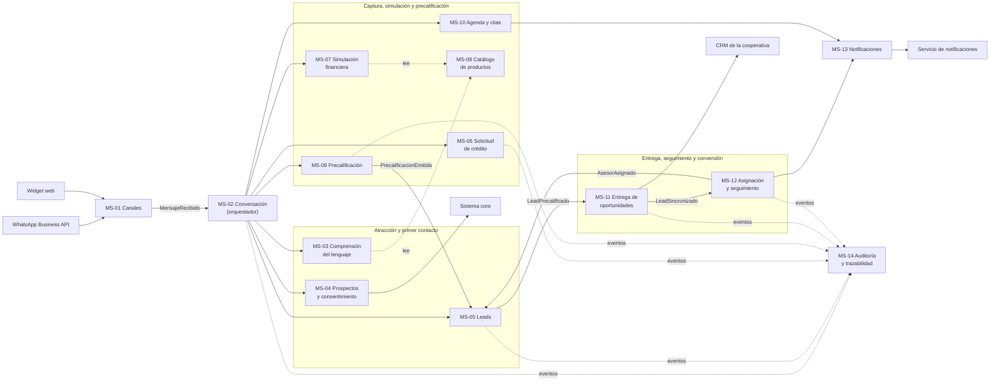

# Microservicios de July a partir del mapa de capacidades

| Campo | Valor |
|---|---|
| **ID** | SAD-03 |
| **Versión** | 1.0 |
| **Fecha** | 2026-11-12 |
| **Estado** | Borrador |
| **Deriva de** | CAP-03 (capacidades, flujos de valor y servicios SA-01 a SA-25), CAP-04, LIN-01 (dominios de datos y matriz capacidad × entidad), DAT-01 (tablas), REV-01 (vista de desarrollo) |
| **Alimenta a** | SAD-01, vistas de implementación y despliegue (hoy en blanco) |

> **Para qué sirve.** Propone cómo partir July en microservicios usando el mapa de capacidades de CAP-03 como frontera. Cada capacidad de nivel 3 queda en manos de un solo microservicio y cada tabla de DAT-01 tiene un solo dueño.
>
> **Lo que no es:** no cambia la cadena de trazabilidad. CLS-01 sigue teniendo un único control `July`. Aquí ese control se reparte entre servicios, y el orquestador queda en MS-02.

## Contenido

1. [Criterios de identificación](#1-criterios-de-identificación)
2. [Tabla resumen de microservicios](#2-tabla-resumen-de-microservicios)
3. [Correspondencia capacidad → microservicio](#3-correspondencia-capacidad--microservicio)
4. [Vista por flujo de valor](#4-vista-por-flujo-de-valor)
5. [Decisiones y pendientes](#5-decisiones-y-pendientes)

## 1. Criterios de identificación

| # | Criterio | Cómo se aplicó |
|---|---|---|
| C1 | **La capacidad de nivel 1 es la frontera por defecto.** | Las 7 capacidades de nivel 1 (1.1 a 3.2) dan el primer corte. |
| C2 | **Se parte por nivel 2 cuando el dueño del dato, su ritmo de cambio o su escala son distintos.** | 2.2 se separa en cálculo (2.2.1) y catálogo (2.2.2): el catálogo lo publica el Área de productos y lo leen cinco servicios. 1.2 se separa en conversación, comprensión del lenguaje, prospectos y leads. |
| C3 | **Un solo escritor por entidad.** | Se usan los dominios DD-1 a DD-7 y la matriz C/A/L de LIN-01. `Lead` lo actualizan 10 capacidades, así que MS-05 es su único escritor. Las demás capacidades le mandan comandos o eventos. |
| C4 | **Cada sistema externo entra por un solo servicio** (capa anticorrupción). | WhatsApp y widget → MS-01. Sistema core → MS-04. CRM → MS-11. Servicio de notificaciones → MS-13. |
| C5 | **La configuración la publica el servicio dueño de la regla.** | SA-20 a SA-23 no forman un servicio aparte. Cada tipo de `Configuracion` vive con quien la usa y se versiona igual en todos (una sola versión vigente). |
| C6 | **Lo transversal se separa solo si tiene datos propios.** | La bitácora `evento` (SA-24) y los avisos internos son servicios. El gateway, el broker y el IAM son plataforma, no microservicios. |

## 2. Tabla resumen de microservicios

Tipo según DDD: **Núcleo** (diferencia a la cooperativa), **Soporte** (necesario pero propio del negocio) o **Genérico** (resuelto de forma estándar).

| ID | Microservicio | Capacidad de nivel 1 | Capacidades de nivel 2 y 3 | Servicios SA | Datos propios (tablas de DAT-01) | Sistemas externos | Eventos principales que publica | Tipo |
|---|---|---|---|---|---|---|---|---|
| **MS-01** | Canales | 1.1 Canales de contacto | 1.1.1 Recepción multicanal (1.1.1.1 a 1.1.1.3) · 1.1.2 Unificación de mensajes (1.1.2.1 a 1.1.2.3) | SA-01 (entrada y salida) | `campana`; deduplicación por `idExterno` y cola de entrada (Redis) | WhatsApp Business API, Widget web | `MensajeRecibido`, `MensajeEntregado` | Genérico |
| **MS-02** | Conversación (orquestador) | 1.2 Primer contacto · 2.1 Perfilamiento · 3.2 Asignación y seguimiento | 1.2.1.1 Respuesta automática · 1.2.1.3 Derivación a asesor · 2.1.2.2 Guardado del avance · 2.1.2.3 Retoma tras abandono · 3.2.1.3 Traspaso con contexto | SA-01 (respuesta), SA-06, SA-08, SA-16, SA-20 (guiones y plantillas) | `conversacion`, `mensaje`, `mensaje_opcion`, `mensaje_adjunto`, `plantilla_mensaje`, `plantilla_opcion` | — (canales por MS-01) | `ConversacionIniciada`, `ConversacionDerivada`, `ConversacionAbandonada`, `ConversacionRetomada` | Núcleo |
| **MS-03** | Comprensión del lenguaje | 1.2 Primer contacto | 1.2.2.1 Detección de intención (y extracción de valores para 2.1.1) | SA-04, SA-20 (intenciones) | Ninguno (sin estado). Lee palabras clave de MS-08 y preguntas frecuentes de MS-02 | Proveedor de LLM | `IntencionDetectada` | Soporte |
| **MS-04** | Prospectos y consentimiento | 1.2 Primer contacto · 2.1 Perfilamiento | 1.2.1.2 Consentimiento de datos · 1.2.2.2 Reconocimiento de socio · 2.1.1.1 Identidad y contacto | SA-02, SA-05, SA-25 | `prospecto` (cédula y teléfono cifrados) | Sistema core | `ConsentimientoAceptado`, `ConsentimientoRetirado`, `SocioReconocido`, `IdentidadValidada` | Núcleo |
| **MS-05** | Leads | 1.2 Primer contacto · 3.2 Asignación y seguimiento | 1.2.2.3 Registro del lead · 3.2.2.3 Estados y cierre (y todas las transiciones de `EstadoLead`) | SA-03, SA-19 | `lead` | — (CRM por MS-11) | `LeadRegistrado`, `LeadPrecalificado`, `LeadAsignado`, `LeadCerrado` | Núcleo |
| **MS-06** | Solicitud de crédito | 2.1 Perfilamiento | 2.1.1.2 Ingresos y actividad · 2.1.1.3 Monto, plazo y destino · 2.1.2.1 Validación de formatos | SA-07 | `solicitud_credito`, `solicitud_factor`, `solicitud_documento` | — | `SolicitudConfirmada`, `EscenarioElegido`, `DocumentosRecibidos` | Núcleo |
| **MS-07** | Simulación financiera | 2.2 Simulación financiera | 2.2.1 Cálculo del crédito (2.2.1.1 Cuota y amortización · 2.2.1.2 Total a pagar · 2.2.1.3 Comparación de escenarios) | SA-09, SA-10 | `simulacion` (copia la tasa y la versión de la línea) | — | `SimulacionCalculada` | Núcleo |
| **MS-08** | Catálogo de productos | 2.2 Simulación financiera · 2.3 Precalificación | 2.2.2 Productos y condiciones (2.2.2.1 a 2.2.2.3) · 2.3.2.2 Documentos a preparar | SA-21, SA-12 (requisitos) | `linea_credito`, `linea_credito_version`, `linea_plazo`, `linea_palabra_clave`, `linea_requisito` | — | `CatalogoPublicado` | Soporte |
| **MS-09** | Precalificación | 2.3 Precalificación | 2.3.1 Evaluación por reglas (2.3.1.1 a 2.3.1.3) · 2.3.2.1 Explicación del resultado | SA-11, SA-22 | `regla_negocio` y `regla_parametro` de tipo PRECALIFICACION | Sistema core (por MS-04) | `PrecalificacionEmitida` (APTO, A_REVISAR o NO_APTO, con la versión de la regla), `CasoRevisionAbierto` | Núcleo |
| **MS-10** | Agenda y citas | 2.3 Precalificación · 3.2 Asignación y seguimiento | 2.3.2.3 Afiliación y cita · 3.2.2.2 Confirmación de citas | SA-12 (cita), SA-18 | `cita`, `agencia` | — (horarios que publica el Personal de agencia) | `CitaReservada`, `CitaConfirmada`, `CitaReprogramada`, `CitaAtendida` | Soporte |
| **MS-11** | Entrega de oportunidades | 3.1 Entrega de oportunidades | 3.1.1 Generación de la ficha (3.1.1.1 a 3.1.1.3) · 3.1.2 Integración con CRM (3.1.2.1 a 3.1.2.3) | SA-13, SA-14, SA-23 (priorización) | Proyección de la ficha (`v_ficha_lead` como modelo de lectura), `regla_negocio` de tipo PRIORIDAD, bandeja de salida al CRM y mapeo `idCRM` | CRM de la cooperativa | `FichaGenerada`, `PrioridadCalculada`, `LeadSincronizado`, `SincronizacionFallida` | Núcleo |
| **MS-12** | Asignación y seguimiento | 3.2 Asignación y seguimiento | 3.2.1.1 Enrutamiento · 3.2.1.2 Notificación al asesor · 3.2.2.1 Recordatorios y reactivación | SA-15, SA-17, SA-23 (enrutamiento) | `asesor_comercial`, `asesor_linea`, `regla_negocio` de tipo ENRUTAMIENTO, `v_asesor_carga`; temporizadores («pendiente vencido») | — (avisos por MS-13) | `AsesorAsignado`, `PlazoAtencionVencido`, `ReactivacionSolicitada` | Núcleo |
| **MS-13** | Notificaciones | Transversal (apoya 1.2, 2.3 y 3.2) | 1.2.1.3 (aviso de derivación) · 3.2.1.2 · 3.2.2.1 · 3.2.2.2 · regla R2 (aviso al delegado) | SA-15, SA-17, SA-18 (envío de avisos) | Registro de envíos y plantillas de aviso interno | Servicio de notificaciones | `NotificacionEnviada`, `NotificacionFallida` | Genérico |
| **MS-14** | Auditoría y trazabilidad | Transversal (todas) | Bitácora de cambios y embudo; cierra las brechas B-03 y B-04 de LIN-01 | SA-24 (y la evidencia de SA-25) | `evento` (encadenado con SHA-256), proyección del embudo | — | — (solo consume eventos) | Genérico |

**Plataforma (no son microservicios):** API Gateway y BFF del Panel de la cooperativa (`PanelCooperativa` de CLS-02), broker de eventos (RabbitMQ o Kafka), Redis para la cola de entrada y la caché del catálogo, e IAM con OIDC para los colaboradores (`colaborador`).

### Resumen numérico

| Concepto | Cantidad |
|---|---|
| Microservicios | 14 (7 núcleo, 3 soporte, 4 genéricos) |
| Capacidades de nivel 3 cubiertas | 42 de 42, cada una con un único dueño (sección 3) |
| Servicios de aplicación cubiertos | 25 de 25 (SA-01 a SA-25) |
| Sistemas externos | 6 (los 5 componentes externos de CAP-03 y el proveedor de LLM), cada uno detrás de un solo servicio |

## 3. Correspondencia capacidad → microservicio

El **dueño** realiza la capacidad y escribe su dato. Los **colaboradores** aportan una lectura, un comando o un aviso.

| Flujo de valor | Capacidad de nivel 2 | Capacidades de nivel 3 → dueño | Colaboradores |
|---|---|---|---|
| Atracción y primer contacto | 1.1.1 Recepción multicanal | 1.1.1.1, 1.1.1.2, 1.1.1.3 → MS-01 | MS-02 |
| | 1.1.2 Unificación de mensajes | 1.1.2.1, 1.1.2.2, 1.1.2.3 → MS-01 | MS-02 (crea `Conversacion`), MS-04 (crea `Prospecto` por teléfono) |
| | 1.2.1 Atención inmediata | 1.2.1.1 → MS-02 · 1.2.1.2 → MS-04 · 1.2.1.3 → MS-02 | MS-12 y MS-13 (asesor de la derivación) |
| | 1.2.2 Identificación del prospecto | 1.2.2.1 → MS-03 · 1.2.2.2 → MS-04 · 1.2.2.3 → MS-05 | MS-08 (palabras clave) |
| Captura, simulación y precalificación | 2.1.1 Captura conversacional | 2.1.1.1 → MS-04 · 2.1.1.2, 2.1.1.3 → MS-06 | MS-02 (pregunta), MS-03 (extrae valores) |
| | 2.1.2 Validación y continuidad | 2.1.2.1 → MS-06 · 2.1.2.2, 2.1.2.3 → MS-02 | MS-04 (cédula en el core), MS-08 (rangos por línea) |
| | 2.2.1 Cálculo del crédito | 2.2.1.1, 2.2.1.2, 2.2.1.3 → MS-07 | MS-08 (tasa vigente), MS-06 (escenario elegido) |
| | 2.2.2 Productos y condiciones | 2.2.2.1, 2.2.2.2, 2.2.2.3 → MS-08 | MS-05 (línea definitiva del lead) |
| | 2.3.1 Evaluación por reglas | 2.3.1.1, 2.3.1.2, 2.3.1.3 → MS-09 | MS-04 (edad, actividad y socio), MS-06 (guarda el resultado), MS-05 (PRECALIFICADO) |
| | 2.3.2 Orientación y requisitos | 2.3.2.1 → MS-09 · 2.3.2.2 → MS-08 · 2.3.2.3 → MS-10 | MS-07 (alternativa sugerida), MS-13 (aviso a la agencia) |
| Entrega, seguimiento y conversión | 3.1.1 Generación de la ficha | 3.1.1.1, 3.1.1.2, 3.1.1.3 → MS-11 | MS-02 (historial), MS-05 (guarda la prioridad) |
| | 3.1.2 Integración con CRM | 3.1.2.1, 3.1.2.2, 3.1.2.3 → MS-11 | MS-05 (`idCRM`), MS-13 (aviso al jefe comercial) |
| | 3.2.1 Asignación a asesor | 3.2.1.1, 3.2.1.2 → MS-12 · 3.2.1.3 → MS-02 | MS-05 (asesor del lead), MS-13 (aviso) |
| | 3.2.2 Seguimiento y cierre | 3.2.2.1 → MS-12 · 3.2.2.2 → MS-10 · 3.2.2.3 → MS-05 | MS-11 (estado final al CRM), MS-06 (documentos y resolución), MS-13 |

## 4. Vista por flujo de valor

Las flechas continuas son llamadas síncronas o comandos. Las etiquetadas son eventos del broker. Las punteadas son lecturas o suscripciones.

## 5. Decisiones y pendientes

| # | Decisión o pendiente | Detalle |
|---|---|---|
| D1 | **El orquestador es MS-02.** | Hace lo que el control «Atender mensaje» de ROB-01: decide el siguiente paso de la conversación y llama a los demás. Los flujos 2 → 3 en adelante se coordinan por eventos (coreografía) porque ya no dependen de un mensaje del prospecto. |
| D2 | **`Lead` tiene un solo escritor (MS-05).** | Prioridad (MS-11), asesor (MS-12) y reactivación (MS-12) llegan como comandos. Así se evita la inconsistencia que LIN-01 señala para la entidad más disputada. |
| D3 | **La precalificación no escribe la solicitud.** | MS-09 publica el resultado con la versión de la regla (brecha B-02 de LIN-01) y MS-06 lo guarda en `solicitud_credito`. |
| D4 | **La ficha no se persiste como entidad.** | MS-11 mantiene una proyección de lectura (CQRS) a partir de los eventos, igual que `v_ficha_lead` en DAT-01 (brecha B-07). |
| D5 | **Despliegue progresivo.** | La portada del repositorio fija «monolito modular → microservicios». Fase 1 con 6 desplegables: MS-01; MS-03 (Python, LLM); núcleo de captación (MS-02, MS-04, MS-05, MS-06); motor financiero (MS-07, MS-08, MS-09); gestión comercial (MS-10, MS-11, MS-12, MS-13); y MS-14. Cada módulo usa su propio esquema de PostgreSQL desde el inicio para poder separarlo después. |
| P1 | **DAT-01 es una base única.** | Las claves foráneas de DAT-01 que cruzan de un servicio a otro (por ejemplo `lead` → `prospecto` o `simulacion` → `linea_credito_version`) pasan a ser referencias por identificador entre servicios. Hace falta una versión de DAT-01 por servicio. |
| P2 | **Colaboradores y asesores (B-10).** | MS-12 mantiene los asesores. Los colaboradores se resuelven en el IAM. Falta el servicio de CAP-03 que los publique. |
| P3 | **CAP-03 no modela los microservicios.** | Si se aprueba esta propuesta, conviene añadir los 14 componentes de aplicación al modelo Archi y regenerar CAP-05. |
