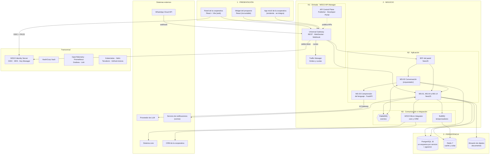

# Stack tecnológico de July

| Campo | Valor |
|---|---|
| **ID** | SAD-04 |
| **Versión** | 2.1 |
| **Fecha** | 2026-11-26 |
| **Estado** | Borrador |
| **Deriva de** | SAD-03 (14 microservicios y plataforma), SAD-02 (controles de seguridad por rol), DAT-01 y DAT-02 (PostgreSQL 16), CLS-01 (`PanelCooperativa`, `Canal`, `RolColaborador`), REV-01 (vista de desarrollo), portada del repositorio (stack del equipo) |
| **Alimenta a** | SAD-01, vistas de implementación y despliegue (hoy en blanco) |

> **Para qué sirve.** Fija con qué tecnologías se construye July, capa por capa, y por qué. Parte de tres requisitos dados: **el frontend web se hace en React**, **todo lo que es gateway se resuelve con WSO2** y **la cooperativa ya tiene una app móvil, a la que July se ajusta en lugar de construir otra**. El resto se elige para encajar con esas decisiones, con los microservicios de SAD-03 y con los controles de SAD-02. La [sección 11](#11-resumen-de-tecnologías) resume cada tecnología con su porqué, cómo se aplica y su fundamento.
>
> **Lo que no es:** no cambia la cadena de trazabilidad ni SAD-03. Las versiones son las vigentes a la fecha del documento; se revisan al empezar la construcción.

## Contenido

1. [Requisitos fijos y criterios](#1-requisitos-fijos-y-criterios)
2. [Vista general por capas](#2-vista-general-por-capas)
3. [Frontend: React](#3-frontend-react)
4. [Gateway: WSO2](#4-gateway-wso2)
5. [Backend](#5-backend)
6. [Datos y mensajería](#6-datos-y-mensajería)
7. [Inteligencia artificial](#7-inteligencia-artificial)
8. [Infraestructura, observabilidad y entrega](#8-infraestructura-observabilidad-y-entrega)
9. [Cambios respecto a la portada del repositorio](#9-cambios-respecto-a-la-portada-del-repositorio)
10. [Decisiones y pendientes](#10-decisiones-y-pendientes)
11. [Resumen de tecnologías](#11-resumen-de-tecnologías)

## 1. Requisitos fijos y criterios

| # | Requisito o criterio | Consecuencia |
|---|---|---|
| R1 | **Frontend web en React.** | El panel de colaboradores y el widget del prospecto se construyen con React y TypeScript. |
| R2 | **Gateway con WSO2.** | Todo el tráfico que entra desde fuera (panel, widget, app móvil existente, webhooks de WhatsApp) pasa por WSO2 API Manager. La identidad de los colaboradores la emite WSO2 Identity Server, que es el Key Manager nativo del gateway. |
| R3 | **La app móvil ya existe; July se ajusta a ella.** | July no construye app móvil. Publica en el gateway las APIs que la app necesite y respeta su tecnología y su forma de autenticar. |
| K1 | Un lenguaje de punta a punta donde se pueda. | TypeScript en el frontend, en el BFF y en la mayoría de los microservicios; Python solo donde aporta (LLM). |
| K2 | API-first. | Cada microservicio publica su contrato OpenAPI 3.1; el gateway lo importa y el frontend (y la app existente) genera su cliente desde él. |
| K3 | El backend es la única fuente de verdad de la seguridad (SAD-02, 6.2). | El gateway filtra y limita; los servicios vuelven a validar y autorizar. |
| K4 | Microservicios desde el inicio (D5 de SAD-03). | Los 14 servicios se despliegan por separado desde la etapa 1, con un PostgreSQL y un esquema por servicio. |

## 2. Vista general por capas

July se organiza en tres capas: **Presentación**, **Negocio** y **Persistencia**. Cada capa solo llama a la que tiene debajo. Los sistemas externos entran por un único punto (criterio C4 de SAD-03), y lo transversal (identidad, secretos, observabilidad e infraestructura) sirve a las tres.

La división sigue la del análisis: los objetos **borde** de ROB-01 y CLS-02 (`PanelCooperativa`, `Canal`) quedan en Presentación o en la entrada de Negocio, el **control** `July` se reparte entre los servicios de Negocio y las **entidades** se guardan en Persistencia como tablas de DAT-01.

Las flechas van siempre de arriba hacia abajo o hacia fuera: Presentación no conoce los servicios y ningún servicio llama a Presentación (los avisos al asesor llegan por el WebSocket que el panel abrió antes o por correo).

### 2.1 Presentación

Lo que ve y toca una persona. No tiene reglas de negocio: valida para la experiencia y le habla **solo** al gateway.

| Componente | Tecnología | Versión | Usuario | Responsabilidad | En el análisis |
|---|---|---|---|---|---|
| Panel de la cooperativa | React + TypeScript, Vite, React Router, TanStack Query, Tailwind CSS + shadcn/ui | React 19 | Los 8 roles de `RolColaborador` | Bandejas por rol, ficha del lead, toma de la conversación, citas, configuración (detalle en la sección 3). Diseño adaptable: el asesor lo usa también desde el navegador del teléfono | Borde `PanelCooperativa` |
| Widget del prospecto | React + TypeScript, empaquetado como elemento incrustable con Shadow DOM | React 19 | Prospecto en el sitio de la cooperativa | Chat incrustado, reto antibots invisible, sin datos personales en el navegador | Borde `Canal` (WEB) |
| App móvil de la cooperativa | **Existente**: su tecnología no se decide aquí | — | Quien la use hoy (por confirmar, P2) | Consume las APIs que July publica en el gateway (sección 3.4) | Cliente externo del gateway |

WhatsApp también es presentación para el prospecto, pero la interfaz la pone Meta: para July es un sistema externo (sección 2.5).

### 2.2 Negocio

Donde vive la lógica de July. Se divide en tres subcapas: N1 Entrada, N2 Aplicación y N3 Comunicación e integración.

| Subcapa | Componente | Tecnología | Versión | Responsabilidad |
|---|---|---|---|---|
| **N1 Entrada** | Universal Gateway | WSO2 API Manager | 4.7.0 | Único punto de entrada: valida tokens, aplica políticas y enruta (REST, WebSocket y webhook de WhatsApp) |
| | Traffic Manager | WSO2 API Manager | 4.7.0 | Límites por aplicación, usuario y API; controles antibots de SAD-02 |
| | API Control Plane | WSO2 API Manager | 4.7.0 | Publicación y versiones de las APIs desde los OpenAPI; registro de aplicaciones cliente (panel, widget, app móvil) |
| **N2 Aplicación** | BFF del panel | NestJS | — | Une datos de varios servicios para el panel, enmascara según el rol, mantiene el WebSocket |
| | MS-02 Conversación | NestJS | — | Orquestador: el control «Atender mensaje» de ROB-01 |
| | MS-01, MS-04 a MS-14 | NestJS | — | Canales, prospectos, leads, solicitud, simulación, catálogo, precalificación, citas, entrega, asignación, notificaciones y auditoría (SAD-03) |
| | MS-03 Comprensión del lenguaje | FastAPI (Python) | Python 3.12+ | Intención y extracción de valores con el LLM; sin estado |
| **N3 Comunicación e integración** | Broker de eventos | RabbitMQ con patrón *outbox* | 4.x | Eventos entre servicios (`LeadPrecalificado`, `AsesorAsignado`…) |
| | Temporizadores | BullMQ | — | Abandono, plazo de atención, recordatorios y reactivaciones |
| | Mediación con core y CRM | WSO2 Micro Integrator | 4.x | Transformación de protocolos, tiempo máximo, reintentos y bandeja de salida |
| | Salida al LLM | AI Gateway de WSO2 API Manager | 4.7.0 | Guarda la llave del proveedor, limita tokens y registra el consumo |

### 2.3 Persistencia

Donde quedan los datos. Solo guarda reglas de integridad (claves, `CHECK`, triggers de la bitácora de DAT-02); ninguna regla de negocio.

| Componente | Tecnología | Versión | Qué guarda | Dueño |
|---|---|---|---|---|
| Base transaccional | PostgreSQL con `pgcrypto` | 16 | Las 26 tablas de DAT-01, un esquema por servicio; cédula y teléfono cifrados por columna | Cada microservicio, su esquema (C3 de SAD-03) |
| Búsqueda vectorial | `pgvector` en el mismo PostgreSQL | — | Preguntas frecuentes para MS-03 | MS-03 (lectura), MS-02 (publica) |
| Caché y colas cortas | Redis | 7 | Cola de entrada y deduplicación por `idExterno`, caché del catálogo, colas de BullMQ | MS-01, MS-08, temporizadores |
| Almacén de objetos | Compatible con S3, cifrado | — | Documentos de la solicitud (`solicitud_documento`) | MS-06 |
| Respaldos | pgBackRest | — | Copias y recuperación a un punto en el tiempo | Plataforma |

Las bases propias de WSO2 (registro, usuarios y analítica) van en una instancia de PostgreSQL **separada** de la de July.

### 2.4 Transversal

| Componente | Tecnología | Versión | Sirve a |
|---|---|---|---|
| Identidad y acceso | WSO2 Identity Server | 7.3.0 | Presentación (inicio de sesión OIDC + PKCE, MFA) y Negocio (Key Manager del gateway, roles y agencias en el token) |
| Secretos | HashiCorp Vault | — | Llaves de cifrado de Persistencia; credenciales del core, CRM y LLM; secretos de WSO2 |
| Observabilidad | OpenTelemetry, Prometheus, Grafana, Loki, Tempo | — | Las tres capas, con el mismo identificador de correlación (`traceparent`) |
| Infraestructura y entrega | Docker, Kubernetes, Helm, Terraform, GitHub Actions | — | Despliegue de todas las capas (sección 8) |

### 2.5 Sistemas externos

| Sistema | Por dónde entra o sale | Capa que lo toca |
|---|---|---|
| WhatsApp Cloud API | Webhook → Universal Gateway → MS-01 | Negocio (N1 Entrada) |
| App móvil de la cooperativa | API `app-movil` → Universal Gateway → BFF o MS-01 | Negocio (N1 Entrada) |
| Sistema core | MS-04 → Micro Integrator | Negocio (N3 Integración) |
| CRM de la cooperativa | MS-11 → Micro Integrator | Negocio (N3 Integración) |
| Proveedor de LLM | MS-03 → AI Gateway | Negocio (N3 Integración) |
| Servicio de notificaciones | MS-13 | Negocio (N2 Aplicación) |

### 2.6 Reglas entre capas

| # | Regla | Por qué |
|---|---|---|
| L1 | Presentación (incluida la app móvil existente) solo habla con el gateway; nunca con un servicio, con la base ni con un sistema externo. | Un único punto donde se autentica, se limita y se audita (D2). |
| L2 | Un servicio solo lee y escribe su propio esquema; los datos de otro los pide por API o los recibe por evento. | Un solo escritor por entidad (C3 de SAD-03) y separación futura del monolito modular. |
| L3 | Persistencia no decide: no hay reglas de negocio en procedimientos almacenados. | La precalificación, la simulación y la prioridad viven en código probado y versionado. |
| L4 | Cada sistema externo tiene un único punto de entrada o salida. | Capa anticorrupción (C4 de SAD-03). |
| L5 | La seguridad se repite en cada capa: experiencia en Presentación, token y límites en la entrada, autorización fina en la aplicación y cifrado en Persistencia. | El backend es la fuente de verdad (K3, SAD-02). |

## 3. Frontend: React

### 3.1 Qué se construye y qué se integra

| Pieza | ¿Se construye? | Para quién |
|---|---|---|
| **Panel de la cooperativa** | Sí, en React | Los colaboradores. Es el borde `PanelCooperativa` de CLS-02 y ROB-01; cada rol ve solo sus bandejas (`PanelCooperativa.rolesConAcceso`). |
| **Widget del prospecto** | Sí, en React | El prospecto que llega por el sitio web de la cooperativa (canal WEB). |
| **App móvil de la cooperativa** | **No.** Ya existe; July se ajusta a ella | Quien la use hoy. July le publica APIs en el gateway (sección 3.4). |

| Rol (`RolColaborador`) | Qué hace en el panel | Microservicios detrás (vía BFF) |
|---|---|---|
| ASESOR | Disponibilidad, bandeja de leads, ficha, toma de la conversación en tiempo real, citas y cierre | MS-02, MS-05, MS-10, MS-11, MS-12 |
| JEFE_COMERCIAL | Avisos de sincronización fallida, reasignación, embudo | MS-05, MS-11, MS-12, MS-14 |
| AGENCIA | Horarios y citas de la agencia | MS-10 |
| COMITE_CREDITO | Casos «a revisar» y resolución de la solicitud | MS-06, MS-09 |
| PRODUCTOS_CREDITO | Catálogo de líneas, tasas y requisitos | MS-08 |
| ADMINISTRADOR | Guiones, plantillas y reglas de negocio | MS-02, MS-09, MS-11, MS-12 |
| MARKETING | Campañas y origen de los leads | MS-01, MS-14 |
| PROTECCION_DATOS | Consentimientos, retiros y bitácora | MS-04, MS-14 |

### 3.2 Stack del frontend

| Área | Tecnología | Por qué |
|---|---|---|
| Biblioteca de interfaz | **React 19** con TypeScript en modo estricto | Requisito R1; mismos tipos que el BFF y los contratos OpenAPI. |
| Compilación | **Vite** (aplicación de una sola página) | El panel es privado, detrás de inicio de sesión: no necesita SEO ni renderizado en servidor. El BFF ya hace la agregación en el servidor, así que Next.js añadiría un segundo servidor sin beneficio. El resultado son archivos estáticos que se sirven desde un CDN o Nginx con una CSP estricta. |
| Navegación | React Router 7 | Rutas por rol y enlaces directos desde los avisos («abrir lead 123»). |
| Datos del servidor | TanStack Query + cliente generado desde OpenAPI (`openapi-typescript` u Orval) | Caché, reintentos y refresco de bandejas (`PanelCooperativa.tiempoRefresco`) sin código a mano. |
| Estado local | Zustand | Solo estado de interfaz; los datos de negocio viven en el servidor. |
| Tiempo real | WebSocket a través del gateway WSO2 | Toma de la conversación (`Conversacion.traspasar()`) y avisos al instante. |
| Formularios | React Hook Form + Zod | Validación de experiencia; el backend repite todo (K3). |
| Estilos y componentes | Tailwind CSS 4 + shadcn/ui (sobre Radix UI); Storybook | Componentes accesibles por defecto (teclado, foco, ARIA) y coherentes con el sistema de diseño de UI/UX. |
| Autenticación | `oidc-client-ts` con Authorization Code + PKCE contra WSO2 Identity Server | El panel es un cliente público: no guarda secretos. *Access token* corto y solo en memoria (decisión P3). |
| Widget | El mismo React, empaquetado con Vite en modo biblioteca como elemento incrustable con Shadow DOM | Aísla sus estilos del sitio anfitrión; presupuesto de peso por definir (P1). |
| Accesibilidad | Pruebas con axe-core y con lector de pantalla | WCAG 2.2 AA (ISO/IEC 40500). |
| Pruebas | Vitest + Testing Library; Playwright para extremo a extremo | Cada flujo de CU-08 que toca el panel o el widget es un guion de prueba (REV-01). |
| Errores en producción | Sentry para React | Fallos y rendimiento por versión publicada. |

### 3.3 Seguridad del frontend

| Control | Cómo se cumple | Origen |
|---|---|---|
| Sesión | *Access token* de 5 a 15 min en memoria, nunca en `localStorage`; renovación con *refresh token* rotado; cierre por inactividad | SAD-02 6.4, RFC 9700 |
| MFA | FIDO2/WebAuthn para Comité, Administrador y Delegado; al menos OTP para asesores; lo exige Identity Server | SAD-02 6.4 |
| Contenido | CSP Nivel 3, `frame-ancestors` con los sitios de la cooperativa (widget), SRI en los scripts, HSTS | SAD-02 6.4 |
| Texto de prospectos | Se muestra como texto plano, nunca como HTML interpretado | SAD-02 6.4 (XSS almacenado) |
| Datos mostrados | Cédula y teléfono enmascarados (`******1234`); el BFF no envía el dato completo si el rol no lo necesita | SAD-02 6.4, LOPDP |
| Widget | Reto antibots invisible, campo trampa, token de sesión solo en memoria, nada en la URL | SAD-02 6.4 |

### 3.4 Integración con la app móvil existente

July **no** construye ni cambia la app; se ajusta a ella desde el gateway.

| Aspecto | Cómo se ajusta July |
|---|---|
| Acceso | La app se registra como una aplicación más en el Developer Portal de WSO2, con su propia credencial, su nivel de límites y sus *scopes*. |
| Autenticación | Si la app ya tiene su proveedor de identidad, se registra en WSO2 API Manager como **Key Manager de terceros** (o se federa en Identity Server). Así July acepta los tokens que la app ya emite, sin un segundo inicio de sesión. |
| Qué APIs consume | Depende de su uso (P2). Si la usan **socios o prospectos**, consume el chat de July como un canal más (MS-01). Si la usan **colaboradores**, consume las mismas APIs del panel a través del BFF. |
| Contrato | OpenAPI 3.1 publicado en el Developer Portal; la app genera su cliente con la herramienta de su propia tecnología. |
| Versionado | El gateway mantiene la versión vigente y la anterior en paralelo, para que la app no tenga que actualizarse al mismo tiempo que July. |
| Impacto en el análisis | Si la app lleva el chat con July, `TipoCanal` de CLS-01 (hoy WHATSAPP y WEB) necesita un valor nuevo (por ejemplo APP), con su paso de verificación del canal en CU-08. **No está aplicado**: se decide en P2. |

## 4. Gateway: WSO2

### 4.1 Componentes

| Componente WSO2 | Papel en July | Equivale en SAD-03 a |
|---|---|---|
| **API Control Plane** (Publisher y Developer Portal) | Se publican las APIs desde los OpenAPI de cada servicio, con versiones y ciclo de vida (creada → publicada → obsoleta → retirada). El portal registra las aplicaciones cliente: panel, widget, app móvil y webhook. | API Gateway (plataforma) |
| **Universal Gateway** | Plano de datos: valida el token, aplica las políticas, enruta al BFF o al servicio y expone REST, WebSocket y webhooks. | API Gateway (plataforma) |
| **Traffic Manager** | Límites por aplicación, por usuario y por API; cuotas de ráfaga. Es donde viven los límites antibots de SAD-02. | Parte de los controles «Aplicación» de SAD-02 |
| **Identity Server** | Proveedor OIDC de los colaboradores (usuarios, roles `RolColaborador`, agencias, MFA FIDO2/OTP) y Key Manager del gateway. | IAM con OIDC (plataforma) |
| **Micro Integrator** | Mediación con el Sistema core y el CRM: transforma SOAP o formatos propios a REST, aplica tiempo máximo, reintentos y bandeja de salida. Lo llaman solo MS-04 (core) y MS-11 (CRM). | Capa anticorrupción del criterio C4 |

### 4.2 APIs que expone el gateway

Solo pasa por el gateway el tráfico **norte-sur** (desde fuera). Las llamadas entre microservicios (este-oeste) van por la red interna y por RabbitMQ.

| API en WSO2 | Tipo | Consumidor | Seguridad en el gateway | Destino |
|---|---|---|---|---|
| `canal-whatsapp` v1 | REST (webhook entrante) | Meta (WhatsApp Cloud API) | Sin OAuth (Meta no lo usa); rangos de IP de Meta, tamaño máximo y una política personalizada que verifica `X-Hub-Signature-256` antes de enrutar; MS-01 la vuelve a verificar | MS-01 |
| `canal-widget` v1 | WebSocket | Widget web | Clave de API restringida por *referrer* a los dominios de la cooperativa + token de sesión anónima emitido por MS-01 tras el reto antibots | MS-01 |
| `panel` v1 | REST | Panel de la cooperativa | OAuth 2.0 (JWT de Identity Server), *scopes* por rol | BFF |
| `panel-tiempo-real` v1 | WebSocket | Panel de la cooperativa | OAuth 2.0, mismo token | BFF → MS-02 |
| `configuracion` v1 | REST | Panel (roles ADMINISTRADOR, PRODUCTOS_CREDITO) | OAuth 2.0 con *scope* `config:publicar` y MFA reciente | MS-02, MS-08, MS-09, MS-11, MS-12 |
| `app-movil` v1 | REST y WebSocket | App móvil existente | OAuth 2.0 con el Key Manager de la app (de terceros o federado), *scopes* y límites propios | BFF o MS-01, según P2 |

### 4.3 Políticas

| Política | Detalle | Origen |
|---|---|---|
| Autenticación | JWT validado en el gateway; el gateway reenvía al backend un JWT interno firmado con el usuario, el rol y la agencia | SAD-02 (E de STRIDE) |
| Autorización gruesa | *Scopes* por recurso (`leads:leer`, `leads:cerrar`, `solicitud:resolver`, `config:publicar`…) asignados a cada `RolColaborador` | SAD-02 A9 |
| Autorización fina | En el servicio: un asesor solo ve los leads de su agencia | K3 |
| Límites | Por número de WhatsApp y por sesión del widget (ráfaga y por minuto); por usuario en el panel y en la app; cuota diaria al webhook | SAD-02, límites «pendientes» de la sección 8 |
| Cabeceras | CORS solo para los orígenes del panel y del widget; HSTS; eliminación de cabeceras internas en la respuesta | SAD-02 6.4 |
| Tamaño y esquema | Rechazo de cuerpos que no cumplen el OpenAPI (validación de esquema en el gateway) | OWASP API Security Top 10 |
| Trazabilidad | Identificador de correlación (`traceparent` de W3C) en cada petición, que llega hasta MS-14 | LIN-01, MS-14 |
| Analítica | Analítica del gateway (on-premise con ELK u OpenSearch) para latencia, errores y consumo por API | Meta de respuesta en menos de 2 minutos |

### 4.4 Despliegue

- **Gateway y WAF en la DMZ**; plano de control, Identity Server, Micro Integrator, servicios y datos en la red interna.
- Al menos **2 réplicas del Universal Gateway** y 2 de Identity Server; el plano de control puede ir en 1 réplica al inicio.
- WSO2 se instala con sus **Helm charts oficiales** en Kubernetes; la configuración (`deployment.toml`) y las definiciones de APIs se versionan en Git y se publican con **`apictl`** desde la tubería de CI/CD, nunca a mano en la consola.
- Bases de WSO2 (registro, usuarios, analítica) en una instancia de PostgreSQL **separada** de la de July.

## 5. Backend

| Pieza | Tecnología | Detalle |
|---|---|---|
| BFF del panel | NestJS (TypeScript) | Une las bandejas de varios servicios para el panel, enmascara datos según el rol y mantiene el WebSocket. Es el único servicio que el panel ve. |
| Microservicios MS-01, MS-02, MS-04 a MS-14 | NestJS | Mismo lenguaje que el frontend; una aplicación NestJS por microservicio (D5 de SAD-03). |
| MS-03 Comprensión del lenguaje | FastAPI (Python) | Ecosistema de LLM y evaluación en Python; sin estado. |
| Motor financiero y de reglas (MS-07, MS-09) | NestJS con `decimal.js`; nunca coma flotante | Mismo criterio que DAT-01 (`NUMERIC`). |
| Contratos | OpenAPI 3.1 por servicio; AsyncAPI 3 para los eventos | Fuente del gateway, del cliente del panel y del de la app existente (K2). |
| ORM y migraciones | Prisma o Drizzle para TypeScript; Alembic en MS-03; el DDL de DAT-02 es la base de la primera migración | Un esquema de PostgreSQL por servicio. |
| Tareas programadas | BullMQ sobre Redis | Temporizador de REV-01: abandono, plazo de atención, recordatorios y reactivaciones. |
| Pruebas | Jest y Pytest; Testcontainers para PostgreSQL, Redis y RabbitMQ; pruebas de contrato con Pact | Core y CRM simulados con Micro Integrator en modo *mock*. |

## 6. Datos y mensajería

| Pieza | Tecnología | Uso |
|---|---|---|
| Base transaccional | PostgreSQL 16 (DAT-02) | Un esquema por servicio desde el inicio (SAD-03 P1). Cifrado por columna de cédula y teléfono con `pgcrypto` y llave en Vault. |
| Caché y colas cortas | Redis 7 | Cola de entrada y deduplicación por `idExterno` (MS-01), caché del catálogo (MS-08), colas de BullMQ. |
| Broker de eventos | RabbitMQ 4 (*quorum queues*), con patrón *outbox* en cada servicio | Eventos de SAD-03 (`LeadPrecalificado`, `AsesorAsignado`…). Kafka solo si el volumen o la reproducción de eventos lo exigen (decisión P4). |
| Búsqueda vectorial | `pgvector` en PostgreSQL | Preguntas frecuentes de MS-03, si se usa recuperación. |
| Archivos | Almacenamiento de objetos compatible con S3, cifrado | Documentos de la solicitud (`solicitud_documento`). |
| Secretos | HashiCorp Vault | Llaves de cifrado, credenciales del core, CRM y LLM; WSO2 lee sus secretos de Vault. |
| Respaldos | pgBackRest | Copias y recuperación a un punto en el tiempo. |

## 7. Inteligencia artificial

| Pieza | Decisión |
|---|---|
| Papel del LLM | Solo clasificar la intención y extraer valores (REV-01). La simulación y la precalificación son deterministas. |
| Proveedor | API de un LLM comercial (Claude API en el stack del equipo), llamado únicamente desde MS-03. |
| Paso por el gateway | La salida hacia el LLM pasa por el **AI Gateway de WSO2 API Manager** como API de salida: guarda la llave del proveedor, limita tokens por conversación y registra el consumo. Cubre el «tope de tokens pendiente» de SAD-02. |
| Validación | La respuesta se valida contra las enumeraciones y el catálogo de MS-08; si no encaja, July pregunta con opciones cerradas. |
| Datos personales | Cédula y teléfono se reemplazan por marcadores antes de enviar el texto al LLM. |
| Evaluación | Conjunto de mensajes etiquetados por intención y pruebas de *prompt injection* (OWASP Top 10 para LLM) en la tubería de CI. |

## 8. Infraestructura, observabilidad y entrega

| Área | Tecnología |
|---|---|
| Contenedores | Docker, imágenes mínimas (*distroless*) firmadas con Cosign |
| Orquestación | Kubernetes, Helm (incluidos los charts de WSO2), Terraform para la infraestructura |
| Nube o local | Por decidir con la cooperativa (P5): AWS no tiene región en Ecuador y la LOPDP regula la transferencia internacional; la arquitectura funciona igual en un Kubernetes local |
| Frontend estático | El panel y el widget se publican como archivos estáticos en un CDN o en Nginx detrás del WAF, con las cabeceras de seguridad de la sección 3.3 |
| Observabilidad | OpenTelemetry en el panel, el BFF, los servicios y el gateway; Prometheus y Grafana para métricas; Loki para registros; Tempo o Jaeger para trazas |
| CI/CD | GitHub Actions: pruebas, análisis (Semgrep, SonarQube, Trivy, OWASP ZAP contra el gateway), imágenes, compilación del frontend y `apictl` para las APIs de WSO2 |
| Entornos | `desarrollo`, `pruebas` y `produccion`, cada uno con su gateway WSO2; la app móvil existente apunta al entorno de `pruebas` durante la integración |

## 9. Cambios respecto a la portada del repositorio

| La portada dice | Este documento propone | Motivo |
|---|---|---|
| Frontend web: Next.js, React | React con Vite (aplicación de una sola página) | R1; el panel es privado y el BFF ya hace el trabajo de servidor |
| Móvil: React Native + Expo; SQLite local | No se construye app móvil; se integra la existente | R3 |
| Seguridad móvil: OWASP MASVS | Responsabilidad de la app existente; July asegura sus APIs con OWASP API Security y ASVS | R3 |
| Identidad: Keycloak | WSO2 Identity Server | R2: es el Key Manager nativo de WSO2 API Manager; Keycloak también se puede conectar como Key Manager externo, pero suma un producto más |
| Mensajería: RabbitMQ o Kafka | RabbitMQ desde el inicio | Volumen moderado de una cooperativa; Kafka queda como opción (P4) |
| Backend: FastAPI y NestJS | NestJS para casi todo; FastAPI solo en MS-03 | K1 y D5 de SAD-03 |

Si estos cambios se aprueban, hay que actualizar la sección «Stack tecnológico» de la portada. La vista de desarrollo de REV-01 (panel en Next.js) también cambia a React con Vite.

## 10. Decisiones y pendientes

| # | Decisión o pendiente | Detalle |
|---|---|---|
| D1 | **Frontend web en React.** | Panel y widget con React 19, TypeScript y Vite. |
| D2 | **Todo tráfico externo entra por WSO2.** | Incluye el webhook de WhatsApp, el WebSocket del widget y la app móvil existente; nada se publica directo desde un servicio. |
| D3 | **WSO2 Identity Server es el IAM de los colaboradores.** | Resuelve también la brecha B-10 de LIN-01 y el pendiente P2 de SAD-03: los colaboradores viven en Identity Server y MS-12 solo guarda los datos comerciales del asesor. |
| D4 | **El core y el CRM se integran por WSO2 Micro Integrator.** | MS-04 y MS-11 siguen siendo los únicos que hablan con ellos (C4 de SAD-03); el Micro Integrator es su adaptador técnico. |
| D5 | **No se construye app móvil.** | July se ajusta a la app existente publicándole APIs en el gateway (sección 3.4). |
| P1 | Peso del widget. | Fijar un presupuesto de peso; si React lo excede, evaluar Preact con la capa de compatibilidad de React. |
| P2 | Uso de la app móvil existente. | Quién la usa (socios, prospectos o colaboradores), con qué proveedor de identidad, en qué tecnología y si mostrará el chat de July (que pediría un valor nuevo en `TipoCanal`). |
| P3 | Manejo del token en el panel. | Token en memoria con PKCE (propuesto) o patrón *token handler* en el BFF con cookie `HttpOnly`, como recomienda la guía de IETF para aplicaciones en el navegador. |
| P4 | RabbitMQ o Kafka. | Revisar cuando se conozca el volumen real de mensajes. |
| P5 | Nube o servidores de la cooperativa. | Depende de la LOPDP y de lo que exija la SEPS; condiciona el despliegue de WSO2. |
| P6 | Licencia de WSO2. | Los productos son Apache 2.0; las actualizaciones de seguridad continuas y el soporte requieren suscripción. Definir con la cooperativa. |
| P7 | Tecnología y contrato del Sistema core. | Necesario para diseñar las mediaciones del Micro Integrator. |

## 11. Resumen de tecnologías

Cada tecnología con la capa donde vive, por qué se elige, cómo se aplica en July y en qué se fundamenta (norma, estándar, documento del proyecto o requisito).

| # | Tecnología | Capa | Por qué se elige | Cómo se aplica en July | Fundamento |
|---|---|---|---|---|---|
| 1 | **React 19 + TypeScript** | Presentación | Requisito del proyecto; tipado compartido con el backend evita errores de contrato | Panel de la cooperativa (8 roles) y widget del prospecto | R1; ISO/IEC 25010 (mantenibilidad); K1 |
| 2 | **Vite** | Presentación | El panel es privado y no necesita SEO ni renderizado en servidor; compila a archivos estáticos fáciles de proteger | Compila el panel como aplicación de una sola página y el widget en modo biblioteca | REV-01 (vista de desarrollo); SAD-02 6.4 (CSP estricta) |
| 3 | **React Router, TanStack Query, Zustand** | Presentación | Separan navegación, datos del servidor y estado de interfaz; menos código propio | Rutas por rol; bandejas con refresco automático (`tiempoRefresco`); estado solo de pantalla | CLS-01 (`PanelCooperativa`); K3 |
| 4 | **Tailwind CSS + shadcn/ui (Radix UI)** | Presentación | Componentes accesibles por defecto y sistema de diseño con *tokens* | Bandejas, fichas, formularios y el chat del widget con los colores de la cooperativa | WCAG 2.2 AA (ISO/IEC 40500); ISO 9241-110 |
| 5 | **React Hook Form + Zod** | Presentación | Validación declarativa que reutiliza los esquemas del contrato | Formularios de configuración, cierre del lead y resolución del Comité | OWASP ASVS 5.0 (validación también en el servidor); K3 |
| 6 | **`oidc-client-ts` (OIDC + PKCE)** | Presentación | Un cliente en el navegador no puede guardar secretos; PKCE evita el robo del código de autorización | Inicio de sesión de los colaboradores contra WSO2 Identity Server; token solo en memoria | OpenID Connect Core 1.0; RFC 7636 (PKCE); RFC 9700 (buenas prácticas de OAuth 2.0) |
| 7 | **Vitest, Testing Library, Playwright, axe-core** | Presentación | Pruebas rápidas de componentes y de extremo a extremo con accesibilidad automatizada | Cada flujo de CU-08 que toca el panel o el widget como guion de prueba | ISO/IEC/IEEE 29119; WCAG 2.2; REV-01 (pruebas) |
| 8 | **App móvil existente** (se integra) | Presentación (cliente externo) | Ya está en manos de los usuarios; construir otra duplicaría costo y soporte | Se registra en el Developer Portal y consume la API `app-movil` con su propio proveedor de identidad | R3; criterio C4 de SAD-03 (un punto de entrada) |
| 9 | **WSO2 API Manager 4.7 — Universal Gateway** | Negocio (N1) | Requisito del proyecto; un solo punto que autentica, limita, valida esquemas y audita | Expone `panel`, `panel-tiempo-real`, `configuracion`, `canal-widget`, `canal-whatsapp` y `app-movil` | R2; OWASP API Security Top 10 (2023); SAD-02 |
| 10 | **WSO2 Traffic Manager** | Negocio (N1) | Los límites por cliente y por usuario son la primera defensa contra bots | Ráfaga y cuota por número de WhatsApp, sesión del widget, usuario del panel y app | SAD-02 (controles antibots, hoy pendientes); OWASP API4 (consumo sin límites) |
| 11 | **WSO2 API Control Plane + `apictl`** | Negocio (N1) | Ciclo de vida y versiones de cada API; configuración como código | Publica las APIs desde los OpenAPI en CI/CD; mantiene dos versiones para la app existente | K2; ISO/IEC 27001:2022 control 8.32 (gestión de cambios) |
| 12 | **WSO2 Identity Server 7.3** | Transversal | Key Manager nativo del gateway; MFA resistente al *phishing*; federación con el proveedor de la app | Usuarios, roles `RolColaborador` y agencias de los colaboradores; FIDO2 para Comité y Administrador | NIST SP 800-63-4; ISO/IEC 29115; SAD-02 6.4; brecha B-10 de LIN-01 |
| 13 | **WSO2 Micro Integrator** | Negocio (N3) | El core y el CRM suelen hablar protocolos propios; la mediación los aísla del dominio | Adaptador de MS-04 (core) y MS-11 (CRM) con tiempo máximo, reintentos y bandeja de salida | Capa anticorrupción (DDD); *Enterprise Integration Patterns*; CU 3.1.2.3 |
| 14 | **AI Gateway de WSO2** | Negocio (N3) | Controla costo y abuso del LLM sin código propio | Salida de MS-03 al proveedor: llave guardada, tope de tokens por conversación, registro de consumo | OWASP Top 10 para LLM (2025); SAD-02 (tope de tokens pendiente) |
| 15 | **NestJS (TypeScript)** | Negocio (N2) | Mismo lenguaje que el frontend; una aplicación por microservicio | BFF del panel y MS-01, MS-02, MS-04 a MS-14 | K1; D5 de SAD-03 (microservicios desde el inicio) |
| 16 | **FastAPI (Python)** | Negocio (N2) | El ecosistema de LLM y de evaluación está en Python | MS-03 Comprensión del lenguaje, sin estado | D5 de SAD-03; REV-01 (el LLM solo clasifica y extrae) |
| 17 | **OpenAPI 3.1 y AsyncAPI 3** | Negocio | Contratos legibles por máquina para gateway, frontend y app | Un contrato por servicio; clientes generados; eventos documentados | K2; OpenAPI Initiative; AsyncAPI |
| 18 | **RabbitMQ 4 + patrón *outbox*** | Negocio (N3) | Entrega fiable de eventos sin perder mensajes si un servicio cae | Eventos de SAD-03 (`LeadPrecalificado`, `AsesorAsignado`, `CitaReservada`…) | SAD-03 (coreografía, D1); *Enterprise Integration Patterns* |
| 19 | **BullMQ** | Negocio (N3) | Trabajos programados con reintentos sobre el Redis que ya existe | Abandono, plazo de atención, recordatorios y reactivaciones | REV-01 (temporizador); CLS-01 (`tiempoAbandono`, `plazoAtencion`) |
| 20 | **PostgreSQL 16 + `pgcrypto`** | Persistencia | Integridad fuerte, tipos `NUMERIC` exactos para dinero y cifrado por columna | Las 26 tablas de DAT-01, un esquema por servicio; bitácora encadenada | DAT-01, DAT-02; ISO/IEC 9075; LOPDP art. 37; ISO/IEC 27001:2022 control 8.24 |
| 21 | **Redis 7** | Persistencia | Memoria rápida para colas cortas, deduplicación y caché | Cola de entrada e `idExterno` (MS-01), caché del catálogo (MS-08) | CU 1.1.2.2 (picos de mensajes); REV-01 (cola de entrada) |
| 22 | **`pgvector`** | Persistencia | Búsqueda semántica sin otra base de datos | Preguntas frecuentes que consulta MS-03 | Portada (memoria y búsqueda vectorial); K4 |
| 23 | **Almacén de objetos compatible con S3** | Persistencia | Archivos fuera de la base, cifrados y con retención | Documentos de la solicitud (`solicitud_documento`) | LOPDP art. 10 (conservación); ISO/IEC 27001:2022 control 8.10 |
| 24 | **pgBackRest** | Persistencia | Respaldos y recuperación a un punto en el tiempo | Copias de la base de July | ISO/IEC 27001:2022 control 8.13 |
| 25 | **HashiCorp Vault** | Transversal | Secretos fuera del código y con rotación | Llaves de cifrado, credenciales del core, CRM y LLM, secretos de WSO2 | ISO/IEC 27001:2022 control 8.24; NIST SP 800-57 |
| 26 | **OpenTelemetry, Prometheus, Grafana, Loki** | Transversal | Trazas, métricas y registros con un solo identificador de punta a punta | Medir la meta de respuesta en menos de 2 minutos y seguir un mensaje del gateway a MS-14 | W3C Trace Context; ISO/IEC 27001:2022 controles 8.15 y 8.16; LIN-01 |
| 27 | **Docker, Kubernetes, Helm, Terraform** | Transversal | Despliegue repetible igual en nube o en servidores de la cooperativa | Servicios de July y productos WSO2 con sus Helm charts oficiales | P5; ISO/IEC 27001:2022 control 8.9 (gestión de la configuración) |
| 28 | **GitHub Actions + Semgrep, SonarQube, Trivy, OWASP ZAP** | Transversal | Seguridad integrada en cada cambio (DevSecOps) | Pruebas, análisis estático y de dependencias, escaneo de imágenes y pruebas dinámicas contra el gateway | ISO/IEC 27001:2022 controles 8.25 y 8.28; OWASP ASVS 5.0 |
| 29 | **Sentry** | Transversal | Ver errores reales de los usuarios por versión publicada | Errores y rendimiento del panel y del widget | ISO/IEC 25010 (fiabilidad) |
