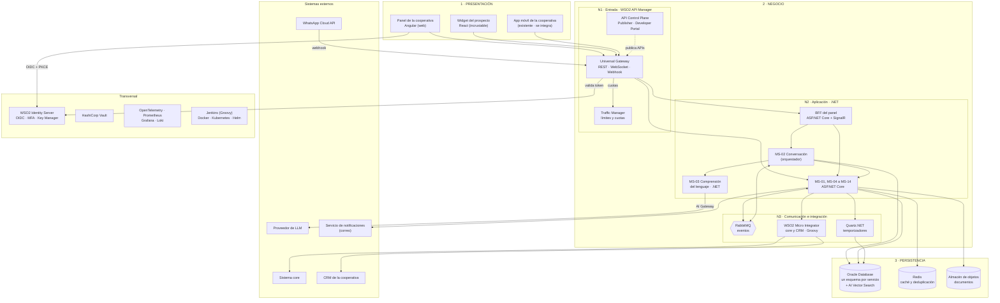

# Stack tecnológico de July sobre las tecnologías de la Cooperativa Padre Julián Lorente

| Campo | Valor |
|---|---|
| **ID** | SAD-05 |
| **Versión** | 1.1 |
| **Fecha** | 2026-11-26 |
| **Estado** | Borrador |
| **Deriva de** | SAD-04 (stack tecnológico de July, v2.0), SAD-03 (14 microservicios y plataforma), SAD-02 (controles de seguridad por rol), DAT-01 y DAT-02 (modelo y DDL de datos), CLS-01 (`PanelCooperativa`, `Canal`, `RolColaborador`) |
| **Alimenta a** | SAD-01, vistas de implementación y despliegue |

> **Para qué sirve.** Reorganiza el stack de SAD-04 sobre las cinco tecnologías que ya usa la Cooperativa Padre Julián Lorente (PJL): **Groovy, Angular, React, Oracle y .NET**. Construir July con lo que el equipo de TI de la cooperativa ya conoce, licencia y opera reduce el costo de mantenerlo después de la entrega. Se conservan los requisitos de SAD-04 que no dependen del lenguaje: **gateway con WSO2** y **la app móvil existente se integra, no se construye**. La [sección 12](#12-resumen-de-tecnologías) resume cada tecnología con su porqué, cómo se aplica y su fundamento.
>
> **Lo que no es:** no cambia la cadena de trazabilidad ni los 14 microservicios de SAD-03; cambia con qué se construyen. SAD-04 queda como la propuesta anterior hasta que la cooperativa apruebe esta. Las versiones son las vigentes a la fecha del documento y se ajustan a las que tenga instaladas la cooperativa.

## Contenido

1. [Tecnologías de la cooperativa y criterios](#1-tecnologías-de-la-cooperativa-y-criterios)
2. [Vista general por capas](#2-vista-general-por-capas)
3. [Frontend: Angular y React](#3-frontend-angular-y-react)
4. [Gateway: WSO2](#4-gateway-wso2)
5. [Backend: .NET](#5-backend-net)
6. [Datos: Oracle](#6-datos-oracle)
7. [Groovy: integración y entrega](#7-groovy-integración-y-entrega)
8. [Inteligencia artificial](#8-inteligencia-artificial)
9. [Infraestructura, observabilidad y entrega](#9-infraestructura-observabilidad-y-entrega)
10. [Cambios respecto a SAD-04](#10-cambios-respecto-a-sad-04)
11. [Decisiones y pendientes](#11-decisiones-y-pendientes)
12. [Resumen de tecnologías](#12-resumen-de-tecnologías)

## 1. Tecnologías de la cooperativa y criterios

### 1.1 Papel de cada tecnología en July

| Tecnología de PJL | Capa | Papel en July |
|---|---|---|
| **Angular** | Presentación | Panel de la cooperativa (`PanelCooperativa`): la aplicación interna de los 8 roles de colaborador. |
| **React** | Presentación | Widget del prospecto (canal WEB) incrustado en el sitio público de la cooperativa. |
| **.NET** | Negocio | BFF del panel y los 14 microservicios de SAD-03, incluido MS-03 (comprensión del lenguaje). |
| **Oracle** | Persistencia | Base transaccional de July (un esquema por microservicio), búsqueda vectorial, cola de trabajos programados y auditoría. |
| **Groovy** | Negocio (integración) y transversal | Transformaciones puntuales en la mediación con el core y el CRM (WSO2 Micro Integrator) y tuberías de entrega en Jenkins. |

### 1.2 Requisitos y criterios

| # | Requisito o criterio | Consecuencia |
|---|---|---|
| R1 | **Usar las tecnologías de la cooperativa** (Groovy, Angular, React, Oracle, .NET). | Ninguna capa introduce un lenguaje o una base de datos que la cooperativa no opere hoy. Sale TypeScript de servidor (NestJS), Python (FastAPI) y PostgreSQL de SAD-04. |
| R2 | **Gateway con WSO2** (se mantiene de SAD-04). | Todo el tráfico externo pasa por WSO2 API Manager; WSO2 Identity Server es el Key Manager. WSO2 es independiente del lenguaje del backend. |
| R3 | **La app móvil ya existe; July se ajusta a ella** (se mantiene de SAD-04). | July no construye app móvil; le publica APIs en el gateway. |
| K1 | Un lenguaje por capa. | TypeScript en el navegador (Angular y React), C# en el servidor, SQL y PL/SQL solo para integridad en Oracle, Groovy solo en integración y entrega. |
| K2 | API-first. | Cada microservicio publica su contrato OpenAPI 3.1 (lo genera ASP.NET Core); el gateway lo importa y Angular, React y la app existente generan su cliente desde él. |
| K3 | El backend es la única fuente de verdad de la seguridad (SAD-02, 6.2). | El gateway filtra y limita; los servicios .NET vuelven a validar y autorizar. |
| K4 | Microservicios desde el inicio (D5 de SAD-03). | Los 14 servicios se despliegan por separado desde la etapa 1: una solución .NET con un proyecto y un host por servicio, y una base Oracle con un esquema por servicio. |

## 2. Vista general por capas

Las tres capas de SAD-04 (**Presentación**, **Negocio** y **Persistencia**) y sus reglas no cambian; cambia la tecnología de cada componente.

### 2.1 Presentación

| Componente | Tecnología | Versión | Usuario | Responsabilidad | En el análisis |
|---|---|---|---|---|---|
| Panel de la cooperativa | **Angular** + TypeScript, Angular Material/CDK | 21 o superior | Los 8 roles de `RolColaborador` | Bandejas por rol, ficha del lead, toma de la conversación, citas y configuración (sección 3.2). Diseño adaptable para el navegador del teléfono | Borde `PanelCooperativa` |
| Widget del prospecto | **React** + TypeScript, elemento incrustable con Shadow DOM | 19 | Prospecto en el sitio de la cooperativa | Chat incrustado, reto antibots invisible, sin datos personales en el navegador | Borde `Canal` (WEB) |
| App móvil de la cooperativa | **Existente** | — | Quien la use hoy (P2) | Consume las APIs que July publica en el gateway | Cliente externo del gateway |

### 2.2 Negocio

| Subcapa | Componente | Tecnología | Versión | Responsabilidad |
|---|---|---|---|---|
| **N1 Entrada** | Universal Gateway, Traffic Manager, API Control Plane | WSO2 API Manager | 4.7.0 | Sin cambios respecto a SAD-04 (sección 4) |
| **N2 Aplicación** | BFF del panel | ASP.NET Core + SignalR | .NET 10 LTS | Une datos de varios servicios para el panel, enmascara según el rol y mantiene el canal en tiempo real |
| | MS-02 Conversación | ASP.NET Core | .NET 10 LTS | Orquestador: el control «Atender mensaje» de ROB-01 |
| | MS-01, MS-04 a MS-14 | ASP.NET Core | .NET 10 LTS | Canales, prospectos, leads, solicitud, simulación, catálogo, precalificación, citas, entrega, asignación, notificaciones y auditoría (SAD-03) |
| | MS-03 Comprensión del lenguaje | .NET con `Microsoft.Extensions.AI` | .NET 10 LTS | Intención y extracción de valores con el LLM; sin estado |
| **N3 Comunicación e integración** | Broker de eventos | RabbitMQ con patrón *outbox* (tabla en Oracle) | 4.x | Eventos entre servicios (`LeadPrecalificado`, `AsesorAsignado`…) |
| | Temporizadores | Quartz.NET con almacén de trabajos en Oracle | 3.x | Abandono, plazo de atención, recordatorios y reactivaciones |
| | Mediación con core y CRM | WSO2 Micro Integrator, con *Script Mediator* en Groovy donde haga falta | 4.x | Transformación de protocolos, tiempo máximo, reintentos y bandeja de salida |
| | Salida al LLM | AI Gateway de WSO2 API Manager | 4.7.0 | Guarda la llave del proveedor, limita tokens y registra el consumo |

### 2.3 Persistencia

| Componente | Tecnología | Qué guarda | Dueño |
|---|---|---|---|
| Base transaccional | **Oracle Database** (19c o 23ai/26ai, la que tenga la cooperativa), con TDE | Las 26 tablas de DAT-01, un esquema por servicio; cédula y teléfono cifrados por columna | Cada microservicio, su esquema (C3 de SAD-03) |
| Búsqueda vectorial | Oracle AI Vector Search (tipo `VECTOR`, desde 23ai) | Preguntas frecuentes para MS-03 | MS-03 (lectura), MS-02 (publica) |
| Trabajos programados | Tablas de Quartz.NET en un esquema propio de Oracle | Disparadores de los temporizadores | Plataforma |
| Caché y deduplicación | Redis 7 | Deduplicación por `idExterno`, caché del catálogo | MS-01, MS-08 |
| Almacén de objetos | Compatible con S3, cifrado | Documentos de la solicitud (`solicitud_documento`) | MS-06 |
| Respaldos | Oracle RMAN (y Data Guard si la cooperativa lo tiene) | Copias y recuperación a un punto en el tiempo | DBA de la cooperativa |

Las bases propias de WSO2 (registro, usuarios y analítica) van en un esquema o una PDB de Oracle **separada** de la de July; WSO2 admite Oracle como base de sus productos.

### 2.4 Transversal

| Componente | Tecnología | Sirve a |
|---|---|---|
| Identidad y acceso | WSO2 Identity Server 7.3.0 (con el directorio de usuarios de la cooperativa como almacén, si existe) | Inicio de sesión OIDC + PKCE y MFA del panel; Key Manager del gateway |
| Secretos | HashiCorp Vault | Llaves de cifrado, credenciales del core, CRM, LLM y Oracle; secretos de WSO2 |
| Observabilidad | OpenTelemetry (SDK de .NET y del navegador), Prometheus, Grafana, Loki, Tempo | Las tres capas, con el mismo `traceparent` |
| Entrega | **Jenkins con tuberías en Groovy**, Docker, Kubernetes, Helm | Compilación, pruebas y despliegue de todas las capas (secciones 7 y 9) |

### 2.5 Sistemas externos y reglas entre capas

Los sistemas externos (WhatsApp Cloud API, app móvil, core, CRM, proveedor de LLM y notificaciones) entran y salen por los mismos puntos que en SAD-04, sección 2.5. Las reglas L1 a L5 de SAD-04, sección 2.6, se mantienen; con Oracle se precisan así:

| # | Regla | Cómo se cumple con Oracle y .NET |
|---|---|---|
| L2 | Un servicio solo lee y escribe su propio esquema. | Cada microservicio tiene su usuario de Oracle (que en Oracle es su esquema) sin `GRANT` sobre los esquemas de otros servicios. |
| L3 | Persistencia no decide: no hay reglas de negocio en procedimientos almacenados. | PL/SQL solo para integridad (triggers de la bitácora de DAT-02, restricciones). La precalificación, la simulación y la prioridad viven en C#, con pruebas. Es la regla que más cuesta sostener en una cooperativa acostumbrada a PL/SQL, por eso se dice explícitamente. |

## 3. Frontend: Angular y React

### 3.1 Reparto

| Pieza | Tecnología | Por qué esta y no la otra |
|---|---|---|
| **Panel de la cooperativa** | **Angular** | Es una aplicación interna grande, con 8 roles, formularios complejos y vida larga. Angular trae de fábrica enrutador, formularios, cliente HTTP, inyección de dependencias y pruebas, lo que da una estructura uniforme y fácil de mantener por el equipo de TI de la cooperativa, que ya trabaja con Angular junto a .NET. |
| **Widget del prospecto** | **React** | Se incrusta en el sitio público de la cooperativa: tiene que pesar poco, aislarse del sitio anfitrión y cargar rápido en teléfonos de gama baja. React con Vite en modo biblioteca produce un paquete más pequeño que una aplicación Angular completa, y la cooperativa ya usa React. |
| **App móvil** | Existente | No se construye (R3). |

Las dos piezas comparten los contratos OpenAPI y la librería de *tokens* de diseño (colores, tipografía y espaciado de la cooperativa), para que se vean como una sola marca.

### 3.2 Stack del panel (Angular)

| Área | Tecnología | Por qué |
|---|---|---|
| Framework | **Angular 21+** con componentes *standalone*, *signals* y TypeScript en modo estricto | Estructura uniforme; *signals* para el estado de las bandejas sin bibliotecas extra. |
| Compilación | Angular CLI (esbuild) como aplicación de una sola página | El panel es privado: no necesita SEO ni renderizado en servidor; se publica como archivos estáticos con CSP estricta. |
| Navegación | Angular Router con *guards* por rol | Rutas por `RolColaborador` y enlaces directos desde los avisos («abrir lead 123»). |
| Datos del servidor | `HttpClient` + cliente generado desde OpenAPI (`openapi-generator`, plantilla `typescript-angular`) | Sin código de acceso a mano; refresco de bandejas según `PanelCooperativa.tiempoRefresco`. |
| Tiempo real | Cliente `@microsoft/signalr`, solo transporte WebSocket, a través del gateway WSO2 | Toma de la conversación (`Conversacion.traspasar()`) y avisos al instante; mismo stack que el BFF en .NET. |
| Formularios | Formularios reactivos tipados de Angular | Validación de experiencia; el backend repite todo (K3). |
| Componentes | Angular Material y CDK con el tema de la cooperativa | Componentes accesibles (teclado, foco, ARIA) y coherentes con el sistema de diseño de UI/UX. |
| Autenticación | `angular-auth-oidc-client` (certificado por OpenID) con Authorization Code + PKCE contra WSO2 Identity Server | El panel es un cliente público: no guarda secretos. *Access token* corto en memoria (P3). |
| Pruebas | Vitest (corredor por defecto de Angular 21) y Angular Testing Library; Playwright para extremo a extremo; axe-core | Cada flujo de CU-08 que toca el panel es un guion de prueba (REV-01). |
| Calidad | ESLint (`angular-eslint`) | Reglas de plantillas seguras y accesibles. |

### 3.3 Stack del widget (React)

| Área | Tecnología | Por qué |
|---|---|---|
| Biblioteca | **React 19** + TypeScript | Paquete pequeño para un componente incrustable. |
| Empaquetado | Vite en modo biblioteca, como elemento personalizado con Shadow DOM | Aísla sus estilos del sitio anfitrión; presupuesto de peso por definir (P1). |
| Conexión | WebSocket al API `canal-widget` del gateway | Sesión anónima emitida por MS-01 tras el reto antibots. |
| Pruebas | Vitest + Testing Library; Playwright | Mismo corredor de pruebas que el panel. |

### 3.4 Seguridad del frontend

Los controles de SAD-04, sección 3.3 (sesión corta en memoria, MFA, CSP Nivel 3, texto de prospectos como texto plano, datos enmascarados y reto antibots del widget) se aplican igual a las dos piezas. Lo que cambia con Angular: sus plantillas escapan y sanean por defecto, así que se prohíbe `bypassSecurityTrust*` salvo revisión, y se activa *Trusted Types* en la CSP.

### 3.5 App móvil existente

Sin cambios respecto a SAD-04, sección 3.4: se registra en el Developer Portal de WSO2, su proveedor de identidad se conecta como Key Manager de terceros y consume la API `app-movil`.

## 4. Gateway: WSO2

Los componentes, las APIs expuestas (`canal-whatsapp`, `canal-widget`, `panel`, `panel-tiempo-real`, `configuracion` y `app-movil`), las políticas y el despliegue de SAD-04, sección 4, se mantienen. Cambia solo lo que toca a las tecnologías de la cooperativa:

| Aspecto | Ajuste |
|---|---|
| Destinos | El gateway enruta al BFF y a los servicios en ASP.NET Core; importa el OpenAPI 3.1 que cada uno genera. |
| Tiempo real | `panel-tiempo-real` se publica como API WebSocket; el cliente SignalR del panel usa solo WebSocket y omite la negociación HTTP, para que el gateway vea una sola conexión. |
| Token interno | Los servicios .NET validan el JWT interno que firma el gateway con `Microsoft.AspNetCore.Authentication.JwtBearer`; los roles y la agencia salen de sus *claims*. |
| Bases de WSO2 | Registro, usuarios y analítica en Oracle, separados de July. |
| Usuarios | Si la cooperativa tiene un directorio corporativo (LDAP o Active Directory), Identity Server lo usa como almacén de usuarios y los colaboradores entran con su cuenta de siempre (P8). |
| Mediación | El Micro Integrator puede usar Groovy en el *Script Mediator* para transformaciones que el *Data Mapper* no cubra (sección 7). |

## 5. Backend: .NET

| Pieza | Tecnología | Detalle |
|---|---|---|
| Plataforma | **.NET 10 (LTS)**, C# | Soporte hasta noviembre de 2028; contenedores Linux. |
| BFF del panel | ASP.NET Core + SignalR | Une las bandejas de varios servicios, enmascara según el rol y mantiene el canal en tiempo real. Es el único servicio que el panel ve. |
| Microservicios MS-01 a MS-14 | ASP.NET Core (*Minimal APIs*) | Una solución con un proyecto de servicio y un host `.Api` por microservicio, cada uno con su imagen (D5 de SAD-03, SAD-07). |
| Motor financiero y de reglas (MS-07, MS-09) | C# con el tipo `decimal` | Aritmética decimal exacta de la plataforma; nunca `double` para dinero. Corresponde a `NUMBER(p,s)` en Oracle. |
| Acceso a datos | EF Core 10 con el proveedor oficial `Oracle.EntityFrameworkCore` (ODP.NET Core); Dapper para consultas de lectura pesadas | Un `DbContext` por servicio, apuntando a su propio esquema. |
| Migraciones | Migraciones de EF Core revisadas por el DBA, o Liquibase si la cooperativa ya lo usa | El DDL de DAT-02 traducido a Oracle es la base de la primera migración (sección 6.2). |
| Contratos | OpenAPI 3.1 generado por `Microsoft.AspNetCore.OpenApi`; AsyncAPI 3 para los eventos | Fuente del gateway y de los clientes de Angular, React y la app (K2). |
| Validación | FluentValidation | Las mismas reglas que el formulario, repetidas en el servidor (K3). |
| Mensajería | `RabbitMQ.Client` con *outbox* en la misma transacción de Oracle | Ningún evento se pierde si el servicio cae entre guardar y publicar. |
| Tareas programadas | Quartz.NET en clúster, con almacén ADO.NET en Oracle | Temporizador de REV-01: abandono, plazo de atención, recordatorios y reactivaciones. |
| Resiliencia | `Microsoft.Extensions.Http.Resilience` (Polly) | Tiempo máximo, reintentos y cortacircuitos hacia el Micro Integrator y el LLM. |
| Pruebas | xUnit; Testcontainers para .NET con la imagen Oracle Database Free, Redis y RabbitMQ; pruebas de contrato con PactNet | Core y CRM simulados con el Micro Integrator en modo *mock*. |

## 6. Datos: Oracle

### 6.1 Qué cambia respecto a PostgreSQL

| Necesidad (SAD-04) | En PostgreSQL | En Oracle |
|---|---|---|
| Un esquema por servicio | `CREATE SCHEMA` | Un usuario por servicio en la PDB de July; sin privilegios cruzados |
| Cifrado en reposo | Cifrado del disco | **TDE** (Transparent Data Encryption) por *tablespace* |
| Cifrado de cédula y teléfono | `pgcrypto` | TDE por columna, o cifrado en la aplicación con llave en Vault (P9) |
| Enmascarar según el rol | En el BFF | En el BFF (se mantiene); **Data Redaction** como segunda barrera para consultas directas de soporte |
| Un asesor solo ve su agencia | En el servicio | En el servicio (K3); **VPD** opcional como defensa en profundidad |
| Búsqueda vectorial | `pgvector` | **AI Vector Search** (tipo `VECTOR`, 23ai/26ai). En 19c no existe: ver P10 |
| Bitácora encadenada (DAT-02) | Triggers | Triggers en PL/SQL; **Unified Auditing** para los accesos de usuarios de base |
| Respaldos | pgBackRest | **RMAN**; Data Guard para alta disponibilidad |

### 6.2 Impacto en DAT-02

DAT-02 es un script para PostgreSQL 16. Para Oracle hay que traducirlo; **este documento no lo cambia**, solo deja el mapeo:

| PostgreSQL (DAT-02) | Oracle |
|---|---|
| `NUMERIC(p,s)` | `NUMBER(p,s)` |
| `UUID` | `RAW(16)` (o `VARCHAR2(36)` si se prefiere legible) |
| `TEXT`, `VARCHAR(n)` | `VARCHAR2(n CHAR)` o `CLOB` |
| `BOOLEAN` | `BOOLEAN` desde 23ai; `NUMBER(1)` con `CHECK` en 19c |
| `JSONB` | `JSON` (21c en adelante); `CLOB` con `IS JSON` en 19c |
| `TIMESTAMPTZ` | `TIMESTAMP WITH TIME ZONE` |
| `SERIAL` / `IDENTITY` | `GENERATED AS IDENTITY` |
| Enumeraciones (`CHECK ... IN`) | Igual: `CHECK ... IN` |

## 7. Groovy: integración y entrega

Groovy aparece donde la cooperativa ya lo usa en la JVM, y no en la lógica de negocio de July.

| Uso | Detalle | Límite |
|---|---|---|
| **Mediación con el core y el CRM** | El WSO2 Micro Integrator (Java) admite scripts en el *Script Mediator*. Groovy cubre transformaciones de mensajes del core o del CRM que el *Data Mapper* o XSLT no resuelvan con claridad (formatos propios, cálculos de campos). | Solo transforma formatos; no decide nada del negocio (L3). Los scripts se versionan en Git junto a las integraciones y se prueban en modo *mock*. Verificar en la versión instalada del Micro Integrator que el motor de Groovy está habilitado. |
| **Tuberías de entrega en Jenkins** | `Jenkinsfile` declarativo por repositorio y una *shared library* en Groovy con los pasos comunes: compilar .NET, Angular y React, pruebas, análisis, imágenes, despliegue con Helm y publicación de APIs con `apictl`. | La *shared library* vive en un repositorio propio con revisión de cambios; los secretos los entrega Vault, nunca quedan en el script. |
| **Automatización de operación** (opcional) | Scripts Groovy para tareas repetitivas de Jenkins o de la JVM de WSO2 (por ejemplo, rotar configuraciones). | Solo si el equipo de TI ya los usa así (P11). |

## 8. Inteligencia artificial

| Pieza | Decisión |
|---|---|
| Papel del LLM | Solo clasificar la intención y extraer valores (REV-01). La simulación y la precalificación son deterministas, en C#. |
| Implementación | MS-03 pasa de FastAPI (Python) a **.NET** con `Microsoft.Extensions.AI`, la abstracción de Microsoft para modelos de lenguaje: el proveedor se cambia por configuración y la cooperativa no suma Python a su stack. |
| Proveedor | API de un LLM comercial (Claude API en el stack del equipo), llamado únicamente desde MS-03. |
| Paso por el gateway | Salida por el **AI Gateway de WSO2 API Manager**: llave guardada, tope de tokens por conversación y registro del consumo. |
| Recuperación | Preguntas frecuentes con AI Vector Search de Oracle (sección 6.1). |
| Validación y datos personales | Sin cambios respecto a SAD-04, sección 7: respuesta validada contra el catálogo de MS-08 y cédula y teléfono reemplazados por marcadores antes de enviar el texto. |
| Evaluación | Conjunto de mensajes etiquetados y pruebas de *prompt injection* (OWASP Top 10 para LLM) en la tubería de Jenkins. |

## 9. Infraestructura, observabilidad y entrega

| Área | Tecnología |
|---|---|
| Contenedores | Docker; imágenes oficiales de .NET (`chiseled`, sin shell) firmadas con Cosign |
| Orquestación | Kubernetes y Helm (incluidos los charts de WSO2); con 15 desplegables (14 servicios y el BFF) desde el inicio, Kubernetes es necesario; si la cooperativa no lo opera, hay que acordar un clúster gestionado o una instalación propia antes de la etapa 1 |
| Base de datos | Oracle en la infraestructura de la cooperativa, administrado por su DBA; July recibe una PDB o un conjunto de esquemas |
| Nube o local | Por decidir (P5 de SAD-04); la LOPDP regula la transferencia internacional de datos |
| Frontend estático | Panel (Angular) y widget (React) como archivos estáticos en Nginx o IIS detrás del WAF, con las cabeceras de seguridad de la sección 3.4 |
| Observabilidad | OpenTelemetry en .NET, Angular, React y WSO2; Prometheus y Grafana para métricas; Loki para registros; Tempo para trazas |
| CI/CD | **Jenkins** con tuberías en Groovy (sección 7): `dotnet test`, `ng test`, Vitest, análisis con SonarQube, Semgrep y Trivy, OWASP ZAP contra el gateway, imágenes y despliegue |
| Entornos | `desarrollo`, `pruebas` y `produccion`, cada uno con su gateway WSO2 y su PDB de Oracle |

## 10. Cambios respecto a SAD-04

| SAD-04 decía | SAD-05 propone | Motivo |
|---|---|---|
| Panel en React con Vite | Panel en **Angular** | R1; aplicación interna grande que el equipo de la cooperativa mantiene con Angular |
| Widget en React | Widget en **React** (sin cambio) | Paquete pequeño e incrustable |
| BFF y microservicios en NestJS (TypeScript) | **ASP.NET Core (.NET 10)** | R1 |
| MS-03 en FastAPI (Python) | **.NET** con `Microsoft.Extensions.AI` | R1; un solo lenguaje de servidor |
| PostgreSQL 16 + `pgcrypto` + `pgvector` | **Oracle** con TDE y AI Vector Search | R1; la cooperativa ya licencia y administra Oracle |
| pgBackRest | RMAN (y Data Guard) | Herramienta nativa de Oracle |
| BullMQ sobre Redis | Quartz.NET con almacén en Oracle | Temporizadores en el mismo stack; Redis queda solo para caché y deduplicación |
| `decimal.js` | `decimal` de C# | Tipo nativo exacto |
| Prisma, Drizzle, Alembic | EF Core con proveedor de Oracle | R1 |
| Jest, Pytest | xUnit, Vitest | R1 |
| GitHub Actions | **Jenkins con tuberías en Groovy** | R1 |
| Tailwind + shadcn/ui en el panel | Angular Material y CDK | Componentes nativos de Angular |
| Gateway WSO2, Identity Server, Micro Integrator, RabbitMQ, Vault, observabilidad | Sin cambio (Micro Integrator suma Groovy) | R2; no dependen del lenguaje |

Si la cooperativa aprueba este documento, SAD-04 pasa a `Obsoleto` y hay que actualizar: SAD-01 (vista de implementación), la sección «Stack tecnológico» de la portada del repositorio, la vista de desarrollo de REV-01 y una versión de DAT-02 para Oracle.

## 11. Decisiones y pendientes

| # | Decisión o pendiente | Detalle |
|---|---|---|
| D1 | **Panel en Angular, widget en React.** | Cada uno con la tecnología de la cooperativa que mejor encaja con su uso (sección 3.1). |
| D2 | **Todo el servidor en .NET 10.** | BFF, los 14 microservicios y MS-03. |
| D3 | **Oracle es la base de July.** | Un esquema por servicio, sin reglas de negocio en PL/SQL (L3). |
| D4 | **Groovy solo en integración y entrega.** | *Script Mediator* del Micro Integrator y tuberías de Jenkins; nunca en reglas de negocio. |
| D5 | **WSO2 y la app móvil existente se mantienen** (D2 a D5 de SAD-04). | No dependen del lenguaje del backend. |
| P1 | Peso del widget. | Igual que en SAD-04: fijar un presupuesto; si React lo excede, evaluar Preact. |
| P2 | Uso de la app móvil existente. | Igual que en SAD-04. |
| P3 | Manejo del token en el panel. | Token en memoria con PKCE (propuesto) o patrón *token handler* en el BFF de .NET con cookie `HttpOnly`. |
| P4 a P7 | RabbitMQ o Kafka, nube o local, licencia de WSO2 y contrato del core. | Siguen igual que en SAD-04, sección 10. |
| P8 | Directorio de usuarios. | Confirmar si la cooperativa tiene LDAP o Active Directory para conectarlo a Identity Server. |
| P9 | Cifrado de cédula y teléfono. | TDE por columna (lo administra el DBA) o cifrado en la aplicación con llave en Vault (protege también frente a quien consulta la base directamente). |
| P10 | Versión de Oracle. | Si la cooperativa está en 19c no hay tipo `VECTOR` ni `BOOLEAN`: la búsqueda de preguntas frecuentes se hace en MS-03 en memoria (son pocas) o se espera la migración a 23ai/26ai. |
| P11 | Uso actual de Groovy. | Confirmar con TI dónde lo usan hoy (Jenkins, integraciones, Grails u otro) para alinear la sección 7. |
| P12 | Versiones instaladas. | Confirmar versiones de .NET, Angular, React y Oracle en la cooperativa; este documento asume las vigentes. |
| P13 | Licencias de Oracle. | TDE, Data Redaction y Data Guard forman parte de opciones que pueden requerir licencia adicional (Advanced Security) según la edición. Revisar con la cooperativa. |

## 12. Resumen de tecnologías

| # | Tecnología | Capa | Por qué se elige | Cómo se aplica en July | Fundamento |
|---|---|---|---|---|---|
| 1 | **Angular 21+ + TypeScript** | Presentación | Tecnología de la cooperativa; estructura completa de fábrica para una aplicación interna grande | Panel de la cooperativa (8 roles) | R1; ISO/IEC 25010 (mantenibilidad); CLS-01 (`PanelCooperativa`) |
| 2 | **Angular Material y CDK** | Presentación | Componentes accesibles y temables | Bandejas, fichas y formularios con los colores de la cooperativa | WCAG 2.2 AA (ISO/IEC 40500); ISO 9241-110 |
| 3 | **`angular-auth-oidc-client` (OIDC + PKCE)** | Presentación | Cliente certificado por OpenID; un navegador no puede guardar secretos | Inicio de sesión de colaboradores contra WSO2 Identity Server | OpenID Connect Core 1.0; RFC 7636; RFC 9700 |
| 4 | **React 19 + Vite (modo biblioteca)** | Presentación | Tecnología de la cooperativa; paquete pequeño e incrustable | Widget del prospecto con Shadow DOM | R1; SAD-02 6.4 (widget) |
| 5 | **Vitest, Testing Library, Playwright, axe-core** | Presentación | Mismo corredor de pruebas en Angular y React; accesibilidad automatizada | Flujos de CU-08 del panel y del widget como guiones de prueba | ISO/IEC/IEEE 29119; WCAG 2.2; REV-01 |
| 6 | **App móvil existente** | Presentación (cliente externo) | Ya está en manos de los usuarios | API `app-movil` en el gateway | R3; C4 de SAD-03 |
| 7 | **WSO2 API Manager 4.7 (Gateway, Traffic Manager, Control Plane)** | Negocio (N1) | Un solo punto que autentica, limita, valida y audita | APIs de SAD-04, sección 4.2, hacia servicios .NET | R2; OWASP API Security Top 10 (2023); SAD-02 |
| 8 | **WSO2 Identity Server 7.3** | Transversal | Key Manager nativo; MFA; puede usar el directorio de la cooperativa | Usuarios, roles y agencias de los colaboradores | NIST SP 800-63-4; SAD-02 6.4; B-10 de LIN-01 |
| 9 | **WSO2 Micro Integrator + Groovy** | Negocio (N3) | Aísla al dominio de los protocolos del core y del CRM; Groovy para transformaciones puntuales | Adaptador de MS-04 (core) y MS-11 (CRM) | Capa anticorrupción (DDD); *Enterprise Integration Patterns*; R1 |
| 10 | **AI Gateway de WSO2** | Negocio (N3) | Controla costo y abuso del LLM | Salida de MS-03 con tope de tokens | OWASP Top 10 para LLM (2025) |
| 11 | **.NET 10 LTS + ASP.NET Core** | Negocio (N2) | Tecnología de la cooperativa; soporte largo; un host por servicio con poco código de arranque | BFF y MS-01 a MS-14 | R1; K4; D5 de SAD-03 |
| 12 | **SignalR (solo WebSocket)** | Negocio (N2) | Tiempo real nativo de .NET con cliente para Angular | Toma de la conversación y avisos al asesor | CLS-01 (`Conversacion.traspasar()`) |
| 13 | **`Microsoft.Extensions.AI`** | Negocio (N2) | Abstracción del proveedor de LLM sin salir de .NET | MS-03 Comprensión del lenguaje | REV-01 (el LLM solo clasifica y extrae) |
| 14 | **EF Core 10 + `Oracle.EntityFrameworkCore`** | Negocio (N2) | Proveedor oficial de Oracle; un contexto por esquema | Acceso a datos de cada servicio | L2; C3 de SAD-03 |
| 15 | **OpenAPI 3.1 y AsyncAPI 3** | Negocio | Contratos legibles por máquina | Generados por ASP.NET Core; clientes de Angular, React y la app | K2 |
| 16 | **RabbitMQ 4 + *outbox* en Oracle** | Negocio (N3) | Entrega fiable de eventos | Eventos de SAD-03 | SAD-03 (coreografía); *Enterprise Integration Patterns* |
| 17 | **Quartz.NET** | Negocio (N3) | Trabajos programados en clúster sobre Oracle | Abandono, plazo de atención, recordatorios y reactivaciones | REV-01 (temporizador); CLS-01 (`tiempoAbandono`, `plazoAtencion`) |
| 18 | **Oracle Database (19c o 23ai/26ai)** | Persistencia | Tecnología de la cooperativa; ya licenciada y administrada | Las 26 tablas de DAT-01, un esquema por servicio | R1; DAT-01; ISO/IEC 9075 |
| 19 | **Oracle TDE y Data Redaction** | Persistencia | Cifrado en reposo y enmascaramiento nativos | *Tablespaces* de July cifrados; cédula y teléfono protegidos | LOPDP art. 37; ISO/IEC 27001:2022 controles 8.11 y 8.24 |
| 20 | **Oracle AI Vector Search** | Persistencia | Búsqueda semántica sin otra base | Preguntas frecuentes de MS-03 | K1; P10 |
| 21 | **Oracle RMAN (y Data Guard)** | Persistencia | Respaldo y recuperación nativos | Copias y recuperación a un punto en el tiempo | ISO/IEC 27001:2022 control 8.13 |
| 22 | **Redis 7** | Persistencia | Memoria rápida para deduplicación y caché | `idExterno` (MS-01), catálogo (MS-08) | CU 1.1.2.2 (picos de mensajes) |
| 23 | **Almacén de objetos compatible con S3** | Persistencia | Archivos fuera de la base, cifrados | Documentos de la solicitud | LOPDP art. 10; ISO/IEC 27001:2022 control 8.10 |
| 24 | **HashiCorp Vault** | Transversal | Secretos fuera del código, con rotación | Llaves de cifrado y credenciales de Oracle, core, CRM y LLM | ISO/IEC 27001:2022 control 8.24; NIST SP 800-57 |
| 25 | **OpenTelemetry, Prometheus, Grafana, Loki, Tempo** | Transversal | Un solo identificador de punta a punta | Seguir un mensaje del gateway a MS-14 | W3C Trace Context; ISO/IEC 27001:2022 controles 8.15 y 8.16 |
| 26 | **Jenkins con tuberías en Groovy** | Transversal | Tecnología de la cooperativa; configuración de la entrega como código | Compilación, pruebas, análisis, imágenes, Helm y `apictl` | R1; ISO/IEC 27001:2022 controles 8.25, 8.28 y 8.32 |
| 27 | **Docker, Kubernetes, Helm** | Transversal | Despliegue repetible en servidores de la cooperativa o en nube | Servicios .NET, frontend estático y productos WSO2 | ISO/IEC 27001:2022 control 8.9 |
| 28 | **SonarQube, Semgrep, Trivy, OWASP ZAP** | Transversal | Seguridad en cada cambio (DevSecOps) | Análisis de C#, TypeScript e imágenes; pruebas dinámicas contra el gateway | OWASP ASVS 5.0 |
