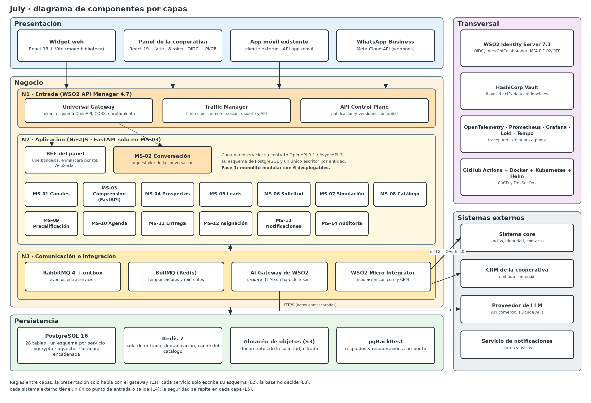
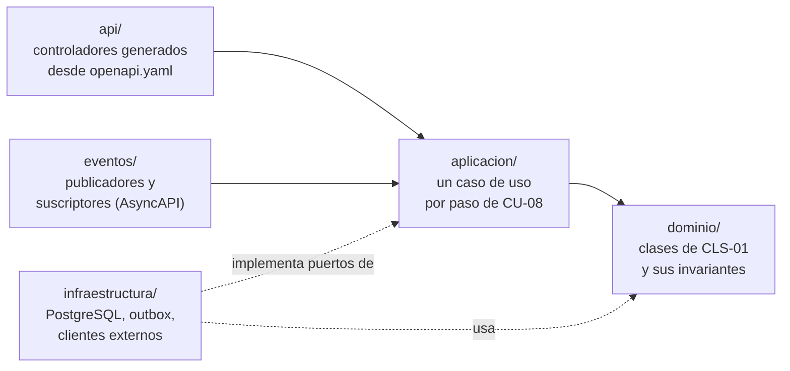
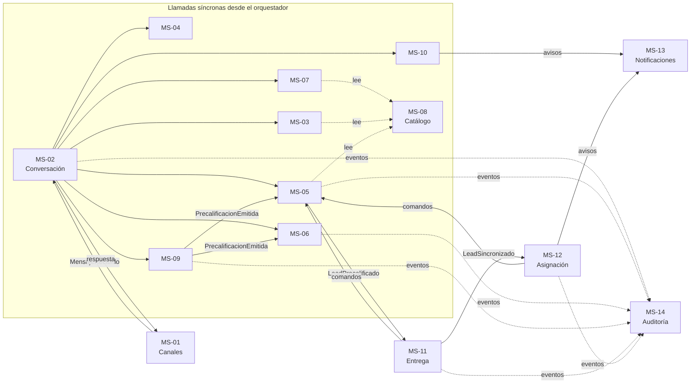
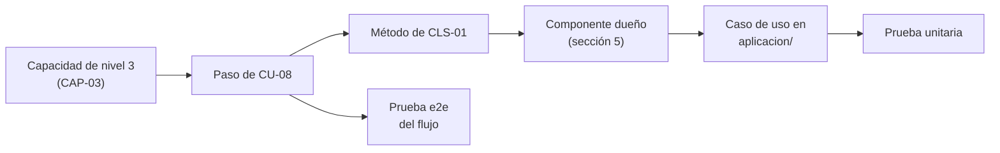

# Vista de desarrollo de July

| Campo | Valor |
|---|---|
| **ID** | SAD-06 |
| **Versión** | 1.0 |
| **Fecha** | 2026-11-25 |
| **Estado** | Borrador |
| **Deriva de** | SAD-01 (sección 7, vista de implementación), SAD-03 (microservicios), SAD-04 (stack del equipo), SAD-05 (stack sobre las tecnologías de la cooperativa), CLS-01 y CLS-02 (clases y métodos), ROB-01 (controles), DAT-01 (tablas), REV-01 (sección 5, vista de desarrollo) |
| **Alimenta a** | SAD-01 (sección 7), vista física (despliegue), PRO-01 cuando el prototipo pase a construcción |

> **Para qué sirve.** Reúne en un solo lugar la **vista de desarrollo** del modelo 4+1 de Kruchten: cómo se organiza el software de July para construirlo, probarlo y entregarlo. Responde qué componentes hay, en qué capa vive cada uno, de qué puede depender, dónde queda en el código cada clase y cada método de CLS-01, cómo se estructura el repositorio, qué entrega cada componente y quién lo construye.
>
> **Vale para los dos stacks propuestos.** La carpeta tiene dos propuestas de tecnología: [SAD-04](stack-tecnologico-july.md), con el stack del equipo (React, NestJS, PostgreSQL y GitHub Actions), y [SAD-05](stack_tecnologico_PJL.md), con las tecnologías que ya opera la cooperativa (Angular, React, .NET, Oracle y Groovy en Jenkins). La organización que aquí se describe (componentes, capas, dueños de cada método, reglas de dependencia, repositorio, artefactos y pruebas) **no depende de cuál se apruebe**; la [sección 3](#3-dos-stacks-posibles) dice qué herramienta concreta usa cada uno.
>
> **Lo que no es:** no repite el detalle de [SAD-03](microservicios-july.md) (criterios de partición y correspondencia capacidad → microservicio) ni el de SAD-04 o SAD-05 (por qué se eligió cada tecnología); los enlaza. No cambia la cadena de trazabilidad: CLS-01 sigue teniendo un único control `July`. Lo que aquí es nuevo (sección 5, correspondencia método → componente; sección 6, reglas de dependencia; secciones 10 y 11, trazabilidad hasta las pruebas y reparto del trabajo) es **propuesta**.

## Contenido

1. [La vista de desarrollo en el modelo 4+1](#1-la-vista-de-desarrollo-en-el-modelo-41)
2. [Capas y reglas entre capas](#2-capas-y-reglas-entre-capas)
3. [Dos stacks posibles](#3-dos-stacks-posibles)
4. [Subsistemas y componentes](#4-subsistemas-y-componentes)
5. [De la vista lógica a la de desarrollo](#5-de-la-vista-lógica-a-la-de-desarrollo)
6. [Dependencias entre componentes](#6-dependencias-entre-componentes)
7. [Estructura del repositorio](#7-estructura-del-repositorio)
8. [Artefactos, contratos y versionado](#8-artefactos-contratos-y-versionado)
9. [Construcción, integración y entrega](#9-construcción-integración-y-entrega)
10. [Pruebas y trazabilidad hasta el código](#10-pruebas-y-trazabilidad-hasta-el-código)
11. [Reparto del trabajo](#11-reparto-del-trabajo)
12. [Orden de construcción](#12-orden-de-construcción)
13. [Decisiones y pendientes](#13-decisiones-y-pendientes)

## 1. La vista de desarrollo en el modelo 4+1

Kruchten (1995) define la vista de desarrollo como la **organización estática del software en su entorno de desarrollo**: módulos y subsistemas agrupados en capas, con sus interfaces y sus dependencias, de forma que cada uno pueda asignarse a un equipo, construirse y probarse por separado. Sus interesados son los programadores y quienes gestionan el proyecto; sus preocupaciones, la facilidad de desarrollo, la reutilización, la gestión de la configuración y las restricciones que imponen el lenguaje y las herramientas.

| Pregunta | Dónde se responde |
|---|---|
| ¿En qué capas se organiza el software y qué puede llamar a qué? | Sección 2 |
| ¿Con qué lenguajes y herramientas se construye? | Sección 3 |
| ¿Qué componentes hay y de qué tipo es cada uno? | Sección 4 |
| ¿Dónde queda en el código cada clase y cada método del modelo? | Sección 5 |
| ¿Qué dependencias están permitidas entre componentes? | Sección 6 |
| ¿Cómo se ordena el repositorio y el interior de cada servicio? | Sección 7 |
| ¿Qué entrega cada componente y cómo se versiona? | Sección 8 |
| ¿Cómo se construye y se entrega? | Sección 9 |
| ¿Cómo se prueba y cómo llega la trazabilidad al código? | Sección 10 |
| ¿Quién construye cada parte y en qué orden? | Secciones 11 y 12 |

### Relación con las otras vistas

| Vista | Qué toma la vista de desarrollo de ella | Qué le devuelve |
|---|---|---|
| **+1 · Escenarios** ([CU-08](../0-escenarios/03-especificacion-casos-de-uso/especificaciones-casos-de-uso.md)) | Los 282 pasos de los tres flujos. | Cada paso tiene un caso de uso de aplicación y una prueba de extremo a extremo (sección 10). |
| **Lógica** ([CLS-01](../1-vista-logica/05-diccionario-de-datos/diccionario-de-datos-etapa3.md), [ROB-01](../1-vista-logica/08-diagrama-de-robustez/diagramas-de-robustez-etapa3.drawio), [DAT-01](../1-vista-logica/10-modelo-de-datos/modelo-de-datos-july.md)) | 18 clases, 53 métodos, 51 controles y 26 tablas. | Cada clase y cada método tiene un componente dueño (sección 5); cada tabla, un esquema de servicio. |
| **De procesos** ([SEC-01](../2-vista-de-procesos/07-diagrama-de-secuencia/diagramas-de-secuencia-etapa3.drawio)) | Las llamadas síncronas, los eventos y los temporizadores. | Contratos OpenAPI y AsyncAPI que fijan esas llamadas y eventos (sección 8). |
| **Física** ([despliegue](../4-vista-fisica/imagenes/despliegue-july.png)) | Los nodos y los entornos. | Los 6 desplegables de la fase 1, sus imágenes y sus charts de Helm (secciones 4 y 8). |

## 2. Capas y reglas entre capas

El software se organiza en tres capas, más lo transversal y los sistemas externos. La capa de Negocio se divide en tres subcapas. Las capas y sus reglas son las mismas en los dos stacks; el detalle de cada capa está en [SAD-04, sección 2](stack-tecnologico-july.md#2-vista-general-por-capas) y en [SAD-05, sección 2](stack_tecnologico_PJL.md#2-vista-general-por-capas).



*Figura 1. Diagrama de componentes de July por capas (figura 13 de SAD-01), dibujado con el stack de SAD-04.*

| Capa | Componentes | Tecnología con SAD-04 | Tecnología con SAD-05 |
|---|---|---|---|
| Presentación | Widget del prospecto, panel de la cooperativa (8 roles). La app móvil existente es un cliente externo. | React 19 en los dos | Widget en React 19; panel en Angular 21 |
| Negocio · N1 Entrada | Universal Gateway, Traffic Manager, API Control Plane | WSO2 API Manager 4.7 | Igual |
| Negocio · N2 Aplicación | BFF del panel y los 14 microservicios | NestJS; FastAPI solo en MS-03 | ASP.NET Core (.NET 10) en todos, incluido MS-03 |
| Negocio · N3 Comunicación e integración | Eventos, temporizadores, mediación con el core y el CRM, salida al LLM | RabbitMQ 4 con outbox, BullMQ, WSO2 Micro Integrator, AI Gateway de WSO2 | RabbitMQ 4 con outbox, Quartz.NET, Micro Integrator (con Groovy en el *Script Mediator*), AI Gateway de WSO2 |
| Persistencia | Datos transaccionales, caché y colas cortas, documentos, respaldos | PostgreSQL 16, Redis 7, almacén S3, pgBackRest | Oracle (un usuario por servicio, TDE), Redis 7, almacén S3, RMAN |
| Transversal | Identidad, secretos, observabilidad, entrega | WSO2 Identity Server 7.3, Vault, OpenTelemetry, GitHub Actions, Kubernetes, Helm | Igual, con Jenkins y tuberías en Groovy en lugar de GitHub Actions |

Las cinco reglas entre capas de SAD-04 (L1 a L5) son también **reglas de desarrollo**: se comprueban en el código y en la tubería, no solo en el diagrama.

| Regla | Enunciado | Cómo se comprueba en desarrollo |
|---|---|---|
| L1 | La presentación solo habla con el gateway. | El cliente del panel y del widget se genera desde los contratos publicados en el gateway; no hay URL de servicios internos en `apps/`. |
| L2 | Un servicio solo lee y escribe su propio esquema. | Cada servicio tiene un usuario de base sin permisos sobre otros esquemas; las migraciones de un servicio solo tocan su carpeta en `db/migraciones/`. |
| L3 | La persistencia no decide. | Revisión de las migraciones: solo hay triggers de integridad y bitácora (DAT-02), nunca reglas de negocio. |
| L4 | Cada sistema externo tiene un único punto de entrada o salida. | Solo `ms01-canales`, `ms04-prospectos` (por el Micro Integrator), `ms11-entrega` (por el Micro Integrator), `ms13-notificaciones` y `ms03-comprension` (por el AI Gateway) tienen clientes de sistemas externos. |
| L5 | La seguridad se repite en cada capa. | Cada servicio valida de nuevo el JWT interno y el esquema de entrada, aunque el gateway ya lo haya hecho. |

### Capas dentro de cada servicio

Cada microservicio sigue la misma arquitectura hexagonal (puertos y adaptadores). Las dependencias apuntan siempre hacia el dominio:



| Carpeta | Contiene | Puede depender de | No puede depender de |
|---|---|---|---|
| `dominio/` | Clases «entidad» de CLS-01 que posee el servicio, enumeraciones y transiciones de estado | `packages/dominio` | Ninguna otra carpeta del servicio, ningún framework ni base de datos |
| `aplicacion/` | Casos de uso: un método por paso de CU-08 que recibe el servicio; los puertos (interfaces) hacia repositorios y clientes | `dominio/` | `infraestructura/`, `api/` |
| `infraestructura/` | Repositorios de PostgreSQL, outbox, clientes del Micro Integrator, del AI Gateway o del broker | `aplicacion/` (implementa sus puertos), `dominio/` | `api/` |
| `api/` y `eventos/` | Adaptadores de entrada: controladores HTTP y suscriptores de eventos | `aplicacion/` | `infraestructura/` |

## 3. Dos stacks posibles

[SAD-05](stack_tecnologico_PJL.md) propone construir July con las tecnologías que la cooperativa ya licencia y opera; si se aprueba, SAD-04 pasa a `Obsoleto` ([SAD-05, sección 10](stack_tecnologico_PJL.md#10-cambios-respecto-a-sad-04)). Mientras la cooperativa decide, esta vista fija lo que no cambia y deja la herramienta concreta en esta tabla, que es la única parte del documento que depende del stack:

| Elemento de la vista de desarrollo | Con SAD-04 (stack del equipo) | Con SAD-05 (stack de la cooperativa) |
|---|---|---|
| Lenguajes de servidor | TypeScript (NestJS); Python (FastAPI) solo en MS-03 | C# (.NET 10) en todos los servicios, incluido MS-03 con `Microsoft.Extensions.AI` |
| Lenguajes de presentación | TypeScript con React en el panel y en el widget | TypeScript con Angular en el panel y React en el widget |
| Organización del código de servidor | Monorrepositorio con un paquete por servicio (`services/ms06-solicitud/`) | Monorrepositorio con una solución .NET y un proyecto por módulo (`services/Ms06.Solicitud/`); la solución agrupa los 6 desplegables de la fase 1 |
| Carpetas hexagonales de cada servicio (sección 7) | Carpetas dentro de `src/` | Las mismas carpetas como espacios de nombres, o proyectos separados (`.Dominio`, `.Aplicacion`, `.Infraestructura`, `.Api`) si el equipo prefiere que el compilador impida las dependencias prohibidas |
| Compartido (`packages/`) | Paquetes de TypeScript (`packages/dominio`) | Proyectos de biblioteca de .NET (`Shared.Dominio`) y una librería de TypeScript para los tipos que usan Angular y React |
| Contratos | OpenAPI 3.1 escrito primero; controladores generados | OpenAPI 3.1 generado por ASP.NET Core y revisado como artefacto; AsyncAPI 3 para los eventos |
| Clientes del frontend | Generados desde OpenAPI | `openapi-generator` con plantilla `typescript-angular` en el panel; cliente TypeScript en el widget |
| Base de datos y migraciones | PostgreSQL 16; Prisma o Drizzle (Alembic en MS-03), en `db/migraciones/` | Oracle; migraciones de EF Core en cada proyecto, revisadas por el DBA de la cooperativa, o Liquibase si ya lo usa |
| DDL de partida | DAT-02 tal como está | DAT-02 traducido a Oracle con el mapeo de [SAD-05, sección 6.2](stack_tecnologico_PJL.md#62-impacto-en-dat-02) (aún no existe) |
| Temporizadores (`vencerPlazo()`) | BullMQ sobre Redis | Quartz.NET en clúster con almacén en Oracle |
| Pruebas | Jest o Pytest, Testcontainers, Pact (SAD-04) · xUnit, Testcontainers, PactNet, Vitest (SAD-05) | xUnit, Testcontainers para .NET (Oracle Database Free), PactNet; Vitest en el panel y el widget |
| Pruebas e2e y evals | Playwright; evals del LLM | Igual |
| Comprobación de las reglas de dependencia (sección 6) | Reglas de fronteras de Nx o dependency-cruiser | NetArchTest o ArchUnitNET en las pruebas, más las referencias entre proyectos |
| Integración y entrega | GitHub Actions | Jenkins con `Jenkinsfile` declarativo y una *shared library* en Groovy |
| Imágenes | Imagen mínima de Node.js o Python firmada con Cosign | Imagen `chiseled` de .NET firmada con Cosign |
| Gateway, identidad, broker, secretos, observabilidad | WSO2, RabbitMQ, Vault, OpenTelemetry | Igual |

## 4. Subsistemas y componentes

El detalle de cada microservicio (capacidades, servicios SA, tablas, eventos y sistemas externos) está en [SAD-03, sección 2](microservicios-july.md#2-tabla-resumen-de-microservicios). Aquí se resume lo que importa para construirlos.

| Componente | Carpeta | Tipo (DDD) | Lenguaje (SAD-04 · SAD-05) | Desplegable de la fase 1 | Clases de CLS-01 que posee |
|---|---|---|---|---|---|
| Widget del prospecto | `apps/widget` | Presentación | React · React | Estáticos en el CDN | Borde de `Canal` (lado web) |
| Panel de la cooperativa | `apps/panel` | Presentación | React · Angular | Estáticos en el CDN | `PanelCooperativa` |
| BFF del panel | `services/bff-panel` | Plataforma | NestJS · ASP.NET Core | Junto a los desplegables | — (une bandejas y enmascara por rol) |
| MS-01 Canales | `services/ms01-canales` | Genérico | NestJS · .NET | 1 · Canales | `Canal`, `Mensaje` (formato común) |
| MS-02 Conversación | `services/ms02-conversacion` | Núcleo | NestJS · .NET | 3 · Núcleo de captación | `July` (orquestador), `Conversacion`, `Mensaje`, `PlantillaMensaje` |
| MS-03 Comprensión del lenguaje | `services/ms03-comprension` | Soporte | FastAPI · .NET | 2 · Comprensión del lenguaje | — (sin estado) |
| MS-04 Prospectos y consentimiento | `services/ms04-prospectos` | Núcleo | NestJS · .NET | 3 · Núcleo de captación | `Prospecto`; cliente de `SistemaCore` |
| MS-05 Leads | `services/ms05-leads` | Núcleo | NestJS · .NET | 3 · Núcleo de captación | `Lead` (único escritor) |
| MS-06 Solicitud de crédito | `services/ms06-solicitud` | Núcleo | NestJS · .NET | 3 · Núcleo de captación | `SolicitudCredito` |
| MS-07 Simulación financiera | `services/ms07-simulacion` | Núcleo | NestJS · .NET | 4 · Motor financiero | `Simulacion` |
| MS-08 Catálogo de productos | `services/ms08-catalogo` | Soporte | NestJS · .NET | 4 · Motor financiero | `LineaCredito` |
| MS-09 Precalificación | `services/ms09-precalificacion` | Núcleo | NestJS · .NET | 4 · Motor financiero | `ReglaNegocio` (PRECALIFICACION) |
| MS-10 Agenda y citas | `services/ms10-agenda` | Soporte | NestJS · .NET | 5 · Gestión comercial | `Cita` |
| MS-11 Entrega de oportunidades | `services/ms11-entrega` | Núcleo | NestJS · .NET | 5 · Gestión comercial | `ReglaNegocio` (PRIORIDAD); cliente de `CRMCooperativa` |
| MS-12 Asignación y seguimiento | `services/ms12-asignacion` | Núcleo | NestJS · .NET | 5 · Gestión comercial | `AsesorComercial`, `ReglaNegocio` (ENRUTAMIENTO) |
| MS-13 Notificaciones | `services/ms13-notificaciones` | Genérico | NestJS · .NET | 5 · Gestión comercial | — (registro de envíos) |
| MS-14 Auditoría y trazabilidad | `services/ms14-auditoria` | Genérico | NestJS · .NET | 6 · Auditoría | — (tabla `evento`) |
| Contratos | `packages/contratos` | Compartido | YAML (OpenAPI 3.1, AsyncAPI 3) | — | — |
| Tipos del dominio | `packages/dominio` | Compartido | TypeScript · C# (y TypeScript para el frontend) | — | Enumeraciones de CLS-01 y la clase abstracta `Configuracion` |
| Observabilidad | `packages/observabilidad` | Compartido | TypeScript · C# | — | — |
| Configuración del gateway | `gateway/` | Plataforma | TOML, YAML | Charts de WSO2 | — |

`Colaborador` no tiene un servicio propio: la identidad y el rol los emite WSO2 Identity Server y MS-12 mantiene los asesores (pendiente P2 de SAD-03). `Configuracion` es abstracta: cada subclase vive con el servicio que la usa (criterio C5 de SAD-03).

Los seis desplegables de la fase 1 agrupan módulos que cambian juntos, y cada módulo usa su propio esquema de base de datos (PostgreSQL con SAD-04, usuario de Oracle con SAD-05) desde el inicio para poder separarlo después sin reescribir (decisión DA-06 de SAD-01):

| # | Desplegable | Módulos | Por qué juntos |
|---|---|---|---|
| 1 | Canales | MS-01 | Frontera con WhatsApp y el widget; escala con el tráfico de entrada. |
| 2 | Comprensión del lenguaje | MS-03 | Habla con el LLM; sin estado (en Python con SAD-04). |
| 3 | Núcleo de captación | MS-02, MS-04, MS-05, MS-06 | Conversación, prospecto, lead y solicitud cambian juntos. |
| 4 | Motor financiero | MS-07, MS-08, MS-09 | Cálculo y reglas deterministas sobre el catálogo. |
| 5 | Gestión comercial | MS-10, MS-11, MS-12, MS-13 | Citas, CRM, asignación y avisos. |
| 6 | Auditoría | MS-14 | Bitácora de solo inserción, aislada por integridad. |

Dentro de un desplegable, los módulos se llaman por la misma interfaz que usarían en red (puerto de aplicación), nunca leyendo las tablas del otro. Así la separación de la fase 2 cambia solo el adaptador.

## 5. De la vista lógica a la de desarrollo

CLS-01 tiene un único control, `July`. En desarrollo ese control se reparte: **MS-02 hace de `July.atender()`** (el control «Atender mensaje» de ROB-01, que decide el siguiente paso y llama a los demás) y cada uno de los otros 50 controles de ROB-01 se vuelve una llamada al servicio dueño del método. Desde la precalificación, los servicios se coordinan por eventos (decisión D1 de SAD-03).

La tabla asigna cada uno de los **53 métodos** de CLS-01 al componente que lo implementa, en la carpeta `aplicacion/` de ese componente. Cuando el método cambia una entidad que pertenece a otro servicio, el que lo implementa decide y el dueño del dato guarda, por comando o evento (decisiones D2 y D3 de SAD-03).

| Clase (estereotipo) | Método | Componente que lo implementa | Quién guarda el dato | Nota |
|---|---|---|---|---|
| `July` «control» | `atender()` | MS-02 | — | Orquestador de la conversación. |
| | `vencerPlazo()` | MS-02 (RESPUESTA_PROSPECTO), MS-12 (ATENCION_ASESOR), MS-10 (RECORDATORIO) | — | Cada plazo es un trabajo de BullMQ del servicio dueño del temporizador. |
| `Canal` «interfaz» | `recibir()`, `verificarAutenticidad()`, `enviar()`, `abrirSesion()` | MS-01 | MS-01 | La firma de WhatsApp se verifica también en el gateway (L5). |
| `SistemaCore` «interfaz» | `validarCedula()`, `consultarSocio()` | MS-04 por el Micro Integrator | MS-04 | Único cliente del core (L4). |
| `CRMCooperativa` «interfaz» | `buscarLead()`, `sincronizarLead()` | MS-11 por el Micro Integrator | MS-11 (bandeja de salida) | Reintentos con la bandeja de salida. |
| `PanelCooperativa` «interfaz» | — | `apps/panel` y BFF del panel | — | Sin métodos en CLS-01; las bandejas las arma el BFF. |
| `Prospecto` «entidad» | `recibir()` | MS-01 | MS-02 (historial) | Es la entrega al prospecto por su canal. |
| | `registrarConsentimiento()` | MS-04 | MS-04 | Evento `ConsentimientoAceptado` o `ConsentimientoRetirado`. |
| `Colaborador` «entidad» | `recibir()` | MS-13 | MS-13 | Aviso en el panel o por correo. |
| | `consultarPublicacion()` | BFF del panel | Servicio dueño de cada `Configuracion` | Lee de MS-02, MS-08, MS-09, MS-11 y MS-12. |
| | `consultarAgenda()` | MS-10 | MS-10 | |
| `Conversacion` «entidad» | `registrarMensaje()`, `etiquetarOrigen()`, `guardarAvance()`, `marcarAbandonada()`, `retomar()`, `traspasar()` | MS-02 | MS-02 | `etiquetarOrigen()` lee la campaña que registra MS-01. |
| | `encolar()` | MS-02 | MS-02 | La cola física de entrada está en Redis, en MS-01. |
| `Lead` «entidad» | `registrar()`, `elegirLinea()`, `actualizarEstado()` | MS-05 | MS-05 | `elegirLinea()` valida contra MS-08. |
| | `priorizar()`, `generarFicha()`, `vincularCRM()` | MS-11 | MS-05 (por comando) | La ficha es una proyección de lectura (D4 de SAD-03). |
| | `asignar()`, `aceptarAsignacion()`, `reactivar()` | MS-12 | MS-05 (por comando) | |
| `SolicitudCredito` «entidad» | `iniciar()`, `campoPendiente()`, `registrarDato()`, `resumir()`, `actualizarEstado()`, `registrarDocumento()` | MS-06 | MS-06 | MS-03 extrae los valores del texto libre. |
| | `precalificar()`, `explicarResultado()`, `derivarARevision()` | MS-09 | MS-06 (por el evento `PrecalificacionEmitida`) | Código determinista, sin LLM (DA-05). |
| `Simulacion` «entidad» | `calcular()`, `generarTablaAmortizacion()`, `sugerirAlternativa()` | MS-07 | MS-07 | Copia la tasa y la versión de la línea vigente. |
| | `elegir()` | MS-06 | MS-06 (`simulacionElegida`) | SAD-03 asigna el evento `EscenarioElegido` a MS-06. |
| `Cita` «entidad» | `reservar()`, `reprogramar()`, `actualizarEstado()`, `programarRecordatorio()` | MS-10 | MS-10 | |
| `LineaCredito` «entidad» | `buscar()`, `validarCondiciones()`, `requisitosPara()` | MS-08 | MS-08 | MS-03 usa sus palabras clave. |
| `PlantillaMensaje` «entidad» | `componer()`, `buscarRespuesta()` | MS-02 | MS-02 | |
| `Mensaje`, `AsesorComercial`, `Configuracion`, `ReglaNegocio` | — | — | MS-02, MS-12, `packages/dominio`, MS-09/MS-11/MS-12 | Clases sin métodos en CLS-01. |

Resumen por componente: MS-02 implementa 11 métodos, MS-01 5, MS-04 3, MS-05 3, MS-06 7, MS-07 3, MS-08 3, MS-09 3, MS-10 6, MS-11 5, MS-12 4, MS-13 1 y el BFF 1. Suman 55 porque `vencerPlazo()` se cuenta en MS-02, MS-10 y MS-12; sin repetirlo son los 53 de CLS-01. MS-03 y MS-14 no implementan métodos de CLS-01: MS-03 es un servicio técnico que llama MS-02 para clasificar la intención y extraer valores, y MS-14 solo consume eventos.

## 6. Dependencias entre componentes

Hay tres formas de dependencia. Todas pasan por un contrato publicado en `packages/contratos`; ningún servicio importa código de otro.

| Forma | Cuándo se usa | Contrato |
|---|---|---|
| **Llamada síncrona** (HTTP interno) | El que llama necesita la respuesta para seguir la conversación. | OpenAPI 3.1 |
| **Comando** (mensaje dirigido) | El que decide no es el dueño del dato (por ejemplo, MS-12 asigna y MS-05 guarda). | AsyncAPI 3 |
| **Evento** (publicación) | Algo ya pasó y a otros les interesa (por ejemplo, `PrecalificacionEmitida`). | AsyncAPI 3 |



*Continuas: llamadas o comandos. Etiquetadas: eventos del broker. Punteadas: lecturas o suscripciones. Basado en [SAD-03, sección 4](microservicios-july.md#4-vista-por-flujo-de-valor).*

Reglas de dependencia (propuesta, verificables en la tubería):

| # | Regla | Motivo |
|---|---|---|
| R-D1 | Las llamadas síncronas forman un árbol con raíz en MS-02: ningún otro servicio llama de forma síncrona a MS-02, y no hay ciclos síncronos. | Evita bloqueos y cascadas de fallas en la conversación. |
| R-D2 | Solo MS-02 coordina llamadas síncronas a varios servicios en un mismo paso; los demás solo hacen consultas de lectura a otro servicio (por ejemplo, al catálogo de MS-08) o emiten comandos y eventos. | El orquestador es único (D1 de SAD-03). |
| R-D3 | Ningún servicio importa otro servicio; lo compartido vive en `packages/`. | Permite separar los desplegables sin reescribir. |
| R-D4 | `packages/dominio` solo contiene tipos, enumeraciones y transiciones de CLS-01, sin lógica de un servicio. | Evita un «monolito compartido» disfrazado de paquete. |
| R-D5 | Un evento lo publica un solo servicio, el dueño de la entidad que cambió, mediante el outbox de su esquema. | Un solo escritor por entidad (criterio C3 de SAD-03). |

Las reglas R-D1, R-D3 y R-D4 se comprueban con un análisis de dependencias del monorrepositorio (sección 3: reglas de fronteras de Nx o dependency-cruiser con SAD-04; NetArchTest o ArchUnitNET con SAD-05) en cada solicitud de cambio.

## 7. Estructura del repositorio

Se propone un **monorrepositorio**: los contratos y los tipos del dominio se comparten, y cada componente se construye, prueba y despliega por separado. El árbol muestra los nombres con SAD-04; con SAD-05 la forma es la misma, con una solución .NET (`July.sln`) y los nombres de proyecto de la sección 3 (`services/Ms06.Solicitud/`), el panel en Angular y `Jenkinsfile` en lugar de `.github/workflows/`.

```
july/
├── apps/
│   ├── panel/                  # panel de la cooperativa (PanelCooperativa): React o Angular
│   └── widget/                 # React (modo biblioteca): chat del sitio web
├── services/
│   ├── bff-panel/              # bandejas, enmascarado por rol, tiempo real
│   ├── ms01-canales/
│   ├── ms02-conversacion/      # orquestador (July.atender)
│   ├── ms03-comprension/       # LLM: FastAPI o .NET
│   ├── ms04-prospectos/
│   ├── ms05-leads/
│   ├── ms06-solicitud/
│   ├── ms07-simulacion/
│   ├── ms08-catalogo/
│   ├── ms09-precalificacion/
│   ├── ms10-agenda/
│   ├── ms11-entrega/
│   ├── ms12-asignacion/
│   ├── ms13-notificaciones/
│   └── ms14-auditoria/
├── packages/
│   ├── contratos/              # OpenAPI 3.1 y AsyncAPI 3 de cada servicio
│   ├── dominio/                # tipos y enumeraciones de CLS-01
│   └── observabilidad/         # OpenTelemetry y registros sin datos personales
├── db/
│   ├── migraciones/            # una carpeta por esquema
│   └── july.sql                # DDL de partida (DAT-02)
├── gateway/
│   ├── apis/                   # definiciones de las APIs para apictl
│   └── deployment.toml         # configuración de WSO2 versionada
├── infra/
│   ├── helm/                   # charts de July y valores de WSO2
│   └── terraform/              # red, clúster, bases y almacenamiento
├── tests/
│   ├── contrato/               # Pact
│   ├── e2e/                    # Playwright: los flujos de CU-08
│   └── evals/                  # intención y prompt injection del LLM
└── .github/workflows/          # CI/CD: pruebas, Semgrep, SonarQube, Trivy, ZAP
```

Dentro de cada servicio el código sigue las mismas carpetas (sección 2), para que cada paso de CU-08 tenga un lugar fijo:

```
services/ms06-solicitud/
├── src/
│   ├── api/                # controladores generados desde openapi.yaml
│   ├── aplicacion/         # casos de uso: un método por paso de CU-08
│   ├── dominio/            # SolicitudCredito y sus invariantes
│   ├── infraestructura/    # repositorio de la base, outbox y clientes
│   └── eventos/            # publicadores y suscriptores (AsyncAPI)
├── test/
├── openapi.yaml
└── Dockerfile
```

### Convenciones de código

| Elemento | Convención | Ejemplo |
|---|---|---|
| Carpeta de servicio | `msNN-nombre`, en minúsculas y con guiones | `ms06-solicitud` |
| Clase de dominio | El nombre de CLS-01, sin cambios | `SolicitudCredito` |
| Método de dominio | El nombre de CLS-01 con sus mismos parámetros; en C# (SAD-05) solo cambia la inicial a mayúscula, por la convención del lenguaje | `registrarDato(campo, valor)` · `RegistrarDato(campo, valor)` |
| Caso de uso de aplicación | Verbo del paso + sustantivo, con el número de paso de CU-08 en su comentario | `RegistrarDatoSolicitud` (F2: 12) |
| Evento | Sustantivo + participio, en PascalCase y en español | `PrecalificacionEmitida` |
| Esquema de base | El número del servicio | `ms06` |
| Tabla | El nombre de DAT-01, sin cambios | `solicitud_credito` |

Mantener los nombres de CLS-01 y DAT-01 en el código es lo que permite seguir un paso desde la especificación hasta la prueba (sección 10).

## 8. Artefactos, contratos y versionado

Cada componente entrega los mismos artefactos:

| Artefacto | Herramienta | Regla |
|---|---|---|
| Contrato de API | OpenAPI 3.1 en `packages/contratos` | Se escribe antes que el código (API-first, K2 de SAD-04). El gateway lo importa y el panel y la app móvil generan su cliente desde él. |
| Contrato de eventos | AsyncAPI 3 en `packages/contratos` | Cada evento lleva su versión y el identificador de correlación (`traceparent`). |
| Migraciones | Prisma o Drizzle, Alembic en MS-03 (SAD-04) · EF Core o Liquibase (SAD-05) | La primera migración de cada esquema sale de DAT-02 (traducido a Oracle con SAD-05); solo se avanza, nunca se edita una migración publicada. |
| Imagen de contenedor | Docker, imagen mínima (Node.js o Python · .NET `chiseled`) firmada con Cosign | Una por desplegable. |
| Chart de Helm | `infra/helm` | Uno por desplegable, con los valores por entorno. |
| Pruebas | Jest o Pytest, Testcontainers, Pact | Unitarias, de integración y de contrato en el mismo cambio que el código. |

### Versionado

- **Contratos:** versionado semántico. Un cambio que rompe la compatibilidad (quitar un campo, cambiar un tipo) sube la versión mayor y obliga a publicar la API nueva en el gateway junto a la anterior hasta que la app móvil y el panel migren.
- **Servicios:** cada imagen se etiqueta con la versión del servicio y el commit.
- **Configuración del negocio** (`LineaCredito`, `PlantillaMensaje`, `ReglaNegocio`): no es código. Se publica por versiones en la base, con una sola versión vigente, y cada resultado guarda la versión que lo produjo (DAT-01).
- **Configuración de WSO2:** `gateway/` se versiona en Git y se publica con apictl desde la tubería, nunca a mano.

## 9. Construcción, integración y entrega

El detalle de la infraestructura y de la observabilidad está en [SAD-04, sección 8](stack-tecnologico-july.md#8-infraestructura-observabilidad-y-entrega) y en [SAD-05, sección 9](stack_tecnologico_PJL.md#9-infraestructura-observabilidad-y-entrega). Las etapas son las mismas con GitHub Actions (SAD-04) o con Jenkins y su *shared library* en Groovy (SAD-05); la tubería solo construye y prueba lo que cambió en el monorrepositorio:

```mermaid
flowchart LR
    PR["Solicitud de cambio"] --> LINT["Formato, tipos<br/>y reglas R-D1 a R-D5"]
    LINT --> UNIT["Pruebas unitarias<br/>y de integración"]
    UNIT --> CONT["Pruebas de contrato<br/>(Pact)"]
    CONT --> SAST["Semgrep · SonarQube<br/>Trivy (dependencias)"]
    SAST --> IMG["Imagen firmada<br/>(Cosign) y chart"]
    IMG --> DEV["Despliegue en<br/>desarrollo"]
    DEV --> E2E["Pruebas e2e de CU-08<br/>evals del LLM · ZAP"]
    E2E --> PRU["Pruebas"]
    PRU -- aprobación humana --> PROD["Producción"]
```



| Entorno | Para qué | Quién lo usa |
|---|---|---|
| desarrollo | Integración continua y pruebas de extremo a extremo | Equipo |
| pruebas | Validación con la cooperativa; la app móvil existente apunta aquí durante la integración | Equipo y cooperativa |
| produccion | Operación | Cooperativa |

Cada entorno tiene su propio gateway WSO2, su base y sus secretos en Vault. El paso a producción exige aprobación humana.

## 10. Pruebas y trazabilidad hasta el código

La cadena de trazabilidad de la documentación llega hasta el código y las pruebas:



| Nivel de prueba | Qué cubre | Dónde | Relación con la documentación |
|---|---|---|---|
| Unitaria | Un caso de uso de aplicación y las invariantes de su entidad | `services/*/test` | Un caso por paso de CU-08 que recibe el servicio. |
| Integración | Repositorio, outbox y clientes externos simulados | `services/*/test` con Testcontainers | Las tablas y restricciones de DAT-02. |
| Contrato | Que el que llama y el llamado cumplan el mismo contrato | `tests/contrato` (Pact) | Las flechas de la sección 6. |
| Extremo a extremo | Un flujo de CU-08 completo como conversación esperada, con su principal y sus alternativos, contra un core y un CRM simulados | `tests/e2e` (Playwright) | Los 282 pasos; el prototipo PRO-01 ya recorre 281 en sus pruebas. |
| Evals del LLM | Clasificación de la intención, extracción de valores y resistencia a prompt injection | `tests/evals` | CU 1.2.2 y los hallazgos de SAD-02. |

Las pruebas de extremo a extremo reutilizan el formato de [PRO-01](../../Complementarios/prototipo/README.md): cada paso de CU-08 lleva su número, de modo que una prueba fallida señala el paso y, con la sección 5, el componente responsable.

## 11. Reparto del trabajo

Kruchten usa la vista de desarrollo para asignar el trabajo. La propuesta reparte los componentes por rol del equipo (portada del repositorio); cada componente tiene un responsable y los compartidos tienen dos.

| Rol | Responsable de | Apoya en |
|---|---|---|
| Arquitectura de software | `packages/contratos`, reglas R-D1 a R-D5, MS-02 (orquestador), decisiones y su registro | Revisión de toda solicitud de cambio que toque contratos |
| Backend | MS-01, MS-03 a MS-13, BFF del panel, `packages/dominio` | Pruebas de contrato y e2e |
| Base de datos | `db/` (migraciones por esquema), MS-14 (bitácora encadenada), respaldos | Repositorios de `infraestructura/` |
| Frontend | `apps/panel`, `apps/widget`, cliente generado desde los contratos | BFF del panel |
| UI/UX | Sistema de diseño, textos de `PlantillaMensaje`, pruebas con usuarios | `apps/panel`, `apps/widget` |
| Seguridad | `gateway/`, políticas de WSO2, Vault, etapas de seguridad de la tubería, `tests/evals` | MS-01 (autenticidad), MS-04 (identidad y consentimiento) |

Con SAD-05 entra un actor más: el **equipo de TI de la cooperativa**, que mantendrá July después de la entrega. Su DBA revisa las migraciones de Oracle y administra TDE, RMAN y los usuarios por servicio; su equipo de Jenkins mantiene la *shared library* en Groovy. Conviene que participe desde la etapa 0 de la sección 12 y que cada componente tenga una contraparte de la cooperativa antes del paso a producción.

## 12. Orden de construcción

El orden sigue los flujos de valor (REV-01, sección 5) y el despliegue progresivo (D5 de SAD-03):

| Etapa | Qué se construye | Desplegables | Condición para empezar |
|---|---|---|---|
| 0 · Base | Monorrepositorio, `packages/`, tubería, gateway y Identity Server en desarrollo, DDL de DAT-02 | — | Aprobación de este documento |
| 1 · Flujo 1 | MS-01, MS-02, MS-03, MS-04, MS-05 y el widget | 1, 2 y 3 (parcial) | Etapa 0. Mide la meta de responder en menos de 2 minutos. |
| 2 · Flujo 2 | MS-06, MS-07, MS-08, MS-09 y MS-10 (citas) | 3 y 4 | Reglas de precalificación acordadas con el Comité de crédito |
| 3 · Flujo 3 | MS-11, MS-12, MS-13, BFF y panel | 5 | Contrato del CRM y reglas de prioridad y enrutamiento (P-02 de SAD-01) |
| 4 · Transversal | MS-14 y el embudo | 6 | Puede ir en paralelo desde la etapa 1 |
| 5 · Separación | Partir los desplegables 3, 4 y 5 en sus microservicios | 14 | Volumen real (P-03 de SAD-01) |

## 13. Decisiones y pendientes

Esta vista aplica las decisiones ya tomadas en SAD-01, SAD-03, SAD-04 y SAD-05 y agrega las suyas:

| # | Decisión o pendiente | Detalle | Origen |
|---|---|---|---|
| DA-01, DA-03 | Un servicio dueño por capacidad y un solo escritor por entidad. | Sección 5: cada método tiene un componente que lo implementa y un dueño del dato. | SAD-01, SAD-03 |
| DA-02 | MS-02 orquesta; desde la precalificación, coreografía por eventos. | Sección 6: árbol de llamadas síncronas con raíz en MS-02. | SAD-01, SAD-03 (D1) |
| DA-06 | Monolito modular con 6 desplegables y un esquema por servicio. | Secciones 4 y 12. | SAD-01, SAD-03 (D5) |
| DV-01 | **Monorrepositorio** con `apps/`, `services/` y `packages/`. | Contratos y tipos compartidos sin acoplar servicios. | SAD-01 (sección 7.3) |
| DV-02 | **Arquitectura hexagonal en cada servicio** con las mismas carpetas. | Cada paso de CU-08 tiene un lugar fijo en `aplicacion/`. | Esta vista |
| DV-03 | **Los nombres de CLS-01 y DAT-01 no se traducen ni se cambian en el código.** | Trazabilidad paso → método → código → prueba. | Esta vista |
| DV-04 | **Reglas de dependencia R-D1 a R-D5 verificadas en la tubería.** | Que la separación de la fase 2 no exija reescribir. | Esta vista |
| DV-05 | **La organización del desarrollo no depende del stack.** | Componentes, dueños de cada método, reglas de dependencia, repositorio, artefactos y pruebas valen igual con SAD-04 o SAD-05; solo cambia la tabla de la sección 3. | Esta vista |
| PV-01 | Aprobar el stack: SAD-04 o SAD-05. Con SAD-04 falta elegir la herramienta del monorrepositorio (Nx, Turborepo o pnpm workspaces) y la de migraciones (Prisma o Drizzle); con SAD-05, si las capas hexagonales son carpetas o proyectos de .NET y si las migraciones van con EF Core o Liquibase. | Condiciona la sección 3 y cómo se comprueban R-D1 a R-D4. | Equipo de backend |
| PV-02 | DAT-01 es una base única: hace falta repartirlo por esquema de servicio. | Las claves foráneas entre servicios pasan a ser referencias por identificador. | SAD-03 (P1) |
| PV-03 | `Colaborador` no tiene servicio dueño. | Hoy se resuelve con Identity Server y MS-12. | SAD-03 (P2) |
| PV-04 | CAP-03 no modela los componentes de aplicación. | Añadir los 14 microservicios al modelo Archi y regenerar CAP-05. | SAD-03 (P3) |
| PV-05 | `Simulacion.elegir()` y `vencerPlazo()` quedan repartidos entre servicios. | Confirmar con el equipo de backend la asignación de la sección 5 o ajustar CLS-01. | Esta vista |
| PV-06 | La figura de componentes no muestra `packages/` ni las reglas R-D1 a R-D5. | Volver a dibujarla cuando se apruebe esta vista. | Esta vista |
