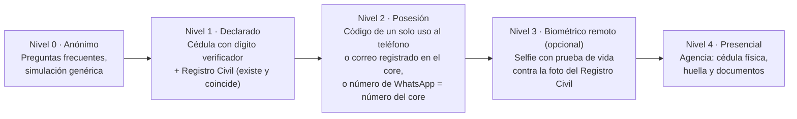

# Seguridad de July: bots, suplantación de identidad y veracidad de los datos

| Campo | Valor |
|---|---|
| **ID** | SAD-02 |
| **Versión** | 1.0 |
| **Fecha** | 2026-11-11 |
| **Estado** | Borrador |
| **Deriva de** | CU-08 (pasos de identidad y canal), CLS-01, CLS-02, NEG-01, PRE-02 (sección 5, leyes e ISO), PRO-01 |
| **Alimenta a** | SAD-01, sección de seguridad (hoy en blanco) |

> **Para qué sirve este documento.** Responde tres preguntas: **(1)** cómo demostramos que July va a ser segura, **(2)** cómo evitamos ataques con mensajes de bots y **(3)** cómo sabemos que quien escribe es quien dice ser y que lo que declara es cierto. Cada respuesta se da desde seis roles: Arquitecto de software, Backend, Base de datos, Frontend, UI/UX y Seguridad, con la ley, la norma ISO o el estándar que la sustenta.
>
> **Lo que no es:** no cambia la cadena de trazabilidad. Las propuestas que tocan clases o pasos están en la [sección 9](#9-hallazgos-sobre-el-diseño-actual-y-cambios-propuestos) como cambios por aprobar, con los documentos que habría que actualizar.

## Contenido

1. [Resumen en una página](#1-resumen-en-una-página)
2. [Punto de partida: qué protegemos y qué no hace July](#2-punto-de-partida-qué-protegemos-y-qué-no-hace-july)
3. [Amenazas (STRIDE aplicado a July)](#3-amenazas-stride-aplicado-a-july)
4. [Idea central: verificación proporcional por etapa](#4-idea-central-verificación-proporcional-por-etapa)
5. [Marco normativo común](#5-marco-normativo-común)
6. [Punto de vista de cada rol](#6-punto-de-vista-de-cada-rol)
   - [6.1 Arquitecto de software](#61-arquitecto-de-software)
   - [6.2 Backend](#62-backend)
   - [6.3 Base de datos](#63-base-de-datos)
   - [6.4 Frontend](#64-frontend)
   - [6.5 UI/UX](#65-uiux)
   - [6.6 Seguridad](#66-seguridad)
7. [Respuesta integrada a las tres preguntas](#7-respuesta-integrada-a-las-tres-preguntas)
8. [Cómo lo evidenciamos: el caso de aseguramiento](#8-cómo-lo-evidenciamos-el-caso-de-aseguramiento)
9. [Hallazgos sobre el diseño actual y cambios propuestos](#9-hallazgos-sobre-el-diseño-actual-y-cambios-propuestos)
10. [Decisiones que necesitamos de la cooperativa](#10-decisiones-que-necesitamos-de-la-cooperativa)
11. [Referencias](#11-referencias)

---

## 1. Resumen en una página

| Pregunta | Respuesta corta | Norma principal |
|---|---|---|
| **¿Cómo evidenciamos que July es segura?** | No basta con decirlo: se arma un **caso de aseguramiento** (afirmación → argumento → evidencia). Cada afirmación («solo entran mensajes auténticos», «nadie ve datos de otro socio»…) se respalda con un control trazado a un requisito de **OWASP ASVS 5.0** y con una evidencia verificable: prueba automatizada, resultado de pentest, registro de auditoría o métrica. | ISO/IEC/IEEE 15026-2:2022, OWASP ASVS 5.0, ISO/IEC 27001:2022 |
| **¿Cómo evitamos los bots?** | **Defensa en capas**: el canal ya filtra (WhatsApp verifica el número; el webhook va firmado), y July añade límites por número, IP y cédula; idempotencia por `idExterno`; cola cuando se supera `capacidadMaxima`; heurísticas de comportamiento; reto invisible solo en el widget web y solo cuando el riesgo sube; y tope de consumo del modelo de lenguaje. | OWASP API Security Top 10 (2023) API4 y API6, OWASP OAT-017 y OAT-019, OWASP Top 10 para LLM (2025) LLM10 |
| **¿Cómo evitamos la suplantación?** | Saber una cédula **no prueba** ser su dueño: en Ecuador nombre y cédula son fáciles de conseguir. Por eso la identidad se **sube de nivel por etapa**: declarada → validada con el Registro Civil → **posesión** verificada (código al teléfono que la cooperativa ya tiene registrado) → biometría con prueba de vida, solo si la cooperativa lo decide → verificación **presencial** en la agencia, que ya existe en el flujo. July **nunca muestra datos del core** antes de la posesión verificada. | NIST SP 800-63-4, ISO/IEC 29115:2013, ISO/IEC 30107-3, LOPDP, COIP art. 212 |
| **¿Cómo validamos que la información es verídica?** | Cada dato guarda su **origen** (declarado, core, Registro Civil o verificado en agencia). La precalificación usa lo declarado y por eso es **preliminar**; los ingresos y la actividad se verifican con documentos en la agencia, como exige la debida diligencia de la UAFE. July detecta incoherencias (ingresos fuera de rango para la actividad, muchas cédulas desde un número) y las marca para el asesor, sin decidir por su cuenta. | Normativa UAFE y SEPS (conozca a su cliente), LOPDP arts. 10 y 20, ISO/IEC 25012 (calidad de datos) |

**Mensaje clave para la cooperativa:** July no aprueba créditos ni mueve dinero. El daño que puede causar un atacante es **filtrar datos personales**, **ensuciar el embudo con leads falsos** y **gastar recursos** (mensajes pagados a Meta, tiempo de asesores). La seguridad se diseña contra esos tres daños, con fricción solo donde hay algo que proteger.

---

## 2. Punto de partida: qué protegemos y qué no hace July

### 2.1 Activos

| Activo | Dónde vive (CLS-01) | Por qué importa |
|---|---|---|
| Datos personales del prospecto (nombres, cédula, teléfono, correo) | `Prospecto` | LOPDP: su filtración es una vulneración que se notifica a la autoridad |
| Datos financieros declarados (ingresos, actividad, monto) | `SolicitudCredito` | Revelan la situación económica; base de la precalificación |
| Datos del core (condición de socio, edad, actividad registrada) | `SistemaCore` (fuente), copia parcial en `Prospecto` | Son de la cooperativa; mostrarlos a quien no es su dueño es una filtración |
| Evidencia de consentimiento | `Prospecto` (`consentimientoAceptado`, `versionAviso`, `fechaConsentimiento`) | Demuestra qué aceptó cada persona y cuándo |
| Configuración publicada | `LineaCredito`, `PlantillaMensaje`, `ReglaNegocio` | Si alguien la altera, July informa tasas o reglas falsas |
| Integridad del embudo | `Lead`, CRM | Leads falsos consumen asesores y distorsionan los indicadores |
| Disponibilidad y costo del canal | `Canal`, `July.capacidadMaxima` | Cada conversación iniciada por la empresa en WhatsApp tiene costo |

### 2.2 Lo que acota el riesgo

- July **precalifica, no aprueba**: `APROBADA` y `NEGADA` solo las registra el Comité de crédito (CLS-01, `SolicitudCredito`).
- July **no mueve dinero** ni consulta burós.
- El crédito **termina en la agencia**, donde la persona se presenta con su cédula física. Ese control presencial ya existe y es el que exige la debida diligencia de la UAFE.

Por eso **no necesitamos verificación bancaria fuerte en el primer mensaje**. Necesitamos que July **no filtre**, **no se sature** y **no entregue al asesor un lead que parezca más confiable de lo que es**.

---

## 3. Amenazas (STRIDE aplicado a July)

STRIDE (Microsoft) clasifica amenazas en seis tipos. Se complementa con **LINDDUN** para las amenazas de privacidad.

| STRIDE | Amenaza concreta en July | Paso o clase afectada (CU-08 / CLS-01) | Control principal |
|---|---|---|---|
| **S**uplantación (*Spoofing*) | Alguien escribe la cédula o el teléfono de otro socio para ver sus datos o pedir crédito a su nombre | Flujo 2, A1 (pasos 14a y 15a): July **muestra los datos registrados del socio** | Verificar posesión antes de mostrar nada; enmascarar (sección 9, H1) |
| | Webhook falso que se hace pasar por WhatsApp | Flujo 1, pasos 2 a 5 y A3 | `Canal.verificarAutenticidad()` con HMAC (ya diseñado) |
| **T**ampering (manipulación) | Alterar una tasa o regla publicada; inyectar instrucciones al modelo de lenguaje (*prompt injection*) para que «apruebe» | `Configuracion`, futura capa de IA | Publicación con permisos y versión; la IA solo clasifica, el cálculo es determinista (REV-01) |
| **R**epudio | «Yo nunca acepté el aviso de privacidad» / «yo no pedí ese crédito» | `Prospecto.registrarConsentimiento()` | Registro de consentimiento con versión, fecha, canal e `idExterno` del mensaje; bitácora inalterable |
| **I**nformation disclosure (divulgación) | Enumerar quién es socio («¿es socio?» → sí/no); XSS en el panel del asesor; datos en registros (*logs*) | Flujo 1, pasos 30 y 31; panel de PRO-01 | Respuesta neutra; codificar la salida; enmascarar datos en los registros |
| **D**enial of service (denegación) | Bots abren miles de conversaciones; *denial of wallet* (costo de mensajes y del modelo de lenguaje) | `July.capacidadMaxima`, `Conversacion.encolar()` | Límites de tasa, cola, tope de consumo |
| **E**levation of privilege (escalamiento) | Un colaborador sin rol de Comité registra `APROBADA`; un asesor ve leads de otra agencia | `Colaborador.rol`, `SolicitudCredito.actualizarEstado()` | Autorización por rol y por agencia en el backend, no en la pantalla |

---

## 4. Idea central: verificación proporcional por etapa

La verificación de identidad se apoya en los **niveles de aseguramiento** de **ISO/IEC 29115:2013** y de **NIST SP 800-63-4** (IAL: aseguramiento de la identidad; AAL: aseguramiento de la autenticación). Ambos dicen lo mismo: **el nivel se elige según el daño posible**, no se pide lo máximo siempre. En July el nivel sube a medida que el flujo avanza:



| Nivel | Qué permite en July | Qué se comprueba | Equivalencia aproximada | Etapa (CU-08) |
|---|---|---|---|---|
| **0 · Anónimo** | Información general, preguntas frecuentes, simular «un crédito de 5 000 a 24 meses» | Nada; solo controles anti-bot | Sin IAL | Flujo 1; simulación sin datos personales |
| **1 · Declarado** | Registrar el lead, capturar la solicitud y precalificar **con lo declarado** | Formato y dígito verificador de la cédula (ya en `registrarDato()`); el Registro Civil confirma que la cédula existe, que la persona vive y que el nombre coincide | IAL1 | Flujo 2, pasos 14 a 19 |
| **2 · Posesión** | **Ver o reutilizar datos del core** (alternativa A1), agendar la cita a su nombre | La persona controla el teléfono o el correo que la cooperativa ya tenía registrado | IAL1 con autenticador AAL1 | Antes del paso 14a; antes de la cita |
| **3 · Biométrico remoto** | Opcional: enviar la solicitud al Comité **sin pasar antes por la agencia**, si la cooperativa ofreciera ese servicio | Selfie con prueba de vida (detección de ataques de presentación) cotejada con la foto del Registro Civil | IAL2 remoto | Hoy fuera del alcance de July |
| **4 · Presencial** | Formalizar y aprobar el crédito | Cédula física, huella contra el Registro Civil, documentos de ingresos | IAL2 o IAL3 presencial | Flujo 3, cita en agencia |

> **Decisión de diseño que proponemos:** July opera en los niveles 0 a 2. El nivel 3 queda como decisión de la cooperativa (cuesta por consulta y trata **datos biométricos**, que la LOPDP considera **sensibles**). El nivel 4 ya existe y no se reemplaza.

---

## 5. Marco normativo común

Los seis roles se apoyan en el mismo marco. Se separa lo **obligatorio** (ley ecuatoriana y normas de control) de lo **voluntario** (ISO y guías), igual que en PRE-02, sección 5.

### 5.1 Obligatorio en Ecuador

| Norma | Qué exige para este tema |
|---|---|
| **Ley Orgánica de Protección de Datos Personales (LOPDP, 2021)** y su **Reglamento (2023)** | Principios de minimización y exactitud (art. 10); datos **biométricos como sensibles** (art. 26); **medidas de seguridad** técnicas y organizativas (art. 37); **evaluación de impacto** (art. 42); notificación de **vulneraciones** a la autoridad y al titular (arts. 43 y 46); no quedar sometido solo a decisiones automatizadas (art. 20). *Confirmar numeración y plazos con el Delegado de protección de datos.* |
| **Resolución SPDP-SPD-2026-0009-R** | Tratamiento automatizado y con IA: aviso, gestión de riesgos, evaluación de impacto previa y registro de actividades (ya citada en PRE-02) |
| **Ley Orgánica de Prevención, Detección y Erradicación del Delito de Lavado de Activos** y normativa de la **UAFE** | Debida diligencia: **identificar y verificar** al cliente antes de la relación; es la razón de fondo del nivel 4 |
| **Normas de control de la SEPS** para el sector financiero popular y solidario | Gestión del riesgo operativo y de la seguridad de la información; prevención de lavado de activos. *Confirmar con la cooperativa la resolución vigente que le aplica según su segmento.* |
| **Código Orgánico Monetario y Financiero (COMF)** | Sigilo y reserva de la información de los socios |
| **Ley de Comercio Electrónico, Firmas Electrónicas y Mensajes de Datos (2002)** | Valor probatorio de los mensajes de datos: el consentimiento dado por chat sirve como prueba si se conserva íntegro |
| **Código Orgánico Integral Penal (COIP)** | Suplantación de identidad (art. 212); acceso no consentido a un sistema informático (art. 234). Sustenta la denuncia cuando se detecta un intento |

### 5.2 Voluntario (referencia técnica)

| Área | Normas y estándares |
|---|---|
| Gestión de seguridad | **ISO/IEC 27001:2022** (sistema de gestión) y **ISO/IEC 27002:2022** (controles); **ISO/IEC 27005:2022** (riesgo); **ISO/IEC 27035** (incidentes); **ISO/IEC 27036** (proveedores); **NIST CSF 2.0** (2024) |
| Privacidad | **ISO/IEC 27701:2025**, **ISO/IEC 29100**, **ISO/IEC 29184:2020** (avisos y consentimiento), **ISO/IEC TS 27560:2023** (registro de consentimiento), **ISO/IEC 20889:2018** (desidentificación) |
| Identidad | **NIST SP 800-63-4** (2025; partes A, B y C), **ISO/IEC 29115:2013**, **ISO/IEC 24760-1:2019** (gestión de identidad), **ISO/IEC 30107-3** (detección de ataques de presentación biométrica), **FIDO2 / W3C WebAuthn** |
| Desarrollo seguro | **OWASP ASVS 5.0** (2025), **OWASP Top 10:2025**, **OWASP API Security Top 10 (2023)**, **OWASP Automated Threats (OAT)**, **OWASP Top 10 para LLM (2025)**, **OWASP WSTG** (pruebas), **NIST SP 800-218** (SSDF), **ISO/IEC 27034** (seguridad de aplicaciones) |
| Arquitectura y calidad | **ISO/IEC 25010:2023** (subcaracterísticas de seguridad), **ISO/IEC 25012** (calidad de datos), **ISO/IEC/IEEE 42010:2022** (vistas), **ISO/IEC/IEEE 15026-2:2022** (casos de aseguramiento), **NIST SP 800-207** (confianza cero) |
| Protocolos | **RFC 8446** (TLS 1.3), **RFC 2104** (HMAC), **RFC 6238** (TOTP) y **RFC 4226** (HOTP), **RFC 6797** (HSTS), **RFC 6585** (HTTP 429), **RFC 9700** (seguridad de OAuth 2.0), **RFC 8725** (buenas prácticas JWT), **W3C CSP Nivel 3** |
| Interacción y accesibilidad | **ISO 9241-110:2020**, **ISO/IEC 40500:2025 (WCAG 2.2)**, **ISO 24495-1:2023** (lenguaje claro) |

**Descartadas:** **PCI DSS** (July no procesa tarjetas) e **ISO 20022** (no ejecuta pagos).

---

## 6. Punto de vista de cada rol

Cada rol responde con el mismo formato: **postura**, **qué haría**, **cómo lo evidencia** y **en qué se apoya**.

### 6.1 Arquitecto de software

**Postura.** La seguridad es un **atributo de calidad** que se diseña, no un módulo que se agrega al final. La arquitectura de July ya tiene una ventaja: **un solo punto de entrada** (`July.atender(mensaje)`) y **fronteras explícitas** (`Canal`, `SistemaCore`, `CRMCooperativa`). Toda defensa se concentra ahí.

**Qué haría:**

1. **Defensa en capas** con un control por frontera:

   ```mermaid
   flowchart LR
       I(["Internet / Meta"]) --> W["Borde: WAF, TLS 1.3,<br/>límite por IP"]
       W --> C["Canal «interfaz»<br/>firma HMAC / token,<br/>idempotencia"]
       C --> R["Riesgo y antiabuso<br/>límites por número y cédula,<br/>heurísticas de bot"]
       R --> J["July «control»<br/>reglas R1 y R2,<br/>nivel de identidad exigido"]
       J --> E["Entidades<br/>datos cifrados,<br/>autorización por rol"]
       J --> X["SistemaCore / CRM / Registro Civil<br/>mTLS, OAuth 2.0,<br/>mínimo privilegio"]
   ```

2. **Confianza cero** (NIST SP 800-207) entre componentes: July también se autentica ante el core y el CRM; nada es confiable por estar «dentro» de la red.
3. **Nivel de identidad como dato del flujo:** July sabe en qué nivel está cada prospecto (sección 4) y cada paso declara el nivel mínimo que exige. Así la regla «no mostrar datos del core sin nivel 2» se verifica igual que R1 y R2.
4. **Dos fronteras nuevas** (propuesta, sección 9): `ServicioIdentidad` «interfaz» (Registro Civil y, si se decide, un proveedor biométrico) y una evaluación de riesgo dentro de `Canal` o como componente aparte. Mantienen el principio de PRE-02: July coordina, no guarda lógica de terceros.
5. **La IA solo entiende** (decisión ya tomada en REV-01). Contra *prompt injection*, la salida del modelo se valida contra el catálogo: no hay texto del prospecto que pueda cambiar una tasa, una regla o un estado.
6. **Escenarios de calidad** para la vista de seguridad del SAD, con las subcaracterísticas de **ISO/IEC 25010:2023**:

| Subcaracterística | Escenario medible |
|---|---|
| Autenticidad | El 100 % de los mensajes con firma inválida se rechaza sin abrir conversación (A3) |
| Confidencialidad | Ningún dato del core se muestra a un prospecto sin nivel 2 |
| Integridad | Cambiar una tasa exige publicar una versión firmada por un colaborador con ese rol; queda en bitácora |
| No repudio | Cada consentimiento se puede reconstruir con versión del aviso, fecha, canal e `idExterno` |
| Responsabilidad (*accountability*) | Toda acción de colaborador sobre un lead queda con quién, qué y cuándo |
| Resistencia | Con 10 veces el tráfico normal de bots, los prospectos reales siguen con primera respuesta en 2 minutos o menos |

**Cómo lo evidencia:** vista de seguridad en SAD-01 según **ISO/IEC/IEEE 42010:2022**; registros de decisión de arquitectura (ADR) para cada elección (por qué código por SMS/WhatsApp y no biometría, por qué la IA no decide); modelo de amenazas versionado (sección 3); revisión de arquitectura con el método **ATAM** sobre los escenarios anteriores.

**En qué se apoya:** ISO/IEC/IEEE 42010:2022, ISO/IEC 25010:2023, NIST SP 800-207, ISO/IEC 27001:2022 control 8.27 (arquitectura y principios de ingeniería segura), LOPDP art. 37.

---

### 6.2 Backend

**Postura.** El backend es **la única fuente de verdad** de la seguridad: todo lo que hace el frontend se puede saltar. Cada mensaje es hostil hasta demostrar lo contrario.

**Qué haría:**

**a) Autenticidad del mensaje (ya diseñada, hay que endurecerla)**

- Verificar la cabecera `X-Hub-Signature-256` de WhatsApp: HMAC-SHA256 del cuerpo **crudo** con el secreto de la app, comparado en **tiempo constante** (RFC 2104).
- **Idempotencia** con `Mensaje.idExterno`: un mensaje repetido no se procesa dos veces (evita reenvíos y ataques de repetición).
- Rechazar mensajes con marca de tiempo fuera de una ventana (por ejemplo, 5 minutos).
- En el widget web, token de sesión firmado de vida corta, ligado al origen del sitio.

**b) Antibots y abuso**

| Control | Valor inicial sugerido (a calibrar) | Responde a |
|---|---|---|
| Límite por número de WhatsApp | 20 mensajes por minuto; 3 conversaciones nuevas por hora | OWASP API4 (consumo de recursos sin restricción) |
| Límite por IP en el widget | 30 solicitudes por minuto; respuesta **HTTP 429** (RFC 6585) | OWASP API4 |
| Límite por cédula | Máximo 3 números distintos por cédula en 24 h; alerta si se supera | OAT-019 (creación masiva de cuentas) |
| Límite por número | Máximo 2 cédulas distintas por número en 30 días | Suplantación en serie |
| Cola | Sobre `capacidadMaxima`, `Conversacion.encolar()` (ya diseñado) | Denegación de servicio |
| Heurísticas | Respuestas en menos de 1 s de forma sostenida; texto idéntico desde muchos números; números virtuales o de prefijo extranjero | OAT-017 (*spamming*) |
| Tope del modelo de lenguaje | Tokens máximos por conversación y por día | OWASP LLM10 (consumo sin límite) |
| Flujo de negocio sensible | Registrar lead y agendar cita solo una vez por solicitud y nivel | OWASP API6 (acceso sin restricción a flujos de negocio sensibles) |

**c) Identidad y veracidad**

- **Validación de cédula en dos pasos:** algoritmo (ya en `registrarDato()`) y luego el servicio de identidad. El Registro Civil responde si la cédula existe, si coincide el nombre y si la persona vive. **Nunca** se devuelve al prospecto lo que respondió.
- **Código de un solo uso (OTP)** para el nivel 2: 6 dígitos, vigencia de 5 minutos, máximo 3 intentos, enviado **solo** al teléfono o correo que el core ya tenía, nunca a uno que el prospecto acaba de escribir (RFC 6238 / NIST SP 800-63B-4).
- En WhatsApp, si el número del canal es el mismo que el core tiene registrado, eso ya cuenta como posesión; aun así se pide OTP antes de mostrar datos si el riesgo es alto (cambio reciente de número, varias cédulas).
- **Origen de cada dato** (`DECLARADO`, `CORE`, `REGISTRO_CIVIL`, `VERIFICADO_AGENCIA`), que viaja hasta la ficha del lead.
- **Reglas de coherencia** que **marcan**, no rechazan: ingresos fuera del rango típico de la actividad; edad declarada distinta de la del core; destino incompatible con la línea.

**d) Higiene general**

- Validación por lista blanca y esquema en cada entrada; salida codificada por contexto.
- Secretos en un gestor (no en código ni variables de entorno en claro); rotación periódica.
- Integraciones con el core, el CRM y el Registro Civil por **mTLS** y **OAuth 2.0 credenciales de cliente** (RFC 9700), con permisos mínimos.
- Autorización en cada operación: solo el rol Comité registra `APROBADA` o `NEGADA`; un asesor solo ve los leads que le asignaron.
- Registros de seguridad sin datos personales en claro (cédula enmascarada).

**Cómo lo evidencia:** pruebas automatizadas por control (firma falsa → rechazo; mensaje repetido → no se duplica; cuarto intento de OTP → bloqueo; prospecto sin nivel 2 → no recibe datos del core); análisis estático (SAST) y de dependencias (SCA) en cada cambio; lista de verificación **OWASP ASVS 5.0 nivel 2** con cada requisito marcado y enlazado a su prueba. El prototipo ya prueba la firma inválida (A3); se agregan las demás al mismo conjunto de pruebas de PRO-01.

**En qué se apoya:** OWASP ASVS 5.0 (capítulos de validación y lógica de negocio, que incluye antiautomatización; autenticación; autorización; criptografía; registros), OWASP API Security Top 10 (2023), OWASP OAT, OWASP Top 10 para LLM (2025), NIST SP 800-63B-4, RFC 2104, 6238, 6585, 9700; ISO/IEC 27001:2022 controles 8.5 (autenticación segura), 8.26 (requisitos de seguridad de aplicaciones) y 8.28 (codificación segura).

---

### 6.3 Base de datos

**Postura.** Si todo lo demás falla, la base de datos debe hacer que lo robado **no sirva** y que lo cambiado **se note**.

**Qué haría:**

1. **Clasificar los datos** y protegerlos según su clase:

| Clase | Ejemplos (CLS-01) | Protección |
|---|---|---|
| Sensible | Biometría (si se usa), resultado de la verificación de identidad | Preferir **no guardarla**: solo resultado, puntaje, proveedor e identificador de la transacción |
| Personal | `cedula`, `nombres`, `telefono`, `correo` | **Cifrado por columna** (AES-256) y búsqueda por **índice ciego** (HMAC de la cédula), para buscar sin descifrar |
| Financiera declarada | `ingresosMensuales`, `actividadEconomica`, `monto` | Cifrado en reposo; acceso solo por rol |
| Configuración | `LineaCredito`, `ReglaNegocio` | Integridad: versiones inmutables con `publicadoPor` (ya en el modelo) |
| Operacional | Conversaciones, estados | Cifrado en reposo; retención limitada |

2. **Llaves fuera de la base:** gestor de llaves (KMS o HSM) con rotación, según **NIST SP 800-57**.
3. **Mínimo privilegio:** el usuario de la aplicación no es dueño del esquema; usuarios separados para July, el panel y los reportes; **seguridad por fila** para que un asesor solo lea los leads de su agencia.
4. **Bitácora de auditoría inalterable:** tabla solo de inserción, con cada registro encadenado al anterior por hash; ahí van consentimientos, cambios de estado, publicaciones de configuración y verificaciones de identidad.
5. **Evidencia de consentimiento** con la estructura de **ISO/IEC TS 27560:2023**: titular, finalidad, versión del aviso, canal, fecha, `idExterno` del mensaje y estado (vigente o retirado por R2).
6. **Evidencia de verificación** (tabla nueva): nivel alcanzado, método (Registro Civil, OTP, biometría, agencia), resultado, proveedor, identificador de la transacción y fecha. Así se puede demostrar **cómo** se verificó a cada persona.
7. **Origen del dato** como columna de cada atributo sensible a la veracidad (ver backend, punto c).
8. **Retención y supresión:** plazos por clase de dato acordados con el Delegado; borrado o anonimización al vencer (ISO/IEC 20889); derecho de supresión atendido por el Delegado (fuera de July, como dice PRE-02).
9. **Ambientes separados:** nunca datos reales en pruebas; las cédulas del prototipo ya son sintéticas, se mantiene así (ISO/IEC 27001:2022, control 8.33).
10. **Respaldos cifrados** y probados (restauración periódica), con copia fuera del sitio.

**Cómo lo evidencia:** inventario de datos con su clasificación (base del **registro de actividades de tratamiento** que exige la SPDP); configuración revisada contra el **CIS Benchmark** del motor elegido; prueba de que un usuario de aplicación no puede leer columnas cifradas sin la llave; prueba de restauración documentada; verificación de la cadena de hashes de la bitácora.

**En qué se apoya:** LOPDP arts. 10 (minimización, conservación), 26 (datos sensibles) y 37 (seguridad); ISO/IEC 27001:2022 controles 8.10 (eliminación), 8.11 (enmascaramiento), 8.12 (prevención de fuga), 8.13 (respaldo), 8.15 (registro) y 8.24 (criptografía); ISO/IEC TS 27560:2023; ISO/IEC 20889:2018; NIST SP 800-57; NIST SP 800-92 (gestión de registros).

---

### 6.4 Frontend

**Postura.** El frontend tiene dos caras: el **widget web** que usa el prospecto y el **panel** de los colaboradores. En ambos, la validación del navegador es para la **experiencia**, no para la seguridad; el backend repite todo.

**Qué haría en el widget del prospecto:**

- **Reto antibots invisible** (por ejemplo Cloudflare Turnstile o reCAPTCHA v3) que solo se vuelve visible cuando el riesgo sube; nunca un CAPTCHA de imágenes por defecto.
- **Campo trampa** (*honeypot*) oculto para personas y visible para bots simples; si llega lleno, el mensaje se descarta en silencio.
- **Sin datos personales en el navegador:** nada en `localStorage`, nada en la URL; sesión en cookie `HttpOnly`, `Secure`, `SameSite`.
- **Política de seguridad de contenido** (CSP Nivel 3) y `frame-ancestors` con la lista de sitios de la cooperativa que pueden incrustar el widget (evita *clickjacking* y copias del widget en sitios falsos).
- **Integridad de subrecursos** (SRI) para los scripts del widget; **HSTS** (RFC 6797).
- **Enmascarar al mostrar:** cédula `******1234`, correo `m***@gmail.com`; nunca el dato completo del core.
- **Campo de código OTP** con `autocomplete="one-time-code"` para que el teléfono lo complete solo.

**Qué haría en el panel de colaboradores:**

- **Autenticación multifactor** resistente al *phishing* (llaves FIDO2 / WebAuthn) para el Comité, el Administrador del asistente y el Delegado; al menos OTP para asesores.
- **Codificar todo texto que escribió un prospecto** antes de mostrarlo: un mensaje con `<script>` no puede ejecutarse en el panel del asesor (XSS almacenado, OWASP Top 10 A03/A05 según la edición).
- Cierre de sesión por inactividad; protección CSRF en toda acción que cambia estado.
- Ocultar acciones que el rol no tiene, **sabiendo** que eso es solo comodidad: el backend es quien niega.

**Cómo lo evidencia:** análisis dinámico (DAST, por ejemplo OWASP ZAP) contra el widget y el panel; reporte de cabeceras de seguridad; prueba de que un mensaje con código HTML se muestra como texto; prueba de que el widget no carga dentro de un sitio no autorizado.

**En qué se apoya:** OWASP ASVS 5.0 (seguridad del frontend web, sesiones), OWASP Top 10:2025, W3C CSP Nivel 3, W3C WebAuthn, RFC 6797, RFC 6265 (cookies), ISO/IEC 27001:2022 control 8.28.

---

### 6.5 UI/UX

**Postura.** Una medida de seguridad que el socio no entiende o que lo expulsa del flujo **falla dos veces**: pierde al prospecto real y no detiene al atacante, que sí tiene paciencia. La fricción se pone **solo donde hay algo que proteger** y siempre se explica.

**Qué haría:**

1. **Fricción progresiva** (sección 4): preguntar y simular sin identificarse; pedir el código solo cuando July va a usar datos del core o agendar a nombre de alguien.
2. **Explicar por qué se pide cada cosa**, en lenguaje claro (ISO 24495-1): «Para cuidar tus datos, te enviamos un código al número que tienes registrado en la cooperativa».
3. **Mensajes que no revelan nada:** «Si los datos coinciden con nuestros registros, recibirás un código» (igual si existe o no la cédula). Evita que un tercero averigüe quién es socio.
4. **Enseñar a reconocer a la cooperativa:** cuenta de WhatsApp Business **verificada**; aviso fijo «La cooperativa nunca te pedirá claves, PIN ni que compartas tu código con otra persona». Reduce el *phishing* que imita a July.
5. **Accesibilidad de los retos** (WCAG 2.2, criterio 3.3.8 *Autenticación accesible*): nada de transcribir letras distorsionadas; el OTP se puede pegar o autocompletar; siempre hay alternativa («Prefiero ir a la agencia»).
6. **Pensar en el socio real:** la cooperativa atiende en Loja a muchos adultos mayores y personas de zonas rurales, a veces con un teléfono compartido en la familia. Por eso: tiempos de vencimiento generosos, reenvío del código con contador visible, y la salida al asesor humano siempre a un toque.
7. **Consentimiento claro** (ISO/IEC 29184): aceptar o rechazar con el mismo peso visual; sin casillas premarcadas ni patrones engañosos.
8. **Resultado siempre «preliminar»** y con sus factores (ya diseñado): el prospecto no confunde la precalificación con una aprobación.

**Cómo lo evidencia:** pruebas con usuarios (incluidos adultos mayores) midiendo tasa de éxito y tiempo en el paso de verificación; métrica de **abandono por paso** antes y después de agregar el OTP; auditoría de accesibilidad WCAG 2.2 AA del widget; revisión de los textos por el Delegado de protección de datos.

**En qué se apoya:** ISO 9241-110:2020 (principios de interacción), ISO 9241-11 (usabilidad), ISO/IEC 40500:2025 (WCAG 2.2), ISO 24495-1:2023, ISO/IEC 29184:2020, ISO 22458:2022 (consumidores vulnerables), NIST SP 800-63B-4 (sección de usabilidad).

---

### 6.6 Seguridad

**Postura.** La seguridad se **gestiona**: se identifica el riesgo, se elige el control, se mide y se mejora. Y se **demuestra** con evidencia que un tercero pueda revisar, no con afirmaciones.

**Qué haría:**

1. **Evaluación de riesgos** (ISO/IEC 27005:2022) a partir de la sección 3, con probabilidad, impacto y dueño de cada riesgo. Se complementa con **LINDDUN** para privacidad.
2. **Evaluación de impacto en protección de datos** antes del desarrollo, como exige la LOPDP (art. 42) y la Resolución SPDP (ya pendiente en PRE-02). Este documento le sirve de insumo.
3. **Declaración de aplicabilidad**: qué controles del Anexo A de ISO/IEC 27001:2022 aplican a July y cuáles no, y por qué.
4. **Evaluación de proveedores** (ISO/IEC 27036): Meta (WhatsApp), el proveedor del modelo de lenguaje, el servicio de identidad y la nube. Qué datos reciben, dónde los guardan, si sirven para entrenar modelos, y su certificación (ISO/IEC 27001, SOC 2).
5. **Monitoreo y detección:** registros centralizados (SIEM) con alertas para picos de firmas inválidas, OTP fallidos, muchas cédulas por número y uso anómalo del modelo de lenguaje.
6. **Respuesta a incidentes** (ISO/IEC 27035): procedimiento escrito, con quién avisa a la autoridad de protección de datos y al titular (LOPDP arts. 43 y 46), y cuándo se denuncia (COIP arts. 212 y 234).
7. **Pruebas ofensivas** antes de salir a producción: pentest con la guía **OWASP WSTG**, pruebas de *prompt injection* contra la capa de IA (OWASP LLM01) y simulación de tráfico de bots para medir la resistencia.
8. **Desarrollo seguro como proceso** (NIST SP 800-218, OWASP SAMM): modelado de amenazas al diseñar, revisión de código, SAST, SCA y DAST en la integración continua.

**Cómo lo evidencia:** el **caso de aseguramiento** de la sección 8; informe de pentest con hallazgos cerrados; declaración de aplicabilidad; evaluación de impacto firmada por el Delegado; tablero de métricas de seguridad.

**En qué se apoya:** ISO/IEC 27001:2022, ISO/IEC 27005:2022, ISO/IEC 27035, ISO/IEC 27036, ISO/IEC/IEEE 15026-2:2022, NIST CSF 2.0, NIST SP 800-218, OWASP WSTG, OWASP SAMM, LOPDP, Resolución SPDP, COIP.

---

## 7. Respuesta integrada a las tres preguntas

### 7.1 ¿Cómo evitamos los ataques con mensajes de bots?

| Capa | Control | Rol responsable | Estado |
|---|---|---|---|
| Canal | WhatsApp exige un número real verificado por Meta para tener cuenta | — (lo da el proveedor) | Ya existe |
| Canal | Firma HMAC del webhook; rechazo sin abrir conversación (A3) | Backend | **Diseñado** (CU-08, flujo 1) y probado en PRO-01 |
| Canal | Idempotencia por `idExterno` y ventana de tiempo | Backend | `idExterno` diseñado; ventana pendiente |
| Borde | WAF con gestión de bots y límite por IP para el widget | Arquitecto, Seguridad | Pendiente |
| Aplicación | Límites por número, por cédula y por número de cédulas | Backend | Pendiente |
| Aplicación | Cola cuando se supera `capacidadMaxima` | Backend | **Diseñado** (`Conversacion.encolar()`) |
| Aplicación | Heurísticas de comportamiento y puntaje de riesgo | Backend, Seguridad | Pendiente |
| Interfaz web | Reto invisible y campo trampa | Frontend, UI/UX | Pendiente |
| IA | Tope de tokens y validación de la salida contra el catálogo | Backend, Arquitecto | Validación decidida (REV-01); tope pendiente |
| Operación | Alertas de picos y bloqueo de números o IP | Seguridad | Pendiente |

### 7.2 ¿Cómo evitamos que alguien se haga pasar por otra persona?

1. **No revelar antes de verificar.** July no confirma si alguien es socio ni muestra datos del core hasta el nivel 2 (hallazgos H1 y H2).
2. **Validar contra fuentes oficiales.** La cédula se confirma con el Registro Civil (existe, vive, nombre coincide). Esto detecta cédulas **inventadas**, no cédulas **robadas**.
3. **Comprobar posesión.** Para las cédulas robadas, la defensa es el código enviado al **teléfono o correo que la cooperativa ya tenía**. El atacante conoce la cédula, pero no tiene el teléfono del socio.
4. **Para no socios** (no hay teléfono registrado): July trabaja con lo declarado (nivel 1), marca el lead como «identidad no verificada» y la verificación real ocurre en la agencia (nivel 4). El daño posible es bajo porque no hay datos del core que filtrar ni crédito que aprobar.
5. **Detectar patrones:** muchas cédulas desde un número o muchos números para una cédula disparan alerta y bloqueo temporal.
6. **Opcional, nivel 3:** selfie con prueba de vida (ISO/IEC 30107-3) contra la foto del Registro Civil, solo si la cooperativa quiere que la solicitud llegue al Comité sin pasar antes por la agencia. Requiere evaluación de impacto por ser dato sensible.
7. **Preguntas de conocimiento** («¿cuál es su fecha de nacimiento?») **no sirven** como verificación: esos datos se consiguen con facilidad, y NIST SP 800-63A-4 no las acepta para verificar identidad.

### 7.3 ¿Cómo validamos que la información es verídica?

| Dato | Cómo se valida en July | Cómo se verifica de verdad | Origen que queda guardado |
|---|---|---|---|
| Cédula | Dígito verificador + Registro Civil | Cédula física y huella en la agencia | `REGISTRO_CIVIL` → `VERIFICADO_AGENCIA` |
| Nombres | Coincidencia con el Registro Civil | Agencia | `REGISTRO_CIVIL` |
| Teléfono | Posesión (WhatsApp o código) | — | `VERIFICADO_POSESION` |
| Correo | Enlace o código de confirmación (si se usa) | — | `VERIFICADO_POSESION` |
| Edad, condición de socio | Core (ya diseñado, paso 66) | — | `CORE` |
| Ingresos y actividad | **Declarados**; regla de coherencia que solo marca | Rol de pagos, mecanizado del IESS, RUC o RISE en el SRI, en la agencia | `DECLARADO` → `VERIFICADO_AGENCIA` |
| Monto, plazo, destino | Rango de la línea (ya diseñado) | Comité de crédito | `DECLARADO` |

**Principio:** July **no castiga** un dato sospechoso, lo **marca**. Rechazar automáticamente por «ingresos inverosímiles» sería una decisión automatizada con efecto sobre la persona (LOPDP art. 20) y podría discriminar (ISO/IEC TR 24027). El asesor ve la marca en la ficha y lo verifica con documentos.

---

## 8. Cómo lo evidenciamos: el caso de aseguramiento

**ISO/IEC/IEEE 15026-2:2022** define el **caso de aseguramiento**: una afirmación principal, dividida en afirmaciones más pequeñas, cada una con un argumento y una evidencia que se puede revisar. Es la forma de responder «¿cómo sabemos que es segura?» sin pedir que nos crean.

**Afirmación principal:** *July protege los datos de los prospectos y la integridad del embudo frente a bots, suplantación y datos falsos, en la medida que exige la ley ecuatoriana.*

| # | Afirmación | Argumento | Evidencia |
|---|---|---|---|
| A1 | Solo se procesan mensajes auténticos del canal | Firma HMAC verificada antes de abrir conversación | Prueba automatizada de A3; prueba de repetición con el mismo `idExterno`; resultado de pentest |
| A2 | Los bots no degradan el servicio a los prospectos reales | Límites, cola y reto en capas | Prueba de carga con tráfico simulado de bots: primera respuesta ≤ 2 min para usuarios reales; tablero de solicitudes con HTTP 429 |
| A3 | Nadie ve datos del core de otra persona | Nivel 2 obligatorio antes de mostrar; enmascaramiento | Prueba: cédula ajena sin OTP no devuelve datos; revisión de código del paso 14a; pentest |
| A4 | Una cédula inventada no llega al asesor como válida | Registro Civil + dígito verificador | Prueba con cédulas inválidas e inexistentes; registro de verificaciones |
| A5 | El asesor sabe qué dato está verificado y cuál no | Origen guardado por dato y mostrado en la ficha | Revisión de la ficha generada (`Lead.generarFicha()`); prueba de que lo declarado aparece como declarado |
| A6 | Los datos robados de la base no se pueden leer | Cifrado por columna con llaves fuera de la base | Prueba de lectura sin llave; configuración del KMS |
| A7 | Se puede demostrar qué aceptó cada persona y cuándo | Registro de consentimiento según ISO/IEC TS 27560 en bitácora inalterable | Reconstrucción de un consentimiento de muestra; verificación de la cadena de hashes |
| A8 | Ningún prospecto queda sometido solo a una decisión automática | NO_APTO ofrece asesor; A_REVISAR va al Comité; datos sospechosos se marcan, no se rechazan | Pasos de CU-08 (A12 y derivación); pruebas del prototipo |
| A9 | Un colaborador no hace lo que su rol no permite | Autorización por rol y agencia en el backend | Pruebas de autorización por rol (ASVS); pentest de escalamiento |
| A10 | Si algo falla, se detecta y se responde a tiempo | Monitoreo, alertas y procedimiento de incidentes | Simulacro de incidente documentado; procedimiento aprobado por el Delegado |

**Métricas para el tablero de seguridad:**

| Métrica | Para qué |
|---|---|
| Mensajes rechazados por firma inválida por día | Detecta intentos contra el webhook |
| Respuestas HTTP 429 y números bloqueados por día | Mide la presión de bots |
| Tasa de OTP fallidos y bloqueos por intentos | Detecta intentos de suplantación |
| Cédulas por número y números por cédula (percentil 99) | Detecta suplantación en serie |
| Abandono en el paso de verificación | Vigila que la seguridad no expulse a los socios reales |
| Leads marcados como sospechosos que el asesor confirmó como falsos | Calibra las heurísticas |
| Hallazgos de pentest abiertos por severidad | Mide la deuda de seguridad |

---

## 9. Hallazgos sobre el diseño actual y cambios propuestos

Revisando CU-08, CLS-01 y PRO-01 con esta mirada, aparecen cuatro hallazgos (H1 a H4) y una práctica correcta que hay que conservar (H5). **Ningún cambio está aplicado.** Cada uno, si se aprueba, se propaga por la cadena (CU-08 → CU-09 → CLS-01 → CLS-02 → SEC-01 → ROB-01 → PRO-01) y se verifica con REV-02.

| # | Hallazgo | Dónde | Riesgo | Cambio propuesto | Documentos afectados |
|---|---|---|---|---|---|
| **H1** | La alternativa A1 **muestra los datos registrados del socio** (nombres, cédula, correo, teléfono del core) para que los confirme. En el widget web el teléfono es declarado, así que cualquiera que escriba el número de un socio vería sus datos | CU-08, flujo 2, pasos 14a y 15a | Divulgación de datos personales (LOPDP art. 37) | Exigir nivel 2 antes de 14a; mostrar los datos **enmascarados** y pedir que el prospecto **complete**, no que confirme | CU-08, CU-09, SEC-01, ROB-01, PRO-01 |
| **H2** | July consulta la condición de socio por teléfono (y, según PRE-02, por cédula) y la usa en la conversación antes de verificar a la persona | CU-08, flujo 1, pasos 30 y 31 | Enumeración: un tercero averigua quién es socio | Usar la condición internamente sin revelarla hasta el nivel 2 | CU-08, PRE-02 |
| **H3** | No hay método para verificar posesión ni para consultar el Registro Civil | CLS-01 | Sin nivel 2, H1 no se puede corregir | Nueva clase `ServicioIdentidad` «interfaz» con `validarIdentidad(cedula, nombres)` y `enviarCodigo(destino)` / `verificarCodigo(codigo)`; atributo `nivelIdentidad` en `Prospecto` | CLS-01, CLS-02, DOM-01, SEC-01, ROB-01 |
| **H4** | Los datos no guardan su origen; la ficha no distingue declarado de verificado | CLS-01, `Lead.generarFicha()` | El asesor confía en un dato que nadie verificó | Enumeración `OrigenDato` y origen por dato sensible | CLS-01, CLS-02 |
| **H5** | *Ya está bien en el prototipo:* el chat y el panel insertan el texto del prospecto con `textContent` y la negrita se arma sin `innerHTML`, así que un mensaje con HTML no se ejecuta | PRO-01, `js/interfaz.js` | XSS almacenado en el panel del asesor si el producto cambia esa práctica | Mantenerla en el producto y agregar una prueba que envíe un mensaje con `<script>` y compruebe que se muestra como texto | PRO-01 (solo la prueba) |

> Para H3, recordar la regla del proyecto: cada llamada de los diagramas de secuencia debe ser un método de su clase en CLS-02 con los mismos parámetros. Primero se cambia CLS-01 y CLS-02, después SEC-01.

---

## 10. Decisiones que necesitamos de la cooperativa

| Tema | Pregunta | Por qué importa |
|---|---|---|
| Registro Civil | ¿La cooperativa ya consume el servicio de validación de identidad (vía DINARDAP u otro convenio)? ¿Incluye foto o huella? | Define si el nivel 1 se puede automatizar y si el 3 es posible |
| Datos de contacto del core | ¿Qué tan actualizados están el teléfono y el correo de los socios? | El nivel 2 depende de ellos; si están desactualizados, muchos socios irán directo a la agencia |
| Nivel 3 (biometría) | ¿Quieren que una solicitud llegue al Comité sin pasar por la agencia? | Si no, el nivel 3 sobra y se evita tratar datos sensibles |
| Momento de la debida diligencia | ¿En qué paso de la afiliación hacen hoy el «conozca a su cliente»? | Ubica el nivel 4 en el flujo 3 |
| Retención | ¿Cuánto tiempo conservar conversaciones, leads perdidos y evidencias de verificación? | Plazos de la base de datos y de la evaluación de impacto |
| Normativa de la SEPS | ¿Qué resolución de seguridad de la información y riesgo operativo les aplica según su segmento? | Completa el marco obligatorio (sección 5.1) |
| Proveedores | ¿Qué nube, CRM y proveedor de WhatsApp usan o prefieren? | Evaluación de proveedores (ISO/IEC 27036) |

---

## 11. Referencias

**Ley y regulación ecuatoriana**

- Ley Orgánica de Protección de Datos Personales. Registro Oficial, Suplemento 459, 26 de mayo de 2021; y su Reglamento General (Decreto Ejecutivo 904, 2023).
- Superintendencia de Protección de Datos Personales. Resolución SPDP-SPD-2026-0009-R.
- Ley Orgánica de Prevención, Detección y Erradicación del Delito de Lavado de Activos y del Financiamiento de Delitos (2016) y normativa de la UAFE.
- Código Orgánico Monetario y Financiero (2014); Ley Orgánica de Economía Popular y Solidaria (2011); normas de control de la SEPS.
- Ley de Comercio Electrónico, Firmas Electrónicas y Mensajes de Datos (2002).
- Código Orgánico Integral Penal (2014), arts. 212 y 234.

**Normas ISO/IEC**

- ISO/IEC 27001:2022, 27002:2022, 27005:2022, 27035, 27036, 27701:2025, 27034, TS 27560:2023.
- ISO/IEC 29100, 29115:2013, 29184:2020, 24760-1:2019, 30107-3, 20889:2018.
- ISO/IEC 25010:2023, 25012, ISO/IEC/IEEE 42010:2022, ISO/IEC/IEEE 15026-2:2022, ISO/IEC TR 24027:2021.
- ISO 9241-110:2020, ISO 9241-11, ISO/IEC 40500:2025 (WCAG 2.2), ISO 24495-1:2023, ISO 22458:2022.

**NIST**

- SP 800-63-4, *Digital Identity Guidelines* (2025), con 800-63A-4, 800-63B-4 y 800-63C-4.
- SP 800-207, *Zero Trust Architecture* (2020). SP 800-218, *Secure Software Development Framework* (2022). SP 800-57, *Key Management*. SP 800-92, *Log Management*. *Cybersecurity Framework* 2.0 (2024).

**OWASP**

- *Application Security Verification Standard* 5.0 (2025). *Top 10:2025*. *API Security Top 10* (2023). *Automated Threats to Web Applications*. *Top 10 for LLM Applications* (2025). *Web Security Testing Guide*. SAMM. *Cheat Sheet Series*.

**IETF y W3C**

- RFC 2104 (HMAC), 4226 (HOTP), 6238 (TOTP), 6265 (cookies), 6585 (HTTP 429), 6797 (HSTS), 8446 (TLS 1.3), 8725 (JWT), 9700 (seguridad de OAuth 2.0).
- W3C *Content Security Policy Level 3*; W3C *Web Authentication* (WebAuthn); W3C *WCAG 2.2*.

**Proveedor**

- Meta, documentación de WhatsApp Business Platform: verificación de webhooks con `X-Hub-Signature-256` y política de mensajes fuera de la ventana de 24 horas.

**Documentos del proyecto**

- CU-08 (especificación de casos de uso), CLS-01 y CLS-02 (diccionario y diagrama de clases), REV-01 (decisión: la IA solo entiende), NEG-01 (negocio), PRE-02 (sección 5, leyes e ISO), PRO-01 (prototipo), SAD-01 (documento de arquitectura).
