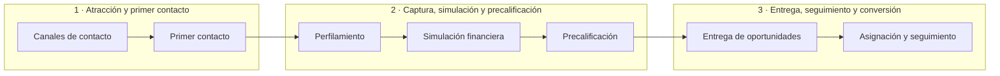
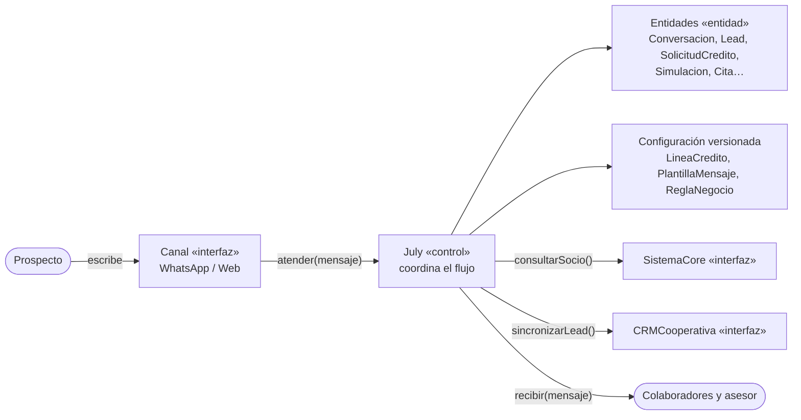
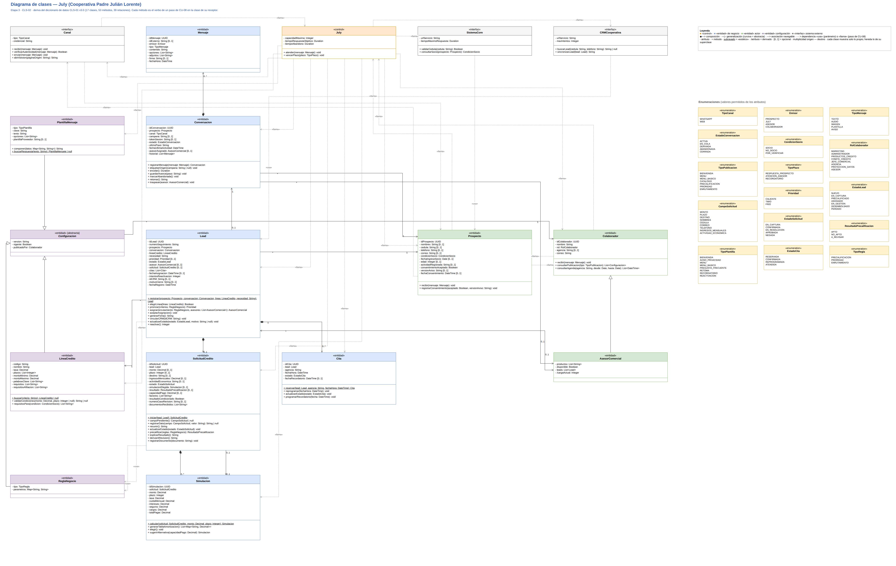

# Apuntes para presentar July a la Cooperativa Padre Julián Lorente

**ID:** PRE-02 · **Versión:** 1.0 · **Fecha:** 2026-11-11 · **Estado:** Borrador  
**Deriva de:** [NEG-01](../negocio/guia-negocio-cooperativa-y-captacion.md), [PRO-01](../prototipo/README.md), [CLS-01](../../Arquitectura/05-diccionario-de-datos/diccionario-de-datos-etapa3.md), [CLS-02](../../Arquitectura/06-diagrama-de-clases/diagrama-de-clases-etapa3.drawio), [CU-08](../../Arquitectura/03-especificacion-casos-de-uso/especificaciones-casos-de-uso.md), [REV-01](../revisiones/revision-consistencia-etapa3.md), la sección «Normas y estándares» del [`README.md`](../../../README.md) y [PRE-01](guion-presentacion-readme.md)

Apuntes de apoyo para una reunión con directivos y colaboradores de la cooperativa. No es un guion palabra por palabra (para eso está PRE-01): cada sección tiene el **mensaje clave**, los **datos** que conviene tener a mano y lo que **no hay que prometer**.

> **Antes de presentar, tener presente:**
> - Todos los montos, tasas, plazos y reglas del prototipo son **ilustrativos**. Nunca presentarlos como valores de la cooperativa.
> - July **precalifica, no aprueba** créditos. Repetirlo cuantas veces haga falta.
> - No afirmamos cumplir ninguna norma: **las ISO son referencia, no certificación**.

---

## Contenido

1. [El mensaje en 30 segundos](#1-el-mensaje-en-30-segundos)
2. [El negocio](#2-el-negocio)
3. [Cómo funciona el prototipo por dentro](#3-cómo-funciona-el-prototipo-por-dentro)
4. [El diagrama de clases, clase por clase](#4-el-diagrama-de-clases-clase-por-clase)
5. [Leyes, normas ISO y estándares](#5-leyes-normas-iso-y-estándares)
6. [Qué está por revisar con la cooperativa](#6-qué-está-por-revisar-con-la-cooperativa)
7. [Preguntas probables](#7-preguntas-probables)
8. [Cierre: qué le pedimos a la cooperativa](#8-cierre-qué-le-pedimos-a-la-cooperativa)

**Orden y tiempos sugeridos (≈ 30 min + preguntas)**

| # | Parte | Presenta (sugerido) | Tiempo |
|---|---|---|---|
| 1 | Mensaje central | Carlos | 1 min |
| 2 | El negocio y el problema | Luis | 5 min |
| 3 | Demo y funcionamiento técnico | Jean Pool y Juan | 9 min |
| 4 | Diagrama de clases | Juan y Aaron | 7 min |
| 5 | Normas y estándares | Alex | 5 min |
| 6 | Pendientes y decisiones | Carlos | 3 min |

---

## 1. El mensaje en 30 segundos

> Hoy, quien escribe a la cooperativa pidiendo un crédito espera, y en esa espera se va. July lo atiende **al instante**, por **WhatsApp o la web**, le pide **permiso** para usar sus datos, le **simula** el crédito, lo **precalifica** con las reglas del Comité y entrega la **oportunidad ya filtrada** al asesor y al CRM. **Las decisiones importantes siguen en manos de personas.**

Tres ideas que deben quedar en la sala:

1. **Velocidad:** meta de primera respuesta en menos de 2 minutos.
2. **Calidad:** el asesor recibe leads con ficha completa y prioridad, no curiosos.
3. **Control:** July no aprueba créditos, respeta la LOPDP y cada paso queda trazado.

---

## 2. El negocio

### 2.1 La cooperativa, en términos de July

- Una COAC es una entidad financiera **cuyos dueños son sus socios**. Recibe ahorro y lo presta; el **margen financiero** (lo que cobra menos lo que paga) cubre gastos, provisiones y crecimiento.
- **El crédito es el motor de ingresos**, pero **prestar mal cuesta más que no prestar** (mora → provisiones → pérdidas). Por eso July **filtra y prioriza**, no aprueba.
- **El socio es dueño, no solo cliente.** La atención debe cuidar la confianza y la privacidad, no solo «vender».
- Opera en Ecuador, dolarizado, bajo el **COMF**, la **LOEPS**, la supervisión de la **SEPS** y las tasas máximas de la **JPRF**.

### 2.2 El problema que resolvemos

| Situación actual | Consecuencia | Qué hace July |
|---|---|---|
| Las consultas digitales tardan en atenderse | El prospecto se va justo cuando su interés es más alto | Responde al instante, 24/7 |
| El asesor recibe consultas sin filtrar | Pierde tiempo en curiosos o en casos que no califican | Entrega leads precalificados, con ficha y prioridad |
| No se sabe de qué campaña llega cada persona | Marketing no puede medir el retorno | Etiqueta el origen de cada conversación |
| Las conversaciones se abandonan a medias | Se pierde la oportunidad | Guarda el avance y retoma con una plantilla aprobada |

### 2.3 Lo que pidió el reto (y dónde está resuelto)

| # | Capacidad pedida | Dónde se ve |
|---|---|---|
| 1 | Capturar requerimientos y datos financieros básicos en una conversación | Flujo 2 · Perfilamiento (CU 2.1) |
| 2 | Motor de simulación: cuotas, plazos y requisitos por línea | Flujo 2 · Simulación financiera (CU 2.2), clase `Simulacion` |
| 3 | Precalificación básica | Flujo 2 · Precalificación (CU 2.3), `SolicitudCredito.precalificar()` |
| 4 | Enviar la oportunidad al equipo comercial o al CRM | Flujo 3 · Entrega de oportunidades (CU 3.1), `CRMCooperativa.sincronizarLead()` |
| 5 | Primera respuesta en menos de 2 minutos | `July.tiempoRespuestaObjetivo`; el prototipo la mide en la pestaña Recorrido |

### 2.4 El recorrido: 3 flujos de valor, 7 etapas



### 2.5 Alcance: lo que July hace y lo que no

| ✅ July sí | ⛔ July no |
|---|---|
| Atiende por WhatsApp Business API y widget web | Aprueba créditos (lo hace el **Comité de crédito**) |
| Pide el consentimiento **antes** de cualquier dato personal | Edita tasas, líneas o reglas (solo **las lee**) |
| Captura identidad, ingresos, actividad, monto, plazo y destino | Configura guiones o reglas desde un *back-office* |
| Simula cuota, tabla de amortización y total a pagar | Atiende derechos ARCO (lo hace el **Delegado de protección de datos**) |
| Precalifica por reglas y explica el resultado | Calcula el tablero del embudo (lo hace el CRM) |
| Genera la ficha, registra el lead en el CRM y lo asigna | Consulta burós de crédito ni visita al socio |
| Agenda citas, recuerda, reactiva y cierra el lead | |

### 2.6 Caso para contar: María

> María, 38 años, tiene una tienda de abarrotes en Loja. Ve un anuncio en Facebook y escribe por WhatsApp: necesita **5 000 USD a 24 meses** para mercadería.

1. July la saluda y le muestra el **aviso de privacidad**; María acepta.
2. Detecta la intención (microcrédito) y consulta al core: **no es socia**.
3. Simula: cuota de **249,62 USD**, total a pagar **5 990,89 USD** (sistema francés, tasa ilustrativa del 18 %).
4. Con ingresos de 1 400 USD, su capacidad de pago en el prototipo es de **210 USD**: a 24 meses **no entra**.
5. July **no la rechaza**: le explica el motivo y le ofrece **36 meses**, con cuota de **180,76 USD**. Queda **APTO**.
6. Le dice qué documentos llevar y agenda una cita en agencia.
7. Su lead pasa al CRM con prioridad **CALIENTE** y se asigna a un asesor de la agencia de la cita.
8. El asesor, el Comité y la agencia siguen el proceso hasta el **desembolso**.

**Qué gana cada parte:** María se informa sin filas y con una cuota que puede pagar; la cooperativa gana una socia con un crédito bien dimensionado y un asesor que dedicó su tiempo a un lead ya filtrado.

### 2.7 Indicadores con los que se mediría el valor de July

| KPI | Qué mide | Cómo ayuda July |
|---|---|---|
| Tiempo de primera respuesta | Respuesta − primer mensaje | Respuesta inmediata |
| Conversión por etapa | Cuántos pasan a la etapa siguiente | Muestra dónde se fuga el embudo |
| Tasa de abandono y de retoma | Conversaciones abandonadas y recuperadas | Guarda el avance y retoma |
| Costo por lead y costo de adquisición | Gasto ÷ leads; gasto ÷ créditos desembolsados | Más conversión con el mismo gasto |
| Tiempo hasta el desembolso | Desembolso − primer contacto | Ficha completa y cita agendada |
| Calidad de la colocación | Morosidad de los créditos originados por July | Comprueba que trae **buenos** socios, no solo más |

> Ejemplo ilustrativo de NEG-01: si July eleva la conversión lead → desembolso del 10 % al 13 % con el mismo gasto, el costo de adquisición baja de 50 USD a unos 38 USD por crédito. **Es un ejemplo, no una proyección.**

### 2.8 A quién le importa qué

| Rol en la cooperativa | Lo que le interesa | Cómo hablarle de July |
|---|---|---|
| Consejo de Administración | Crecimiento sano, riesgo, imagen | Más colocación con riesgo controlado y datos protegidos |
| Consejo de Vigilancia | Cumplimiento | Cada paso queda registrado; July no aprueba |
| Gerencia | Metas, eficiencia, costos | Respuesta inmediata y asesores enfocados |
| Comité de crédito | Calidad de cartera | La precalificación usa **sus** reglas; lo dudoso va «a revisar» |
| Jefe comercial | Metas por asesor | Prioridad caliente/tibio/frío y enrutamiento por carga |
| Marketing | Retorno de campañas | Origen etiquetado en cada conversación |
| Tecnología | Integraciones y seguridad | Webhooks firmados, reintentos ante fallas del CRM |
| Delegado de protección de datos | LOPDP | Aviso, consentimiento y retiro del consentimiento (reglas R1 y R2) |

---

## 3. Cómo funciona el prototipo por dentro

### 3.1 Qué es

- Una **página web sin dependencias** (HTML, CSS y JavaScript): se abre con doble clic en [`index.html`](../prototipo/index.html), sin servidor ni internet.
- Dos lados en la misma pantalla: el **chat del prospecto** y un **panel** que muestra lo que pasa por dentro.
- Implementa **las mismas clases y métodos del diagrama de clases** (CLS-02), con los mismos nombres y parámetros.

| Pestaña del panel | Qué muestra |
|---|---|
| **Recorrido** | Las 7 etapas, la primera respuesta medida y cada paso de la especificación con el método que lo ejecuta |
| **Datos** | El estado vivo de `Prospecto`, `Conversacion`, `Lead`, `SolicitudCredito`, `Simulacion` y `Cita` |
| **Cooperativa** | Lo que le toca a cada colaborador: acciones pendientes por rol, ficha del prospecto, conversación del asesor y avisos |
| **Escenarios** | 11 recorridos guiados, canal, perfil, origen, condiciones de falla y datos de prueba |

### 3.2 Arquitectura: control, entidades e interfaces

El código sigue los tres estereotipos del análisis UML (los mismos del diagrama de robustez):



| Archivo | Rol | Contenido |
|---|---|---|
| `js/july.js` | «control» | Clase `July`: recibe todo mensaje y decide el siguiente paso; clase `Sesion` que arma el escenario |
| `js/dominio.js` | «entidad» | Las 13 clases de negocio y configuración |
| `js/sistemas.js` | «interfaz» | `Canal`, `SistemaCore` y `CRMCooperativa`, **simulados** |
| `js/datos.js` | Configuración | Líneas, plantillas, reglas, asesores, agencias y registros simulados del core |
| `js/pasos.js` | Trazabilidad | Los 282 pasos de la especificación con su método; **generado** desde CU-09 y CLS-01 |
| `js/guiones.js` | Escenarios | Recorridos que se reproducen en pantalla y que también son las pruebas |
| `js/interfaz.js` | Presentación | Chat y panel |
| `pruebas/pruebas.js` | Pruebas | Corre los guiones, comprueba la matemática y mide la cobertura |

### 3.3 El ciclo de un mensaje

1. El prospecto escribe → `Canal.recibir(mensaje)` le pone la **firma** (WhatsApp) o el **token de sesión** (web).
2. El canal notifica → `July.atender(mensaje)`: **único punto de entrada** de todo mensaje.
3. July comprueba `Canal.verificarAutenticidad(mensaje)`. Si la firma es falsa, el mensaje se rechaza y **no abre conversación** (flujo 1, A3).
4. `Conversacion.registrarMensaje(mensaje)` guarda el mensaje en formato común.
5. Antes de seguir el flujo, July revisa prioridades transversales:
   - Si el prospecto pide **retirar su consentimiento** → regla R2 (deja de tratar sus datos y avisa al Delegado).
   - Si pide **hablar con una persona** → traspaso al asesor con todo el historial.
   - Si la conversación estaba **abandonada** → la retoma desde el último paso guardado.
6. Si no, July ejecuta el paso de la etapa en la que está (aviso, necesidad, captura, simulación, resultado, agenda…).
7. Cada paso ejecutado se registra en la traza con su número de la especificación. **Si un paso citado no existe en CU-09, el prototipo falla a propósito**: así no puede desalinearse del diseño.

### 3.4 Flujo 1 · Atracción y primer contacto

- Etiqueta el **origen** (campaña o directo) y avisa a Marketing.
- Si hay **pico de demanda** (más de `capacidadMaxima` conversaciones, 50 en el prototipo), encola y da el tiempo de espera.
- Muestra la **bienvenida y el aviso de privacidad** que publica el Administrador del asistente.
- **Sin aceptación no se piden datos personales** (regla R1): quien rechaza el aviso recibe un menú básico de información general.
- Detecta la **intención** buscando las palabras clave de cada línea (`LineaCredito.buscar()`); si no encaja, ofrece opciones cerradas.
- Responde **preguntas frecuentes** (`PlantillaMensaje.buscarRespuesta()`).
- Consulta al **core** si es socio (por teléfono o cédula) y **registra el lead** con un número de seguimiento.

### 3.5 Flujo 2 · Captura, simulación y precalificación

**Captura.** Pide un dato a la vez (monto, plazo y destino primero; luego identidad e ingresos), aunque acepta «5 000 a 24 meses para mercadería» en una sola frase. Cada dato se valida en `SolicitudCredito.registrarDato()`:

| Dato | Validación |
|---|---|
| Cédula | 10 dígitos, código de provincia válido y **dígito verificador** (módulo 10); luego `SistemaCore.validarCedula()` |
| Teléfono | 10 dígitos que empiezan con 09 |
| Correo | Formato válido |
| Monto y plazo | Dentro del rango y de los plazos de la línea |

Si es socio, July **no vuelve a pedir** lo que el core ya sabe: le muestra los datos registrados para que los confirme. Al final, muestra un **resumen** y permite corregir cualquier dato.

**Simulación** (`Simulacion.calcular()`), sistema francés de cuota fija:

```
i      = tasa anual / 12
cuota  = monto × i / (1 − (1 + i)^−plazo)
intereses   = cuota × plazo − monto
totalPagar  = monto + intereses + seguros + cargos
tasaEfectiva = (1 + i)^12 − 1
```

- Muestra cuota, **tasa efectiva**, intereses y **total a pagar** (no solo la cuota), y la **tabla de amortización** si se pide.
- Permite **comparar escenarios** y elegir uno (`Simulacion.elegir()`).
- Seguros y cargos están en 0 hasta que la cooperativa los defina.

| Línea (ilustrativa) | Tasa | Plazos (meses) | Monto (USD) |
|---|---|---|---|
| Microcrédito | 18 % | 6 a 36 | 500 a 20 000 |
| Consumo | 16 % | 12 a 60 | 1 000 a 30 000 |
| Con depósito a plazo fijo | 12 % | 6 a 36 | 500 a 50 000 |
| Emergente | 17 % | 3 a 12 | 200 a 3 000 |
| Convenio institucional | 15 % | 12 a 48 | 500 a 20 000 |

> Las cinco líneas y sus nombres salen de lorente.fin.ec; **tasas, plazos y montos son ilustrativos**.

**Precalificación** (`SolicitudCredito.precalificar(reglas)`), con la regla que publica el Comité de crédito:

| Paso | Regla del prototipo |
|---|---|
| Capacidad de pago | `ingresos × 15 %` (supuesto; ver [sección 6](#6-qué-está-por-revisar-con-la-cooperativa)) |
| Edad fuera de 18 a 75 años (dato del core) | **NO_APTO** |
| Cuota ≤ 90 % de la capacidad | **APTO** |
| Cuota entre 90 % y 100 % | **A_REVISAR** → caso al Comité de crédito con número de revisión |
| Cuota > capacidad | **NO_APTO** → explica el motivo y sugiere una alternativa |

- **Siempre explica** el resultado y los factores (`explicarResultado()`), y lo llama **preliminar**.
- **Alternativa** (`sugerirAlternativa()`): primero busca un **plazo mayor** de la línea cuya cuota quepa; si no hay, el **mayor monto** que cabe al plazo máximo.
- Ante **NO_APTO**, ofrece la **revisión con un asesor** (LOPDP, art. 20).
- Si el core no responde, precalifica con lo declarado y marca el resultado como **condicionado**.
- Después: requisitos según la condición de socio (`requisitosPara()`) y **cita** en la agencia con los horarios libres de la agenda.

### 3.6 Flujo 3 · Entrega, seguimiento y conversión

**Prioridad** (`Lead.priorizar()`, criterios del Jefe comercial):

| Prioridad | Criterio del prototipo |
|---|---|
| **CALIENTE** | APTO y con cita agendada |
| **TIBIO** | APTO sin cita, o A_REVISAR |
| **FRÍO** | Resto, o reactivaciones agotadas (2) |

**Enrutamiento** (`Lead.asignar()`, reglas del Jefe comercial): asesor **disponible**, que **atiende esa línea**, con carga menor a 10 leads, **preferentemente de la agencia de la cita** y, entre ellos, el de **menor carga**. Si no acepta en el plazo (2 horas en el prototipo), se **reasigna** excluyendo al anterior.

**Entrega y seguimiento:**

- `Lead.generarFicha()` consolida datos, simulación, resultado, prioridad e historial.
- `CRMCooperativa.buscarLead()` evita duplicados; `sincronizarLead()` crea o actualiza con **reintentos** (3) y, si falla, avisa.
- `Conversacion.traspasar()` pasa la conversación al asesor **con todo el historial**.
- Recordatorio de cita con **plantilla aprobada por Meta** (fuera de la ventana de 24 horas de WhatsApp), reprogramación y reactivación.
- El panel de la cooperativa simula a cada rol: asesor (acepta, registra documentos), personal de agencia (registra la atención), Comité (aprueba o niega) y asesor (cierra como **DESEMBOLSADO** o **PERDIDO** con motivo).

### 3.7 Pruebas y cobertura

```bash
node pruebas/pruebas.js
```

- Corre los **11 escenarios** de `guiones.js` más pruebas de matemática y de seguridad (firma falsa).
- Resultado actual: **todas las pruebas pasan** y se recorren **281 de 282 pasos** de la especificación.
- El paso que falta (F3:6a, ficha con datos incompletos) no se puede alcanzar en el prototipo, porque el flujo 3 solo arranca con la captura terminada.

| Escenario | Qué demuestra |
|---|---|
| María: del anuncio al desembolso | Recorrido completo, alternativa de plazo, lead CALIENTE |
| Rosa: una socia que compara plazos | Datos tomados del core, comparación de escenarios |
| Por la web: caso a revisar | Canal web con token, resultado A_REVISAR al Comité |
| Rechaza el aviso de privacidad | Regla R1: sin consentimiento no hay datos |
| Pide hablar con una persona | Traspaso al asesor con historial |
| No apto y pide la revisión con un asesor | LOPDP art. 20: revisión humana |
| Errores de captura, abandono y línea no vigente | Validaciones, retoma, cambio de línea |
| Fallas del CRM, agenda llena y reactivación | Reintentos, fechas cercanas, prioridad FRÍO |
| Retira el consentimiento | Regla R2 y aviso al Delegado |
| Socio fuera del rango de edad | NO_APTO por edad, con explicación |
| Lead que ya existe en el CRM | No duplica, actualiza |

### 3.8 Qué es real y qué es simulado (decirlo siempre)

| Componente | En el prototipo | En el producto |
|---|---|---|
| WhatsApp y widget web | Simulados; firma y token de juguete | WhatsApp Business API con webhooks firmados; sesión web |
| Sistema core | Datos de `datos.js` con cédulas sintéticas | Servicio (API) del core de la cooperativa |
| CRM | Registro en memoria | API del CRM de la cooperativa |
| Comprensión del lenguaje | **Palabras clave**, sin IA | Un modelo de lenguaje **solo** para clasificar la intención y extraer valores; su salida se valida contra el catálogo |
| Motor financiero y de reglas | Código determinista | **Sigue siendo determinista**, sin IA: la cuota y la precalificación no las decide un modelo |
| Datos | En memoria; se pierden al reiniciar | Base de datos con respaldo y registro de consentimiento |

> **Decisión de diseño clave (REV-01):** la IA, cuando se incorpore, solo **entiende** al prospecto. Los **números y las decisiones** los calcula código con reglas publicadas por la cooperativa. Así el resultado es explicable y auditable.

### 3.9 Colores

Azul `#0069b2` y tinte `#e6eff4` (oficiales, de lorente.fin.ec), blanco, y verde `#187a4c` como **propuesta** para acciones y resultados positivos. Un NO_APTO se muestra en gris neutro, no en rojo, para **orientar sin alarmar**. El logo oficial no se usa.

---

## 4. El diagrama de clases, clase por clase



**Cifras:** 17 clases (una abstracta), 53 métodos, 16 enumeraciones y 39 relaciones. Fuente: [CLS-02](../../Arquitectura/06-diagrama-de-clases/diagrama-de-clases-etapa3.drawio), con el detalle en [CLS-01](../../Arquitectura/05-diccionario-de-datos/diccionario-de-datos-etapa3.md).

### 4.1 Cómo nacieron las clases (por qué no son arbitrarias)

> **Mensaje clave:** ninguna clase se inventó. Cada una sale de un concepto del negocio o de un participante de la especificación, y cada método es el verbo de un paso de la conversación.

| Regla | Ejemplo |
|---|---|
| Las clases salen del **modelo de dominio** (12 conceptos) y de los **participantes** de la especificación | «July registra el mensaje en la **Conversación**» → `Conversacion` |
| El método está en la clase de **quien recibe** la acción | «July consulta la condición de socio al **Sistema core**» → `SistemaCore.consultarSocio(prospecto)` |
| Una respuesta no es un método: es lo que devuelve el método | «El core devuelve la condición de socio» → salida de `consultarSocio()` |
| Verbos sinónimos son un solo método | Escribir, pedir, confirmar a July → siempre `July.atender(mensaje)` |
| Se generaliza solo si se **comparten datos** | Línea, plantilla y regla comparten versión → `Configuracion` |
| Lo que es 1 a 1 con otra clase es **atributo** suyo | El consentimiento es del `Prospecto`; la precalificación, de la `SolicitudCredito` |

De ahí salen tres **naturalezas** de clase:

| Naturaleza | Qué significa | Clases |
|---|---|---|
| «control» | Coordina el flujo; no guarda datos del negocio | `July` |
| «interfaz» | Frontera con un sistema externo; se modela solo lo que July le pide | `Canal`, `SistemaCore`, `CRMCooperativa` |
| «entidad» | Información del negocio que persiste más allá de la conversación | Las 13 restantes |

### 4.2 Vista simplificada de las relaciones

```mermaid
classDiagram
    direction LR
    <<control>> July
    <<interfaz>> Canal
    <<interfaz>> SistemaCore
    <<interfaz>> CRMCooperativa
    <<abstracta>> Configuracion

    Canal ..> July : atender()
    July ..> SistemaCore : consultarSocio()
    July ..> CRMCooperativa : sincronizarLead()

    Conversacion "1" *-- "0..*" Mensaje
    Conversacion "*" --> "1" Prospecto
    Conversacion "*" --> "0..1" AsesorComercial : tras el traspaso
    Lead "*" --> "1" Prospecto
    Lead "0..1" --> "1" Conversacion : origen
    Lead "*" --> "0..1" AsesorComercial : asignado
    Lead "*" --> "1" LineaCredito
    Lead "1" *-- "0..1" SolicitudCredito
    Lead "1" *-- "0..*" Cita
    SolicitudCredito "1" *-- "0..*" Simulacion
    SolicitudCredito "0..1" --> "0..1" Simulacion : elegida

    Colaborador <|-- AsesorComercial
    Configuracion <|-- LineaCredito
    Configuracion <|-- PlantillaMensaje
    Configuracion <|-- ReglaNegocio
    Configuracion "*" --> "1" Colaborador : publicadoPor

    Lead ..> ReglaNegocio : usa
    SolicitudCredito ..> ReglaNegocio : usa
    SistemaCore ..> Prospecto : completa datos
    CRMCooperativa ..> Lead : crea y actualiza
```

> Vista simplificada: faltan las dependencias «llama» de `July` hacia cada entidad (relaciones 29 a 37) y las de las personas hacia July y el canal. El diagrama completo está en CLS-02.

**Cómo leer las relaciones:**

| Tipo | Símbolo | Significado | Ejemplo |
|---|---|---|---|
| Composición | rombo lleno | La parte no existe sin el todo | Sin `Conversacion` no hay `Mensaje` |
| Asociación | línea con flecha | Una clase guarda una referencia a otra | El `Lead` sabe de qué `Prospecto` es |
| Generalización | triángulo | «es un» y hereda | `AsesorComercial` es un `Colaborador` |
| Dependencia | línea punteada | La usa en un método sin guardarla: «usa» (parámetro) o «llama» (invoca un método) | `SolicitudCredito` usa la `ReglaNegocio` para precalificar |

### 4.3 Las clases, una por una

#### El sistema y sus fronteras

**`July`** · «control»
- **Qué es:** el asistente; el sistema que se diseña.
- **Por qué existe:** hace falta **un solo coordinador** que reciba todo mensaje y decida el siguiente paso. Si cada entidad hablara con todas, el flujo sería imposible de seguir y de auditar.
- **Atributos:** `capacidadMaxima` (conversaciones simultáneas), `tiempoRespuestaObjetivo` (2 minutos, la meta del reto), `tiempoAbandono`.
- **Métodos:** `atender(mensaje)`, la puerta de entrada de todo; `vencerPlazo(plazo)`, que dispara abandono, reasignación o reactivación cuando se acaba un tiempo.
- **Para decir:** «July no guarda datos de negocio; coordina. Los datos viven en las entidades».

**`Canal`** · «interfaz»
- **Qué es:** WhatsApp Business API o el widget web.
- **Por qué existe:** aísla a July del proveedor. July habla **un solo idioma** (`Mensaje`); el canal traduce. Agregar otro canal no cambia la lógica.
- **Por qué una sola clase y no dos:** WhatsApp y web hacen lo mismo (recibir, verificar, enviar); solo difieren en el tipo (`TipoCanal`) y en cómo se autentican.
- **Métodos:** `recibir()`, `verificarAutenticidad()` (firma del webhook o token: **seguridad**), `enviar()`, `abrirSesion()` (solo web).

**`SistemaCore`** · «interfaz»
- **Qué es:** el sistema transaccional de la cooperativa; **fuente oficial** de socios e identidad.
- **Por qué existe:** July no debe guardar ni inventar quién es socio; lo **pregunta**. Además evita volver a pedir datos que la cooperativa ya tiene.
- **Métodos:** `validarCedula()`, `consultarSocio()` → SOCIO, NO_SOCIO o **POR_VERIFICAR** si no responde a tiempo (el flujo sigue sin bloquearse).

**`CRMCooperativa`** · «interfaz»
- **Qué es:** el CRM comercial donde vive el embudo.
- **Por qué existe:** es el destino de la oportunidad (capacidad 4 del reto). Separarlo permite cambiar de CRM sin tocar a July.
- **Métodos:** `buscarLead()` (evita duplicados), `sincronizarLead()` (crea o actualiza, con **reintentos** hasta `maxIntentos`).

#### Las personas

**`Prospecto`** · «entidad»
- **Qué es:** la persona que contacta a la cooperativa.
- **Por qué existe:** hay que saber **quién** es, si es socio y si **dio su consentimiento**. Se crea con el primer mensaje, cuando quizá solo se conoce el teléfono; por eso casi todos sus datos son opcionales.
- **Atributos clave:** identidad (nombres, cédula, teléfono, correo), `condicionSocio`, datos del core (edad, actividad registrada) y `consentimientoAceptado`, `versionAviso`, `fechaConsentimiento`.
- **Por qué el consentimiento es atributo y no clase:** es uno por prospecto (regla 1 a 1). Guardar **la versión del aviso** y la fecha permite demostrar **qué aceptó y cuándo** (LOPDP).
- **Métodos:** `recibir(mensaje)`, `registrarConsentimiento(aceptado, versionAviso)` (también el retiro, regla R2).

**`Colaborador`** · «entidad»
- **Qué es:** cualquier persona de la cooperativa que participa: Marketing, Administrador del asistente, Área de productos y crédito, Comité de crédito, Jefe comercial, Personal de agencia, Delegado de protección de datos.
- **Por qué existe una sola clase con un `rol`:** todos hacen lo mismo frente a July (publicar configuración, recibir avisos, registrar atención). Siete clases casi idénticas serían redundancia.
- **Métodos:** `recibir()`, `consultarPublicacion(tipo)` (la versión vigente de lo que publicó), `consultarAgenda()` (horarios libres de la agencia).

**`AsesorComercial`** · «entidad», hereda de `Colaborador`
- **Qué es:** el colaborador que atiende leads.
- **Por qué tiene clase propia:** el **enrutamiento** necesita datos que los demás colaboradores no tienen: `productos` que atiende, `disponible` y `/cargaActual` (derivada: leads en ASIGNADO o EN_GESTION).

> **Decisión que se puede contar:** existió una clase abstracta `Participante` para unir prospecto y colaborador. Se **retiró** porque no compartían datos, solo el método `recibir()`; generalizar sin datos comunes solo complica.

#### La conversación

**`Conversacion`** · «entidad»
- **Qué es:** el hilo de mensajes entre el prospecto, July y, si hay traspaso, el asesor.
- **Por qué existe:** guarda el **contexto**: canal, campaña de origen, estado, `ultimoPaso` (para **retomar** donde quedó) y `asesorAsignado` (para que el asesor **vea todo el historial**).
- **Estados:** ACTIVA → EN_COLA / DERIVADA / ABANDONADA → CERRADA.
- **Métodos:** `registrarMensaje()`, `etiquetarOrigen()`, `encolar()`, `guardarAvance()`, `marcarAbandonada()`, `retomar()`, `traspasar()`.

**`Mensaje`** · «entidad»
- **Qué es:** un mensaje en **formato común**, venga del canal que venga.
- **Por qué existe:** es el parámetro de `atender()`, `recibir()` y `enviar()`. Un formato único hace que July no dependa de WhatsApp ni de la web.
- **Atributos clave:** `emisor`, `tipo`, `contenido`, `opciones` (botones), `idExterno` (evita procesar dos veces el mismo mensaje) y `firma` (para verificarlo).
- **Composición:** no existe sin su conversación.

#### El lead y el crédito

**`Lead`** · «entidad»
- **Qué es:** la **oportunidad comercial**: un prospecto con una intención de crédito.
- **Por qué existe separado del Prospecto:** una misma persona puede tener **varias oportunidades** a lo largo del tiempo, cada una con su línea, prioridad, asesor y estado en el embudo. Es lo que se **entrega** al asesor y al CRM.
- **Estados:** NUEVO → EN_CAPTURA → PRECALIFICADO → ASIGNADO → EN_GESTION → DESEMBOLSADO o PERDIDO (con motivo obligatorio).
- **Métodos:** `registrar()`, `elegirLinea()`, `priorizar()`, `asignar()`, `aceptarAsignacion()`, `generarFicha()`, `vincularCRM()`, `actualizarEstado()`, `reactivar()`.

**`SolicitudCredito`** · «entidad», compuesta en `Lead`
- **Qué es:** los datos del crédito que pide el prospecto (monto, plazo, destino, ingresos, actividad) y su **precalificación**.
- **Por qué existe:** separa el **qué pide** (solicitud) del **quién es** (prospecto) y de la **oportunidad** (lead). Su ciclo es distinto: EN_CAPTURA → CONFIRMADA → EN_RESOLUCION → APROBADA o NEGADA.
- **Por qué la precalificación no es una clase aparte:** hay una por solicitud (regla 1 a 1), así que sus datos (`resultado`, `capacidadPago`, `factores`, `resultadoCondicionado`, `numeroCasoRevision`) son atributos de la solicitud.
- **Métodos:** `iniciar()`, `campoPendiente()` (qué falta preguntar), `registrarDato()` (valida), `resumir()`, `actualizarEstado()`, `precalificar()`, `explicarResultado()`, `derivarARevision()`, `registrarDocumento()`.
- **Para decir:** «`APROBADA` y `NEGADA` solo los registra el **Comité**; July nunca llega ahí por su cuenta».

**`Simulacion`** · «entidad», compuesta en `SolicitudCredito`
- **Qué es:** **un escenario**: un monto a un plazo con su cuota, intereses, seguros, cargos y total.
- **Por qué existe como clase y no como un cálculo suelto:** el prospecto puede **comparar varias** y **elegir una**; la elegida es la que se precalifica. Además guarda la **tasa del momento**, para conservar lo que el prospecto vio aunque la tasa cambie después.
- **Métodos:** `calcular()`, `generarTablaAmortizacion()`, `elegir()`, `sugerirAlternativa(capacidadPago)`.

**`Cita`** · «entidad», compuesta en `Lead`
- **Qué es:** la cita en una agencia.
- **Por qué existe:** el crédito termina en la agencia (documentos, firma). La cita tiene su propio estado (RESERVADA → CONFIRMADA / REPROGRAMADA → ATENDIDA) y su recordatorio, y sirve para elegir la agencia del asesor.
- **Métodos:** `reservar()`, `reprogramar()`, `actualizarEstado()`, `programarRecordatorio()`.

#### La configuración que publica la cooperativa

**`Configuracion`** · «entidad», *abstracta*
- **Qué es:** todo lo que **publica un colaborador por versiones** y July solo lee.
- **Por qué existe:** las tres configuraciones comparten `version`, `vigente` y `publicadoPor`. Esto garantiza que **la cooperativa sigue mandando**: cambiar una tasa o una regla es publicar una nueva versión, no reprogramar a July. Y queda registro de **quién publicó qué**.

**`LineaCredito`** · hereda de `Configuracion`
- **Qué es:** un producto del catálogo, publicado por el Área de productos y crédito.
- **Atributos:** tasa, plazos, montos mínimo y máximo, `palabrasClave` (para detectar la intención), requisitos y requisitos de afiliación.
- **Métodos:** `buscar()` (detecta la línea en texto libre), `validarCondiciones()`, `requisitosPara(condicionSocio)`.

**`PlantillaMensaje`** · hereda de `Configuracion`
- **Qué es:** el contenido conversacional, publicado por el Administrador del asistente: bienvenida, **aviso de privacidad**, menús, preguntas frecuentes, retoma, recordatorio y reactivación.
- **Por qué existe:** lo que July **dice** lo decide la cooperativa, no el código. `plantillaProveedor` guarda la plantilla **aprobada por Meta**, obligatoria para escribir fuera de la ventana de 24 horas de WhatsApp.
- **Métodos:** `componer(datos)` (reemplaza {nombre}, {fechaCita}…), `buscarRespuesta(texto)`.

**`ReglaNegocio`** · hereda de `Configuracion`
- **Qué es:** los parámetros de decisión: **precalificación** (Comité de crédito), **prioridad** y **enrutamiento** (Jefe comercial).
- **Por qué existe:** las reglas de crédito y comerciales son **de la cooperativa**. July las aplica tal cual están publicadas; si el Comité cambia el porcentaje máximo de cuota, July lo usa desde la nueva versión.

### 4.4 Enumeraciones que vale la pena mencionar

| Enumeración | Valores | Por qué importa |
|---|---|---|
| `ResultadoPrecalificacion` | APTO, NO_APTO, A_REVISAR | Tres salidas, y una lleva a revisión humana |
| `EstadoLead` | NUEVO … DESEMBOLSADO, PERDIDO | Es el embudo comercial |
| `Prioridad` | CALIENTE, TIBIO, FRIO | Ordena el trabajo del asesor |
| `CondicionSocio` | SOCIO, NO_SOCIO, POR_VERIFICAR | El flujo no se detiene si el core falla |
| `RolColaborador` | 8 roles | Quién publica, recibe o decide cada cosa |

### 4.5 Cómo se conecta con el resto del diseño

Cada clase y método se puede rastrear hasta el negocio:

> Capacidad **1.2.1.2 Consentimiento de datos** → caso de uso **1.2.1.2** → paso **20** del flujo 1: «July registra el consentimiento aceptado en el Prospecto» → método **`Prospecto.registrarConsentimiento(aceptado, versionAviso)`** → mensaje 20 de la secuencia → control «Registrar consentimiento» de robustez → **misma función en el prototipo**.

Un script (`verificar-trazabilidad.py`, reglas V1 a V8) comprueba que la cadena no se rompa.

---

## 5. Leyes, normas ISO y estándares

> **Mensaje clave:** tres niveles. La **ley ecuatoriana** es obligatoria; las **ISO** son voluntarias y las usamos como referencia; las **guías del sector** orientan buenas prácticas. **No hay una ISO específica para chatbots de captación financiera**, así que combinamos normas de atención, IA, privacidad y modelado. **Nadie está certificado.**

**Balance actual (36 entradas):** 9 reflejadas en los artefactos · 11 parciales · 16 pendientes · 5 evaluadas y descartadas.

### 5.1 Ya aplicadas (reflejadas en el diseño y el prototipo)

| Norma | Qué exige o aporta | Cómo se refleja en July |
|---|---|---|
| **LOPDP (2021)** y su Reglamento (Decreto 904, 2023) | Consentimiento y derechos del titular | Aviso y aceptación **antes** de pedir datos (CU 1.2.1.2); reglas R1 (sin consentimiento no hay datos) y R2 (retiro en cualquier momento) |
| **LOPDP, art. 20** | No quedar sometido a decisiones automatizadas que produzcan efectos jurídicos | «A revisar» va al **Comité**; «no apto» ofrece **revisión con un asesor**; la aprobación es humana |
| **Principios G20/OCDE de protección del consumidor financiero (2022)** | Información clara antes de decidir | Cuota, **tasa efectiva** y **total a pagar**; comparación de escenarios |
| **ISO/IEC 29184:2020** | Contenido de avisos de privacidad en línea y forma de pedir el consentimiento | Aviso con finalidad, opción de aceptar o rechazar y versión |
| **ISO/IEC 29100:2024** | Marco y vocabulario de privacidad | Reglas transversales R1 y R2 |
| **ArchiMate** (The Open Group) | Lenguaje de arquitectura empresarial | Mapa de capacidades y flujo de valor |
| **Ulrich y Rosen (2011) y BIZBOK** | Mapa de capacidades | Origen de toda la cadena |
| **ISO/IEC/IEEE 29148:2018** | Ingeniería de requisitos | Casos de uso y especificación paso a paso |
| **UML (ISO/IEC 19505)** | Notación de modelado | Casos de uso, clases y secuencia |

### 5.2 Aplicadas en parte

| Norma | Lo que ya está | Lo que falta |
|---|---|---|
| **Resolución SPDP-SPD-2026-0009-R, art. 5.1** | Hay aviso de privacidad | Que el aviso diga que hay **tratamiento automatizado / con IA** y sus finalidades |
| **COMF, LOEPS, normas de la JPRF y la SEPS** | Catálogo de líneas y guía del negocio | **Confirmar tasas, segmentos y valores** con la cooperativa |
| **Estándares SPTF/Cerise** (protección al cliente) | Capacidad de pago y alternativa que cabe (contra el sobreendeudamiento) | Reclamos (fuera del alcance) |
| **ISO 18295-1:2017** (centros de contacto, por analogía) | Meta de 2 minutos y medición de la primera respuesta | Medición real con integraciones |
| **ISO/IEC TS 8200:2024** (controlabilidad de la IA) | Derivar a humano y traspaso con contexto | Formalizarlo cuando entre el modelo de lenguaje |
| **ISO/IEC 12792:2025** (transparencia de la IA) | `explicarResultado()` con factores | Aplicarla al aviso y a la documentación |
| **ISO 9241-110:2020** (principios de interacción) | Opciones cerradas, resumen y corrección | Pruebas con usuarios |
| **ISO/IEC TS 27560:2023** (registro de consentimiento) | Se guarda aceptación, versión y fecha | La estructura completa del registro |
| **ISO/IEC 27001:2022** (seguridad de la información) | Verificación de webhooks; rechazo de firmas falsas | Vista de seguridad del SAD |
| **ISO/IEC 11179-1:2023** (registro de datos) | Diccionario de datos como referencia | Formalizar metadatos |
| **ISO/IEC/IEEE 42010:2022** (descripción de arquitectura) | SAD con vistas de casos de uso, lógica y datos | Vistas de procesos, implementación y despliegue |

### 5.3 Las que vamos a seguir (pendientes)

**Obligatorias, prioridad alta:**

| Norma | Qué exige | Próximo paso |
|---|---|---|
| **Resolución SPDP, arts. 5.2 y 6** | Gestión de riesgos y **evaluación de impacto antes del desarrollo** | Elaborar la evaluación de impacto (apoyo: ISO/IEC 23894 e ISO/IEC 42005) |
| **Resolución SPDP, arts. 5.4, 5.5 y 7** | **Registro de actividades de tratamiento**, incluidas las decisiones automatizadas, y auditorías | Crear el registro con el Delegado de protección de datos |
| **Normativa UAFE** | Debida diligencia: identificar, verificar y monitorear clientes | Confirmar con la cooperativa en qué momento de la afiliación se hace |

**Voluntarias (ISO y guías):**

| Área | Normas | Para qué |
|---|---|---|
| Gobierno de la IA | ISO/IEC 42001:2023 | Sistema de gestión de IA en la cooperativa |
| Riesgo e impacto de la IA | ISO/IEC 23894:2023, ISO/IEC 42005:2025 | Base para la evaluación de impacto de la SPDP |
| Sesgo | ISO/IEC TR 24027:2021 | Revisar que las reglas de precalificación no discriminen |
| Vocabulario de IA | ISO/IEC 22989:2022, ISO/IEC 23053:2022 | Documentar la detección de intención |
| Seguridad de la IA | ISO/IEC 27090:2026, **OWASP Top 10 para LLM (2025)** | *Prompt injection* y otras amenazas propias de la IA |
| Privacidad y seguridad | ISO/IEC 27701:2025 | Sistema de gestión de la privacidad |
| Calidad | ISO/IEC 25010:2023, ISO/IEC 25059:2023 | Vista de calidad del SAD |
| Inclusión y servicio | ISO 22458:2022, ISO 23592:2021, ISO 10004:2018 | Consumidores vulnerables y satisfacción |
| Lenguaje y accesibilidad | ISO 24495-1:2023 (lenguaje claro), ISO/IEC 40500:2025 (WCAG 2.2) | Mensajes claros y widget accesible |
| Diálogo | ISO 24617-2:2020 | Etiquetar conversaciones si se entrena un modelo |

### 5.4 Evaluadas y descartadas (y por qué)

| Norma | Por qué no aplica |
|---|---|
| ISO 22222:2005 | Certifica a planificadores financieros personales, no a asistentes |
| ISO 20022 | Mensajería entre entidades financieras; July no ejecuta pagos |
| ISO 10008:2022 | Comercio electrónico; July no cierra ventas |
| ISO 10002:2018 | Gestión de reclamos, fuera del alcance |
| ISO/IEC 19510 (BPMN) | El proyecto no modela con BPMN |

### 5.5 Otros estándares técnicos que ya respeta el prototipo

- **Políticas de WhatsApp Business:** fuera de la ventana de 24 horas solo se escribe con **plantillas aprobadas por Meta** (`PlantillaMensaje.plantillaProveedor`).
- **Webhooks firmados:** cada mensaje entrante se verifica antes de procesarse.
- **Validación de cédula ecuatoriana:** código de provincia y dígito verificador (módulo 10).
- **Sistema francés de amortización** y **tasa efectiva anual**, como en NEG-01.
- **Accesibilidad básica en la interfaz:** roles ARIA, chat con `aria-live`, pestañas navegables. No sustituye una evaluación WCAG formal.

---

## 6. Qué está por revisar con la cooperativa

### 6.1 Decisiones de negocio abiertas (el prototipo tomó un supuesto)

| Tema | Supuesto del prototipo | Qué necesitamos decidir |
|---|---|---|
| **Capacidad de pago** | `ingresos × 15 %` (da los 210 USD de María) | ¿Capturar gastos y deudas (ingresos − gastos) o confirmar una regla sobre ingresos? |
| **Umbral de A_REVISAR** | APTO hasta el 90 % de la capacidad; A_REVISAR hasta el 100 % | Valor y nombre del parámetro, con el **Comité de crédito** |
| **Reglas de precalificación** | Edad de 18 a 75 años | Actividades no financiables, antigüedad del negocio, otras reglas |
| **Prioridad** | CALIENTE = APTO con cita | Criterios reales del **Jefe comercial** |
| **Enrutamiento** | Carga máxima 10 leads, plazo de atención 2 horas | Reparto real por agencia y producto |
| **Inicio del flujo 3** | Arranca después de agendar la cita | ¿Ajustar la especificación o recalcular la prioridad al reservar? |
| **Captura de datos** | Un dato a la vez (o monto, plazo y destino en una frase) | Reflejarlo en la especificación |
| **Atributos nuevos del prototipo** | `Lead.ficha`, `Simulacion.tasaEfectiva`, `SolicitudCredito.fueraDeEdad` y otros | Cuáles pasan al modelo |

### 6.2 Datos que la cooperativa debe confirmar

- Líneas vigentes con **montos, plazos, tasas y requisitos** reales.
- Sistema de amortización por línea (francés o alemán), **seguro de desgravamen** y otros cargos que deban mostrarse.
- Si se exige ser socio, el aporte inicial y el ahorro encaje.
- Niveles de aprobación (qué aprueba el jefe de agencia y qué el Comité).
- **Core y CRM** que usan, y si exponen servicios (API).
- Si tienen **WhatsApp Business API** y plantillas aprobadas.
- **Texto del aviso de privacidad** y quién es el **Delegado de protección de datos**.
- Qué **no debe decir nunca** July.
- Segmento de la cooperativa en la SEPS.

### 6.3 Pendientes del equipo

- **Normativos:** evaluación de impacto, registro de actividades de tratamiento, mención del tratamiento automatizado en el aviso, *prompt injection*.
- **Documentales (SAD):** vistas de procesos, implementación, despliegue, calidad y seguridad; autores y revisores.
- **Prototipo:** integración real con WhatsApp, core y CRM; incorporar el modelo de lenguaje solo para entender al prospecto; persistencia de datos; medir la primera respuesta en condiciones reales.

---

## 7. Preguntas probables

| Pregunta | Respuesta corta | Responde |
|---|---|---|
| ¿July aprueba créditos? | No. Precalifica. «A revisar» va al Comité, «no apto» ofrece revisión con un asesor, y APROBADA o NEGADA solo las registra el Comité. | Alex |
| ¿Ya usa inteligencia artificial? | Todavía no: entiende por palabras clave. Cuando se incorpore, la IA solo entenderá el texto; los cálculos y la decisión seguirán siendo reglas de la cooperativa. | Juan |
| ¿Las tasas que vimos son las nuestras? | No. Las líneas salen de su sitio web, pero tasas, montos y plazos son ilustrativos hasta que ustedes los confirmen. | Carlos |
| ¿Quién cambia una tasa o una regla? | La cooperativa, publicando una nueva versión. July solo lee la vigente; no hay que reprogramarlo. | Aaron |
| ¿Cumplen la LOPDP? | Diseñamos para cumplirla: consentimiento previo, retiro, revisión humana. Pero no afirmamos cumplimiento: faltan la evaluación de impacto y el registro de tratamiento. | Alex |
| ¿Qué pasa si el core o el CRM se caen? | Si el core no responde, el socio queda «por verificar» y el resultado se marca como condicionado. El CRM se reintenta y, si falla, se avisa; el lead no se pierde. | Juan |
| ¿Y si alguien quiere hablar con una persona? | Después del aviso de privacidad puede pedirlo en cualquier momento, y July traspasa la conversación al asesor con todo el historial. | Jean Pool |
| ¿Qué pasa con quien no acepta el aviso? | Recibe información general (líneas, agencias, cómo hacerse socio) sin que se guarden sus datos. | Alex |
| ¿Cómo sabemos que el prototipo hace lo que dice el diseño? | Usa las mismas clases y métodos, cada paso cita su número de la especificación y las pruebas recorren 281 de 282 pasos. | Juan |
| ¿Ya atiende en menos de 2 minutos? | Es la meta y el prototipo mide la primera respuesta, pero con integraciones simuladas; la medición real llega con WhatsApp conectado. | Juan |
| ¿Por qué el resultado «no apto» no va en rojo? | Para orientar sin alarmar: siempre va con una alternativa o con la revisión por un asesor. | Luis |
| ¿Qué necesitan de nosotros? | Ver la sección siguiente. | Carlos |

---

## 8. Cierre: qué le pedimos a la cooperativa

> Partimos de un problema real: perder prospectos por tardar en atenderlos. Lo convertimos en un diseño donde cada decisión se rastrea hasta el negocio, y en un prototipo que ya recorre los tres flujos. Para dar el siguiente paso necesitamos a la cooperativa.

1. **Valores reales:** líneas, tasas, plazos, montos, requisitos, seguros y cargos.
2. **Reglas del Comité de crédito** para la precalificación y el umbral de «a revisar».
3. **Criterios del Jefe comercial** para prioridad y enrutamiento.
4. **Aviso de privacidad** y contacto con el **Delegado de protección de datos**, para empezar la evaluación de impacto.
5. **Información técnica** del core, el CRM y WhatsApp Business.
6. **Una sesión de prueba** del prototipo con asesores y personal de agencia.

**Frase final:** *July atiende al instante; las personas de la cooperativa siguen decidiendo.*
