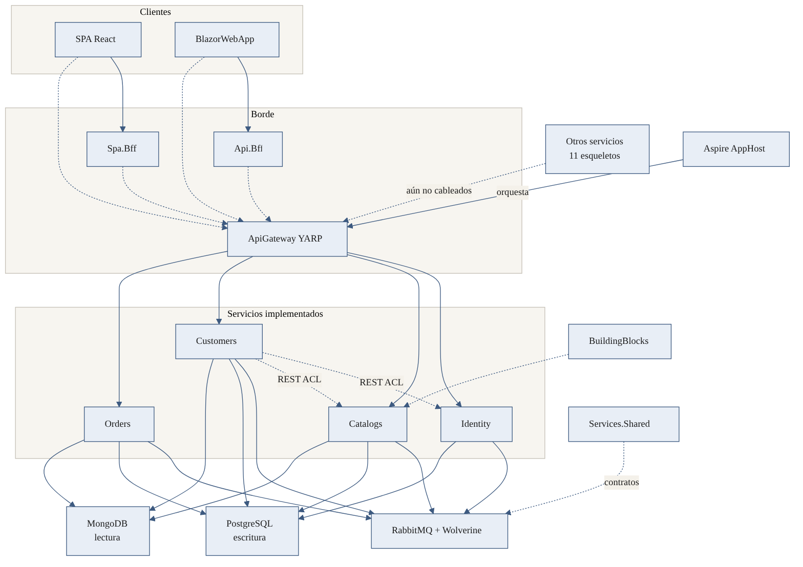
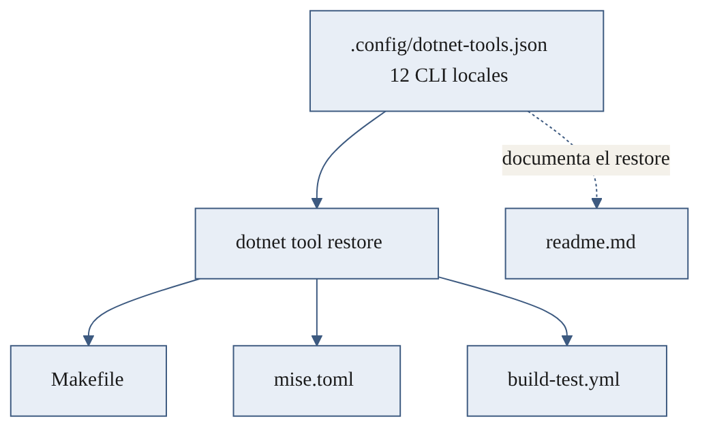
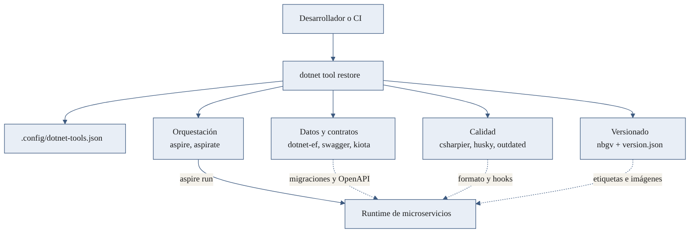

# Manual de Arquitectura: food-delivery-microservices

**Manual técnico**

Guía del monorepositorio food-delivery-microservices: árbol completo, arquitectura de servicios e infraestructura, y la finalidad de cada carpeta y subcarpeta verificada en `main`, más el contrato de tooling de `.config`.

| | |
|---|---|
| **Repositorio** | <https://github.com/mehdihadeli/food-delivery-microservices> |
| **Carpeta `.config`** | <https://github.com/mehdihadeli/food-delivery-microservices/tree/main/.config> |
| **Fecha** | 25 de noviembre de 2026 (America/Guayaquil) |
| **Alcance** | Hechos verificados sobre un clon superficial de la rama `main`. No se inventan carpetas ni ajustes. |

> *Versión en Markdown del PDF [`Manual_Arquitectura_food-delivery-microservices.pdf`](Manual_Arquitectura_food-delivery-microservices.pdf) (25 páginas). Las figuras se extrajeron del PDF y están en [`imagenes/`](imagenes/).*

---

## Índice

1. [El monorepositorio](#el-monorepositorio)
2. [Árbol del repositorio](#árbol-del-repositorio)
3. [Arquitectura del sistema](#arquitectura-del-sistema)
4. [Finalidad de cada carpeta](#finalidad-de-cada-carpeta)
5. [Propósito de la carpeta .config](#propósito-de-la-carpeta-config)
6. [Vista gráfica de .config](#vista-gráfica-de-config)
7. [Explicación punto por punto de .config](#explicación-punto-por-punto-de-config)
8. [Inventario de .config](#inventario-de-config)
9. [Encaje de .config en la arquitectura](#encaje-de-config-en-la-arquitectura)
10. [Flujo de trabajo del desarrollador](#flujo-de-trabajo-del-desarrollador)
11. [CI/CD y calidad de código](#cicd-y-calidad-de-código)
12. [Riesgos y recomendaciones](#riesgos-y-recomendaciones)
13. [Glosario](#glosario)
14. [Fuentes](#fuentes)

---

## El monorepositorio

> **Cómo leer este manual**
>
> En la rama `main` inspeccionada, el repo es un monorepo .NET 10 de microservicios. No hay carpetas Api/Core/Infrastructure por servicio: el patrón real es Vertical Slice (`FoodDelivery.Services.X` + host `.Api`). Catalogs, Customers, Identity y Orders están implementados; once servicios más son esqueletos (`Class1.cs` y un `Program.cs` que solo hace `CreateBuilder`, `Build` y `Run`). La carpeta `.config` sigue documentada más abajo: contiene un solo archivo, `dotnet-tools.json`.

food-delivery-microservices es un monorepositorio de entrega de comida con microservicios autónomos, gateway YARP, BFFs, UIs (Blazor y una SPA React), mensajería Wolverine sobre RabbitMQ y orquestación local con .NET Aspire. El README describe comunicación síncrona puntual (REST/gRPC), CQRS y, en el lado de escritura, PostgreSQL; en lectura, MongoDB (hay `*ReadDbContext` en Catalogs, Customers y Orders).

Los hechos salen de un clon superficial (`git clone --depth 1`) de <https://github.com/mehdihadeli/food-delivery-microservices>, rama `main`. El submódulo `src/BuildingBlocks` (Squirrel) no se materializó en esa copia. No se inventan carpetas: si una ruta no aparece, no estaba en el árbol.

## Árbol del repositorio

Las siguientes vistas recorren la raíz completa, `src/`, los servicios, los tests, el despliegue y el tooling. `.git` se omite a propósito: es metadato de Git, no parte del diseño de la aplicación.

### Raíz

Árbol de la raíz del repositorio, con todas las carpetas y archivos de primer nivel:

```text
food-delivery-microservices/ — monorepo .NET 10, rama main
├── .aspire/ — settings.json del AppHost
├── .config/ — dotnet-tools.json (12 CLI locales)
├── .devcontainer/ — Dockerfile, devcontainer.json, compose, scripts/
├── .github/ — workflows/ y release-drafter.yml
├── .husky/ — pre-commit, pre-push, task-runner.json
├── .vscode/ — extensions, launch, mcp, settings, tasks
├── _httpclients/ — catalogs, customers, identity
├── assets/ — diagramas del README
├── deployments/ — configs, docker-compose, k8s
├── docs/ — eventcatalog/
├── scripts/ — versión, tests, lint, docker/
├── src/ — ApiGateway, Aspire, Bffs, BuildingBlocks, Services, UIs
├── tests/ — ApiGateway, BuildingBlocks, Services, Shared
├── .csharpierrc.yaml
├── .dockerignore
├── .editorconfig
├── .gitattributes
├── .gitignore
├── .gitleaks.toml
├── .gitmodules
├── .prettierignore
├── .prettierrc
├── CONTRIBUTION.md
├── Directory.Build.props
├── Directory.Packages.props
├── LICENSE
├── Makefile
├── food-delivery-microservices.code-workspace
├── food-delivery-microservices.slnx
├── global.json
├── mise.toml
├── nuget.config
├── readme.md
├── stylecop.json
└── version.json
```

### src

Árbol de `src/` y sus proyectos principales:

```text
src/ — código de runtime del monorepo
├── Directory.Build.props — importa el props de la raíz
├── Directory.Build.targets
├── ApiGateway/
│   ├── Directory.Build.props, Dockerfile, Dockerfile.dev
│   └── FoodDelivery.ApiGateway/ — YARP: Program.cs, CorsOptions, appsettings, Properties
├── Aspire/
│   ├── FoodDelivery.AppHost/ — AppHost.cs, Extensions/, Properties/, appsettings
│   └── FoodDelivery.ServiceDefaults/ — Clients/Rest y Extensions/
├── Bffs/
│   ├── Api.Bff/FoodDelivery.Api.Bff/ — Clients, Contracts, Extensions
│   ├── Spa.Bff/FoodDelivery.Spa.Bff/ — Clients, Contracts, Extensions
│   └── Mobile.Bff/FoodDelivery.Mobile.Bff/ — host mínimo (Program.cs, appsettings)
├── BuildingBlocks/ — submódulo Squirrel; vacío si no se clonan submódulos
├── Services/ — 16 entradas: 4 implementados, Shared y 11 esqueletos
└── UIs/
    ├── BlazorWebApp/FoodDelivery.BlazorWebApp/ — Components, Contracts, Dtos, Extensions, Services, wwwroot
    └── Spa/react-food-delivery/ — Vite, React, Tailwind; scripts start, dev, build, lint, preview
```

### Services

Árbol de `src/Services/`:

```text
src/Services/ — no hay capas Api/Core/Infrastructure; el patrón es Vertical Slice
├── Patrón implementado — FoodDelivery.Services.X + FoodDelivery.Services.X.Api
├── Catalogs/ — Brands, Categories, Products, Suppliers, Shared + Dockerfiles
├── Customers/ — Customers, Products, RestockSubscriptions, Users, Shared + Dockerfiles
├── Identity/ — Identity, Users, Shared; Api con Pages/ y wwwroot/
├── Orders/ — Orders, Customers, Shared + Dockerfiles
├── Shared/ — contratos de eventos, permisos, scopes, constantes Aspire
└── Esqueletos — Billing, Carts, Checkouts, GroceryStores, Pricing, Recommendations, Restaurants,
                 Reviews, Search, Shippings, Stocks
```

### tests

Árbol de `tests/`:

```text
tests/ — Directory.Build.props con xunit.v3 y Microsoft Testing Platform
├── ApiGateway/ — UnitTests y TestShared
├── BuildingBlocks/ — Core/UnitTests; EventStoreDB, Marten y Wolverine IntegrationTests
├── Services/Catalogs/ — Unit, Integration, EndToEnd, Dependency, Load, TestShared
├── Services/Customers/ — mismo juego que Catalogs
├── Services/Identity/ — Unit, Integration, EndToEnd, Dependency, TestShared (sin LoadTests)
└── Shared/Tests.Shared/ — Auth, Fixtures, Factory, Helpers, TestBase, XunitCategories
```

### deployments

Árbol de `deployments/`:

```text
deployments/
├── configs/ — Grafana, Loki, Tempo, Prometheus, OTel, Traefik, Postgres, RabbitMQ, realm
├── docker-compose/ — infrastructure, services, dev, debug, prod y variantes -win
└── k8s/
    ├── kubernetes/ — namespaces, infrastructure, catalogs, customers, identity, orders; script kubectl
    └── kustomize/food-delivery/ — base y overlays dev/prod por servicio
```

### Tooling

Árbol de tooling, scripts y documentación:

```text
tooling y documentación
├── .devcontainer/scripts/ — post-create.sh, setup-fonts.sh, update.sh
├── .github/workflows/ — build-test.yml, labeler.yml
├── docs/eventcatalog/ — channels/, domains/, teams/, users/
├── scripts/
│   ├── calculate-version.sh, release-version.sh, run-tests.sh, lint-dockerfiles.sh
│   └── docker/ — base-run.sh, debug-run.sh, dev-run.sh, prod-run.sh
└── _httpclients/ — *.http de catalogs, customers e identity
```

## Arquitectura del sistema

Los clientes hablan con el gateway y/o con un BFF. El AppHost de Aspire levanta, en el recorte leído de `AppHost.cs`, Catalogs, Customers, Identity, Orders, Api.Bff, Spa.Bff, el ApiGateway, BlazorWebApp y la infraestructura (Postgres, MongoDB, Redis, RabbitMQ, EventStore, observabilidad). EventStore aparece como recurso del AppHost; en `src/Services/Orders` no hay referencias a EventStore. Customers llama a Identity y Catalogs por REST (clientes ACL). La integración entre servicios publicados se documenta también en EventCatalog y corre por RabbitMQ con Wolverine.



*Figura 1. Arquitectura del sistema: clientes, borde (BFF y ApiGateway YARP), servicios implementados, contratos, BuildingBlocks e infraestructura.*

Las líneas discontinuas son integraciones opcionales, documentadas o previstas (REST entre servicios, contratos compartidos, BuildingBlocks, y los esqueletos que aún no están en el AppHost ni en el matrix de CI). CI publica imágenes solo para `api-gateway`, `catalogs`, `customers`, `identity` y `orders`.

## Finalidad de cada carpeta

A continuación, por área, se detalla la finalidad de cada ruta verificada. En Servicios, el patrón Vertical Slice se explica una vez y después se listan las subcarpetas reales de cada bounded context. Las carpetas `v1` bajo cada caso de uso no se repiten fila a fila: forman parte del patrón.

### Raíz

| Ruta | Finalidad |
|---|---|
| `.csharpierrc.yaml` | Configura CSharpier (`printWidth: 120`, `tabWidth: 4`). Se usa con `dotnet csharpier`. |
| `.dockerignore` | Exclusiones del contexto de build de Docker (git, bin, obj, node_modules, compose, etc.). |
| `.editorconfig` | Reglas de estilo y analizers para el IDE y `dotnet format`. |
| `.gitattributes` | Atributos de Git (fin de línea, linguist, etc.). |
| `.gitignore` | Lista de rutas que no se versionan. |
| `.gitleaks.toml` | Reglas del escaneo de secretos; el hook pre-push lanza Gitleaks en Docker. |
| `.gitmodules` | Declara el submódulo `src/BuildingBlocks` → <https://github.com/mehdihadeli/Squirrel.git>. |
| `.prettierignore` | Exclusiones de Prettier (node_modules, coverage, locks, etc.). |
| `.prettierrc` | Prettier para JS/HTML/TSX (`printWidth: 120`, tabs). |
| `CONTRIBUTION.md` | Cómo contribuir: issues, PRs y Conventional Commits. |
| `Directory.Build.props` | TFM `net10.0`, analizers (StyleCop, Roslynator, Meziantou, etc.) y `GitVersion.MsBuild`. |
| `Directory.Packages.props` | Gestión central de paquetes; importa el props de BuildingBlocks; AspireVersion 9.4. |
| `LICENSE` | MIT, Copyright (c) 2022 Mehdi Hadeli. |
| `Makefile` | Targets de prepare, calidad, aspire-run y `upgrade-packages`. Uso: `make prepare`. |
| `food-delivery-microservices.code-workspace` | Workspace de VS Code. Incluye una ruta local `d:/OpenSource/CloudNativeKit`, no portable. |
| `food-delivery-microservices.slnx` | Solución del monorepo. Uso: abrirla en el IDE o `dotnet build food-delivery-microservices.slnx`. |
| `global.json` | Fija el SDK 10.0.100 y el runner Microsoft.Testing.Platform. |
| `mise.toml` | Pin de `dotnet = 10` y `node = 24`, más tareas restore, quality y run. |
| `nuget.config` | Deja solo <https://api.nuget.org/v3/index.json>, con `<clear />`. |
| `readme.md` | Documentación de arquitectura, arranque (Aspire, Compose, k8s) y convenciones. |
| `stylecop.json` | Ajustes de StyleCop (documentación XML desactivada, usings fuera del namespace). |
| `version.json` | Esquema de Nerdbank.GitVersioning. Hoy: versión preview con `{height}`. |

### Tooling

| Ruta | Finalidad |
|---|---|
| `.aspire/` | Ajustes locales de Aspire CLI. |
| `.aspire/settings.json` | Apunta `appHostPath` a `src/Aspire/FoodDelivery.AppHost/FoodDelivery.AppHost.csproj`. |
| `.config/` | Manifiesto de .NET local tools. Detalle completo más abajo en este manual. |
| `.config/dotnet-tools.json` | Doce CLI pinneadas (`isRoot: true`). Se instalan con `dotnet tool restore`. |
| `.devcontainer/` | Entorno Dev Container / GitHub Codespaces del repo. |
| `.devcontainer/Dockerfile` | Imagen del contenedor de desarrollo. |
| `.devcontainer/devcontainer.json` | Devcontainer: extensiones, formateador csharpier y features. |
| `.devcontainer/docker-compose.yaml` | Compose que acompaña al devcontainer. |
| `.devcontainer/scripts/` | Scripts de ciclo de vida del contenedor. |
| `.devcontainer/scripts/post-create.sh` | Post-create: certificados, plantillas Aspire, instalación global de aspirate y Aspire.Cli. |
| `.devcontainer/scripts/setup-fonts.sh` | Instala fuentes en el contenedor. |
| `.devcontainer/scripts/update.sh` | Script de actualización del entorno. |
| `.github/` | Automatización de GitHub. |
| `.github/release-drafter.yml` | Configuración de Release Drafter (notas y versionado de drafts). |
| `.github/workflows/` | Pipelines de CI. |
| `.github/workflows/build-test.yml` | Build, `dotnet format style`, tests, cálculo de versión nbgv y publicación de imágenes. |
| `.github/workflows/labeler.yml` | Etiqueta PRs con el autolabeler de Release Drafter. |
| `.husky/` | Hooks de Git de Husky.Net. |
| `.husky/pre-commit` | Hook de commit; la invocación del grupo está comentada. |
| `.husky/pre-push` | Hook de push; la invocación del grupo está comentada. |
| `.husky/task-runner.json` | Define grupos pre-commit (format, style, analyzers) y pre-push (build, gitleaks). |
| `.vscode/` | Configuración del IDE para este repo. |
| `.vscode/extensions.json` | Extensiones recomendadas (C#, csharpier, Prettier, REST Client, etc.). |
| `.vscode/launch.json` | Perfiles de depuración. |
| `.vscode/mcp.json` | Configuración MCP del workspace. |
| `.vscode/settings.json` | `formatOnSave` y csharpier como formateador de C#. |
| `.vscode/tasks.json` | Tareas, entre ellas las de docker-compose que cita el README. |

### src

| Ruta | Finalidad |
|---|---|
| `src/` | Código de runtime. Se compila con la solución raíz. Arranque recomendado: `dotnet run --project src/Aspire/FoodDelivery.AppHost`. |
| `src/Directory.Build.props` | Reexporta el `Directory.Build.props` de la raíz hacia los proyectos de `src`. |
| `src/Directory.Build.targets` | Targets compartidos; el ItemGroup inspeccionado está vacío. |
| `src/ApiGateway/` | API Gateway público basado en YARP. CI publica la imagen `api-gateway`. |
| `src/ApiGateway/Directory.Build.props` | Props locales del gateway. |
| `src/ApiGateway/Dockerfile` y `Dockerfile.dev` | Imágenes de producción y desarrollo del gateway. |
| `src/ApiGateway/FoodDelivery.ApiGateway/` | Host del proxy: `Program.cs`, `CorsOptions.cs`, appsettings y `Properties/launchSettings.json`. |
| `src/Aspire/` | Orquestación cloud-native con .NET Aspire. |
| `src/Aspire/FoodDelivery.AppHost/` | AppHost que registra Catalogs, Customers, Identity, Orders, BFFs, gateway, Blazor e infraestructura. |
| `src/Aspire/FoodDelivery.AppHost/Extensions/` | Extensiones del AppHost (`ProfileExtensions`, `ResourceBuilderExtensions`, p. ej. links a `/swagger`). |
| `src/Aspire/FoodDelivery.AppHost/Properties/` | `launchSettings.json` del AppHost y su dashboard. |
| `src/Aspire/FoodDelivery.ServiceDefaults/` | Defaults compartidos de host (telemetry, health, clientes REST). |
| `src/Aspire/FoodDelivery.ServiceDefaults/Clients/` | Clientes HTTP. Incluye `DevToolBackendClient.cs`. |
| `src/Aspire/FoodDelivery.ServiceDefaults/Clients/Rest/Catalogs/` | Contrato y DTOs del cliente de Catalogs, más `Rest/CatalogsRestClient`. |
| `src/Aspire/FoodDelivery.ServiceDefaults/Clients/Rest/Identity/` | Contrato y DTOs del cliente de Identity, más `Rest/IdentityRestClientOptions`. |
| `src/Aspire/FoodDelivery.ServiceDefaults/Extensions/` | Extensiones de host y de referencias entre servicios. |
| `src/Bffs/` | Backends for Frontends: agregan y autentican llamadas de los clientes UI. |
| `src/Bffs/Api.Bff/FoodDelivery.Api.Bff/` | BFF de API: `Clients/`, `Contracts/`, `Extensions/`, `Program.cs` y appsettings (incluido `appsettings.aspire.json`). Registrado en el AppHost. |
| `src/Bffs/Spa.Bff/FoodDelivery.Spa.Bff/` | BFF de la SPA, misma estructura de Clients/Contracts/Extensions. Registrado en el AppHost. |
| `src/Bffs/Mobile.Bff/FoodDelivery.Mobile.Bff/` | Host mínimo (Program.cs, appsettings, Properties). No aparece en el recorte del AppHost inspeccionado. |
| `src/BuildingBlocks/` | Submódulo Squirrel con bloques reutilizables. En este clon superficial sin `--recurse-submodules` la carpeta está vacía. |
| `src/UIs/` | Interfaces de usuario. |
| `src/UIs/BlazorWebApp/FoodDelivery.BlazorWebApp/` | UI Blazor: Components, Contracts, Dtos, Extensions, Services, wwwroot. Registrada en el AppHost. |
| `src/UIs/Spa/react-food-delivery/` | SPA React + Vite + Tailwind (`package.json` name `food-delivery`). Uso: `npm start` o `npm run dev` en esa carpeta. |
| `src/Services/` | Microservicios. No usan capas Api/Core/Infrastructure; el patrón real se explica en la vista [Servicios](#servicios). |

### tests

| Ruta | Finalidad |
|---|---|
| `tests/` | Proyectos de prueba, separados del código de runtime. Se ejecutan con `dotnet test` o `scripts/run-tests.sh` / `mise run test`. |
| `tests/Directory.Build.props` | Importa el props raíz y configura xunit.v3, Microsoft Testing Platform, Shouldly y cobertura para proyectos `*Tests`. |
| `tests/ApiGateway/` | Pruebas del gateway. |
| `tests/ApiGateway/FoodDelivery.ApiGateway.UnitTests/` | Pruebas unitarias del gateway. |
| `tests/ApiGateway/FoodDelivery.ApiGateway.TestShared/` | Utilidades compartidas de esas pruebas. |
| `tests/BuildingBlocks/` | Pruebas del submódulo Squirrel (el código bajo prueba vive en `src/BuildingBlocks`). |
| `tests/BuildingBlocks/Core/BuildingBlocks.Core.UnitTests/` | Unit tests del núcleo de BuildingBlocks. |
| `tests/BuildingBlocks/EventStoreDB/...IntegrationTests/` | Integración de persistencia EventStoreDB, con `Fixtures/`. |
| `tests/BuildingBlocks/Marten/...IntegrationTests/` | Integración de persistencia Marten. |
| `tests/BuildingBlocks/Wolverine/...IntegrationTests/` | Integración de mensajería Wolverine. |
| `tests/Services/` | Pruebas de los microservicios implementados (Catalogs, Customers, Identity). Orders no tiene carpeta de tests en este árbol. |
| `tests/Services/<svc>/*UnitTests/` | Pruebas unitarias del bounded context, a menudo con `Common/` y carpetas por módulo. |
| `tests/Services/<svc>/*IntegrationTests/` | Pruebas de integración (Testcontainers). En Customers hay subcarpetas Customers, RestockSubscriptions, Users. |
| `tests/Services/<svc>/*EndToEndTests/` | Pruebas de extremo a extremo de la API. |
| `tests/Services/<svc>/*DependencyTests/` | Pruebas de grafo de dependencias / arquitectura. |
| `tests/Services/<svc>/*LoadTests/` | Pruebas de carga. Presentes en Catalogs y Customers, no en Identity. |
| `tests/Services/<svc>/*TestShared/` | Fakes y utilidades compartidas de ese servicio (`Fakes/` en Catalogs y Customers). |
| `tests/Shared/Tests.Shared/` | Infraestructura común de test: Auth, Extensions, Factory, Fixtures (p. ej. Mongo), Helpers, TestBase, XunitCategories. |

### deployments

| Ruta | Finalidad |
|---|---|
| `deployments/` | Manifiestos y configuración para correr infraestructura y servicios fuera del AppHost. |
| `deployments/configs/` | Archivos de configuración montados por Compose o k8s (observabilidad, brokers, identidad). |
| `deployments/configs/dashboards.md` | Notas sobre dashboards. |
| `deployments/configs/food-delivery-microservices-realm.json` | Realm (identidad/Keycloak u homologable) para el entorno desplegado. |
| `deployments/configs/grafana/` | Grafana: `grafana.ini`, dashboards ASP.NET, Node, PostgreSQL, RabbitMQ, y provisioning. |
| `deployments/configs/init-postgres.sql` | Inicialización de PostgreSQL. |
| `deployments/configs/loki-config.yaml` | Configuración de Loki (logs). |
| `deployments/configs/otel-collector-config.yaml` | Collector de OpenTelemetry (incluye export al dashboard de Aspire). |
| `deployments/configs/prometheus.yaml` | Métricas Prometheus. |
| `deployments/configs/tempo.yaml` | Trazas Tempo. |
| `deployments/configs/traefik.yaml` | Proxy Traefik. |
| `deployments/configs/rabbitmq-plugins/` | Lista de plugins habilitados de RabbitMQ. |
| `deployments/docker-compose/` | Ficheros Compose y samples de `.env`. El README pide copiar `.env.sample` y `.env.dev.sample`. |
| `deployments/docker-compose/docker-compose.yaml` | Compose base. |
| `deployments/docker-compose/docker-compose.infrastructure.yaml` | Solo infraestructura (Postgres, Mongo, RabbitMQ, etc.). Uso: `docker compose -f deployments/docker-compose/docker-compose.infrastructure.yaml up -d`. |
| `deployments/docker-compose/docker-compose.services.yaml` | Servicios en modo imagen. |
| `deployments/docker-compose/docker-compose.services.dev.yaml` | Override de desarrollo (build de Dockerfiles). Hay variante `*-win.yaml`. |
| `deployments/docker-compose/docker-compose.services.debug.yaml` | Override de depuración (también `*-win.yaml`). |
| `deployments/docker-compose/docker-compose.services.prod.yaml` | Override de producción. |
| `deployments/docker-compose/docker-compose.override.yaml` | Override genérico. |
| `deployments/docker-compose/.env*.sample` y `.env.prod` | Plantillas de variables. Existe el typo de nombre `.env.cutomers.sample`. |
| `deployments/k8s/` | Manifiestos Kubernetes. El README marca Helm/Kustomize como trabajo en curso; no hay carpeta Helm. |
| `deployments/k8s/kubernetes/` | Manifiestos planos: `namespaces.yaml`, `infrastructure.yaml`, y un YAML por catalogs, customers, identity y orders. |
| `deployments/k8s/kubernetes/kubectl` | Script Bash (no es un binario) para aplicar manifiestos sustituyendo variables de entorno. |
| `deployments/k8s/kubernetes/.env.prod` | Variables de entorno para el script o el entorno prod. |
| `deployments/k8s/kustomize/` | Kustomize del sistema, con `readme.md`. |
| `deployments/k8s/kustomize/food-delivery/base/` | Base común de kustomization. |
| `deployments/k8s/kustomize/food-delivery/<svc>/` | Por catalogs, customers, identity y orders: `base/` y `overlays/dev` y `overlays/prod`. |

### docs y scripts

| Ruta | Finalidad |
|---|---|
| `docs/` | Documentación generada o mantenida junto al código. |
| `docs/eventcatalog/` | Sitio EventCatalog de mensajes y dominios. Tareas mise: `dev:eventcatalog`, `build:eventcatalog`. Catálogo publicado en <https://mehdihadeli.github.io/food-delivery-microservices/>. |
| `docs/eventcatalog/eventcatalog.config.js` y estilos | Configuración y CSS del sitio. |
| `docs/eventcatalog/channels/` | Canales/exchanges documentados (p. ej. `product_created_v1.primary_exchange`, `user_registered_v1.primary_exchange`). Hay 12 carpetas. |
| `docs/eventcatalog/domains/FoodDelivery/` | Dominio raíz del catálogo, con `index.mdx`. |
| `docs/eventcatalog/domains/FoodDelivery/subdomains/` | Un subdominio por servicio (Billing, Carts, Catalogs, …, Stocks), cada uno con `index.mdx` y `services/<Nombre>Service`. |
| `docs/eventcatalog/teams/` y `users/` | Fichas del equipo (`platform.mdx`) y del autor (`mehdihadeli.mdx`). |
| `docs/eventcatalog/public/` | Estáticos del sitio (incluye `.gitkeep`). |
| `scripts/` | Automatización de versión, tests, lint de Dockerfiles y arranque Docker. |
| `scripts/calculate-version.sh` | Calcula SemVer2 con nbgv para GitHub Actions (`GITHUB_OUTPUT`). |
| `scripts/release-version.sh` | Prepara tren preview/rc/stable y crea tag con `dotnet nbgv`. |
| `scripts/run-tests.sh` | Envuelve `dotnet test` de la solución con cobertura y TRX. |
| `scripts/lint-dockerfiles.sh` | Lint de Dockerfiles (hadolint), usado por `mise check:docker`. |
| `scripts/docker/` | Ayudantes de arranque de contenedores. |
| `scripts/docker/base-run.sh`, `dev-run.sh`, `debug-run.sh`, `prod-run.sh` | Arranque base, desarrollo, depuración y producción. |
| `_httpclients/` | Colecciones REST Client de VS Code para probar APIs a mano. |
| `_httpclients/catalogs/catalogs.http` | Escenarios HTTP de Catalogs. |
| `_httpclients/customers/customers.http` | Escenarios HTTP de Customers. |
| `_httpclients/identity/identity.http` | Escenarios HTTP de Identity. |
| `_httpclients/http-client.env.json` y `.private.env.json` | Variables de entorno del REST Client (el `.private` no debe tratarse como público). |
| `assets/` | Imágenes del README: `microservices.png`, `vertical-slice-architecture.jpg`, `vsa.png`, `vsa2.png`, `level-structure.png`, `catalog-service.png`, `header.png`. |

### Servicios

#### Patrón Vertical Slice

Un servicio implementado no se parte en Core/Infrastructure. Hay dos proyectos .NET y, encima, Dockerfiles en Catalogs, Customers, Identity y Orders (`Dockerfile`, `Dockerfile.dev`, `Dockerfile.watch`). Catalogs, Customers e Identity tienen también `Directory.Build.props` propio; Catalogs, Customers y Orders tienen `nuget.config` local (misma fuente nuget.org).

| Ruta del patrón | Finalidad |
|---|---|
| `src/Services/<Name>/` | Carpeta del bounded context. |
| `FoodDelivery.Services.<Name>/` | Proyecto de dominio y aplicación: módulos en Vertical Slice, no una capa única. |
| `FoodDelivery.Services.<Name>.Api/` | Host ASP.NET Core: `Program.cs`, appsettings, `Properties/launchSettings.json` (suele abrir `/swagger`) y, en los implementados, `*ApiMetadata.cs`. |
| `<Modulo>/` | Un agregado o subtópico (Products, Users, …) con su código junto. |
| `<Modulo>/Features/<CasoDeUso>/v1/` | Un caso de uso versionado: comando o consulta, validador y endpoint de esa versión. |
| `<Modulo>/Models/` y `Models/Read/` o `ValueObjects/` | Modelo de escritura, modelo de lectura y value objects. |
| `<Modulo>/Data/` | Configuraciones EF (y a veces repositorios o UOW, como en Customers). |
| `<Modulo>/Dtos/v1/` | Contratos de la API de ese módulo. |
| `<Modulo>/Exceptions/Application` y `Domain/` | Excepciones de aplicación frente a invariantes de dominio. |
| `<Modulo>/Contracts/` y `Services/` | Puertos e implementaciones locales (p. ej. checkers de Brand o Category). |
| `<Modulo>/Rules/` | Reglas de negocio (Catalogs/Products). |
| `*Configurations.cs`, `*Mappings.cs`, `*EventMapper.cs`, `WolverineExtensions.cs` | Registro del módulo, mapeos y suscripción/publicación Wolverine. |
| `Shared/Data/` y `Shared/Data/Migrations/<Name>/` | DbContext de escritura, contexto de lectura, seeder, factory de diseño y migraciones EF. Uso: `dotnet ef` como en el readme del servicio. |
| `Shared/Extensions/` | Extensiones de host (autenticación, infraestructura, storage) y de `WebApplication`. |
| `Shared/Contracts/` y `Shared/Clients/` | Abstracciones de persistencia y clientes HTTP hacia otros servicios. |
| `ApplicationConfiguration(s).cs`, `*Metadata.cs`, `readme.md` | Composición de la aplicación, metadatos y, en los implementados, scripts de migración. |

#### Catalogs

| Ruta | Finalidad |
|---|---|
| `src/Services/Catalogs/` | Catálogo de productos, marcas, categorías y proveedores. Servicio implementado, con imagen en CI. |
| `FoodDelivery.Services.Catalogs/` | Dominio/aplicación del catálogo. |
| `Brands/` | Agregado Brand: Contracts, Data, Exceptions, Services, ValueObjects, `Brand.cs`. |
| `Categories/` | Agregado Category, misma estructura, más `CategoryImage`. |
| `Products/` | Núcleo del catálogo: Features, Models, Data, Dtos, Exceptions, Rules, mapeos y Wolverine. |
| `Products/Features/` | Casos de uso: CreatingProduct, UpdatingProduct, ChangingProductBrand/Category/Price/Supplier, ChangingMaxThreshold, ChangingRestockThreshold, DebitingProductStock, ReplenishingProductStock, GettingProductById, GettingProducts, GettingProductsView, GettingAvailableStockById (todos con `v1/`). |
| `Suppliers/` | Agregado Supplier; Features de eventos SupplierCreated, SupplierDeleted, SupplierUpdated. |
| `Shared/` | `CatalogDbContext`, `CatalogReadDbContext`, migraciones en `Data/Migrations/Catalogs`, seeders y extensiones de host. |
| `FoodDelivery.Services.Catalogs.Api/` | Host del servicio. `appsettings`, `appsettings.development.json`, `appsettings.test.json`. |

#### Customers

| Ruta | Finalidad |
|---|---|
| `src/Services/Customers/` | Clientes y suscripciones de restock. Servicio implementado, con imagen en CI. Llama a Identity y Catalogs por REST. |
| `FoodDelivery.Services.Customers/` | Dominio/aplicación de customers. |
| `Customers/` | Agregado Customer: Features, Models, Data (incl. Repositories/Mongo y UOW/Mongo), Dtos, Exceptions, mapeos, Wolverine. |
| `Customers/Features/` | CreatingCustomer, UpdatingCustomer, GettingCustomerById, GettingCustomerByCustomerId, GettingCustomers. |
| `Products/` | Proyección local de producto (Model, Features CreatingProduct y ReplenishingProductStock) para reaccionar al catálogo. |
| `RestockSubscriptions/` | Suscripciones de reposición de stock, con Features de alta, baja, consulta y notificaciones. |
| `Users/` | Integración de usuarios: Feature RegisteringUser y `Model/IdentityUser.cs`. |
| `Shared/Clients/Rest/Catalogs` e `Identity/` | Capa anticorrupción HTTP hacia esos servicios. |
| `Shared/Data/` | `CustomersDbContext`, `CustomersReadDbContext`, migraciones `Migrations/Customers`. |
| `FoodDelivery.Services.Customers.Api/` | Host, con appsettings de development y test. |

#### Identity

| Ruta | Finalidad |
|---|---|
| `src/Services/Identity/` | Identidad y acceso con Duende IdentityServer. Servicio implementado, con imagen en CI. |
| `FoodDelivery.Services.Identity/` | Dominio/aplicación de identidad. |
| `Identity/` | Login, claims y verificación de email: Features GettingClaims, SendingEmailVerificationCode, VerifyingEmail; Services de login y redirect; `Config.cs` de IdentityServer. |
| `Users/` | Usuarios: Features GettingUserById, GettingUsers, RegisteringUser, UpdatingUserState, y GettingUerByEmail (el nombre de la carpeta tiene ese typo en el repo). |
| `Shared/Data/` | `IdentityContext`, seeders y migraciones `Migrations/Identity`. |
| `Shared/Models/` | ApplicationUser, roles y claims de ASP.NET Identity. |
| `Shared/Extensions/` | Extensiones de autenticación, Authorization, Identity e IdentityServer. |
| `FoodDelivery.Services.Identity.Api/` | Host con UI Razor de IdentityServer. |
| `Identity.Api/Pages/` | Páginas Duende: Account (Login, Logout, Register, AccessDenied), Ciba, Consent, Device, Diagnostics, ExternalLogin, Grants, Home/Error, Redirect, ServerSideSessions y Shared (layout). |
| `Identity.Api/wwwroot/` | Estáticos de esa UI: css, js, favicon, y `lib/` con bootstrap, bootstrap4-glyphicons y jquery. |

#### Orders

| Ruta | Finalidad |
|---|---|
| `src/Services/Orders/` | Pedidos. Servicio implementado, con imagen en CI. El README menciona event sourcing; en este árbol no hay referencias a EventStore (sí EF: `OrdersDbContext` y `OrderReadDbContext`). |
| `FoodDelivery.Services.Orders/` | Dominio/aplicación de pedidos, más reducido que Catalogs o Customers. |
| `Orders/` | Modelo de pedido: `Models/`, `Models/Reads/`, `ValueObjects/` (OrderId, CustomerInfo, ProductInfo) y `Data/EntityConfigurations`. |
| `Customers/Features/CreatingCustomer/v1/` | Reacción al alta de un cliente (integración), con `WolverineExtensions.cs`. |
| `Shared/Data/` | Contextos de escritura y lectura, migraciones `Migrations/Orders`, seeder y factory. |
| `Shared/Extensions/` y `Contracts/` | Composición del host e `IOrdersDbContext`. |
| `FoodDelivery.Services.Orders.Api/` | Host con appsettings de development y test. No hay `*ApiMetadata.cs` en este árbol (a diferencia de Catalogs, Customers e Identity). |

#### Shared

| Ruta | Finalidad |
|---|---|
| `src/Services/Shared/FoodDelivery.Services.Shared/` | Contratos compartidos entre servicios (eventos de integración, permisos, roles), no un microservicio desplegable. |
| `Catalogs/Products/Events/` y `Catalogs/Suppliers/Events/` | Contratos de eventos de catálogo y proveedores. |
| `Customers/Customers/Events/` y `Customers/RestockSubscriptions/Events/` | Contratos de eventos de clientes y de restock. |
| `Identity/Users/Events/` y `UserState.cs` | Contratos de eventos de usuario y el estado del usuario. |
| `Constants/AspireApplicationResources.cs` | Nombres de recursos Aspire compartidos. |
| `Authorization.cs`, `ClientPermissions.cs`, `UserPermissions.cs`, `Role.cs`, `Scopes.cs` | Autorización, permisos, roles y scopes OAuth. |

#### Esqueletos

Once bounded contexts están iniciados con el mismo esqueleto de dos proyectos: el proyecto `FoodDelivery.Services.*` solo contiene `Class1.cs` y el csproj; el host `FoodDelivery.Services.*.Api` contiene un `Program.cs` de tres líneas (`CreateBuilder`, `Build`, `Run`), `appsettings.json`, `appsettings.Development.json` y `Properties/launchSettings.json` (con `launchUrl: swagger`). No están registrados en el AppHost ni en el matrix de imágenes de CI.

| Carpeta | Finalidad declarada o estado |
|---|---|
| `Billing/` | Esqueleto. El readme de Checkouts lo menciona como destino del pago; aquí no hay lógica aún. |
| `Carts/` | Esqueleto con `readme.md`: cesta del cliente, previa a crear un pedido. |
| `Checkouts/` | Esqueleto con `readme.md`: checkout de la cesta y pago vía Billing. |
| `GroceryStores/` | Esqueleto, sin readme. |
| `Pricing/` | Esqueleto con `readme.md`: precios y descuentos de productos y comidas. |
| `Recommendations/` | Esqueleto, sin readme. |
| `Restaurants/` | Esqueleto, sin readme. |
| `Reviews/` | Esqueleto, sin readme. |
| `Search/` | Esqueleto, sin readme. |
| `Shippings/` | Esqueleto, sin readme. |
| `Stocks/` | Esqueleto, sin readme. |

## Propósito de la carpeta .config

En el ecosistema .NET, la carpeta `.config` en la raíz de un repositorio es el lugar convencional del manifiesto creado por `dotnet new tool-manifest`. `dotnet tool restore` lo lee para instalar, en el ámbito del repo, exactamente las CLI que el equipo acordó, en las versiones fijadas. No sustituye a `nuget.config`, `global.json`, `Directory.Build.props` ni a los appsettings de cada servicio.

En este monorepositorio ese manifiesto es el contrato de tooling: formateo (CSharpier), hooks (Husky.Net), versionado (nbgv), orquestación local (Aspire CLI), migraciones (dotnet-ef) y, en intención, generación de contratos OpenAPI. Los microservicios siguen siendo autónomos en runtime; lo que se unifica aquí es la experiencia de desarrollo alrededor de `food-delivery-microservices.slnx`.

## Vista gráfica de .config

Así está organizada `.config` en `main`: una carpeta, un archivo, y las doce tools del manifiesto agrupadas por propósito. Los grupos no son subcarpetas reales; son la lectura de arquitecto sobre el contenido de `tools`.

Árbol de la carpeta `.config` y sus doce tools agrupadas por propósito:

```text
.config/ — una sola entrada, sin subcarpetas
└── dotnet-tools.json — manifiesto de 12 tools locales
    ├── Formato
    │   └── csharpier — 0.30.6 · comando dotnet-csharpier
    ├── Git hooks
    │   └── husky — 0.9.1 · comando husky
    ├── Dependencias NuGet
    │   └── dotnet-outdated-tool — 4.6.8 · comando dotnet-outdated
    ├── Versionado
    │   ├── nbgv — 3.10.94 · comando nbgv
    │   └── gitversion.tool — 6.2.0 · comando dotnet-gitversion
    ├── Aspire y despliegue
    │   ├── aspire.cli — 9.4.0 · comando aspire
    │   ├── aspirate — 9.1.0 · comando aspirate
    │   └── microsoft.tye — 0.11.0-alpha.22111.1 · comando tye
    ├── Entity Framework
    │   └── dotnet-ef — 9.0.3 · comando dotnet-ef
    └── OpenAPI y clientes
        ├── swashbuckle.aspnetcore.cli — 7.3.1 · comando swagger
        ├── microsoft.dotnet-openapi — 9.0.3 · comando dotnet-openapi
        └── microsoft.openapi.kiota — 1.24.1 · comando kiota
```

Ese manifiesto no vive aislado. `dotnet tool restore` lo lee, y ese comando lo disparan el Makefile, mise y el workflow de CI; el README lo documenta para quien clona el repo.



*Figura 2. Cómo se consume `.config/dotnet-tools.json`: `dotnet tool restore` lo lee y lo disparan el Makefile, mise y el workflow de CI; el README lo documenta.*

En el Makefile, `prepare` ejecuta `dotnet tool restore` y `dotnet tool run husky -- install`; además `check-format` y `fix-format` llaman a csharpier, `upgrade-packages` a `dotnet outdated -u`, y `aspire-run` a `aspire run`. En mise, `tasks.restore` hace el restore de la solución y de las tools; `format:cs` y `check:format` usan csharpier; `hook` y `prepare` instalan Husky.Net; `run` arranca el AppHost con Aspire CLI. El job `build-test` restaura las tools y después corre `dotnet format style`, no csharpier. El job `calculate-version` instala nbgv 3.10.94 en un directorio temporal.

## Explicación punto por punto de .config

Sigue el manifiesto real, clave por clave. Primero las tres claves de cabecera y después cada entrada de `tools`, en el orden del archivo.

### version

| | |
|---|---|
| **Valor** | `1` |
| **Qué significa** | Versión del formato del manifiesto de local tools, no la del producto (esa vive en `version.json`). |
| **Quién lo consume** | `dotnet tool restore` y `dotnet tool run`. |
| **Recomendación** | Dejarlo en `1`. |

### isRoot

| | |
|---|---|
| **Valor** | `true` |
| **Qué significa** | Manifiesto raíz: .NET no busca otro `dotnet-tools.json` en directorios padre. |
| **Recomendación** | Mantener `true` en la raíz de un monorepo. |

### tools

| | |
|---|---|
| **Valor** | Objeto con doce entradas; cada clave es el paquete NuGet de la tool. |
| **Recomendación** | Cada entrada debería tener un uso en el repo o salir del manifiesto. |

### nbgv

| | |
|---|---|
| **Clave en tools** | `nbgv` |
| **version** | `3.10.94` |
| **commands** | `["nbgv"]` |
| **rollForward** | No declarado. Es la única tool del manifiesto sin este campo. |
| **Qué hace** | CLI de Nerdbank.GitVersioning: calcula y escribe versiones a partir de `version.json` y de la historia de Git. |
| **Dónde se usa** | `scripts/release-version.sh` (`dotnet nbgv set-version`, `dotnet nbgv tag`) y `scripts/calculate-version.sh` (`nbgv get-version`). El job de CI `calculate-version` instala la misma versión 3.10.94 en un directorio temporal, no vía `dotnet tool restore`. |
| **Comando** | `dotnet tool run nbgv -- get-version -v SemVer2`, o `./scripts/release-version.sh prepare-train\|prepare-rc\|prepare-stable <major.minor.patch>` y `./scripts/release-version.sh tag`. |
| **Recomendación** | Mantenerla. Añadir `rollForward: false`. En CI, preferir el manifiesto en lugar de una segunda instalación. |

### csharpier

| | |
|---|---|
| **Clave en tools** | `csharpier` |
| **version** | `0.30.6` |
| **commands** | `["dotnet-csharpier"]` |
| **rollForward** | `false` |
| **Qué hace** | Formateador opinado de C#. Lee `.csharpierrc.yaml`. |
| **Dónde se usa** | Makefile, mise, tarea Husky `format` y el formateador de VS Code. El job de CI no lo invoca: usa `dotnet format style`. |
| **Comando** | `dotnet csharpier check .` y `dotnet csharpier format .`. |
| **Recomendación** | Mantenerla e incluirla en CI, o documentar por qué CI solo corre `dotnet format style`. |

### husky

| | |
|---|---|
| **Clave en tools** | `husky` |
| **version** | `0.9.1` |
| **commands** | `["husky"]` |
| **rollForward** | `false` |
| **Qué hace** | Husky.Net: hooks de Git. No es el husky de npm ni commitlint. |
| **Dónde se usa** | `make prepare`, mise y `.husky/task-runner.json`. Las invocaciones en `pre-commit` y `pre-push` están comentadas. El README cita `.husky/commit-msg`, que no está en el árbol. |
| **Comando** | `dotnet tool run husky -- install` y `dotnet tool run husky -- run --group pre-commit`. |
| **Recomendación** | Descomentar las invocaciones, y añadir el `commit-msg` o corregir el README. |

```sh
echo "Running Husky pre-commit tasks..."
# dotnet tool run husky -- run --group pre-commit
```

### swashbuckle.aspnetcore.cli

| | |
|---|---|
| **Clave en tools** | `swashbuckle.aspnetcore.cli` |
| **version** | `7.3.1` |
| **commands** | `["swagger"]` |
| **rollForward** | `false` |
| **Qué hace** | CLI para exportar OpenAPI. Distinta de la UI `/swagger` de runtime. |
| **Dónde se usa** | Sin invocación CLI verificada. Sí hay UI `/swagger` y `launchUrl: swagger`. |
| **Comando** | `dotnet tool run swagger -- --help`. El repo no declara un comando de generación. |
| **Recomendación** | Retirarla hasta que exista un script que genere el contrato, o añadir ese script. |

### microsoft.tye

| | |
|---|---|
| **Clave en tools** | `microsoft.tye` |
| **version** | `0.11.0-alpha.22111.1` |
| **commands** | `["tye"]` |
| **rollForward** | `false` |
| **Qué hace** | Orquestador local anterior a Aspire, hoy en desuso. |
| **Dónde se usa** | Solo en el manifiesto y en `.gitignore` (`.tye/`). No hay `tye.yaml`. |
| **Comando** | `dotnet tool run tye -- --help`. Ningún target lo invoca. |
| **Recomendación** | Eliminarla. El orquestador actual es `aspire.cli`. |

### dotnet-ef

| | |
|---|---|
| **Clave en tools** | `dotnet-ef` |
| **version** | `9.0.3` |
| **commands** | `["dotnet-ef"]` |
| **rollForward** | `false` |
| **Qué hace** | CLI de EF Core para migraciones de las bases PostgreSQL de escritura. |
| **Dónde se usa** | Readme de Identity, Catalogs, Customers y Orders. |
| **Comando** | `dotnet ef migrations add ... -c <DbContext>` y `dotnet ef database update -c <DbContext>`. |
| **Recomendación** | Mantenerla. Vigilar el desfase con `net10.0` y el SDK 10.0.100. |

### dotnet-outdated-tool

| | |
|---|---|
| **Clave en tools** | `dotnet-outdated-tool` |
| **version** | `4.6.8` |
| **commands** | `["dotnet-outdated"]` |
| **rollForward** | `false` |
| **Qué hace** | Detecta (y con `-u` actualiza) paquetes NuGet desactualizados. |
| **Dónde se usa** | `make upgrade-packages` → `dotnet outdated -u`. |
| **Comando** | `make upgrade-packages` o `dotnet outdated -u`. |
| **Recomendación** | Mantenerla y revisar el diff: `-u` escribe cambios. |

### microsoft.dotnet-openapi

| | |
|---|---|
| **Clave en tools** | `microsoft.dotnet-openapi` |
| **version** | `9.0.3` |
| **commands** | `["dotnet-openapi"]` |
| **rollForward** | `false` |
| **Qué hace** | Añade o actualiza referencias OpenAPI en un proyecto .NET. |
| **Dónde se usa** | Sin invocación verificada en scripts, Makefile, mise, hooks ni CI. |
| **Comando** | `dotnet tool run dotnet-openapi -- --help`. |
| **Recomendación** | Retirarla o añadir un script real de actualización. |

### microsoft.openapi.kiota

| | |
|---|---|
| **Clave en tools** | `microsoft.openapi.kiota` |
| **version** | `1.24.1` |
| **commands** | `["kiota"]` |
| **rollForward** | `false` |
| **Qué hace** | Genera clientes HTTP tipados a partir de OpenAPI. |
| **Dónde se usa** | No hay `kiota generate`. Solo alias de interfaz ACL (`IIdentityKiotaClientBase`, `ICatalogsKiotaClient`). |
| **Comando** | `dotnet tool run kiota -- --help`. |
| **Recomendación** | Conservarla solo si se va a generar clientes con un script en el repo. |

### gitversion.tool

| | |
|---|---|
| **Clave en tools** | `gitversion.tool` |
| **version** | `6.2.0` |
| **commands** | `["dotnet-gitversion"]` |
| **rollForward** | `false` |
| **Qué hace** | CLI de GitVersion. |
| **Dónde se usa** | Sin CLI ni `GitVersion.yml`. El versionado activo es nbgv. `Directory.Build.props` sí referencia `GitVersion.MsBuild`. |
| **Comando** | `dotnet tool run dotnet-gitversion`. Ningún script lo llama. |
| **Recomendación** | Quitarla del manifiesto y revisar la convivencia de `GitVersion.MsBuild` con nbgv. |

### aspirate

| | |
|---|---|
| **Clave en tools** | `aspirate` |
| **version** | `9.1.0` |
| **commands** | `["aspirate"]` |
| **rollForward** | `false` |
| **Qué hace** | Genera manifiestos de despliegue a partir de un AppHost de Aspire. |
| **Dónde se usa** | Sin receta en el árbol. El devcontainer la instala global con `--prerelease`. |
| **Comando** | `dotnet tool run aspirate -- --help`. |
| **Recomendación** | Unificar la instalación con el pin 9.1.0, o retirarla hasta que haya un flujo documentado. |

### aspire.cli

| | |
|---|---|
| **Clave en tools** | `aspire.cli` |
| **version** | `9.4.0` |
| **commands** | `["aspire"]` |
| **rollForward** | `false` |
| **Qué hace** | CLI de Aspire para orquestar el AppHost (`aspire run`). |
| **Dónde se usa** | `make aspire-run` y `mise run`. El devcontainer también instala Aspire.Cli global, sin versión. |
| **Comando** | `aspire run --project src/Aspire/FoodDelivery.AppHost/FoodDelivery.AppHost.csproj`. |
| **Recomendación** | Mantenerla y alinear el devcontainer al pin 9.4.0. |

## Inventario de .config

### El archivo del manifiesto

| | |
|---|---|
| **Ruta** | `.config/dotnet-tools.json` |
| **Cabecera** | `version: 1`, `isRoot: true` |
| **Herramientas** | 12 paquetes |
| **Consumidor** | `dotnet tool restore` y `dotnet tool run <comando>` |
| **Quién lo invoca** | Makefile `prepare`, mise `tasks.restore`, workflow `build-test.yml`, README y la tarea Husky `setup-tools-restore` |

```json
{
  "version": 1,
  "isRoot": true,
  "tools": {
    "nbgv": { "version": "3.10.94", "commands": ["nbgv"] },
    "csharpier": { "version": "0.30.6", "commands": ["dotnet-csharpier"], "rollForward": false },
    "husky": { "version": "0.9.1", "commands": ["husky"], "rollForward": false },
    "swashbuckle.aspnetcore.cli": { "version": "7.3.1", "commands": ["swagger"], "rollForward": false },
    "microsoft.tye": { "version": "0.11.0-alpha.22111.1", "commands": ["tye"], "rollForward": false },
    "dotnet-ef": { "version": "9.0.3", "commands": ["dotnet-ef"], "rollForward": false },
    "dotnet-outdated-tool": { "version": "4.6.8", "commands": ["dotnet-outdated"], "rollForward": false },
    "microsoft.dotnet-openapi": { "version": "9.0.3", "commands": ["dotnet-openapi"], "rollForward": false },
    "microsoft.openapi.kiota": { "version": "1.24.1", "commands": ["kiota"], "rollForward": false },
    "gitversion.tool": { "version": "6.2.0", "commands": ["dotnet-gitversion"], "rollForward": false },
    "aspirate": { "version": "9.1.0", "commands": ["aspirate"], "rollForward": false },
    "aspire.cli": { "version": "9.4.0", "commands": ["aspire"], "rollForward": false }
  }
}
```

nbgv es la única entrada que no declara `rollForward`. Las otras once lo fijan en `false`.

### Herramientas declaradas

La tabla siguiente reúne las doce tools. La columna *Uso* resume solo lo verificado en el repo.

| Paquete | Versión | Comando | Uso en el repo |
|---|---|---|---|
| `nbgv` | 3.10.94 | `nbgv` | Scripts de release y job de versión en CI |
| `csharpier` | 0.30.6 | `dotnet-csharpier` | Makefile, mise, tarea Husky y formateador de VS Code |
| `husky` | 0.9.1 | `husky` | Instalación de hooks; los grupos están definidos, su invocación en los hooks está comentada |
| `swashbuckle.aspnetcore.cli` | 7.3.1 | `swagger` | Sin invocación CLI verificada; Swagger UI sí se usa en runtime |
| `microsoft.tye` | 0.11.0-alpha.22111.1 | `tye` | Solo aparece en el manifiesto y en `.gitignore` (`.tye/`) |
| `dotnet-ef` | 9.0.3 | `dotnet-ef` | Documentado en los readme de Identity, Catalogs, Customers y Orders |
| `dotnet-outdated-tool` | 4.6.8 | `dotnet-outdated` | Target `upgrade-packages` del Makefile |
| `microsoft.dotnet-openapi` | 9.0.3 | `dotnet-openapi` | Sin invocación verificada en scripts, Makefile, mise ni CI |
| `microsoft.openapi.kiota` | 1.24.1 | `kiota` | Sin `kiota generate`; solo interfaces ACL con ese nombre |
| `gitversion.tool` | 6.2.0 | `dotnet-gitversion` | Sin CLI ni `GitVersion.yml`; el versionado activo es nbgv |
| `aspirate` | 9.1.0 | `aspirate` | En el manifiesto; el devcontainer lo instala global sin pin |
| `aspire.cli` | 9.4.0 | `aspire` | `make aspire-run` y la tarea `mise run` |

### Cómo se usa cada herramienta

**nbgv** es la herramienta de versionado que el repo sí ejecuta. Lee `version.json` en la raíz, hoy en `1.6.0-preview.{height}`, y alimenta `scripts/release-version.sh` y `scripts/calculate-version.sh`. El job de CI `calculate-version` instala la misma versión 3.10.94 en un directorio temporal.

**csharpier** formatea C# con `.csharpierrc.yaml`. El Makefile expone `check-format` y `fix-format`; mise tiene `format:cs` y `check:format`. Husky lo invoca como `dotnet tool run dotnet-csharpier -- .`.

**husky** se instala con `dotnet tool run husky -- install`. En `.husky/pre-commit` la invocación del grupo está comentada:

```sh
echo "Running Husky pre-commit tasks..."
# dotnet tool run husky -- run --group pre-commit
```

**dotnet-ef** aparece en los readme de Identity, Catalogs, Customers y Orders. **dotnet-outdated-tool** se dispara con `make upgrade-packages`. **aspire.cli** arranca el AppHost (`make aspire-run` o `mise run`). Swashbuckle CLI, `dotnet-openapi`, Kiota, `gitversion.tool`, Tye y Aspirate quedan en un estado más débil, detallado en la [explicación punto por punto](#explicación-punto-por-punto-de-config).

## Encaje de .config en la arquitectura

`.config` no decide qué servicios se despliegan: solo alinea las herramientas con las que se construye, formatea, versiona y arranca el conjunto. El AppHost y el workflow de CI recortan el sistema a Catalogs, Customers, Identity, Orders, el gateway y las UIs/BFFs asociadas.



*Figura 3. Encaje de `.config` en la arquitectura: el restore alimenta calidad, versionado, orquestación y datos; Aspire arranca el runtime de microservicios.*

## Flujo de trabajo del desarrollador

El README pide clonar con submódulos, porque `src/BuildingBlocks` apunta a <https://github.com/mehdihadeli/Squirrel.git>. El SDK exigido está en `global.json` (.NET 10).

1. **Clonar con el submódulo.** `git clone --recurse-submodules https://github.com/mehdihadeli/food-delivery-microservices.git` o, si ya se clonó, `git submodule update --init --recursive`.
2. **Restaurar paquetes y tools.** `dotnet tool restore` y `dotnet restore food-delivery-microservices.slnx`, o `make prepare` / `mise run prepare`.
3. **Instalar hooks.** `dotnet tool run husky -- install`.
4. **Arrancar con Aspire.** `dotnet run --project src/Aspire/FoodDelivery.AppHost` o `aspire run --project src/Aspire/FoodDelivery.AppHost/FoodDelivery.AppHost.csproj`. El README cita el gateway en `https://localhost:3001`.
5. **Calidad local.** `make check-all` o `mise run quality`.
6. **Migraciones.** `dotnet ef migrations add ... -c <DbContext>` en Catalogs, Customers, Identity u Orders.
7. **Release.** `make upgrade-packages` y `./scripts/release-version.sh`.

```bash
git clone --recurse-submodules https://github.com/mehdihadeli/food-delivery-microservices.git
cd food-delivery-microservices
make prepare
dotnet run --project src/Aspire/FoodDelivery.AppHost
```

## CI/CD y calidad de código

El workflow `.github/workflows/build-test.yml` se dispara en push y pull request a `main`, y en tags `v*`. Usa .NET `10.0.x`, clona con submódulos y `fetch-depth: 0`, restaura el manifiesto, restaura la solución, corre `dotnet format style` (no csharpier, excluye `src/BuildingBlocks`), compila y testea. El job `calculate-version` instala nbgv 3.10.94 en `$RUNNER_TEMP/nbgv`. Esa versión alimenta `docker-build-push` (imágenes multiarch a ghcr.io para cinco componentes) y `release-drafter`.

## Riesgos y recomendaciones

> **Huecos entre documentación, hooks y servicios**
>
> El README cita `.husky/commit-msg`, que no está en el árbol, y los hooks tienen la invocación de grupos comentada. Once servicios son esqueletos. El workspace de VS Code apunta a una ruta local `d:/OpenSource/CloudNativeKit`. *Technologies* del README aún dice .NET 9, mientras el repo declara .NET 10.

- Clonar siempre con `--recurse-submodules`: sin Squirrel, `Directory.Packages.props` y buena parte de la solución no tienen el código compartido.
- No asumir capas Api/Core/Infrastructure: el código sigue Vertical Slice, y la mayoría de carpetas en `src/Services` aún no tienen dominio.
- Limpiar el manifiesto `.config` de tools sin uso (Tye, gitversion.tool, OpenAPI/Kiota/Swagger CLI) o darles un script.
- Alinear formato local (csharpier) y CI (`dotnet format style`), y el pin de Aspire/Aspirate del manifiesto con el devcontainer.
- Unificar versionado: nbgv es el camino que sí se ejecuta; `GitVersion.MsBuild` y `gitversion.tool` conviven sin un flujo claro.

## Glosario

| Término | Definición |
|---|---|
| **Vertical Slice** | Organizar el código por caso de uso (`Features/<Caso>/v1`), no por capas técnicas horizontales. |
| **Esqueleto de servicio** | Carpeta con proyecto de dominio casi vacío (`Class1.cs`) y un host API que solo arranca Kestrel. |
| **BFF** | Backend for Frontend: API intermedia para un tipo de cliente (Api, Spa, Mobile). |
| **AppHost** | Proyecto Aspire que orquesta servicios e infraestructura en desarrollo. |
| **BuildingBlocks / Squirrel** | Submódulo con bibliotecas compartidas, declarado en `.gitmodules`. |
| **Wolverine** | Bus de mensajes usado para outbox, inbox y procesamiento durable junto a EF Core y RabbitMQ. |
| **.NET local tool** | CLI instalada desde `.config/dotnet-tools.json` con `dotnet tool restore`. |
| **nbgv** | CLI de Nerdbank.GitVersioning, camino de versionado que el repo sí ejecuta. |

## Fuentes

- Repositorio food-delivery-microservices — <https://github.com/mehdihadeli/food-delivery-microservices>
- Carpeta `.config` — <https://github.com/mehdihadeli/food-delivery-microservices/tree/main/.config>
- EventCatalog publicado — <https://mehdihadeli.github.io/food-delivery-microservices/>
