

# 🧠 CoreSystems-AI

### *Software agéntico para empresas que quieren funcionar solas*

> **Ayudamos a las empresas a funcionar de forma automática creando sistemas de inteligencia artificial que ejecutan tareas complejas de principio a fin, siempre bajo supervisión humana.**

**Reto CBL · Arquitectura de Software** — Asistente virtual «July» de la Cooperativa de Ahorro y Crédito Padre Julián Lorente

---

## 🧭 Navegación rápida

| Sección | Contenido |
|---|---|
| [1. Sobre nosotros](#sobre-nosotros) | [Quiénes somos](#quienes-somos) · [Misión](#mision) · [Visión](#vision) · [Conceptos clave](#conceptos) · [DevOps](#devops) · [Normas y estándares](#normas) · [Stack](#stack) · [Equipo](#equipo) · [Contacto](#contacto) |
| [2. El reto](#el-reto) | [En qué consiste](#en-que-consiste) · [Objetivo general](#objetivo) · [Alcance](#alcance) |
| [3. Avance del proyecto](#avance) | [Cadena de trazabilidad](#cadena) · [01 Mapa de capacidades](#a01) · [02 Casos de uso](#a02) · [03 Especificación](#a03) · [04 Modelo de dominio](#a04) · [05 Diccionario de datos](#a05) · [06 Diagrama de clases](#a06) · [07 Secuencia](#a07) · [08 Robustez](#a08) · [Complementarios](#complementarios) |

---

# 1. 🏢 Sobre nosotros

## 🚀 ¿Quién es CoreSystems-AI?

Somos una empresa de **software agéntico**. Ayudamos a otras empresas a dar el salto de *"usar IA como herramienta"* a **convertirse en organizaciones agénticas**: equipos donde personas y agentes de IA trabajan **mano a mano**, y donde los agentes no solo responden preguntas, sino que **toman un objetivo, lo planifican, lo ejecutan y lo verifican**.

| 🛠️ Herramienta tradicional | 🤖 Sistema agéntico de CoreSystems-AI |
|---|---|
| Espera órdenes | Persigue objetivos |
| Resuelve un paso | Resuelve la tarea completa, de inicio a fin |
| Es estática | Aprende y mejora con cada ciclo |
| Se usa sola | Trabaja codo a codo con el programador |
| Sin control claro | Con permisos, trazabilidad y supervisión humana |

## 🎯 Misión

> Crear programas inteligentes que hagan el trabajo pesado de las empresas por sí solos. En lugar de ser herramientas que solo esperan órdenes, desarrollamos asistentes de IA que resuelven tareas completas de inicio a fin, de forma **rápida, segura y bien coordinada**.

## 🔭 Visión

> Ser los líderes en ayudar a las empresas a operar de manera automática, logrando que las personas y la inteligencia artificial trabajen en equipo con **sistemas seguros que aprenden y mejoran solos**.

## 💡 Conceptos clave con los que trabajamos

| Concepto | En qué consiste |
|---|---|
| 🧰 **Harness Engineering** | Un modelo de IA por sí solo es solo el "motor". El **harness** es todo lo que lo rodea para que sea confiable: **herramientas**, **permisos**, **contexto y memoria**, **bucles de verificación**, **sub-agentes** y **límites de seguridad**. Dos equipos con el mismo modelo obtienen resultados distintos; la diferencia está en el harness. |
| 🧩 **Context Engineering** | Decidir *qué* información ve el agente, *cuándo* y *en qué formato*. |
| 🕸️ **Orquestación multi-agente** | Agentes especializados (planificador, ejecutor, revisor, auditor de seguridad) coordinados como un equipo. |
| 🔌 **MCP (Model Context Protocol)** | Estándar abierto para conectar agentes con los sistemas de la empresa de forma ordenada y controlada. |
| ✅ **Evals y verificación** | Pruebas automáticas, evaluaciones y revisión cruzada antes de que un resultado llegue a producción. |
| 🙋 **Human-in-the-Loop** | Autonomía **supervisada**: las acciones sensibles pasan por aprobación humana y todo queda registrado. |
| 🛡️ **Guardrails** | Límites técnicos que impiden que un agente haga lo que no debe, incluso ante *prompt injection*. |
| 🔁 **Mejora continua** | Cada ejecución deja datos (qué funcionó, qué falló) que alimentan la mejora del sistema. |

### 🤝 Cómo trabaja un agente junto al programador

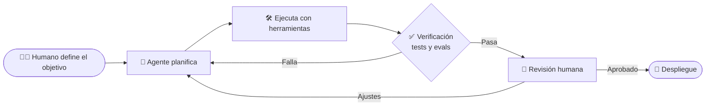

## ♾️ Metodología DevOps (y DevSecOps)

Trabajamos con **DevOps** como columna vertebral: ciclos cortos, automatización de punta a punta y feedback constante. La seguridad está presente en **todas** las etapas (**DevSecOps**), y los agentes de IA participan en cada fase, siempre con un humano responsable.

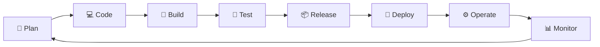

| Fase | Qué pasa | Rol de los agentes | Supervisión humana |
|---|---|---|---|
| 📝 **Plan** | Se definen objetivos y diseño | Analizan requisitos y proponen planes | Arquitectura valida |
| 💻 **Code** | Se escribe el código | Generan y refactorizan código | Revisión de *pull requests* |
| 🔨 **Build** | Se compila y empaqueta | Pipelines CI automatizados | Equipo de backend |
| 🧪 **Test** | Se prueba todo | Crean y ejecutan pruebas y evals | QA y seguridad |
| 📦 **Release** | Se prepara la versión | Generan notas y verifican cambios | Aprobación final |
| 🚀 **Deploy** | Se publica | Despliegue con Infraestructura como Código | Aprobación en acciones críticas |
| ⚙️ **Operate** | Se opera el sistema | Resuelven incidentes rutinarios | Escalamiento a humanos |
| 📊 **Monitor** | Se observa y se aprende | Detectan anomalías y proponen mejoras | Retroalimentación al plan |

## 📜 Normas y estándares que fundamentan el trabajo

Cada decisión de July se apoya en un marco de referencia, en tres niveles: la **ley ecuatoriana**, que es obligatoria; las **normas ISO**, que son voluntarias; y las **guías del sector**. Las normas propias de cada rol están en [Nuestro equipo](#equipo).

> **Sobre el alcance de este marco**
> - **No encontramos una ISO específica para la captación de prospectos financieros ni para chatbots.** Por eso combinamos normas de atención al cliente, inteligencia artificial, privacidad y modelado.
> - **Son una referencia, no una certificación.** Ni July ni CoreSystems-AI están certificados. Las ISO se revisaron por sus resúmenes oficiales, porque su texto completo es de pago.

**Estado en el proyecto:** ✅ reflejada en los artefactos · 🟡 parcial · ⏳ pendiente

<b>⚖️ Obligatorias en Ecuador</b>

 

| Norma | Qué exige | Dónde aplica en July | Estado |
|---|---|---|---|
| [LOPDP (2021)](https://seps.gob.ec/wp-content/uploads/Ley-Org%C3%A1nica-de-Protecci%C3%B3n-de-Datos-Personales-2022.pdf) y su Reglamento (Decreto 904, 2023) | Consentimiento y derechos del titular de los datos | CU 1.2.1.2 y reglas R1 y R2 de CU-08 | ✅ |
| LOPDP, art. 20 | No ser sometido a decisiones basadas única o parcialmente en valoraciones automatizadas que produzcan efectos jurídicos o atenten contra sus derechos | Precalificación (CU 2.3.1.3): «a revisar» llega al Comité de crédito y «no apto» (A12) ofrece la revisión con un asesor (A6 del flujo 1) | ✅ |
| [Resolución SPDP-SPD-2026-0009-R](https://www.fielweb.com/App_Themes/InformacionInteres/Resoluci_n_N_SPDP_SPD_2026_0009_R_1771459633.pdf), art. 5.1 | Informar al titular sobre el tratamiento con IA, sus finalidades y su carácter automatizado | Aviso de privacidad (pasos 16 a 19): CU-08 no especifica que mencione el carácter automatizado | 🟡 |
| Misma resolución, arts. 5.2 y 6 | Gestión de riesgos y evaluación de impacto **antes** del desarrollo | Aún no existe ese documento | ⏳ |
| Misma resolución, arts. 5.4, 5.5 y 7 | Registro de actividades de tratamiento (incluidas las decisiones automatizadas) y auditorías | Aún no existe ese registro | ⏳ |
| COMF, LOEPS y normas de la JPRF y la SEPS | Marco de las cooperativas: tasas máximas, segmentos y gestión del riesgo de crédito | Catálogo de líneas (CU 2.2.2) y [NEG-01](Documentacion/Complementarios/negocio/guia-negocio-cooperativa-y-captacion.md); faltan confirmar los valores con la cooperativa | 🟡 |
| Normativa de la UAFE | Debida diligencia: identificar, verificar y monitorear a los clientes | Por confirmar con la cooperativa en qué momento de la afiliación se hace | ⏳ |

<b>🏦 Captación y atención en servicios financieros</b>

 

| Norma | Para qué la usamos | Dónde aplica en July | Estado |
|---|---|---|---|
| [Principios G20/OCDE de protección del consumidor financiero (2022)](https://www.oecd.org/en/publications/g20-oecd-high-level-principles-on-financial-consumer-protection-2022_48cc3df0-en.html) | 12 principios aplicables al crédito, con la digitalización como tema transversal | Información clara antes de decidir: cuota, total a pagar y comparación de escenarios (CU 2.2.1) | ✅ |
| [Estándares de protección al cliente SPTF/Cerise](https://www.finnfund.fi/en/impact/policies-and-statements/client-protection-in-microfinancing/) | Prevenir el sobreendeudamiento, transparencia, privacidad y resolución de reclamos | Capacidad de pago (CU 2.3.1.1) y alternativa que cabe en ella (paso 72l); los reclamos no están en el alcance | 🟡 |
| [ISO 18295-1:2017](https://www.iso.org/standard/64739.html) | Requisitos y KPI para centros de contacto, incluidos los canales no telefónicos. La usamos por analogía; está en revisión | Meta de atención en menos de 2 minutos (flujo 1) | 🟡 |
| [ISO 22458:2022](https://www.iso.org/standard/73261.html) | Servicio inclusivo para consumidores en situación de vulnerabilidad, incluidos los financieros | Sin definir en los flujos conversacionales | ⏳ |
| [ISO 23592:2021](https://www.iso.org/standard/76358.html) e [ISO 10004:2018](https://www.iso.org/standard/71582.html) | Excelencia en el servicio y medición de la satisfacción | CU-08 todavía no mide la satisfacción | ⏳ |

<b>🤖 Chatbot e inteligencia artificial</b>

 

| Norma | Para qué la usamos | Dónde aplica en July | Estado |
|---|---|---|---|
| [ISO/IEC 22989:2022](https://www.iso.org/standard/74296.html) e [ISO/IEC 23053:2022](https://www.iso.org/standard/74438.html) | Vocabulario común de IA y marco de los sistemas con aprendizaje automático | Lenguaje para documentar la detección de intención (CU 1.2.2.1) | ⏳ |
| [ISO/IEC 42001:2023](https://www.iso.org/standard/81230.html) | Sistema de gestión de IA | Gobierno de July en la cooperativa | ⏳ |
| [ISO/IEC 23894:2023](https://scc-ccn.ca/standardsdb/standards/2052265) e [ISO/IEC 42005:2025](https://www.iso.org/standard/42005) | Gestión de riesgos de IA y evaluación de impacto | Base para cumplir los arts. 5.2 y 6 de la resolución de la SPDP | ⏳ |
| ISO/IEC TR 24027:2021 | Sesgo en decisiones asistidas por IA | Revisar las reglas de precalificación (CU 2.3.1) | ⏳ |
| ISO/IEC TS 8200:2024 | Controlabilidad de sistemas de IA | Derivar a un asesor humano (CU 1.2.1.3) y traspaso con contexto (CU 3.2.1.3) | 🟡 |
| ISO/IEC 12792:2025 | Taxonomía de transparencia de sistemas de IA | Explicación del resultado (CU 2.3.2.1, `SolicitudCredito.explicarResultado()`) | 🟡 |
| [ISO/IEC 25059:2023](https://www.iso.org/standard/80655.html) | Modelo de calidad para sistemas de IA; está en revisión | Vista de calidad del SAD, aún en blanco | ⏳ |
| [ISO 9241-110:2020](https://www.iso.org/standard/75258.html) | Principios de interacción; no cubre aspectos propios de la IA | Diseño de los flujos conversacionales | 🟡 |
| [ISO 24495-1:2023](https://www.iso.org/standard/78907.html) | Lenguaje claro en documentos de texto | Plantillas de mensajes y explicación del resultado | ⏳ |
| [ISO 24617-2:2020](https://www.iso.org/standard/76443.html) | Anotación de actos de diálogo; la norma ISO más cercana al diálogo, aunque no sirve para construir chatbots | Etiquetado de conversaciones si se entrena un modelo | ⏳ |
| [ISO/IEC 40500:2025](https://www.iso.org/standard/91029.html) (WCAG 2.2) | Accesibilidad web | Widget web (CU 1.1.1.2) | ⏳ |
| [ISO/IEC 27090:2026](https://www.iso.org/standard/27090) y [OWASP Top 10 para LLM (2025)](https://genai.owasp.org/resource/owasp-top-10-for-llm-applications-2025/) | Amenazas propias de la IA, como *prompt injection* | Sin tratar todavía en los documentos de arquitectura | ⏳ |

<b>🔐 Privacidad y seguridad</b>

 

| Norma | Para qué la usamos | Dónde aplica en July | Estado |
|---|---|---|---|
| [ISO/IEC 29184:2020](https://www.iso.org/standard/70331.html) | Contenido de los avisos de privacidad en línea y forma de pedir el consentimiento | Aviso y aceptación antes de pedir datos (CU 1.2.1.2) | ✅ |
| [ISO/IEC TS 27560:2023](https://www.iso.org/standard/80392.html) | Estructura del registro de consentimiento | `Prospecto.registrarConsentimiento(aceptado, versionAviso)` guarda la aceptación y la versión, no toda la estructura | 🟡 |
| [ISO/IEC 29100:2024](https://www.iso.org/standard/85938.html) | Marco y vocabulario de privacidad | Reglas transversales R1 y R2 de CU-08 | ✅ |
| [ISO/IEC 27701:2025](https://www.iso.org/standard/27701) | Sistema de gestión de la privacidad | Operación de July en la cooperativa | ⏳ |
| [ISO/IEC 27001:2022](https://www.iso.org/standard/27001) | Sistema de gestión de seguridad de la información | Verificación de webhooks (CU 1.1.2.3); la vista de seguridad del SAD sigue en blanco | 🟡 |

<b>📐 Arquitectura y modelado</b>

 

| Norma | Para qué la usamos | Dónde aplica en July | Estado |
|---|---|---|---|
| [ArchiMate](https://pubs.opengroup.org/architecture/archimate3-doc/ch-Preface.html) (The Open Group) | Lenguaje de modelado empresarial; nuestra exportación usa la 3.1 y la versión vigente es la 3.2 | [01 Mapa de capacidades](#a01) | ✅ |
| Ulrich y Rosen (2011) y BIZBOK Guide | Mapa de capacidades y flujos de valor | [01 Mapa de capacidades](#a01), a partir de REF-01 y REF-02 | ✅ |
| [ISO/IEC/IEEE 29148:2018](https://www.iso.org/standard/72089.html) | Ingeniería de requisitos; hay una nueva edición en borrador | [02 Casos de uso](#a02) y [03 Especificación](#a03) | ✅ |
| [ISO/IEC 19505-1](https://www.iso.org/standard/32624.html) y [19505-2:2012](https://www.iso.org/standard/52854.html) (UML) | Notación de los diagramas | [02 Casos de uso](#a02), [06 Clases](#a06) y [07 Secuencia](#a07) | ✅ |
| [ISO/IEC 11179-1:2023](https://www.iso.org/standard/78914.html) | Marco para describir y registrar datos | [05 Diccionario de datos](#a05), como referencia conceptual | 🟡 |
| [ISO/IEC/IEEE 42010:2022](https://www.iso.org/standard/74393.html) | Descripción de arquitectura mediante vistas | [SAD](#complementarios): faltan las vistas de procesos, implementación y despliegue | 🟡 |
| [ISO/IEC 25010:2023](https://www.iso.org/standard/78176.html) | Modelo de calidad del producto de software | Vista de calidad del SAD, aún en blanco | ⏳ |

<b>🚫 Evaluadas y no adoptadas</b>

 

| Norma | Por qué no la adoptamos |
|---|---|
| [ISO 22222:2005](https://www.iso.org/standard/43033.html) | Certifica a planificadores financieros personales, no procesos de captación ni asistentes |
| [ISO 20022](https://www.iso.org/standard/20022-1) | Es para mensajería entre entidades financieras; July no ejecuta pagos ni transferencias |
| [ISO 10008:2022](https://www.iso.org/standard/80594.html) | Orienta transacciones de comercio electrónico; July no cierra ninguna venta, solo capta y precalifica |
| ISO 10002:2018 | Trata la gestión de reclamos, que no está en el alcance de July |
| [ISO/IEC 19510:2013](https://www.iso.org/standard/62652.html) (BPMN) | El proyecto no modela con BPMN |

## 🧱 Stack tecnológico (aplicación web + móvil)

| Rol | 🌐 Web | 📱 Móvil | 🤖 Agentes / IA |
|---|---|---|---|
| 🏗️ Arquitectura | Monolito modular → microservicios | API-first compartida con web | Orquestación y MCP |
| 🛡️ Seguridad | OWASP ASVS, OAuth 2.0 / OIDC | OWASP MASVS, almacenamiento seguro | Guardrails y auditoría |
| 🗄️ Base de datos | PostgreSQL, Redis | SQLite local (modo offline) | Memoria y búsqueda vectorial |
| ⚙️ Backend | FastAPI, NestJS | Misma API REST / WebSockets | Bucle de agente y herramientas |
| 🖥️ Frontend | Next.js, React | React Native + Expo | Paneles de supervisión |
| 🎨 UI/UX | Figma, sistema de diseño | Guías iOS y Android | Diseño de confianza |

## 👥 Nuestro equipo

Cada integrante aporta su punto de vista para que los sistemas agénticos sean **bien diseñados, seguros, rápidos y agradables de usar**, con **normas ISO** como referencia de calidad.

<table>
<tr>
<td width="33%" align="center">

 <b>Carlos Sánchez</b>
 <i>🏗️ Arquitecto de Software</i>
</td>
<td width="33%" align="center">

 <b>Alex Santiago</b>
 <i>🛡️ Seguridad</i>
</td>
<td width="33%" align="center">

 <b>Aaron Robles</b>
 <i>🗄️ Base de Datos</i>
</td>
</tr>
<tr>
<td width="33%" align="center">

 <b>Juan Cueva</b>
 <i>⚙️ Backend</i>
</td>
<td width="33%" align="center">

 <b>Jean Pool</b>
 <i>🖥️ Frontend</i>
</td>
<td width="33%" align="center">
<!-- 👇 Reemplaza con la foto real: Assets/Luis.jpeg -->

 <b>Luis Aguilar</b>
 <i>🎨 UI/UX</i>
</td>
</tr>
</table>

| Integrante | Rol | Punto de vista | Aporte principal | En DevOps | ISOs representativas |
|---|---|---|---|---|---|
| **Carlos Sánchez** | 🏗️ Arquitecto de Software | *"Un agente poderoso sin una buena arquitectura es solo un riesgo rápido."* | Arquitectura global y **harness**; comunicación entre agentes, herramientas y servicios (MCP); límites de autonomía; ADRs | Lidera **Plan** y **Code** | ISO/IEC/IEEE 42010, ISO/IEC 25010, ISO/IEC/IEEE 12207 |
| **Alex Santiago** | 🛡️ Seguridad | *"Cuanta más autonomía, más importante es que cada acción sea controlada, trazable y reversible."* | Permisos mínimos, sandboxing y **guardrails**; defensa contra *prompt injection*; DevSecOps; auditoría | Todas las fases, foco en **Test**, **Deploy** y **Monitor** | ISO/IEC 27001, 27002, 42001, 27034 |
| **Aaron Robles** | 🗄️ Base de Datos | *"Datos limpios, bien modelados y seguros igual a decisiones confiables."* | Modelado de datos, **memoria persistente** de los agentes, integridad y respaldos, migraciones | **Code**, **Build**, **Deploy** y **Monitor** | ISO/IEC 9075, ISO/IEC 25012, ISO 8000, ISO/IEC 27701 |
| **Juan Cueva** | ⚙️ Backend | *"El backend es el cerebro operativo."* | Lógica de negocio y APIs; el **harness** en código (bucles de agente, colas, orquestación); pruebas y *evals* | Protagonista en **Code**, **Build** y **Test** (CI/CD) | ISO/IEC 25010, ISO/IEC/IEEE 29119, 12207, ISO/IEC 5338 |
| **Jean Pool** | 🖥️ Frontend | *"La interfaz es donde el humano supervisa al agente."* | Interfaces responsivas y accesibles; paneles para **ver, aprobar, pausar o corregir** a los agentes | **Code**, **Build**, **Test** y **Deploy** | ISO/IEC 40500 (WCAG), ISO/IEC 25010, ISO 9241-11 |
| **Luis Aguilar** | 🎨 UI/UX | *"Una IA poderosa que nadie entiende no sirve."* | Investigación de usuarios; diseño de la **confianza**; sistema de diseño y prototipos | Lidera **Plan** y aporta en **Monitor** | ISO 9241-210, 9241-11, 9241-110 |

<b>🧱 Stack tecnológico por integrante</b>

 

**🏗️ Arquitectura (Carlos Sánchez)**

| Área | Tecnologías |
|---|---|
| 🌐 **Web y móvil** |    |
| ☁️ **Infraestructura** |     |
| 📨 **Mensajería** |   |
| 🤖 **Agentes** |    |
| 📐 **Documentación** | -0A66C2?style=flat-square)    |

**🛡️ Seguridad (Alex Santiago)**

| Área | Tecnologías |
|---|---|
| 🌐 **Web** |     |
| 📱 **Móvil** |    |
| 🔎 **Análisis (DevSecOps)** |     |
| 🔑 **Secretos e identidad** |   |
| 🤖 **Seguridad de agentes** |    |

**🗄️ Base de datos (Aaron Robles)**

| Área | Tecnologías |
|---|---|
| 🌐 **Web (servidor)** |    |
| 📱 **Móvil (local / offline)** |   |
| 🧠 **Memoria de agentes** |   |
| 🔄 **Migraciones y ORM** |    |
| ☁️ **Archivos y respaldos** |   |

**⚙️ Backend (Juan Cueva)**

| Área | Tecnologías |
|---|---|
| 🧠 **Lenguajes y frameworks** |     |
| 🔌 **APIs (web y móvil)** |     |
| 🤖 **Agentes e IA** |    |
| ⏱️ **Tareas en segundo plano** |   |
| 🧪 **Pruebas y CI/CD** |     |

**🖥️ Frontend (Jean Pool)**

| Área | Tecnologías |
|---|---|
| 🌐 **Web** |     |
| 📱 **Móvil** |   |
| 🔄 **Estado y datos** |   |
| 🧩 **Componentes** |   |
| 🧪 **Pruebas** |   |

**🎨 UI/UX (Luis Aguilar)**

| Área | Tecnologías |
|---|---|
| 🎨 **Diseño y prototipado** |    |
| 🌐 **Web** |   |
| 📱 **Móvil** |   |
| 🔬 **Investigación de usuarios** |   |

## 📬 Contacto

| | |
|---|---|
| 🌐 **Web** | _(próximamente)_ |
| ✉️ **Correo** | _contacto@coresystems-ai.com_ |
| 💼 **LinkedIn** | _(agregar enlace)_ |

---

# 2. 🎯 El reto

### Asistente Virtual Interactivo para Calificación y Captación de Prospectos

| | |
|---|---|
| 🏦 **Empresa** | Cooperativa de Ahorro y Crédito Padre Julián Lorente |
| 👨‍🏫 **Docente responsable** | Armando Augusto Cabrera Silva |
| 📚 **Asignatura** | Arquitectura de Software |
| 🧪 **Metodología** | Aprendizaje Basado en Retos (CBL) sobre un reto empresarial real |

## ❓ ¿En qué consiste?

La Cooperativa busca evolucionar su asistente virtual **«July»** hacia un **prototipo conversacional avanzado** capaz de interactuar con potenciales socios a través de **WhatsApp o web**.

**El problema:** hoy las consultas digitales tardan en ser atendidas. Eso provoca **deserción de usuarios** y **pérdida de oportunidades de captación** justo en el momento de mayor interés del prospecto.

El equipo debe diseñar y prototipar un asistente virtual interactivo que:

| # | Capacidad esperada |
|---|---|
| 1 | 💬 **Capture requerimientos de crédito y datos financieros básicos** mediante flujos conversacionales dinámicos. |
| 2 | 🧮 **Integre un motor de simulación financiera:** cuotas, plazos y requisitos según la línea de crédito. |
| 3 | ✅ **Realice una precalificación básica** del prospecto. |
| 4 | 📤 **Envíe automáticamente la oportunidad de negocio** (ficha del prospecto precalificado) al equipo comercial o al CRM correspondiente. |
| 5 | ⏱️ **Reduzca el tiempo de atención inicial a menos de 2 minutos.** |

## 🏁 Objetivo general

> Prototipar una solución de IA conversacional para la asistente virtual **«July»**, orientada a la **precalificación, simulación y captación automatizada** de prospectos de ahorro y crédito a través de canales digitales.

## 📐 Alcance

July es el **chatbot de captación**: atiende al prospecto desde que escribe por primera vez hasta que su oportunidad precalificada llega al asesor comercial y al CRM.

| ✅ Dentro del alcance | ⛔ Fuera del alcance |
|---|---|
| Atención por **WhatsApp Business API** y **widget web**, con respuesta inmediata | Edición de guiones, intenciones y plantillas desde un *back-office* |
| Aviso de privacidad y **consentimiento** antes de pedir datos personales | Gestión de líneas, tasas y requisitos (July solo los **lee**) |
| Captura conversacional de identidad, ingresos, actividad, monto, plazo y destino | Configuración de las reglas de precalificación y del enrutamiento |
| **Simulación** de cuota, amortización y total a pagar por línea de crédito | Tablero del embudo de captación (lo calcula el CRM) |
| **Precalificación** por reglas (capacidad de pago, edad, actividad, condición de socio) | Derechos de acceso, rectificación y eliminación de datos (los atiende el Delegado de protección de datos) |
| Generación de la **ficha del prospecto**, alta en el **CRM** y asignación al asesor | Aprobación definitiva del crédito (corresponde al Comité de crédito) |
| Seguimiento del lead: recordatorios, citas, estados y cierre | |

La configuración que publican las áreas de la cooperativa (guiones, catálogo de líneas, reglas, criterios y agenda) se carga como **datos iniciales versionados** que July consulta.

---

# 3. 📈 Avance del proyecto

Todo el trabajo se documenta en [`Documentacion/`](Documentacion/README.md), cuyo índice registra cada artefacto con su ID, de qué deriva, su fecha y su estado. La documentación se divide en dos carpetas:

- **[`Arquitectura/`](Documentacion/Arquitectura/)** — los artefactos de la **cadena de trazabilidad**, numerados en el orden en que cada uno deriva del anterior.
- **[`Complementarios/`](Documentacion/Complementarios/)** — material de apoyo: referencias, revisiones, guía del negocio, el documento de arquitectura (SAD) y plantillas.

## 🔗 Cadena de trazabilidad

El punto de partida es el **mapa de capacidades de negocio**: de él salen los casos de uso, y de cada artefacto sale el siguiente. Así, cada clase, método o mensaje del diseño se puede rastrear hasta la capacidad de negocio que lo justifica.

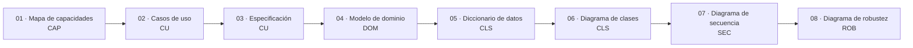

Todo el modelo se organiza en **3 flujos de valor** y **7 etapas**, que se repiten en cada artefacto de la cadena:

| Flujo de valor | Etapas |
|---|---|
| **1 · Atracción y primer contacto** | Canales de contacto → Primer contacto |
| **2 · Captura, simulación y precalificación** | Perfilamiento → Simulación financiera → Precalificación |
| **3 · Entrega, seguimiento y conversión** | Entrega de oportunidades → Asignación y seguimiento |

| # | Artefacto | ID | Carpeta | Estado |
|---|---|---|---|---|
| 01 | Mapa de capacidades (ArchiMate) | CAP-03, CAP-04, CAP-05 | [`01-mapa-capacidades/`](Documentacion/Arquitectura/01-mapa-capacidades/) | Borrador |
| 02 | Diagramas de casos de uso | CU-02 a CU-06 | [`02-casos-de-uso/`](Documentacion/Arquitectura/02-casos-de-uso/) | Borrador |
| 03 | Especificación de casos de uso | CU-08, CU-09 | [`03-especificacion-casos-de-uso/`](Documentacion/Arquitectura/03-especificacion-casos-de-uso/) | Borrador |
| 04 | Modelo de dominio | DOM-01, DOM-02 | [`04-modelo-de-dominio/`](Documentacion/Arquitectura/04-modelo-de-dominio/) | Borrador |
| 05 | Diccionario de datos | CLS-01 | [`05-diccionario-de-datos/`](Documentacion/Arquitectura/05-diccionario-de-datos/) | Borrador |
| 06 | Diagrama de clases | CLS-02 | [`06-diagrama-de-clases/`](Documentacion/Arquitectura/06-diagrama-de-clases/) | Borrador |
| 07 | Diagramas de secuencia | SEC-01 | [`07-diagrama-de-secuencia/`](Documentacion/Arquitectura/07-diagrama-de-secuencia/) | Borrador |
| 08 | Diagramas de robustez | ROB-01 | [`08-diagrama-de-robustez/`](Documentacion/Arquitectura/08-diagrama-de-robustez/) | Borrador |

## 01 · 🗺️ Mapa de capacidades de negocio

Basado en *The Business Capability Map: The «Rosetta Stone» of Business/IT Alignment* (Ulrich y Rosen, 2011), [traducido al español](Documentacion/Complementarios/referencias/Bibliografia/el-mapa-de-capacidades-de-negocio.md) como referencia del equipo. El mapa se modeló en **ArchiMate** con Archi y evolucionó en tres etapas: la versión inicial (CAP-01), la etapa 2, que añadió el flujo de valor con sus etapas (CAP-02), y la etapa 3 vigente (CAP-03), con los servicios de aplicación **SA-01 a SA-25** y los actores Comité de crédito y Equipo de marketing.

Cada etapa del flujo de valor se apoya en una capacidad de nivel 1, que se divide en **dos capacidades de nivel 2** y estas en **tres de nivel 3**: **7 capacidades de nivel 1, 14 de nivel 2 y 42 de nivel 3**.

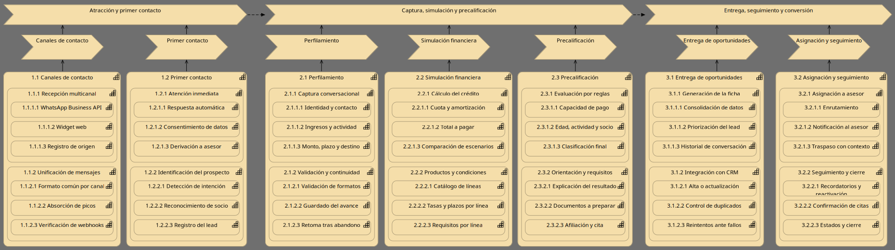

- 📦 Modelo nativo (fuente): [`mapa-capacidades-y-casos-de-uso-etapa3.archimate`](Documentacion/Arquitectura/01-mapa-capacidades/Archi/mapa-capacidades-y-casos-de-uso-etapa3.archimate)
- 🔄 Exportación Open Exchange (XML), regenerada con [`archi-a-open-exchange.py`](Documentacion/Arquitectura/01-mapa-capacidades/Archi/archi-a-open-exchange.py): [`mapa-capacidades-y-casos-de-uso-etapa3.xml`](Documentacion/Arquitectura/01-mapa-capacidades/Archi/mapa-capacidades-y-casos-de-uso-etapa3.xml)

## 02 · 👤 Casos de uso

Los casos de uso salen **directamente del mapa**: cada capacidad se convierte en un caso de uso del mismo nivel y número. Hay un diagrama por flujo de valor; el **Prospecto** inicia los casos de nivel 1 (las etapas), que incluyen sus casos de nivel 2 y estos los de nivel 3. Los actores externos (WhatsApp Business API, Widget web, Sistema core, CRM, Asesor comercial, Equipo de marketing, Comité de crédito…) solo participan en el nivel 3.

| Flujo 1 · Atracción y primer contacto | Flujo 2 · Captura, simulación y precalificación | Flujo 3 · Entrega, seguimiento y conversión |
|---|---|---|
| 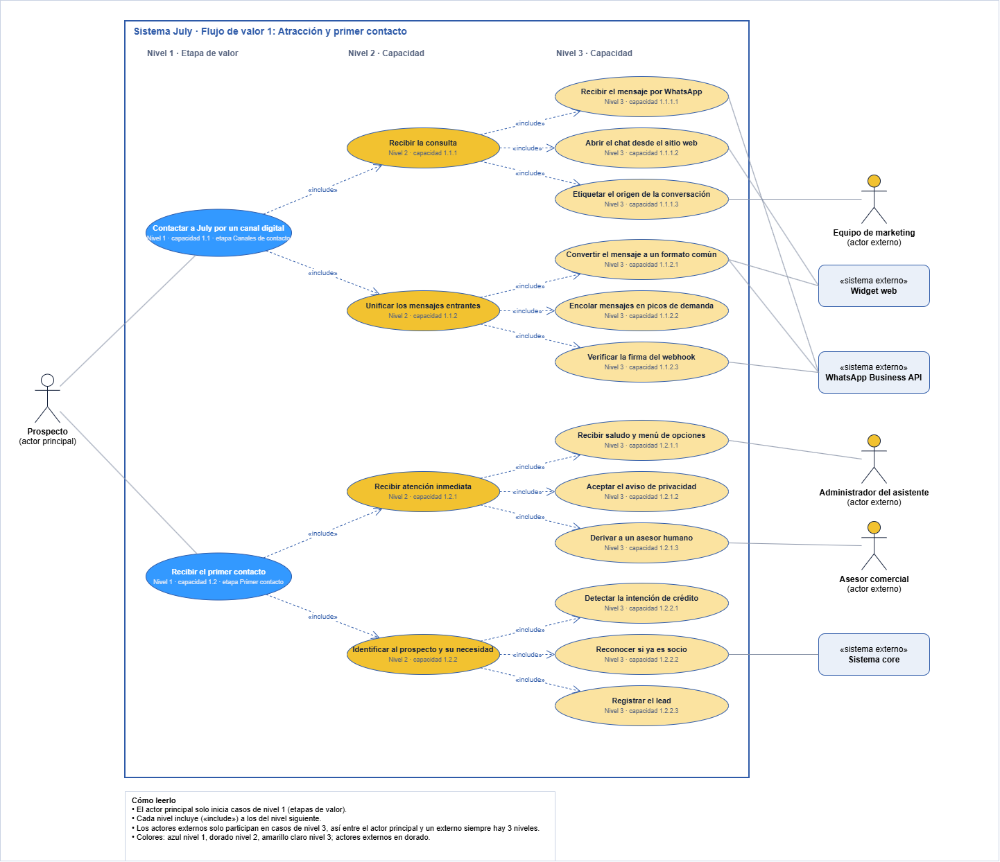 | 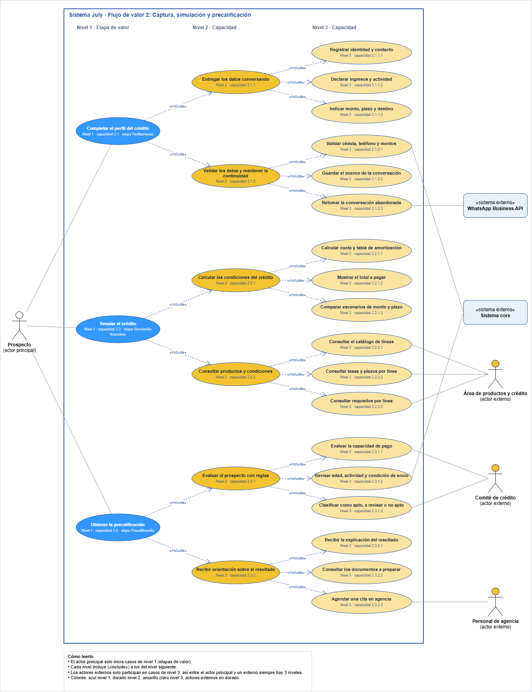 | 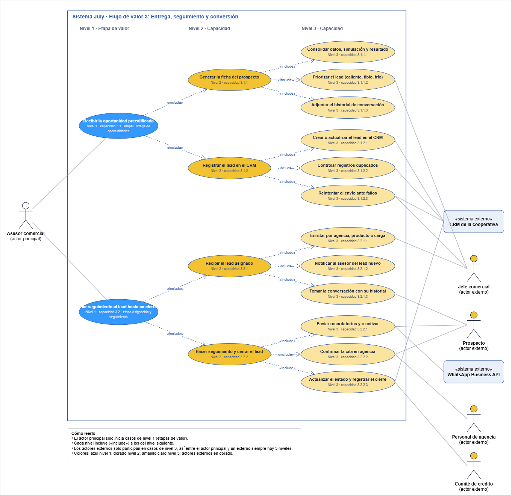 |

- 📝 Descripción por flujo con sus actores: [`casos-de-uso-por-flujo.md`](Documentacion/Arquitectura/02-casos-de-uso/casos-de-uso-por-flujo.md) (CU-06)
- 🧩 Diagrama general: [`casos-de-uso-july.drawio`](Documentacion/Arquitectura/02-casos-de-uso/casos-de-uso-july.drawio) (CU-02)

## 03 · 📋 Especificación de casos de uso

Una especificación **por flujo de valor**, con un flujo principal numerado de corrido que recorre sus casos de nivel 1 y 2 hasta llegar a los actores y sistemas externos, más sus flujos alternativos. Cada paso es **una oración con un solo verbo** que cita el caso de nivel 3 que realiza; de esa oración salen el **sujeto**, el **método** (verbo), la **entidad** (sustantivo) y la **relación**, que alimentan el resto de la cadena. Incluye la correspondencia con los servicios SA-01 a SA-25, el alcance del reto y las reglas transversales de protección de datos (consentimiento previo y retiro del consentimiento).

- 📄 Especificación completa: [`especificaciones-casos-de-uso.md`](Documentacion/Arquitectura/03-especificacion-casos-de-uso/especificaciones-casos-de-uso.md) (CU-08)
- 📄 Versión de lectura, solo con la oración de cada paso: [`especificacion-casos-de-uso-solo-pasos.md`](Documentacion/Arquitectura/03-especificacion-casos-de-uso/especificacion-casos-de-uso-solo-pasos.md) (CU-09)

## 04 · 🧩 Modelo de dominio

Los **conceptos del negocio** que aparecen en la especificación (prospecto, conversación, solicitud, simulación, precalificación, lead, asesor, línea de crédito…) con sus atributos y asociaciones, **sin métodos, sin tipos y sin las clases del sistema**.

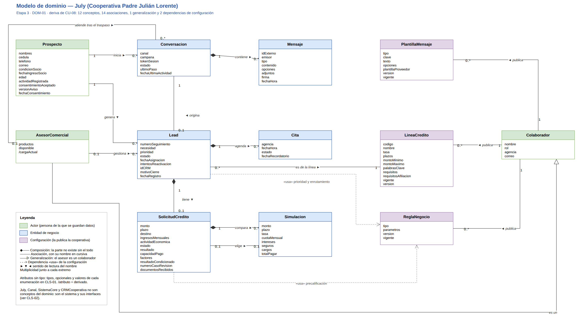

- 🖊️ Diagrama: [`modelo-de-dominio-etapa3.drawio`](Documentacion/Arquitectura/04-modelo-de-dominio/modelo-de-dominio-etapa3.drawio) (DOM-01)
- 📝 Guía de lectura: [`modelo-de-dominio-etapa3.md`](Documentacion/Arquitectura/04-modelo-de-dominio/modelo-de-dominio-etapa3.md) (DOM-02)

## 05 · 📖 Diccionario de datos

Toma los conceptos del dominio y les agrega **tipos, métodos y las clases del sistema**: July como «control»; el Canal (WhatsApp y web), el Sistema core y el CRM como «interfaz»; y los conceptos del dominio como «entidad». Cada método es el verbo de un paso de la especificación, en la clase de quien lo recibe. Incluye enumeraciones con sus transiciones de estado, relaciones con tipo, multiplicidad y navegación, y la trazabilidad paso a paso con CU-08.

- 📄 [`diccionario-de-datos-etapa3.md`](Documentacion/Arquitectura/05-diccionario-de-datos/diccionario-de-datos-etapa3.md) (CLS-01)

## 06 · 🏛️ Diagrama de clases

El diccionario de datos llevado a **UML**: las clases con sus estereotipos, atributos y métodos, las relaciones con su multiplicidad y navegación, y las enumeraciones.

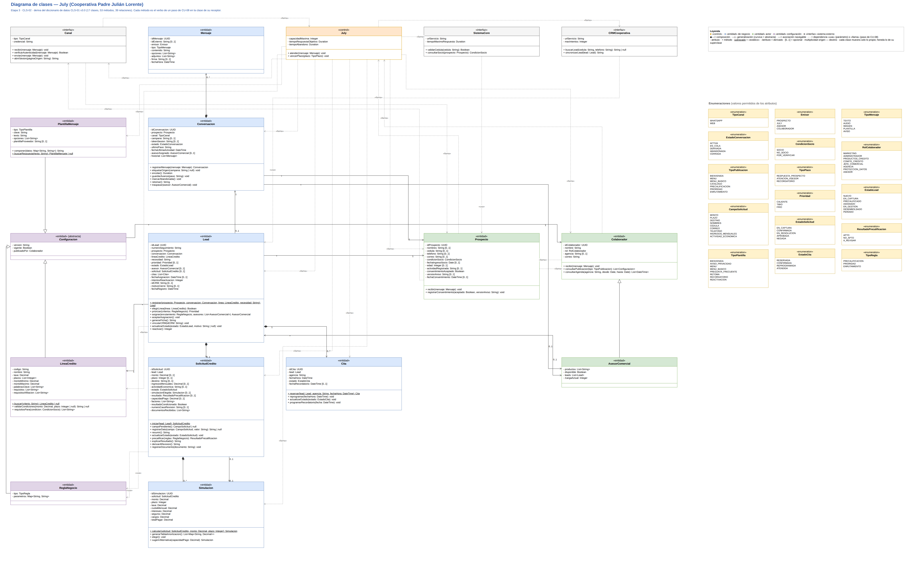

- 🖊️ [`diagrama-de-clases-etapa3.drawio`](Documentacion/Arquitectura/06-diagrama-de-clases/diagrama-de-clases-etapa3.drawio) (CLS-02)

## 07 · 🔁 Diagramas de secuencia

**Un diagrama por flujo de valor** que reúne sus casos de nivel 2, cada uno en un marco con su disparador. Las líneas de vida (actores, bordes, el control `:July` y las entidades) aparecen una sola vez por flujo; **cada llamada es un método de su clase en el diagrama de clases**, con sus mismos parámetros, y lleva el número de paso de la especificación. Los flujos alternativos van en fragmentos `alt`, `opt` y `loop`.

<b>Ver los tres diagramas de secuencia</b>

**Flujo 1 · Atracción y primer contacto**

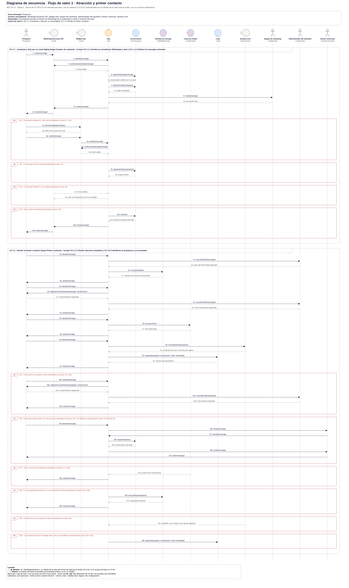

**Flujo 2 · Captura, simulación y precalificación**

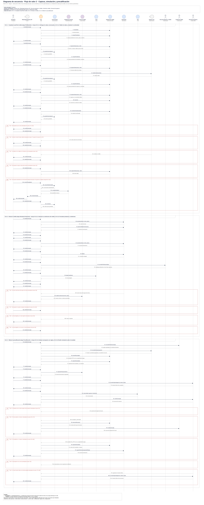

**Flujo 3 · Entrega, seguimiento y conversión**

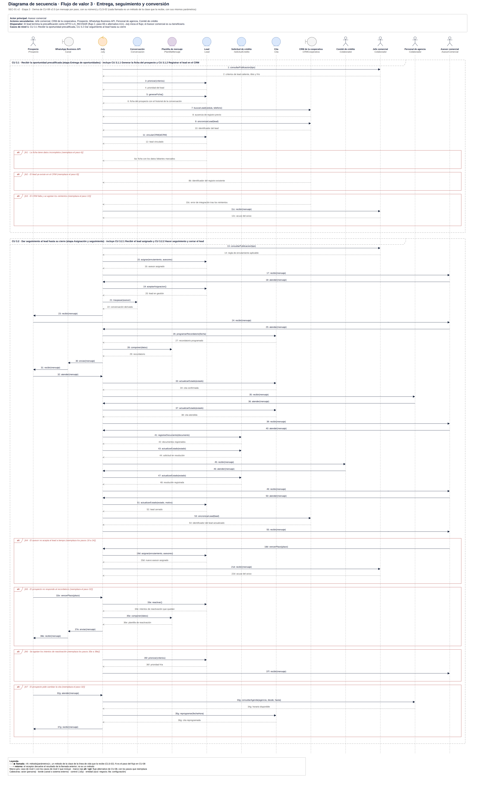

- 🖊️ [`diagramas-de-secuencia-etapa3.drawio`](Documentacion/Arquitectura/07-diagrama-de-secuencia/diagramas-de-secuencia-etapa3.drawio) (SEC-01, una página por flujo)

## 08 · 🧱 Diagramas de robustez

**Un diagrama por flujo de valor** con los objetos **borde**, **control** y **entidad**, cada uno una sola vez por flujo. Cada conexión lleva el caso y el paso de la especificación (por ejemplo, «2.2.1: 4») y cada control lleva el método que lo implementa.

<b>Ver los tres diagramas de robustez</b>

**Flujo 1 · Atracción y primer contacto**

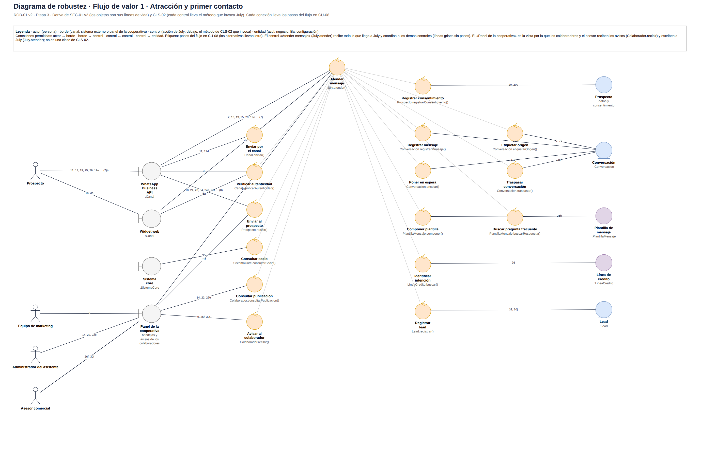

**Flujo 2 · Captura, simulación y precalificación**

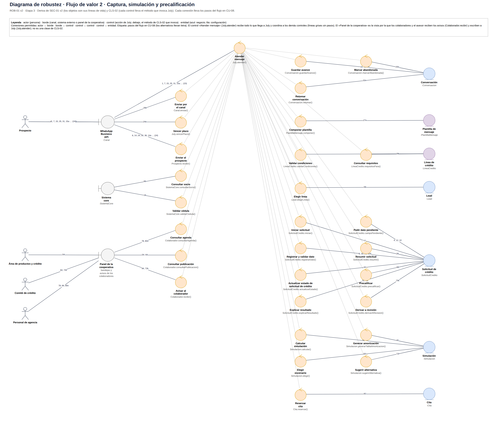

**Flujo 3 · Entrega, seguimiento y conversión**

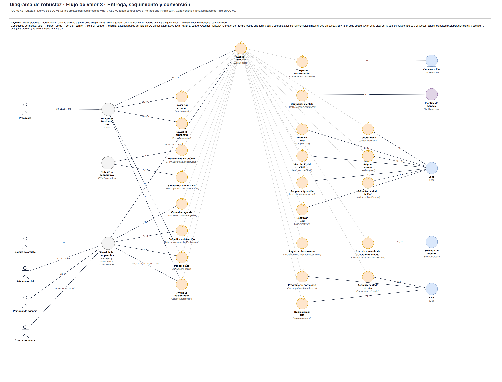

- 🖊️ [`diagramas-de-robustez-etapa3.drawio`](Documentacion/Arquitectura/08-diagrama-de-robustez/diagramas-de-robustez-etapa3.drawio) (ROB-01, una página por flujo)

## 📚 Material complementario

| Documento | ID | Para qué sirve |
|---|---|---|
| [Prototipo conversacional de July](Documentacion/Complementarios/prototipo/README.md) | PRO-01 | Chat funcional con los tres flujos de CU-08 y un panel que muestra cada paso en vivo. Se abre con doble clic en `index.html`. |
| [Documento de Arquitectura de Software (SAD)](Documentacion/Complementarios/arquitectura/documento-arquitectura-software-july.docx) | SAD-01 | Reúne las vistas del sistema (casos de uso, lógica y datos) sobre la [plantilla SAD](Documentacion/Complementarios/plantillas/SAD_Template.docx). Versión 0.1. |
| [Guía del negocio cooperativo y de la captación](Documentacion/Complementarios/negocio/guia-negocio-cooperativa-y-captacion.md) | NEG-01 | Modelo de negocio de una cooperativa, regulación en Ecuador, productos, ciclo del crédito, embudo de captación y KPI, y preguntas para los directivos. |
| [Revisión de consistencia, etapa 3](Documentacion/Complementarios/revisiones/revision-consistencia-etapa3.md) | REV-01 | Consistencia, redundancia y trazabilidad entre documentos, con las decisiones tomadas. |
| [Plan de trazabilidad unificada por flujo](Documentacion/Complementarios/revisiones/plan-trazabilidad-flujos-unificados.md) | REV-02 | Plan en curso para alinear toda la cadena por flujo de valor, con sus reglas de verificación. |
| [El mapa de capacidades de negocio (traducción)](Documentacion/Complementarios/referencias/Bibliografia/el-mapa-de-capacidades-de-negocio.md) | REF-02 | Marco teórico del mapa de capacidades (Ulrich y Rosen, 2011). |

> 📑 El índice completo, con la matriz de trazabilidad y el historial de cambios, está en [`Documentacion/README.md`](Documentacion/README.md).

---

**CoreSystems-AI** · *Personas + IA, trabajando en equipo.*

